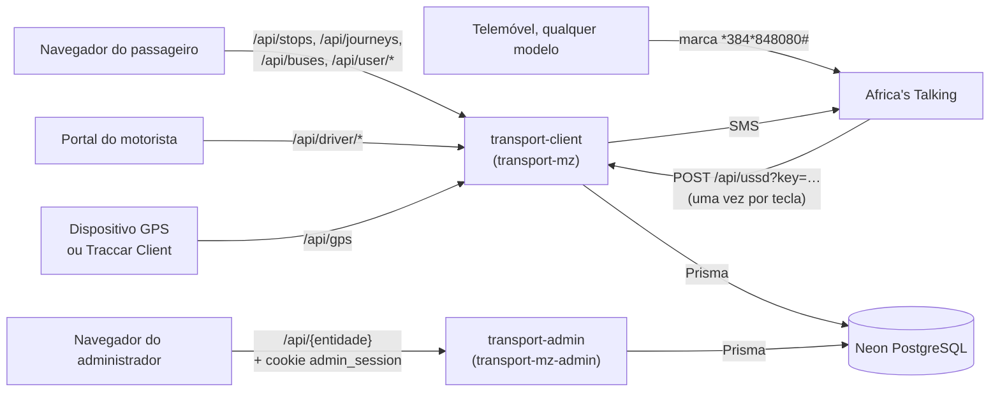

# Transportes Moçambique

Uma plataforma de informação sobre os transportes públicos da área Maputo–Matola. Os passageiros vêem as paragens perto deles e planeiam viagens, com mudança de autocarro quando é preciso, na web ou por USSD em qualquer telemóvel, e podem pedir um SMS quando o autocarro está perto. Os motoristas iniciam e terminam as viagens a partir do telemóvel. Os administradores gerem rotas, paragens, veículos, motoristas e rastreadores GPS num painel.

A rede em produção tem 261 rotas, cerca de 1 900 paragens e 451 veículos em dois municípios (Outubro de 2026). 170 das rotas e 823 das paragens vêm do [OpenStreetMap](docs/fontes-de-dados.md).

Funciona como uma aplicação de boleias, mas para os transportes públicos. A partida é a posição do passageiro ou um local escolhido. A aplicação lista todos os locais a que se chega dali, a chegada mais cedo primeiro, e diz a que paragem ir a pé para o primeiro autocarro. Escolhido um destino C, a viagem lê-se A → B → C: caminhar de onde se está (A) até à paragem (B), e depois o autocarro, ou os autocarros, até C.


**Nesta página:** [Aplicações ao vivo](#aplicações-ao-vivo) · [Como funciona, numa imagem](#como-funciona-numa-imagem) · [O que acontece quando se usa](#o-que-acontece-quando-se-usa) · [Correr localmente](#correr-localmente) · [Documentação](#documentação) · [Contribuir](#contribuir)

**A primeira vez aqui?** [Visão geral](docs/visao-geral.md) · [Primeiros passos](docs/primeiros-passos.md) · [Glossário](docs/glossario.md) · [Estado do projecto](docs/estado-do-projecto.md) · [Toda a documentação](docs/README.md)

## Aplicações ao vivo

| Aplicação | Endereço | Quem a usa | Como se usa |
|---|---|---|---|
| Aplicação dos passageiros | https://transport-mz.vercel.app | qualquer pessoa; a conta só é precisa para os alertas de chegada | [passo a passo](docs/app-passageiros.md#passo-a-passo) |
| Serviço USSD | `*384*848080#` no [simulador da Africa's Talking](https://developers.africastalking.com/simulator) (sandbox) | passageiros sem smartphone; motoristas (opção 6) | [no simulador](docs/africas-talking.md#usar-o-menu-no-simulador), [todos os menus](docs/ussd.md) |
| Portal do motorista | https://transport-mz-driver.vercel.app | motoristas, com o número de telefone e o PIN que um administrador gerou | [o dia de um motorista](docs/portal-motorista.md#o-dia-de-um-motorista-passo-a-passo) |
| Painel de administração | https://transport-mz-admin.vercel.app | administradores | [tarefas comuns](docs/painel-admin.md#tarefas-comuns-passo-a-passo) |

O USSD e os SMS correm no **sandbox** da Africa's Talking: chegam ao simulador, não a telemóveis reais ([Passar a produção](docs/africas-talking.md#passar-a-produção)). As posições dos autocarros vêm do GPS quando um veículo envia uma, e de um modelo de horário nos outros casos ([Localização e GPS](docs/localizacao-gps.md)).

### O menu USSD


| Opção | O que faz |
|---|---|
| 1 Encontrar transporte | Escreve-se onde se está e para onde se vai (basta parte do nome, mesmo mal escrito). Responde a melhor viagem, directa ou com transbordos: onde e quando apanhar, onde sair, hora de chegada e tarifa. Por SMS se pedido, e com um alerta de chegada. |
| 2 Procurar rotas | As rotas de um local, ou uma rota pelo número: paragens, distância e tarifa do percurso todo |
| 3 Paragens de uma rota | As paragens de uma rota pela ordem de viagem, e os detalhes de uma |
| 4 Calcular tarifa | Tarifa e tempo de viagem entre dois locais |
| 5 Rastrear autocarro | Onde está um autocarro, pela matrícula (ou parte dela) |
| 6 Area do motorista | Motoristas, com o PIN: iniciar ou terminar uma viagem, ver o veículo e a rota |
| 7 Ajuda | As teclas: `7` próximo, `8` anterior, `0` voltar |

Cada ecrã, e como o servidor lê cada tecla: [Serviço USSD](docs/ussd.md).

<br clear="right">

## Como funciona, numa imagem

Três aplicações Next.js partilham uma base de dados PostgreSQL (Neon) através do Prisma, e cada uma é um projecto da Vercel. Não há processos em segundo plano: as posições dos autocarros calculam-se quando se lêem, e a verificação dos SMS de chegada corre a cada 5 minutos a partir do GitHub Actions ([Visão geral → Decisões de desenho](docs/visao-geral.md#decisões-de-desenho)).



| Pasta | Projecto da Vercel | O que serve |
|---|---|---|
| [`transport-client`](transport-client) | `transport-mz` | a web dos passageiros, o callback USSD, a API do motorista, a entrada GPS, todos os SMS |
| [`transport-driver`](transport-driver) | `transport-mz-driver` | o portal do motorista; chama a API do motorista da aplicação dos passageiros |
| [`transport-admin`](transport-admin) | `transport-mz-admin` | o painel e a sua própria API |

Cada pasta e ficheiro importante: [Mapa do código](docs/mapa-do-codigo.md).

## O que acontece quando se usa

Tudo passa pelas duas aplicações com servidor, e as duas lêem e escrevem a mesma base de dados. Nada se copia entre elas: uma alteração gravada no painel é o que a web, o USSD e o portal lêem no pedido seguinte.

| Quem, a fazer o quê | O que acontece | Explicado em |
|---|---|---|
| Um passageiro abre o mapa e escolhe um destino | A página pede as paragens, os autocarros (posição de agora) e as viagens até ao destino; nada se escreve. | [Fluxos de dados → Planear uma viagem](docs/fluxos-de-dados.md#planear-uma-viagem) |
| Acompanha a viagem e pede o alerta | A página pede a viagem outra vez a cada 10 s; o alerta grava um `MISSION`, e sai um SMS quando um autocarro está a menos de 1 km. | [Acompanhar uma viagem](docs/fluxos-de-dados.md#acompanhar-uma-viagem), [Alerta de chegada e SMS](docs/fluxos-de-dados.md#alerta-de-chegada-e-sms) |
| Alguém usa o menu USSD | Cada tecla vai do telemóvel à Africa's Talking, que a envia a `/api/ussd`. O pedido traz tudo o que foi escrito na sessão (por exemplo `text="1*museu*zimpeto"`), e o servidor refaz o caminho desde o menu principal para saber que ecrã mostrar; não guarda nada entre teclas. Só escreve no ecrã de viagem da opção 1 (um alerta `MISSION`, e um `Utente` para um número novo) e na opção 6 (o estado da viagem do motorista). Os ecrãs finais também saem por SMS. | [Serviço USSD → O caminho de um pedido](docs/ussd.md#o-caminho-de-um-pedido), [Leitura das teclas](docs/ussd.md#leitura-das-teclas) |
| Um motorista entra e inicia a viagem | Entra com telefone e PIN, e o portal grava `Motorista.emViagem`, o mesmo estado que a opção 6 do USSD muda. | [Entrada e viagem do motorista](docs/fluxos-de-dados.md#entrada-e-viagem-do-motorista) |
| Um dispositivo GPS envia a posição | `/api/gps` confirma o código do dispositivo e guarda a posição no veículo; durante 3 minutos, os passageiros vêem-na em vez do horário. | [Localização e GPS](docs/localizacao-gps.md) |
| Um administrador cria, muda ou apaga um registo | O painel confirma a sessão, valida os dados e grava; as outras aplicações vêem a alteração no pedido seguinte (algumas leituras em cache até 5 minutos). | [Alterações no painel](docs/fluxos-de-dados.md#alterações-no-painel) |

O que se guarda e o que se calcula em cada pedido, e um diagrama de sequência por fluxo: [Fluxos de dados](docs/fluxos-de-dados.md).

## Correr localmente

É preciso o Node.js 20 ou mais recente e o PostgreSQL 16 ou mais recente. [Primeiros passos](docs/primeiros-passos.md) vai de uma base de dados vazia às três aplicações a correr, com dados de demonstração, entradas, uma sessão USSD e uma posição GPS enviada com `curl`. Em resumo, depois de criar o `.env` de cada aplicação ([Configuração](docs/configuracao.md)):

```bash
cd transport-client && npm install && npm run dev            # http://localhost:3000
cd transport-driver && npm install && npm run dev            # http://localhost:3001
cd transport-admin  && npm install && npm run dev -- -p 3002 # http://localhost:3002
```

No Windows, `start-all.bat` abre as três, cada uma na sua janela.

## Documentação

Um guia em seis partes, pela ordem em que se percebe e se monta a plataforma. O [índice](docs/README.md) diz o que tem cada página, responde às perguntas mais comuns com uma ligação, e sugere percursos de leitura.

| Parte | Páginas |
|---|---|
| **1. Conhecer o projecto** | [Visão geral](docs/visao-geral.md) · [Glossário](docs/glossario.md) · [Fontes de dados](docs/fontes-de-dados.md) · [Estado do projecto](docs/estado-do-projecto.md) |
| **2. Montar localmente** | [Primeiros passos](docs/primeiros-passos.md) · [Base de dados](docs/base-de-dados.md) · [Configuração](docs/configuracao.md) |
| **3. Perceber como funciona** | [Fluxos de dados](docs/fluxos-de-dados.md) · [Localização e GPS](docs/localizacao-gps.md) · [Serviço USSD](docs/ussd.md) · [Segurança](docs/seguranca.md) · [Referência da API](docs/referencia-api.md) · [Mapa do código](docs/mapa-do-codigo.md) |
| **4. Usar as aplicações** | [Aplicação dos passageiros](docs/app-passageiros.md) · [Portal do motorista](docs/portal-motorista.md) · [Painel de administração](docs/painel-admin.md) |
| **5. Pôr online** | [Publicação](docs/publicacao.md) · [Guia da Vercel](docs/guia-vercel.md) · [Guia da Neon](docs/guia-neon.md) · [Africa's Talking](docs/africas-talking.md) |
| **6. Manter** | [Testes](docs/testes.md) · [Resolução de problemas](docs/resolucao-de-problemas.md) · [Limitações](docs/limitacoes.md) |

## Contribuir

1. Criar um ramo a partir da `main`. Cada push compila uma pré-visualização das três aplicações na Vercel; o merge na `main` publica a produção ([Publicação](docs/publicacao.md)).
2. Antes do push, correr `npx tsc --noEmit` em cada aplicação alterada, e os testes do painel quando se mexe no painel ([Testes](docs/testes.md)). Os testes recusam correr contra uma base de dados que não seja local. O CI do GitHub repete a verificação dos tipos e confirma os esquemas, as ligações e a navegação da documentação em cada pull request.
3. As alterações ao esquema vão para as três cópias de `schema.prisma`. **Nunca se corre `prisma migrate deploy` na produção**: não tem histórico de migrações. As alterações aplicam-se como em [Publicação → Alterações à base de dados em produção](docs/publicacao.md#alterações-à-base-de-dados-em-produção).
4. O código, os comentários, os commits e a documentação escrevem-se em português, com o porquê das escolhas ao lado do código.

---

As paragens, as rotas e os percursos incluem dados do [OpenStreetMap](https://www.openstreetmap.org/copyright), © contribuidores do OpenStreetMap, sob a ODbL. Mapas da OpenFreeMap e OpenMapTiles; percursos pelo OSRM nos servidores da FOSSGIS. Os veículos, os motoristas e os proprietários são dados de demonstração. Todas as fontes estão em [Fontes de dados](docs/fontes-de-dados.md).

Transportes Moçambique © 2026 · [Documentação](docs/README.md)
