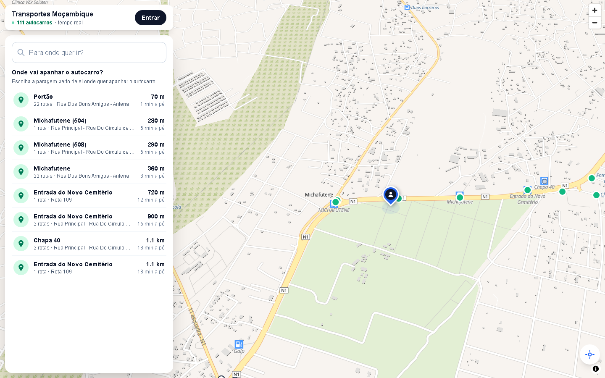
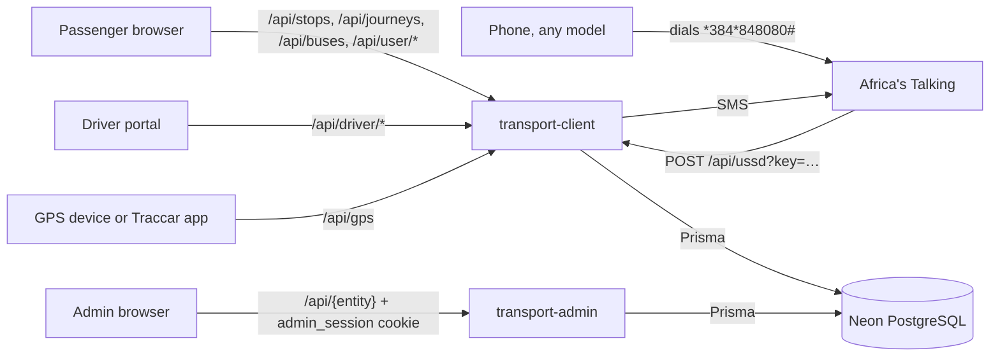

# Transport Mozambique

A public-transport information platform for the Maputo–Matola area. Passengers see the stops near them and plan journeys, with changes of bus when needed, on the web or by USSD on any phone, and can ask for an SMS when their bus is close. Drivers start and end trips from their phone. Administrators manage routes, stops, vehicles, drivers and GPS trackers from a back office.

The network in production has 91 routes, about 1,080 stops and 111 vehicles in two municipalities (October 2026).



## Live apps

| App | URL | Who uses it |
|---|---|---|
| Passenger web app | https://transport-mz.vercel.app | anyone; an account is only needed for arrival alerts |
| USSD service | `*384*848080#` in the [Africa's Talking simulator](https://developers.africastalking.com/simulator) (sandbox) | passengers without a smartphone; drivers (option 6) |
| Driver portal | https://transport-mz-driver.vercel.app | drivers, with their phone number and the PIN an administrator generated |
| Admin dashboard | https://transport-mz-admin.vercel.app | administrators |

USSD and SMS run on the Africa's Talking **sandbox**: they reach the simulator, not real phones ([Going live](docs/africas-talking.md#going-live)). Bus positions come from GPS where a vehicle reports one and from a timetable model otherwise ([GPS tracking](docs/gps-tracking.md)).

## USSD menu

Dial `*384*848080#` in the [Africa's Talking simulator](https://developers.africastalking.com/simulator). Every final screen is also sent by SMS.


| Option | What it does |
|---|---|
| 1 Encontrar transporte | Type where you are and where you are going → journeys, direct or with changes of bus: where and when to board, where to get off, arrival time and fare; the chosen one by SMS. It also registers an arrival alert: an SMS comes when a bus is under 1 km away |
| 2 Procurar rotas | The routes leaving from a place, with length, stops and full-route fare |
| 3 Paragens de uma rota | A route's stops in travel order, then one stop's details |
| 4 Calcular tarifa | Fare, distance and trip time between two places |
| 5 Rastrear autocarro | Where a bus is, by its plate (or part of it) |
| 6 Area do motorista | Drivers, with their PIN: start or end a trip, see their vehicle and route |
| 7 Ajuda | Help |

Every screen, the paging keys (`7` next, `0` back) and what each option reads and writes: [USSD service](docs/ussd.md). Setting up the channel and testing in the simulator: [Africa's Talking](docs/africas-talking.md).

<br clear="right">

## Getting lists out of the database

The production database is on Neon. [Database → Connecting](docs/database.md#connecting) shows four ways in, step by step:

- **Neon SQL Editor** in the browser, for SQL;
- **`psql`**;
- **Prisma Studio**, to browse tables without SQL;
- **ready-made lists with Prisma Client**, for example `npx tsx scripts/queries.ts routes matola` in `transport-client` ([Prisma Client in a script](docs/database.md#prisma-client-in-a-script)).

[Example queries](docs/database.md#example-queries) has tested SQL for the usual questions, such as a route's stops, vehicles with their driver, or the alerts of the last 24 hours.

## How it fits together

Three Next.js apps share one PostgreSQL database (Neon) through Prisma, and each is its own Vercel project:

| Folder | Vercel project | What it serves |
|---|---|---|
| [`transport-client`](transport-client) | `transport-mz` | passenger web app, the USSD callback, the driver API, GPS intake, all SMS |
| [`transport-driver`](transport-driver) | `transport-mz-driver` | driver portal; calls the passenger app's driver API |
| [`transport-admin`](transport-admin) | `transport-mz-admin` | back office and its own API |

There is no message bus and no background worker: vehicle positions are computed when they are read, and the arrival-SMS check runs while the web app is in use. Details and diagrams: [Architecture](docs/architecture.md) and [Data flow](docs/data-flow.md).

```
.
├── transport-client/    passenger app + USSD + driver API + GPS intake
├── transport-driver/    driver portal
├── transport-admin/     admin dashboard (with the Jest and Playwright suites)
├── prisma/              schema.prisma: source of truth for the database
├── docs/                documentation
├── start-all.bat        starts the three apps on Windows (ports 3000, 3001, 3002)
└── app/, lib/, *.js     legacy root app and one-off scripts: not deployed
```

## How the data flows

Everything goes through two server apps, and both read and write the same database. No data is copied between them, so a change saved in the admin is what the passenger app, USSD and the driver portal read on their next request.



Some values are **never stored**; they are worked out on every request from the stored records:

| Value | Worked out from |
|---|---|
| Where a bus is now | its last GPS fix if it is under 3 minutes old, otherwise the timetable model: it shuttles along its route's path from 05:00 to 21:00 at the fare rule's speed |
| When a bus reaches a stop, trip time | that position, the route's path and the fare rule's speeds |
| Fare | distance along the path × `Tarifa.precoPorKm`, at least `Tarifa.tarifaMinima` |
| Order of a route's stops | each stop projected onto the route's path (`ViaParagem` has no order column) |
| Journeys with changes of bus | the network of routes and stops, cached 5 minutes per server instance ([Data flow → Journey planning](docs/data-flow.md#journey-planning)) |

### What happens to an admin create, read, update or delete

Every record in the back office goes through the same steps. Creating a route, for example:

1. **Page.** The form (`/vias/new`) sends `POST /api/vias` with a JSON body. The browser adds the `admin_session` cookie by itself.
2. **Session check.** `transport-admin/proxy.ts` runs before every `/api/*` route. It checks the cookie's HMAC signature and expiry (12 hours) and answers 401 `Sessão expirada. Inicie sessão novamente.` if it fails. Only sign-in and sign-out pass without it.
3. **Validation.** The route handler (`app/api/vias/route.ts`) checks:
   - the required fields: 400 with what is missing;
   - that unique values are free (route code, plate, BI, email…): 400 `Já existe …`;
   - that linked records exist: 404 `Município não encontrado`.

   Passwords and PINs are hashed with bcrypt, and GPS device codes with SHA-256, before they are stored.
4. **Write.** Prisma turns the call into SQL on Neon. When one action touches several tables, they are written together; for example, a new route also creates its `ViaParagem` stop links.
5. **Answer.** `201` with the new record; `200` for reads, updates and deletes. Errors are JSON `{"error", "details"}` in Portuguese. The page shows the message as a notification and goes back to the list.
6. **Everyone else sees it.** The passenger app, USSD and the driver portal read the database directly, so they see the change on their next request. A few reads are cached:
   - the journey planner's network and `GET /api/stops`: up to 5 minutes;
   - the dashboard figures: 5 minutes.

Each entity has the same endpoints:

- `GET /api/{entity}`: a page of the list, with `search`;
- `POST /api/{entity}`: create;
- `GET`, `PUT` or `PATCH`, and `DELETE` on `/api/{entity}/{id}`.

Each also has the same four pages: list, detail, new and edit. What differs is below. Click a record to open it.

<details>
<summary><b>Via</b> (route): code, name, colour, terminals, road path, municipality</summary>

| | |
|---|---|
| **POST** `/api/vias` | Needs `nome`, `codigo` (unique), `municipioId` and `geoLocationPath`: the road path drawn on the form's map, with at least two points. It is stored as `"lng,lat;lng,lat;…"`. `paragensIds` creates the stop links. |
| **GET** | List: 10 per page; `search` also matches the municipality. Each route comes with its number of stops and vehicles, plus totals over the search. One route: with its municipality, stops and vehicles. |
| **PATCH** `/api/vias/{id}` | Name, terminals, colour, municipality. `paragensIds` replaces every stop link. The path cannot be redrawn. |
| **DELETE** | Removes its stop links (cascade). Its vehicles stay, without a route (`viaId = NULL`): they leave the map until they get a new one. |
| **Shown** | Passenger map: the route line when a bus is tapped, the coloured route labels at a stop and in journeys, the path of each bus leg. Tracking page map. USSD options 1–4. Driver portal map. Admin `/vias`, with the path on a map. |
</details>

<details>
<summary><b>Paragem</b> (stop) and <b>ViaParagem</b> (which routes serve it)</summary>

| | |
|---|---|
| **POST** `/api/paragens` | Needs `nome`, `codigo` (unique), `geoLocation` (`"lat,lng"`) and at least one route in `viaIds`. Creates the stop and one `ViaParagem` per route; `isTerminal` marks it as a terminal on them. |
| **GET** | List: 10 per page, with `search`. One: with its routes. |
| **PATCH** `/api/paragens/{id}` | Name, code, position. `viaIds` replaces its route links; on a route it stays on, its terminal flag is kept. |
| **DELETE** | In one transaction, also removes its route links and the arrival alerts at it. The answer says how many alerts were removed (`alertasRemovidos`). |
| **Shown** | Passenger map at every zoom: green dots near you, white dots where buses pass, grey dots where none does. The nearby list, the name search, a stop's page with its destinations, every journey step. USSD place lists and SMS. Driver portal: passengers waiting per stop. Admin `/paragens`. A stop with no bus on any of its routes stays grey on the map and is left out of the search and the nearby list. |
</details>

<details>
<summary><b>Transporte</b> (vehicle): plate, make, model, route, GPS</summary>

| | |
|---|---|
| **POST** `/api/transportes` | Needs `matricula` (unique), `modelo`, `marca` and `viaId`. Gets a numeric `codigo` and a starting position. |
| **GET** | List with `search` on plate, model, make and route. Also:<br>• `/api/transportes/estado`: the list's "Agora" column;<br>• `/{id}/posicao`: the computed position;<br>• `/{id}/operacao`: the day by the timetable. |
| **PUT** `/api/transportes/{id}` | Every field; a new plate is checked for duplicates. **PATCH** changes only the route (`{"viaId"}`, or `null` to take it off). |
| **DELETE** | Refused while a driver or an owner is assigned (400: remove them first). Also removes the vehicle's imported `GeoLocation` rows. |
| **GPS** | `POST /{id}/gps` creates a device code, shown once and stored as a SHA-256 hash. The device sends positions to the passenger app's `/api/gps`, which writes `currGeoLocation`, `gpsAtualizadoEm`, speed and heading. `DELETE /{id}/gps` revokes the code and clears them. |
| **Shown** | Passenger map: a marker per bus, gliding every 5 s; the plate on journey legs. Tracking page. USSD option 5 (by plate) and journey screens. Driver portal. Admin `/transportes`, with what each bus is doing now. |
</details>

<details>
<summary><b>Motorista</b> (driver)</summary>

| | |
|---|---|
| **POST** `/api/motoristas` | Needs name, BI, licence, phone, email, birth date, address, emergency contact, and the BI and licence dates. BI, licence and email must be unique. A vehicle can have only one driver. |
| **GET** | List with `search` (name, BI, licence, phone) and `filter` (`ativos`, `inativos`, `comTransporte`). The PIN hash is never returned. |
| **PUT** `/api/motoristas/{id}` | Every field, with the same checks. |
| **DELETE** | Refused while assigned to a vehicle. The detail page sends `?force=true`, which unassigns the driver first. |
| **PIN** | `POST /{id}/pin` creates a 6-digit PIN, shown once and stored as a bcrypt hash; the old one stops working. The driver signs in with phone number and PIN on the driver portal or USSD option 6. "Iniciar" and "Finalizar" there write `emViagem` (trip in progress). |
| **Shown** | Driver portal: their vehicle, route and municipality. Admin `/motoristas`, the vehicle page, the trip state. |
</details>

<details>
<summary><b>Proprietario</b> (owner) and <b>TransporteProprietario</b></summary>

| | |
|---|---|
| **POST** `/api/proprietarios` | Needs name, BI or NUIT (unique), nationality, start date, address and a contact. Vehicles are linked from the vehicle page (`POST /api/transportes/{id}/atribuir-proprietario`). |
| **PUT** `/api/proprietarios/{id}` | Every field. |
| **DELETE** | Refused while the owner has vehicles. The pages send `?force=true`, which removes the owner–vehicle links but not the vehicles. |
| **Shown** | Admin only: `/proprietarios` and the vehicle page. |
</details>

<details>
<summary><b>Utente</b> (passenger) and <b>MISSION</b> (arrival alert)</summary>

| | |
|---|---|
| **Created** | On the web, by registering (`POST /api/auth/register`): bcrypt password, 90-day session token. By USSD, without a password, when option 1 shows a journey; registering later with that phone completes the same account. By the admin (`POST /api/utentes`). |
| **Read and updated** | The passenger's own page (`/user-info`): name and password, through `/api/user/*` with their Bearer token, which only reaches their own record. The admin: `/utentes`, `PUT /api/utentes/{id}`. The password hash is never returned. |
| **Alerts** | Saved as a `MISSION` at a stop, from "Adicionar aos Meus Transportes" on the tracking page (`POST /api/user/missions/save`) or the USSD journey screen. Saving the same stop again restarts it. The arrival check sends one SMS when a bus is under 1 km away and records `notificadoEm`; alerts older than 24 hours are ignored. "Remover" deletes the alert. |
| **DELETE** (admin) | Refused while the passenger has alerts. The detail page sends `?force=true`, which deletes the alerts first. |
| **Shown** | Passenger account page (profile, "Missões"). SMS. Driver portal: passengers waiting along the route. Admin passenger and stop pages. |
</details>

<details>
<summary><b>Provincia</b>, <b>Municipio</b>, <b>Administrador</b>, <b>Tarifa</b>, <b>GeoLocation</b></summary>

| Record | Create, update, delete | Shown |
|---|---|---|
| `Provincia` | `POST` needs `nome` and a unique `codigo`. `PATCH`. `DELETE` is refused while it has municipalities; the detail page's `?force=true` detaches them first. | admin |
| `Municipio` | `POST` needs `nome`, a unique `codigo` and `provinciaId`. `PATCH`. `DELETE` is refused while it has routes: move or delete them first. | admin; route search; driver portal |
| `Administrador` | `POST` needs name, email (unique) and password (bcrypt). `PATCH`. `DELETE`. Changing one's own password checks the current one. | admin sign-in, `/administradores` |
| `Tarifa` | No screen: one active row, changed with SQL ([Configuration → Fare rule](docs/configuration.md#fare-rule-tarifa)). Cached 60 s. | every fare, speed and arrival time |
| `GeoLocation` | Written once by the initial import. Positions now live on `Transporte`. | nothing current |
</details>

### What happens when people use it

| Who, doing what | What is read | What is written |
|---|---|---|
| Passenger opens the map | `GET /api/stops`: every served stop, with its routes. `GET /api/buses`: every bus, positioned now. Then the positions every 5 s. | nothing; the 5-second poll also starts the arrival check |
| Taps a stop | `GET /api/stops/{id}`: each route through it, each direction's next bus and stops | nothing |
| Chooses a destination | `GET /api/journeys?lat=…&lng=…&to=…` (or `from=`): up to 3 journeys, each bus leg timed for the moment you reach its stop | nothing |
| Follows a bus | `GET /api/bus/{id}?paragem=…&destino=…`, every 10 s | a `MISSION` when they save the alert |
| Dials the USSD code | Africa's Talking posts each step to `/api/ussd` (with `?key=`). Every step resends all the answers so far in `text`, so the server keeps no session. | Option 1: a `MISSION`, and an `Utente` for a new phone. Option 6: `Motorista.emViagem`. SMS go out through Africa's Talking. |
| Driver signs in and starts a trip | `POST /api/driver/login` (phone and PIN; 30-day token); `GET /api/driver/seguidores` (waiting passengers) | `Motorista.emViagem`, `viagemIniciadaEm` |
| A GPS device reports | `POST /api/gps` with the device code. Fixes less accurate than 200 m, or older than the stored one, are ignored. | `Transporte.currGeoLocation`, `gpsAtualizadoEm`, speed, heading |
| Arrival check (at most every 30 s per instance) | alerts of the last 24 h, and the bus positions | `MISSION.notificadoEm`; an SMS through Africa's Talking |

More detail:

- sequence diagrams for each of these: [Data flow](docs/data-flow.md);
- every endpoint, with real request and response samples: [API reference](docs/api-reference.md);
- the tables and their fields: [Database](docs/database.md).

## Run it locally

You need Node.js 20 or newer and PostgreSQL 16 or newer. [Getting started](docs/getting-started.md) goes from an empty database to all three apps running, with demo data, sign-ins, a USSD session and a GPS position sent with `curl`. In short, after creating each app's `.env` ([Configuration](docs/configuration.md)):

```bash
cd transport-client && npm install && npm run dev            # http://localhost:3000
cd transport-driver && npm install && npm run dev            # http://localhost:3001
cd transport-admin  && npm install && npm run dev -- -p 3002 # http://localhost:3002
```

On Windows, `start-all.bat` opens the three in their own windows.

## Documentation

The [documentation index](docs/README.md) lists every page with reading paths. Most used:

- [Architecture](docs/architecture.md) · [Data flow](docs/data-flow.md) · [Database](docs/database.md)
- [Passenger web app](docs/passenger-web.md) · [USSD service](docs/ussd.md) · [Driver portal](docs/driver-portal.md) · [Admin dashboard](docs/admin-dashboard.md)
- [API reference](docs/api-reference.md) · [Deployment](docs/deployment.md) · [Testing](docs/testing.md) · [Security](docs/security.md)
- [Troubleshooting](docs/troubleshooting.md) · [Known limitations](docs/known-limitations.md)

## Contributing

1. Branch from `main`. Every push builds a preview of the three apps on Vercel; merging to `main` deploys production ([Deployment](docs/deployment.md)).
2. Before pushing, run `npx tsc --noEmit` in each app you changed, and the admin suites when you touch the admin ([Testing](docs/testing.md)). The suites refuse to run against anything but a local database.
3. Schema changes go into all three `schema.prisma` copies. **Never run `prisma migrate deploy` on production**: it has no migration history. Apply changes as described in [Deployment → Database changes](docs/deployment.md#database-changes-in-production).

The UI is in Portuguese; code comments and documentation are in English.

---

Transport Mozambique © 2026 · [Documentation →](docs/README.md)
