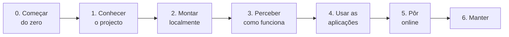

# Documentação

O Transportes Moçambique é uma plataforma de informação sobre os transportes públicos da área Maputo–Matola. Os passageiros encontram autocarros e horas de chegada na web, ou por [USSD](conceitos.md#ussd "Os menus que aparecem num telemóvel quando se marca um código como *384*848080#; funcionam em qualquer telemóvel, sem internet.") em qualquer telemóvel. Os motoristas gerem as viagens a partir do telemóvel. Os administradores gerem a rede num painel. Esta pasta explica como funciona cada parte, como as partes se ligam, e como se montam, configuram, consultam e publicam, passo a passo e com o porquê de cada escolha, para qualquer pessoa conseguir reproduzir a plataforma e percebê-la por inteiro.

> **Nunca programou?** Comece pela parte 0. [Conceitos básicos](conceitos.md) explica cada palavra técnica com exemplos do dia a dia, e [Preparar o computador](preparar-o-computador.md) instala tudo o que é preciso, passo a passo. Depois, em todas as páginas, uma palavra técnica é uma ligação para a sua explicação, e passar o rato por cima mostra-a numa frase.

**Nesta página:** [Como ler](#como-ler) · [As páginas](#as-páginas) · [Perguntas rápidas](#perguntas-rápidas) · [Percursos de leitura](#percursos-de-leitura) · [Língua e convenções](#língua-e-convenções)

---

## Como ler

A documentação é um guia em sete partes, de 0 a 6, pela ordem em que se percebe e se monta a plataforma. A parte 0 é para quem nunca programou. Cada página:

- começa com a **navegação**: em que parte e página se está, a anterior e a seguinte, e a lista de todas as páginas (em "Todas as páginas");
- começa com um resumo **Em palavras simples**, sem termos técnicos;
- tem uma linha **Nesta página** com as suas secções;
- liga cada termo técnico, na primeira vez que aparece, à sua explicação em [Conceitos básicos](conceitos.md) (ou, para as palavras do projecto, no [Glossário](glossario.md));
- explica **o quê**, **como** (passo a passo, com capturas de ecrã ou diagramas) e **porquê** (as notas "Porquê:" explicam as escolhas de tecnologia e a forma de cada fluxo);
- liga ao **código** em que se baseia (por exemplo [`lib/ussdSteps.ts`](../transport-client/lib/ussdSteps.ts)), e o código tem comentários com o mesmo porquê;
- acaba com a anterior e a seguinte, para se poder ler tudo de seguida.

## As páginas

### 0. Começar do zero

| Página | O que tem |
|---|---|
| [Conceitos básicos](conceitos.md) | Cada ideia técnica em palavras simples, com uma comparação do dia a dia e um exemplo deste projecto: [servidor](conceitos.md#servidor "Um computador sempre ligado que recebe pedidos e responde a eles."), pedido [GET](conceitos.md#get-e-post "GET pede para ver uma coisa; POST envia dados para o servidor fazer algo com eles.") e POST, [API](conceitos.md#api "Uma API é a lista de pedidos que um servidor aceita de outros programas; cada um desses pedidos, com o seu endereço, é um endpoint."), [JSON](conceitos.md#json "Uma forma de escrever dados em texto que qualquer programa lê: nomes entre aspas, valores depois de dois pontos, listas entre parênteses rectos."), [base de dados](conceitos.md#base-de-dados "O sítio organizado onde a plataforma guarda tudo o que tem de durar: rotas, paragens, veículos, contas."), [SQL](conceitos.md#sql "A linguagem com que se fazem perguntas e alterações a uma base de dados."), [git](conceitos.md#git "O programa que guarda o histórico de todas as versões do código, e quem mudou o quê e quando."), [publicação](conceitos.md#publicacao "Pôr uma versão nova do código a funcionar nos servidores, ao vivo, para toda a gente."), USSD, [coordenadas](conceitos.md#coordenadas "Dois números que dizem onde está um ponto na Terra."), protocolo [OsmAnd](conceitos.md#osmand "Uma forma combinada de um aparelho enviar a sua posição: abre um endereço com a posição escrita nos parâmetros."), e as outras. |
| [Preparar o computador](preparar-o-computador.md) | As contas, instalar o Git, o [Node.js](conceitos.md#nodejs "O programa que corre JavaScript fora do navegador, num computador ou num servidor."), um editor e uma base de dados, abrir um [terminal](conceitos.md#terminal "A janela onde se escrevem instruções para o computador em texto, em vez de clicar."), ler os comandos desta documentação, descarregar o código. |

### 1. Conhecer o projecto

| Página | O que tem |
|---|---|
| [Visão geral](visao-geral.md) | O problema, quem usa e como, o diagrama do sistema, as três aplicações, as decisões de desenho, as tecnologias e porquê, a estrutura do [repositório](conceitos.md#repositorio "A pasta do projecto com todo o seu histórico no git."). |
| [Glossário](glossario.md) | As palavras do código, da base de dados e dos ecrãs ([`Via`](glossario.md#a-rede-e-as-pessoas "A tabela das rotas de autocarro (route)"), [`Paragem`](glossario.md#a-rede-e-as-pessoas "A tabela das paragens (stop)"), [`MISSION`](glossario.md#a-rede-e-as-pessoas "Um alerta de chegada: um SMS quando um autocarro estiver perto de uma paragem"), "[chapa](glossario.md#transportes-em-maputo "Os minibuses que levam a maior parte dos passageiros de Maputo")"…), e os termos técnicos. |
| [Fontes de dados](fontes-de-dados.md) | De onde vem cada dado ([OpenStreetMap](conceitos.md#openstreetmap "Um mapa do mundo inteiro feito por voluntários, como uma Wikipédia dos mapas, que qualquer pessoa pode usar e corrigir."), [Nominatim](conceitos.md#geocodificacao "Transformar coordenadas no nome de um sítio (ou o contrário)."), [OSRM](conceitos.md#router "Um serviço que, dados dois ou mais pontos, responde com o caminho pelas ruas entre eles e a distância."), os primeiros [scripts](conceitos.md#script "Um pequeno programa que se corre à mão, uma vez, para uma tarefa: importar dados, corrigir percursos, mostrar listas.")), o que é inventado, os mapas e serviços usados, os termos de uso e os créditos. |
| [Estado do projecto](estado-do-projecto.md) | O que funciona hoje, os dados de produção, o que espera por uma acção do dono, os próximos passos e o histórico dos [pull requests](conceitos.md#pull-request "Um pull request é o pedido para juntar um ramo ao main; o merge é a junção, quando o pedido é aceite."). |

### 2. Montar localmente

| Página | O que tem |
|---|---|
| [Primeiros passos](primeiros-passos.md) | Do repositório vazio às três aplicações a correr, com [dados de demonstração](conceitos.md#semente "Um conjunto pequeno de dados inventados que se carrega numa base de dados vazia para a experimentar."), entradas em cada aplicação, uma sessão USSD e uma posição [GPS](conceitos.md#gps "O sistema de satélites com que um telemóvel ou um aparelho sabe as suas coordenadas."). |
| [Base de dados](base-de-dados.md) | Diagrama das entidades, cada tabela, convenções, como ligar ([psql](conceitos.md#postgresql "O programa de base de dados que este projecto usa; gratuito e muito usado."), [Prisma Studio](conceitos.md#prisma "A ferramenta com que o código fala com a base de dados sem escrever SQL à mão."), consola da [Neon](conceitos.md#neon "A empresa que guarda a base de dados PostgreSQL da produção, na internet.")), consultas de exemplo testadas, [migrações](conceitos.md#migracao "O esquema é a lista das tabelas e colunas; uma migração é uma alteração a essa lista, escrita em SQL para se poder repetir."), e os scripts de dados (importação do OpenStreetMap, percursos nas estradas). |
| [Configuração](configuracao.md) | Cada [variável de ambiente](conceitos.md#variavel-de-ambiente "Uma definição que se dá a um programa de fora do código, como o endereço da base de dados ou uma palavra-passe.") de cada aplicação, onde estão os valores, os projectos da [Vercel](conceitos.md#vercel "A empresa cujos servidores correm as três aplicações e as publicam a cada merge.") e da Neon, a regra de tarifa, as constantes no código. |

### 3. Perceber como funciona

| Página | O que tem |
|---|---|
| [Fluxos de dados](fluxos-de-dados.md) | O que é guardado e o que é calculado, quem faz o quê, e um diagrama de sequência por fluxo: planear uma viagem, mapa ao vivo, alerta de chegada, sessão USSD, viagem do motorista, posição GPS, alterações no painel. |
| [Localização e GPS](localizacao-gps.md) | Como se escolhe a posição de um autocarro (GPS real ou horário), ligar um [rastreador](conceitos.md#rastreador "Um aparelho (ou um telemóvel com uma aplicação) que envia a posição de um veículo pela internet; o código do dispositivo é a sua 'palavra-passe'.") ou o [Traccar Client](conceitos.md#traccar "Uma aplicação gratuita para telemóvel que envia a posição do telemóvel pelo protocolo OsmAnd."), o protocolo de entrada. |
| [Serviço USSD](ussd.md) | O caminho de um pedido, como se lê cada tecla, a pesquisa que aceita nomes mal escritos, todos os menus com ecrãs reais, e como testar. |
| [Segurança](seguranca.md) | [Sessões](conceitos.md#sessao "Depois de entrar, o servidor dá uma prova de quem se é (um token), e o navegador mostra-a a cada pedido para não ter de pedir a palavra-passe outra vez.") assinadas, como cada utilizador e aparelho prova quem é, endpoints públicos, o que se guarda em [hash](conceitos.md#hash "Uma 'impressão digital' de um texto, que se calcula num sentido e não se consegue desfazer."), como mudar cada [segredo](conceitos.md#segredo "Um valor que só a plataforma deve saber, como uma palavra-passe: quem o tiver pode agir em nome dela."), falhas conhecidas. |
| [Referência da API](referencia-api.md) | Cada endpoint [HTTP](conceitos.md#http "A forma combinada como o navegador (ou outro programa) pede algo a um servidor, e como o servidor responde.") das duas aplicações com API: método, autenticação, [parâmetros](conceitos.md#parametros "As três formas de um pedido levar informação: no endereço, no conteúdo, ou em etiquetas à parte."), respostas reais. |
| [Mapa do código](mapa-do-codigo.md) | Cada pasta e ficheiro que conta, o que faz, e a página que o explica. |

### 4. Usar as aplicações

| Página | O que tem |
|---|---|
| [Aplicação dos passageiros](app-passageiros.md) | Passo a passo com capturas: o mapa, os destinos, as viagens com [transbordos](glossario.md#palavras-dos-ecrãs "Mudança de autocarro a meio de uma viagem"), acompanhar uma viagem, a conta e os alertas, com o pedido por trás de cada ecrã. |
| [Portal do motorista](portal-motorista.md) | O dia de um motorista passo a passo, a entrada com PIN, iniciar e terminar uma viagem (partilhado com o USSD), partilhar o GPS do telemóvel, os passageiros à espera. |
| [Painel de administração](painel-admin.md) | Tarefas comuns passo a passo (criar uma rota, uma paragem, um veículo, um motorista; dar um PIN; ligar um GPS; mudar a tarifa), e depois cada página do painel. |

### 5. Pôr online

| Página | O que tem |
|---|---|
| [Publicação](publicacao.md) | Os três projectos da Vercel, como uma alteração chega à produção, alterações à base de dados em produção, confirmar e desfazer uma publicação. |
| [Guia da Vercel](guia-vercel.md) | Criar os projectos, as variáveis de ambiente (Secret ou Config), as publicações, os [registos](conceitos.md#registos "As linhas de texto que um programa escreve sobre o que está a fazer, para se perceber depois o que aconteceu."), com capturas. |
| [Guia da Neon](guia-neon.md) | Criar o projecto, colar e correr SQL, descarregar resultados, ver uma tabela, seguir cada fluxo pelas tabelas, repor a palavra-passe. |
| [Africa's Talking](africas-talking.md) | Como o USSD e os [SMS](conceitos.md#sms "As mensagens de texto curtas dos telemóveis.") foram configurados, usar o menu no [simulador](conceitos.md#africas-talking "O gateway de USSD e SMS usado por este projecto."), os registos, passar a produção. |

### 6. Manter

| Página | O que tem |
|---|---|
| [Testes](testes.md) | O [CI](conceitos.md#ci "Verificações que o GitHub corre sozinho a cada pull request, para nenhum erro conhecido chegar ao main.") no [GitHub](conceitos.md#github "O site onde o repositório está guardado e partilhado, e onde se revêem as alterações."), os testes [Jest](conceitos.md#testes "Programas que experimentam as aplicações sozinhos e avisam quando algo deixou de funcionar.") e Playwright do painel, os tipos, e testar à mão o USSD, o GPS e as APIs. |
| [Resolução de problemas](resolucao-de-problemas.md) | Sintomas, causas e correcções dos problemas mais prováveis. |
| [Limitações](limitacoes.md) | O que se corrigiu em 2026-10-18, e o que ainda é incompleto, estimado ou antigo, com como contornar cada item. |

## Perguntas rápidas

| Pergunta | Onde |
|---|---|
| Não percebo uma palavra técnica (API, POST, servidor, JSON…). | [Conceitos básicos](conceitos.md) |
| Nunca programei. Por onde começo? | [Conceitos básicos](conceitos.md) → [Preparar o computador](preparar-o-computador.md) → [Primeiros passos](primeiros-passos.md) |
| O que querem dizer `Via`, `Paragem`, `MISSION` ou "chapa"? | [Glossário](glossario.md) |
| De onde vêm os dados? São reais? | [Fontes de dados](fontes-de-dados.md) |
| Como se cria uma rota, um veículo ou um motorista, ou se dá um PIN? | [Painel → Tarefas comuns](painel-admin.md#tarefas-comuns-passo-a-passo) |
| Como usa um motorista o portal? | [Portal do motorista → O dia de um motorista](portal-motorista.md#o-dia-de-um-motorista-passo-a-passo) |
| Como se mudam as tarifas? | [Painel → Tarifa](painel-admin.md#tarifa) |
| O que acontece a uma tecla USSD, do telemóvel à base de dados? | [Serviço USSD → O caminho de um pedido](ussd.md#o-caminho-de-um-pedido) |
| Como sabe o servidor o que quer dizer "2" ou "7" numa sessão USSD? | [Serviço USSD → Leitura das teclas](ussd.md#leitura-das-teclas) |
| E se o passageiro escrever mal o nome de uma paragem? | [Serviço USSD → Pesquisa tolerante](ussd.md#pesquisa-tolerante) |
| Como se experimenta o menu USSD? | [Africa's Talking → Usar o menu no simulador](africas-talking.md#usar-o-menu-no-simulador) |
| Como foi configurada a Africa's Talking? | [Africa's Talking → Como foi configurado](africas-talking.md#como-foi-configurado-passo-a-passo) |
| Como se transforma um pedido de um passageiro numa viagem e numa hora de chegada? | [Fluxos de dados → Planear uma viagem](fluxos-de-dados.md#planear-uma-viagem) |
| De onde vem a posição de um autocarro? | [Localização e GPS → Como se escolhe uma posição](localizacao-gps.md#como-se-escolhe-uma-posição) |
| Onde está o código de uma funcionalidade? | [Mapa do código](mapa-do-codigo.md) |
| Que endpoint chama um ecrã? | [Referência da API](referencia-api.md), e as tabelas "Pedido" de cada página da parte 4 |
| Como se corre SQL nos dados de produção? | [Guia da Neon](guia-neon.md) |
| Que chave ou definição vai para onde? | [Configuração](configuracao.md), depois [Guia da Vercel → Variáveis de ambiente](guia-vercel.md#variáveis-de-ambiente) |
| A linha de uma rota não segue as estradas. | [Painel → Redesenhar o percurso de uma rota](painel-admin.md#tarefa-redesenhar), [Base de dados → Pôr os percursos nas estradas](base-de-dados.md#pôr-os-percursos-das-rotas-nas-estradas) |
| Uma publicação estragou algo. | [Publicação → Voltar atrás](publicacao.md#voltar-atrás), depois [Resolução de problemas](resolucao-de-problemas.md) |
| Algo não funciona como esperado: já se sabe? | [Limitações](limitacoes.md) |
| O que falta fazer, e o que mudou há pouco? | [Estado do projecto](estado-do-projecto.md) |

## Percursos de leitura

- **Para quem nunca programou:** [Conceitos básicos](conceitos.md) → [Preparar o computador](preparar-o-computador.md) → [Primeiros passos](primeiros-passos.md) → [Visão geral](visao-geral.md), e depois as outras partes por ordem.
- **Para ver a plataforma a funcionar:** as [aplicações ao vivo](../README.md#aplicações-ao-vivo), o [menu USSD no simulador](africas-talking.md#usar-o-menu-no-simulador), e depois [Primeiros passos](primeiros-passos.md) para a correr localmente.
- **Para reproduzir a plataforma do zero:** [Conceitos básicos](conceitos.md) → [Preparar o computador](preparar-o-computador.md) → [Visão geral](visao-geral.md) → [Primeiros passos](primeiros-passos.md) → [Base de dados](base-de-dados.md) → [Configuração](configuracao.md) → [Guia da Neon](guia-neon.md#0-criar-o-projecto) → [Guia da Vercel](guia-vercel.md#criar-os-projectos) → [Africa's Talking](africas-talking.md#como-foi-configurado-passo-a-passo) → [Publicação](publicacao.md).
- **Para chegar ao projecto pela primeira vez:** [Visão geral](visao-geral.md) → [Glossário](glossario.md) → [Estado do projecto](estado-do-projecto.md) → [Fluxos de dados](fluxos-de-dados.md).
- **Para mudar o código:** [Visão geral](visao-geral.md) → [Mapa do código](mapa-do-codigo.md) → [Fluxos de dados](fluxos-de-dados.md) → [Base de dados](base-de-dados.md) → [Referência da API](referencia-api.md) → [Testes](testes.md).
- **Para consultar ou analisar os dados:** [Fontes de dados](fontes-de-dados.md) (o que é real) → [Guia da Neon](guia-neon.md) (passo a passo) → [Base de dados](base-de-dados.md) (ligação, convenções, SQL de exemplo) → [Localização e GPS](localizacao-gps.md) (como se calculam as posições).
- **Para gerir a rede no dia a dia:** [Painel → Tarefas comuns](painel-admin.md#tarefas-comuns-passo-a-passo) → [Portal do motorista → O dia de um motorista](portal-motorista.md#o-dia-de-um-motorista-passo-a-passo) → [Limitações](limitacoes.md).
- **Para operar a plataforma:** [Estado do projecto → À espera de acção](estado-do-projecto.md#à-espera-de-acção) → [Configuração](configuracao.md) → [Guia da Vercel](guia-vercel.md) → [Publicação](publicacao.md) → [Africa's Talking](africas-talking.md) → [Segurança](seguranca.md) → [Resolução de problemas](resolucao-de-problemas.md).

## Língua e convenções

- Tudo está em português europeu: a interface, o código, os comentários, as mensagens dos registos e esta documentação. Os ecrãs USSD e os SMS não têm acentos, porque o USSD só mostra bem o alfabeto [GSM-7](conceitos.md#gsm-7 "O conjunto de letras que todos os telemóveis mostram nos SMS e no USSD; não tem a maior parte das letras acentuadas.") ([Serviço USSD → Dentro do handler](ussd.md#dentro-do-handler)).
- As tabelas e os campos da base de dados mantêm os nomes do projecto original (`Via` = rota, `Paragem` = paragem, [`Transporte`](glossario.md#a-rede-e-as-pessoas "A tabela dos veículos (vehicle)") = veículo, [`Motorista`](glossario.md#a-rede-e-as-pessoas "A tabela dos motoristas e dos seus PIN"), [`Utente`](glossario.md#a-rede-e-as-pessoas "A tabela das contas de passageiros") = passageiro, [`Proprietario`](glossario.md#a-rede-e-as-pessoas "A tabela dos donos dos veículos"), `MISSION` = alerta de chegada, [`Tarifa`](glossario.md#a-rede-e-as-pessoas "A regra de tarifa: preço mínimo, preço por km e velocidades") = regra de tarifa); o [Glossário](glossario.md) tem todos.
- Os textos dos ecrãs citam-se entre aspas tal como aparecem ("Para onde quer ir?", "Gerar PIN").
- As ligações para o código são caminhos relativos (`../transport-client/…`), que funcionam no GitHub e num editor.
- A navegação das páginas é gerada por [`.github/scripts/docs-nav.py`](../.github/scripts/docs-nav.py); uma página nova junta-se a `PARTES` nesse script.
- As ligações dos termos técnicos são escritas por [`.github/scripts/docs-termos.py`](../.github/scripts/docs-termos.py): um conceito novo junta-se a [Conceitos básicos](conceitos.md) (com um `<a id>` e uma linha "**Em uma frase:**") e a `TERMOS` nesse script. O CI confirma as ligações, a navegação e as ligações dos termos ([Testes → CI no GitHub](testes.md#ci-no-github)).
