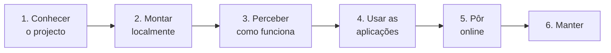

# Documentação

O Transportes Moçambique é uma plataforma de informação sobre os transportes públicos da área Maputo–Matola. Os passageiros encontram autocarros e horas de chegada na web, ou por USSD em qualquer telemóvel. Os motoristas gerem as viagens a partir do telemóvel. Os administradores gerem a rede num painel. Esta pasta explica como funciona cada parte, como as partes se ligam, e como se montam, configuram, consultam e publicam, passo a passo e com o porquê de cada escolha, para qualquer pessoa conseguir reproduzir a plataforma e percebê-la por inteiro.

**Nesta página:** [Como ler](#como-ler) · [As páginas](#as-páginas) · [Perguntas rápidas](#perguntas-rápidas) · [Percursos de leitura](#percursos-de-leitura) · [Língua e convenções](#língua-e-convenções)

---

## Como ler

A documentação é um guia em seis partes, pela ordem em que se percebe e se monta a plataforma. Cada página:

- começa com a **navegação**: em que parte e página se está, a anterior e a seguinte, e a lista de todas as páginas (em "Todas as páginas");
- tem uma linha **Nesta página** com as suas secções;
- explica **o quê**, **como** (passo a passo, com capturas de ecrã ou diagramas) e **porquê** (as notas "Porquê:" explicam as escolhas de tecnologia e a forma de cada fluxo);
- liga ao **código** em que se baseia (por exemplo [`lib/ussdSteps.ts`](../transport-client/lib/ussdSteps.ts)), e o código tem comentários com o mesmo porquê;
- acaba com a anterior e a seguinte, para se poder ler tudo de seguida.

## As páginas

### 1. Conhecer o projecto

| Página | O que tem |
|---|---|
| [Visão geral](visao-geral.md) | O problema, quem usa e como, o diagrama do sistema, as três aplicações, as decisões de desenho, as tecnologias e porquê, a estrutura do repositório. |
| [Glossário](glossario.md) | As palavras do código, da base de dados e dos ecrãs (`Via`, `Paragem`, `MISSION`, "chapa"…), e os termos técnicos. |
| [Fontes de dados](fontes-de-dados.md) | De onde vem cada dado (OpenStreetMap, Nominatim, OSRM, os primeiros scripts), o que é inventado, os mapas e serviços usados, os termos de uso e os créditos. |
| [Estado do projecto](estado-do-projecto.md) | O que funciona hoje, os dados de produção, o que espera por uma acção do dono, os próximos passos e o histórico dos pull requests. |

### 2. Montar localmente

| Página | O que tem |
|---|---|
| [Primeiros passos](primeiros-passos.md) | Do repositório vazio às três aplicações a correr, com dados de demonstração, entradas em cada aplicação, uma sessão USSD e uma posição GPS. |
| [Base de dados](base-de-dados.md) | Diagrama das entidades, cada tabela, convenções, como ligar (psql, Prisma Studio, consola da Neon), consultas de exemplo testadas, migrações, e os scripts de dados (importação do OpenStreetMap, percursos nas estradas). |
| [Configuração](configuracao.md) | Cada variável de ambiente de cada aplicação, onde estão os valores, os projectos da Vercel e da Neon, a regra de tarifa, as constantes no código. |

### 3. Perceber como funciona

| Página | O que tem |
|---|---|
| [Fluxos de dados](fluxos-de-dados.md) | O que é guardado e o que é calculado, quem faz o quê, e um diagrama de sequência por fluxo: planear uma viagem, mapa ao vivo, alerta de chegada, sessão USSD, viagem do motorista, posição GPS, alterações no painel. |
| [Localização e GPS](localizacao-gps.md) | Como se escolhe a posição de um autocarro (GPS real ou horário), ligar um rastreador ou o Traccar Client, o protocolo de entrada. |
| [Serviço USSD](ussd.md) | O caminho de um pedido, como se lê cada tecla, a pesquisa que aceita nomes mal escritos, todos os menus com ecrãs reais, e como testar. |
| [Segurança](seguranca.md) | Sessões assinadas, como cada utilizador e aparelho prova quem é, endpoints públicos, o que se guarda em hash, como mudar cada segredo, falhas conhecidas. |
| [Referência da API](referencia-api.md) | Cada endpoint HTTP das duas aplicações com API: método, autenticação, parâmetros, respostas reais. |
| [Mapa do código](mapa-do-codigo.md) | Cada pasta e ficheiro que conta, o que faz, e a página que o explica. |

### 4. Usar as aplicações

| Página | O que tem |
|---|---|
| [Aplicação dos passageiros](app-passageiros.md) | Passo a passo com capturas: o mapa, os destinos, as viagens com transbordos, acompanhar uma viagem, a conta e os alertas, com o pedido por trás de cada ecrã. |
| [Portal do motorista](portal-motorista.md) | O dia de um motorista passo a passo, a entrada com PIN, iniciar e terminar uma viagem (partilhado com o USSD), partilhar o GPS do telemóvel, os passageiros à espera. |
| [Painel de administração](painel-admin.md) | Tarefas comuns passo a passo (criar uma rota, uma paragem, um veículo, um motorista; dar um PIN; ligar um GPS; mudar a tarifa), e depois cada página do painel. |

### 5. Pôr online

| Página | O que tem |
|---|---|
| [Publicação](publicacao.md) | Os três projectos da Vercel, como uma alteração chega à produção, alterações à base de dados em produção, confirmar e desfazer uma publicação. |
| [Guia da Vercel](guia-vercel.md) | Criar os projectos, as variáveis de ambiente (Secret ou Config), as publicações, os registos, com capturas. |
| [Guia da Neon](guia-neon.md) | Criar o projecto, colar e correr SQL, descarregar resultados, ver uma tabela, seguir cada fluxo pelas tabelas, repor a palavra-passe. |
| [Africa's Talking](africas-talking.md) | Como o USSD e os SMS foram configurados, usar o menu no simulador, os registos, passar a produção. |

### 6. Manter

| Página | O que tem |
|---|---|
| [Testes](testes.md) | O CI no GitHub, os testes Jest e Playwright do painel, os tipos, e testar à mão o USSD, o GPS e as APIs. |
| [Resolução de problemas](resolucao-de-problemas.md) | Sintomas, causas e correcções dos problemas mais prováveis. |
| [Limitações](limitacoes.md) | O que se corrigiu em 2026-10-18, e o que ainda é incompleto, estimado ou antigo, com como contornar cada item. |

## Perguntas rápidas

| Pergunta | Onde |
|---|---|
| O que querem dizer `Via`, `Paragem`, `MISSION` ou "chapa"? | [Glossário](glossario.md) |
| De onde vêm os dados? São reais? | [Fontes de dados](fontes-de-dados.md) |
| Como se cria uma rota, um veículo ou um motorista, ou se dá um PIN? | [Painel → Tarefas comuns](painel-admin.md#tarefas-comuns-passo-a-passo) |
| Como usa um motorista o portal? | [Portal do motorista → O dia de um motorista](portal-motorista.md#o-dia-de-um-motorista-passo-a-passo) |
| Como se mudam as tarifas? | [Painel → Tarifa](painel-admin.md#tarifa) |
| O que acontece a uma tecla USSD, do telemóvel à base de dados? | [Serviço USSD → O caminho de um pedido](ussd.md#o-caminho-de-um-pedido) |
| Como sabe o servidor o que quer dizer "2" ou "7" numa sessão USSD? | [Serviço USSD → Leitura das teclas](ussd.md#leitura-das-teclas) |
| E se o passageiro escrever mal o nome de uma paragem? | [Serviço USSD → Pesquisa tolerante](ussd.md#pesquisa-tolerante) |
| Como se experimenta o menu USSD? | [Africa's Talking → Usar o menu no simulador](africas-talking.md#usar-o-menu-no-simulador) |
| Como foi configurada a Africa's Talking? | [Africa's Talking → Como foi configurado](africas-talking.md#como-foi-configurado-passo-a-passo) |
| Como se transforma um pedido de um passageiro numa viagem e numa hora de chegada? | [Fluxos de dados → Planear uma viagem](fluxos-de-dados.md#planear-uma-viagem) |
| De onde vem a posição de um autocarro? | [Localização e GPS → Como se escolhe uma posição](localizacao-gps.md#como-se-escolhe-uma-posição) |
| Onde está o código de uma funcionalidade? | [Mapa do código](mapa-do-codigo.md) |
| Que endpoint chama um ecrã? | [Referência da API](referencia-api.md), e as tabelas "Pedido" de cada página da parte 4 |
| Como se corre SQL nos dados de produção? | [Guia da Neon](guia-neon.md) |
| Que chave ou definição vai para onde? | [Configuração](configuracao.md), depois [Guia da Vercel → Variáveis de ambiente](guia-vercel.md#variáveis-de-ambiente) |
| A linha de uma rota não segue as estradas. | [Painel → Redesenhar o percurso de uma rota](painel-admin.md#tarefa-redesenhar), [Base de dados → Pôr os percursos nas estradas](base-de-dados.md#pôr-os-percursos-das-rotas-nas-estradas) |
| Uma publicação estragou algo. | [Publicação → Voltar atrás](publicacao.md#voltar-atrás), depois [Resolução de problemas](resolucao-de-problemas.md) |
| Algo não funciona como esperado: já se sabe? | [Limitações](limitacoes.md) |
| O que falta fazer, e o que mudou há pouco? | [Estado do projecto](estado-do-projecto.md) |

## Percursos de leitura

- **Para ver a plataforma a funcionar:** as [aplicações ao vivo](../README.md#aplicações-ao-vivo), o [menu USSD no simulador](africas-talking.md#usar-o-menu-no-simulador), e depois [Primeiros passos](primeiros-passos.md) para a correr localmente.
- **Para reproduzir a plataforma do zero:** [Visão geral](visao-geral.md) → [Primeiros passos](primeiros-passos.md) → [Base de dados](base-de-dados.md) → [Configuração](configuracao.md) → [Guia da Neon](guia-neon.md#0-criar-o-projecto) → [Guia da Vercel](guia-vercel.md#criar-os-projectos) → [Africa's Talking](africas-talking.md#como-foi-configurado-passo-a-passo) → [Publicação](publicacao.md).
- **Para chegar ao projecto pela primeira vez:** [Visão geral](visao-geral.md) → [Glossário](glossario.md) → [Estado do projecto](estado-do-projecto.md) → [Fluxos de dados](fluxos-de-dados.md).
- **Para mudar o código:** [Visão geral](visao-geral.md) → [Mapa do código](mapa-do-codigo.md) → [Fluxos de dados](fluxos-de-dados.md) → [Base de dados](base-de-dados.md) → [Referência da API](referencia-api.md) → [Testes](testes.md).
- **Para consultar ou analisar os dados:** [Fontes de dados](fontes-de-dados.md) (o que é real) → [Guia da Neon](guia-neon.md) (passo a passo) → [Base de dados](base-de-dados.md) (ligação, convenções, SQL de exemplo) → [Localização e GPS](localizacao-gps.md) (como se calculam as posições).
- **Para gerir a rede no dia a dia:** [Painel → Tarefas comuns](painel-admin.md#tarefas-comuns-passo-a-passo) → [Portal do motorista → O dia de um motorista](portal-motorista.md#o-dia-de-um-motorista-passo-a-passo) → [Limitações](limitacoes.md).
- **Para operar a plataforma:** [Estado do projecto → À espera de acção](estado-do-projecto.md#à-espera-de-acção) → [Configuração](configuracao.md) → [Guia da Vercel](guia-vercel.md) → [Publicação](publicacao.md) → [Africa's Talking](africas-talking.md) → [Segurança](seguranca.md) → [Resolução de problemas](resolucao-de-problemas.md).

## Língua e convenções

- Tudo está em português europeu: a interface, o código, os comentários, as mensagens dos registos e esta documentação. Os ecrãs USSD e os SMS não têm acentos, porque o USSD só mostra bem o alfabeto GSM-7 ([Serviço USSD → Dentro do handler](ussd.md#dentro-do-handler)).
- As tabelas e os campos da base de dados mantêm os nomes do projecto original (`Via` = rota, `Paragem` = paragem, `Transporte` = veículo, `Motorista`, `Utente` = passageiro, `Proprietario`, `MISSION` = alerta de chegada, `Tarifa` = regra de tarifa); o [Glossário](glossario.md) tem todos.
- Os textos dos ecrãs citam-se entre aspas tal como aparecem ("Para onde quer ir?", "Gerar PIN").
- As ligações para o código são caminhos relativos (`../transport-client/…`), que funcionam no GitHub e num editor.
- A navegação das páginas é gerada por [`.github/scripts/docs-nav.py`](../.github/scripts/docs-nav.py); uma página nova junta-se a `PARTES` nesse script, e o CI confirma ligações e navegação ([Testes → CI no GitHub](testes.md#ci-no-github)).
