# Africa's Talking

<!-- navegação: gerada por .github/scripts/docs-nav.py, não editar à mão -->
[Documentação](README.md) › 5. Pôr online › **Africa's Talking** (página 22 de 25)

Anterior: [Guia da Neon](guia-neon.md) · [Índice](README.md) · Seguinte: [Testes](testes.md)

<details>
<summary>Todas as páginas</summary>

- 0. Começar do zero: [Conceitos básicos](conceitos.md) · [Preparar o computador](preparar-o-computador.md)
- 1. Conhecer o projecto: [Visão geral](visao-geral.md) · [Glossário](glossario.md) · [Fontes de dados](fontes-de-dados.md) · [Estado do projecto](estado-do-projecto.md)
- 2. Montar localmente: [Primeiros passos](primeiros-passos.md) · [Base de dados](base-de-dados.md) · [Configuração](configuracao.md)
- 3. Perceber como funciona: [Fluxos de dados](fluxos-de-dados.md) · [Localização e GPS](localizacao-gps.md) · [Serviço USSD](ussd.md) · [Segurança](seguranca.md) · [Referência da API](referencia-api.md) · [Mapa do código](mapa-do-codigo.md)
- 4. Usar as aplicações: [Aplicação dos passageiros](app-passageiros.md) · [Portal do motorista](portal-motorista.md) · [Painel de administração](painel-admin.md)
- 5. Pôr online: [Publicação](publicacao.md) · [Guia da Vercel](guia-vercel.md) · [Guia da Neon](guia-neon.md) · **Africa's Talking**
- 6. Manter: [Testes](testes.md) · [Resolução de problemas](resolucao-de-problemas.md) · [Limitações](limitacoes.md)

</details>
<!-- /navegação -->

> **Em palavras simples:** A [Africa's Talking](conceitos.md#africas-talking "O gateway de USSD e SMS usado por este projecto.") é a empresa que liga a plataforma às redes de telemóvel, para o menu [USSD](conceitos.md#ussd "Os menus que aparecem num telemóvel quando se marca um código como *384*848080#; funcionam em qualquer telemóvel, sem internet.") e os [SMS](conceitos.md#sms "As mensagens de texto curtas dos telemóveis.") funcionarem. Esta página mostra como foi configurada, como experimentar o menu num telemóvel simulado no [navegador](conceitos.md#navegador "O programa com que se abrem sites: Chrome, Firefox, Edge, Safari."), e o que falta para funcionar em telemóveis verdadeiros.

A [Africa's Talking](https://africastalking.com) (AT) é o [gateway](conceitos.md#gateway "A empresa que faz a ponte entre as redes dos telemóveis (Vodacom, Movitel, Tmcel) e a internet.") entre as redes de telemóvel e a plataforma. Leva duas coisas:

- **USSD:** um telemóvel marca o código do serviço, e a AT passa cada tecla para `POST /api/ussd` da aplicação dos passageiros ([Serviço USSD](ussd.md)).
- **SMS:** a aplicação dos passageiros envia os resultados do USSD, os alertas de chegada e as confirmações de viagem dos motoristas pela [API](conceitos.md#api "Uma API é a lista de pedidos que um servidor aceita de outros programas; cada um desses pedidos, com o seu endereço, é um endpoint.") de SMS da AT.

Porquê a Africa's Talking: um só fornecedor para USSD e SMS em vários países africanos, com um ambiente de testes (sandbox) gratuito e um simulador de telemóvel no navegador, o que deixa construir e testar tudo antes de pagar um código.

A plataforma corre hoje no **sandbox**. O USSD e os SMS do sandbox só chegam ao simulador da AT, não a telemóveis reais. Esta página mostra:

- como a conta foi configurada, passo a passo;
- como usar o menu USSD no simulador, ecrã a ecrã;
- como um pedido chega ao código;
- onde ler os [registos](conceitos.md#registos "As linhas de texto que um programa escreve sobre o que está a fazer, para se perceber depois o que aconteceu.");
- o que é preciso para passar a produção.

**Nesta página:** [Configuração actual](#configuração-actual) · [Como foi configurado, passo a passo](#como-foi-configurado-passo-a-passo) · [Usar o menu no simulador](#usar-o-menu-no-simulador) · [Como um pedido é tratado](#como-um-pedido-é-tratado) · [SMS](#sms) · [Registos e sessões](#registos-e-sessões) · [Passar a produção](#passar-a-produção)

---

## Configuração actual

| Item | Valor |
|---|---|
| Conta da AT | a conta `transportmozambique` |
| Aplicação | Sandbox, nome de utilizador `sandbox` |
| Código USSD | `*384*848080#` (o canal `848080` no código partilhado do sandbox `*384#`) |
| [URL](conceitos.md#url "O texto que diz ao navegador onde está uma página ou informação, como https://transport-mz.vercel.app/viagem.") do [callback](conceitos.md#callback "Um endereço que se dá a outro serviço para ele chamar sempre que algo acontece.") | `https://transport-mz.vercel.app/api/ussd?key=<USSD_CALLBACK_KEY>`. Os pedidos sem a chave recebem [403](conceitos.md#codigos-de-resposta "O número de três algarismos com que o servidor diz como correu o pedido.") (desde 2026-10-17). |
| Projecto `transport-mz` da [Vercel](conceitos.md#vercel "A empresa cujos servidores correm as três aplicações e as publicam a cada merge.") | `AFRICASTALKING_USERNAME=sandbox`, `AFRICASTALKING_API_KEY` (chave do sandbox), `USSD_CALLBACK_KEY` (Secret, Production) |
| Remetente dos SMS (`AFRICASTALKING_SHORTCODE`) | não definido: os SMS saem do remetente da AT por omissão (`AFRICASTKNG` no simulador) |
| Verificado | menus USSD e SMS de ponta a ponta no simulador, 2026-10-18 |
| Ao vivo (telemóveis reais em Moçambique) | não configurado ([Passar a produção](#passar-a-produção)) |

## Como foi configurado, passo a passo

A ordem conta: a [chave da API](conceitos.md#segredo "Um valor que só a plataforma deve saber, como uma palavra-passe: quem o tiver pode agir em nome dela.") e a chave do callback vão para a Vercel antes de o canal apontar para a aplicação, para o primeiro pedido já as encontrar.

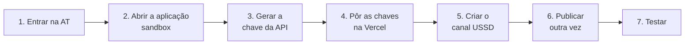

### 1. Entrar

Ir a [account.africastalking.com](https://account.africastalking.com) e entrar, ou **Register** para criar uma conta.

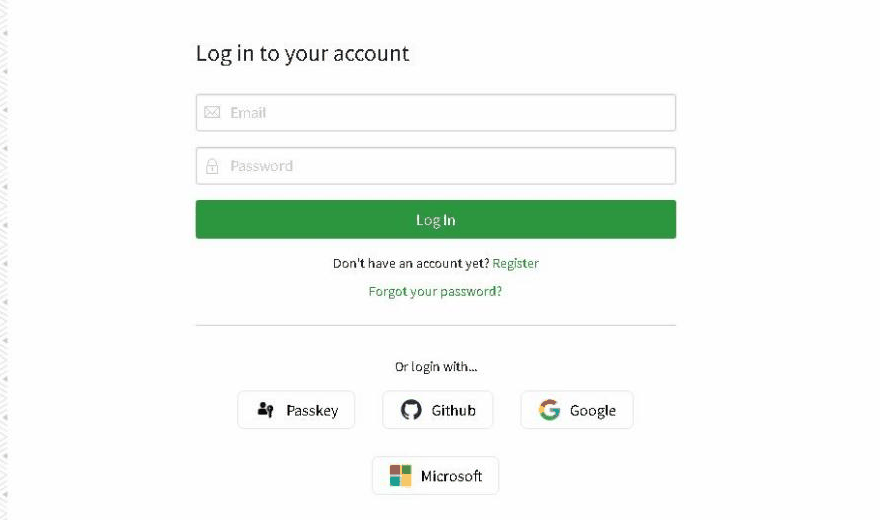

### 2. Abrir a aplicação sandbox

A página inicial oferece **Go To Sandbox App** para testes gratuitos, e **Teams** para as aplicações de produção. Cada aplicação tem o seu nome de utilizador e a sua chave da API. O nome de utilizador do sandbox é `sandbox`.

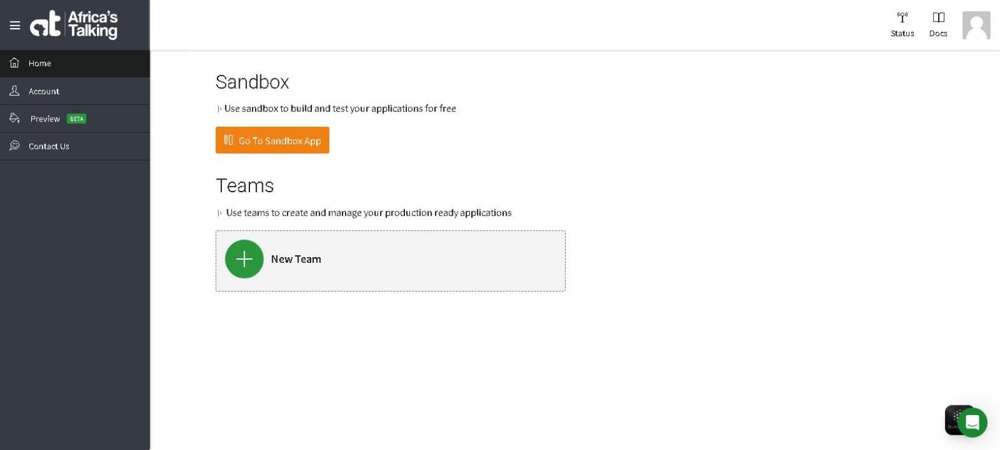

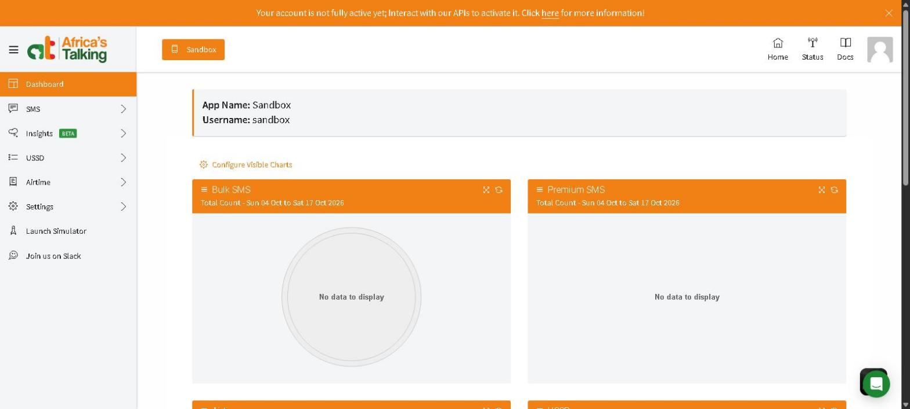

### 3. Gerar a chave da API

Na aplicação sandbox: **Settings → API Key**.

1. Escrever a palavra-passe da conta e clicar em **Request**.
2. A AT envia um link para o email da conta. Abri-lo gera a chave.

Depois:

- A chave aparece uma só vez: copia-se directamente para a Vercel (passo seguinte), e não para um ficheiro ou uma conversa.
- Gerar uma chave nova invalida a anterior.
- Uma chave nova pode demorar alguns minutos até a API a aceitar. Até lá a AT responde "The supplied authentication is invalid".

### 4. Pôr as chaves na Vercel

Abrir o projecto **transport-mz** da Vercel → **Settings → Environment Variables** ([Guia da Vercel](guia-vercel.md#variáveis-de-ambiente)):

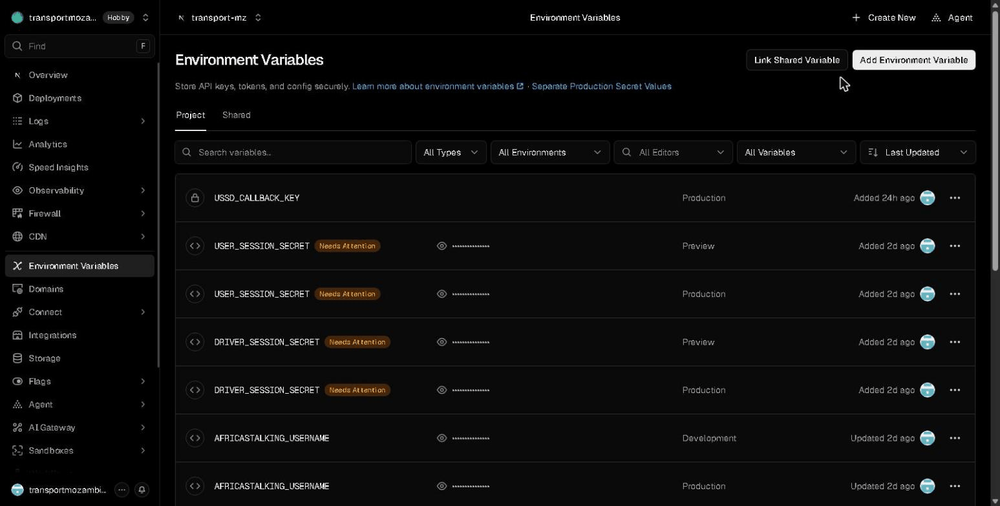

Clicar em **Add Environment Variable** e juntar, para **Production**:

| Key | Tipo | Valor |
|---|---|---|
| `AFRICASTALKING_USERNAME` | Config | `sandbox` (o nome de utilizador da aplicação) |
| `AFRICASTALKING_API_KEY` | **Secret** | a chave do passo 3 |
| `USSD_CALLBACK_KEY` | **Secret** | um valor aleatório longo, por exemplo o resultado de `openssl rand -hex 32` |

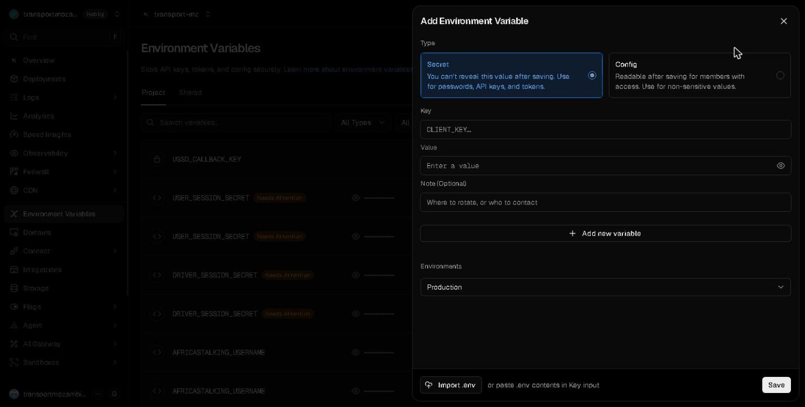

Um **Secret** não se pode ler outra vez depois de gravado, nem pelos membros do projecto. Guarda-se uma cópia de `USSD_CALLBACK_KEY` até o passo 5 a usar, e depois apaga-se a cópia. Porquê a chave do callback: ver [Segurança → Resposta USSD](seguranca.md#resposta-ussd-callback).

### 5. Criar o canal USSD

De volta à aplicação sandbox da AT: **USSD → Create Channel**.

- Escolher o código partilhado `*384#` e um número de canal livre (aqui `848080`).
- Escrever o URL do callback com a chave:

  ```text
  https://transport-mz.vercel.app/api/ussd?key=<USSD_CALLBACK_KEY>
  ```

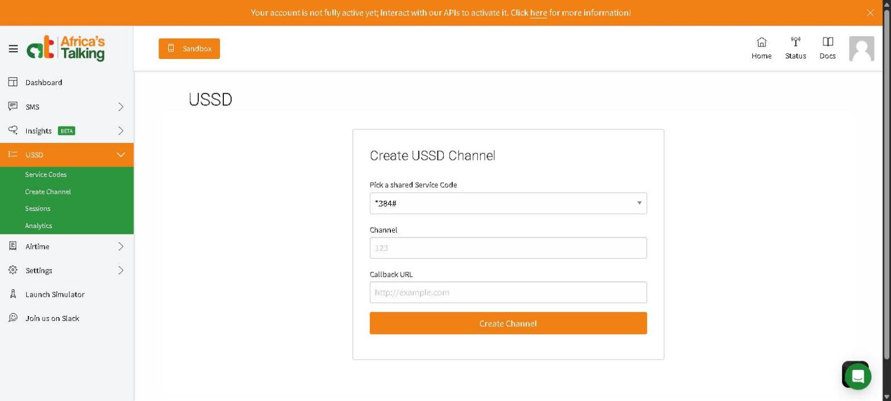

**USSD → Service Codes** lista então o canal e o seu callback. A captura abaixo foi feita antes de juntar a chave; hoje o URL acaba em `?key=…`.

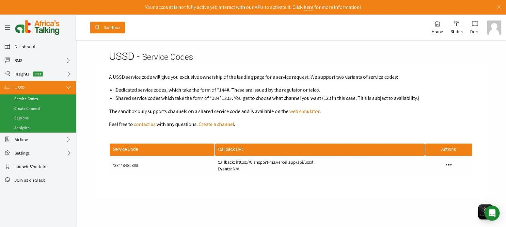

A AT oferece dois tipos de código:

- códigos **dedicados**, como `*144#`, atribuídos pelo regulador ou pelo operador;
- códigos **partilhados**, como `*384*848080#`: um número de canal no código da AT. O sandbox só aceita estes.

O URL de uma pré-visualização também serve de callback, para testar um [ramo](conceitos.md#ramo "Uma linha de trabalho separada, onde se fazem mudanças sem tocar na versão principal.") antes do [merge](conceitos.md#pull-request "Um pull request é o pedido para juntar um ramo ao main; o merge é a junção, quando o pedido é aceite."). Depois volta-se a pôr o URL de produção.

### 6. Publicar outra vez

As funções da Vercel lêem as [variáveis de ambiente](conceitos.md#variavel-de-ambiente "Uma definição que se dá a um programa de fora do código, como o endereço da base de dados ou uma palavra-passe.") quando são publicadas. Em **transport-mz → Deployments**, abrir o menu (**⋯**) da [publicação](conceitos.md#publicacao "Pôr uma versão nova do código a funcionar nos servidores, ao vivo, para toda a gente.") de produção mais nova e clicar em **Redeploy** ([Guia da Vercel → Publicações](guia-vercel.md#publicações)).

### 7. Testar

- No [simulador](#usar-o-menu-no-simulador), aparece o menu principal.
- Sem a chave, o endpoint recusa:

  ```bash
  curl -s -o /dev/null -w "%{http_code}\n" -X POST https://transport-mz.vercel.app/api/ussd \
    -d "sessionId=g&serviceCode=*384*848080%23&phoneNumber=%2B258840000009&text="
  # 403
  ```

Para mudar a chave mais tarde, mudam-se a variável e o URL do callback juntos, e publica-se outra vez ([Segurança → Mudar segredos](seguranca.md#mudar-segredos)).

## Usar o menu no simulador

O simulador não precisa de conta. Os ecrãs abaixo são respostas reais.

1. Abrir o [simulador](https://developers.africastalking.com/simulator). Escolher Moçambique (+258) na bandeira se ainda não estiver escolhido, escrever um número de teste (aqui `84 000 0001`) e carregar em **Connect**.
2. No ecrã inicial do telemóvel, o **telefone** (à esquerda) marca; as **mensagens** (ao meio) guardam os SMS.
3. Marcar `*384*848080#` no teclado e carregar no botão verde.

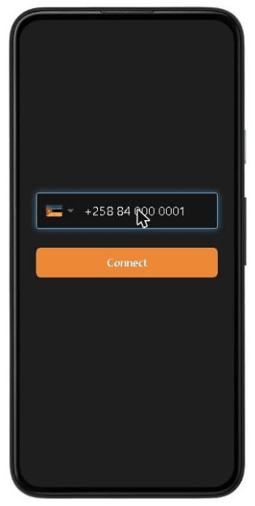 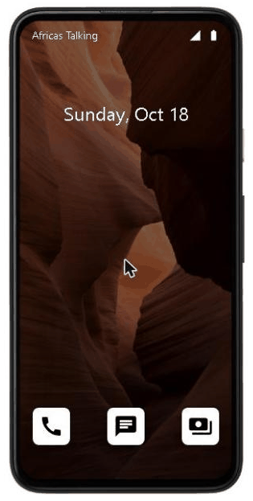 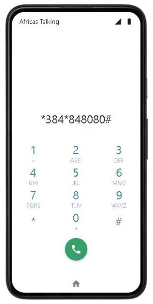

4. Aparece o menu principal. Escrever o número da opção no campo em baixo (aqui `2`, Procurar rotas) e carregar em **SEND**.

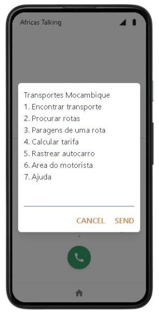 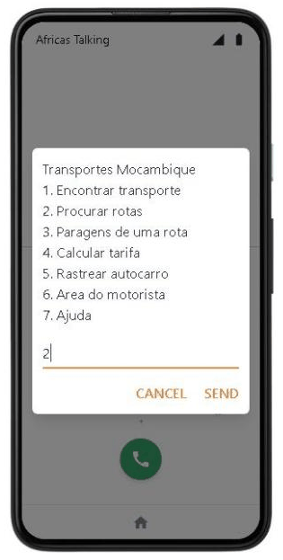

5. A opção 2 pede um local ou o número de uma rota. Escrever `combatentes` e **SEND**: aparecem as rotas activas que passam na Praça dos Combatentes, até 4 por página, cada uma começada pelo código (o número no autocarro). Com mais de 4, `7` mostra a página seguinte e `8` a anterior; `0` volta atrás. Quando só uma rota passa no local (por exemplo `museu`), o ecrã final aparece logo.
6. Escrever `1` escolhe a primeira rota. O ecrã final (`END`) fecha a [sessão](conceitos.md#sessao "Depois de entrar, o servidor dá uma prova de quem se é (um token), e o navegador mostra-a a cada pedido para não ter de pedir a palavra-passe outra vez."): carregar em **OK**.
7. Abrir as **mensagens**: o mesmo resultado chega por SMS de `AFRICASTKNG`.

Os ecrãs desta sessão, como o telemóvel os mostra (os mesmos de [Serviço USSD → 2 Procurar rotas](ussd.md#2-procurar-rotas)):

```text
text="2"                                  text="2*combatentes"                    text="2*combatentes*1"
CON Rotas de um local                     CON Rotas em Praca dos Combatentes:     END 411 Baixa - Praca dos Combatentes
Escreva o nome do local ou o numero       1. 411 Baixa - Praca dos Combatentes    De: P. Trabalhadores (411)
da rota (ex: Museu ou X19)                2. X22 Praca dos Combatentes - Zimpeto  Para: Praca dos Combatentes (X34)
0. Voltar                                 0. Voltar                               Paragens: 27
                                                                                  Distancia: 7.6 km
                                                                                  Tarifa (percurso todo): 77 MT
                                                                                  Em servico: 2 de 2
```

"Em servico: 2 de 2" quer dizer que a rota tem 2 autocarros e os motoristas dos dois iniciaram a viagem. Só os autocarros em serviço entram nas viagens e nos SMS ([Localização dos autocarros](localizacao-gps.md)).

Quando o nome escrito coincide com vários locais (por exemplo `igreja`: Igreja - Capuchinho e Igreja - Bombas-Xicanhanine), aparece primeiro uma lista para escolher um. Só contam as paragens das rotas activas: um nome que só existe em rotas desactivadas responde "Nenhuma rota ou paragem".


**"This session has expired".** O simulador acaba uma sessão quando uma resposta demora demasiado. Marcar outra vez e responder mais depressa.

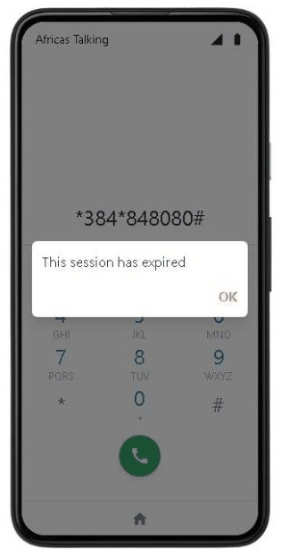

Notas:

- **O número é um passageiro real na produção.** O número do telemóvel simulado é o que a aplicação recebe como `phoneNumber`. As opções 2 a 5 e 7 só lêem. Na opção 1, "1. Acompanhar por SMS" grava um acompanhamento para esse número na [base de dados](conceitos.md#base-de-dados "O sítio organizado onde a plataforma guarda tudo o que tem de durar: rotas, paragens, veículos, contas.") de **produção** e envia-lhe SMS até ao destino. Usa-se um número de teste como `+25884000000x`. (Até Outubro de 2026, o ecrã da viagem criava também um passageiro sem palavra-passe; [Base de dados → Passageiros criados por USSD](base-de-dados.md#passageiros-criados-por-ussd-ainda-sem-palavra-passe) mostra como encontrar ou apagar esses.)
- **O menu do motorista.** Para testar a opção 6, liga-se com o número de telefone de um motorista e usa-se o PIN que o painel gerou para ele ([Painel → Dar um PIN a um motorista](painel-admin.md#tarefa-pin)).
- **Todas as opções.** Todos os menus, com os seus ecrãs, estão em [Serviço USSD → Árvore dos menus](ussd.md#árvore-dos-menus).

## Como um pedido é tratado

Em cada resposta, a AT envia um [`POST`](conceitos.md#get-e-post "GET pede para ver uma coisa; POST envia dados para o servidor fazer algo com eles.") em formulário para o URL do callback com `sessionId`, `serviceCode`, `phoneNumber`, `networkCode` e `text`. `text` tem todas as respostas até agora, juntas com `*`. A aplicação responde `text/plain` a começar por `CON` (mostrar e esperar resposta) ou `END` (mostrar e fechar).

O [servidor](conceitos.md#servidor "Um computador sempre ligado que recebe pedidos e responde a eles.") não guarda sessão. Repete `text` a partir do menu principal em cada pedido, por isso qualquer instância responde a qualquer tecla. Os passos no código são:

1. confirmar a chave;
2. repetir `text`, lendo cada tecla como o ecrã a que respondeu a pede;
3. as leituras da base de dados da opção;
4. o ecrã cortado a 182 caracteres [GSM-7](conceitos.md#gsm-7 "O conjunto de letras que todos os telemóveis mostram nos SMS e no USSD; não tem a maior parte das letras acentuadas.");
5. o SMS, depois da resposta.

Cada passo está em [Serviço USSD → O caminho de um pedido](ussd.md#o-caminho-de-um-pedido) e [Dentro do handler](ussd.md#dentro-do-handler).

## SMS

[`transport-client/lib/notifications.ts`](../transport-client/lib/notifications.ts) envia todos os SMS com o SDK `africastalking`:

- **Destinatário.** O telefone passa primeiro a `+258…` (`"84 123 4567"`, `"0841234567"` e `"258841234567"` dão todos `+258841234567`).
- **Remetente.** `from` é `AFRICASTALKING_SHORTCODE` quando está definido, senão o da AT por omissão.
- **Sem chave.** Sem `AFRICASTALKING_API_KEY`, nada se envia e o registo diz `SMS não enviado para … AFRICASTALKING_API_KEY não configurada`. Porquê: uma instalação local ou uma pré-visualização funciona sem enviar SMS reais.
- **Uma falha nunca pára um fluxo.** Um envio falhado fica registado (`Erro ao enviar SMS para …`) e o ecrã USSD ou a verificação de chegadas continua.

O que se envia:

| Quando | Mensagem | Onde |
|---|---|---|
| Opções 2 a 6 do USSD, no ecrã final | o conteúdo do ecrã | depois da resposta, com `waitUntil` ([Serviço USSD](ussd.md)) |
| Opção 1 do USSD, "Acompanhar por SMS" | a viagem inteira, e depois os avisos de cada etapa: autocarro a 15, 10 e 5 min, "está a chegar", 15, 10 e 5 min até sair, [transbordo](glossario.md#palavras-dos-ecrãs "Mudança de autocarro a meio de uma viagem"), destino | a verificação de chegadas ([Fluxos de dados → Os avisos de uma viagem acompanhada](fluxos-de-dados.md#os-avisos-de-uma-viagem-acompanhada)) |
| Alerta de paragem (web) | "Autocarro {matrícula} (rota {código}) chega a {paragem} em {n} min." | a verificação de chegadas ([Fluxos de dados](fluxos-de-dados.md#alerta-de-chegada-e-sms)) |
| Um motorista inicia ou termina uma viagem pelo USSD | "Viagem iniciada com sucesso! Veiculo: … Bons trabalhos!" / "Viagem encerrada com sucesso. …" | opção 6 do USSD |

**No sandbox**, as mensagens só chegam aos telemóveis abertos no simulador. A API de mensagens do sandbox às vezes é lenta e pode responder "The server was not able to produce a timely response" sem nada estar errado do lado da plataforma. O envio fica então registado como erro e não se repete, e a mensagem pode chegar na mesma.

## Testar os avisos por SMS no simulador

Os avisos só saem para autocarros em viagem, por isso primeiro um motorista inicia a viagem.

1. **Iniciar a viagem de um autocarro.** Entrar no [portal do motorista](https://transport-mz-driver.vercel.app) com o telefone e o PIN de um motorista de uma das rotas activas ([Painel → Dar um PIN a um motorista](painel-admin.md#tarefa-pin)) e carregar em **Iniciar viagem**. O cartão "Os passageiros vêem" passa a "Em circulação". (No simulador, o mesmo faz-se com o número desse motorista: `6`, o PIN, `1`, `1`.)
2. **Pedir a viagem como passageiro.** No simulador, com um número de teste, marcar `*384*848080#`, escrever `1`, depois a origem e o destino (por exemplo `xipamanine` e `zimpeto`), escolhendo nas listas quando aparecem.
3. **Acompanhar.** No ecrã da viagem, escrever `1` ("Acompanhar por SMS"). O ecrã final diz que os avisos vão chegar.
4. **Ver os SMS.** Abrir as **mensagens** do simulador: chega a viagem, e depois um SMS a cada passo. Com a verificação a cada minuto configurada ([abaixo](#verificação-de-chegadas-a-cada-minuto)), os avisos de 15, 10 e 5 minutos chegam a horas; sem ela, chegam quando alguém usa a web, o USSD ou o portal.

Para ver um aviso "deixou de circular", terminar a viagem do autocarro anunciado no portal enquanto o passageiro espera.

## Verificação de chegadas a cada minuto

Os avisos de 15, 10 e 5 minutos precisam que a verificação de chegadas corra pelo menos a cada minuto. O [agendamento](conceitos.md#agendamento "Uma tarefa que corre sozinha a uma hora marcada, ou de tantos em tantos minutos.") do [GitHub Actions](conceitos.md#ci "Verificações que o GitHub corre sozinho a cada pull request, para nenhum erro conhecido chegar ao main.") não chega (em Outubro de 2026 corria a cada 40 a 50 minutos), e o plano Hobby da Vercel só permite cron jobs diários. Um serviço gratuito de pedidos agendados resolve-o. Com o [cron-job.org](https://cron-job.org):

1. Criar uma conta em [console.cron-job.org/signup](https://console.cron-job.org/signup) e confirmar o email.
2. Carregar em **CREATE CRONJOB**.
3. **Title:** `Verificação de chegadas`. **URL:** `https://transport-mz.vercel.app/api/simulation`.
4. **Execution schedule:** "Every minute".
5. Abrir o separador **ADVANCED**:
   - **Request method:** `POST`;
   - **Headers:** juntar `Content-Type` com o valor `application/json`;
   - **Request body:** `{"action":"check"}`.
6. Carregar em **TEST RUN**: a resposta deve ser 200 com `"success":true`. Depois **CREATE**.

O que faz: chama a mesma verificação que o GitHub Actions chama, mas a cada minuto ([Fluxos de dados → O que dispara a verificação](fluxos-de-dados.md#o-que-dispara-a-verificação)). Porquê é seguro: a verificação é a mesma para quem a chamar e nunca envia o mesmo aviso duas vezes, por isso chamá-la a mais só gasta um pouco de tempo de servidor. Para parar, desligar o cronjob no cron-job.org.

## Registos e sessões

**Do lado da AT:** USSD → **Sessions** lista cada sessão com o número de passos, a duração e o estado. "Incomplete" quer dizer que o telemóvel saiu da sessão antes de um ecrã `END`, ou que o callback não respondeu a tempo.

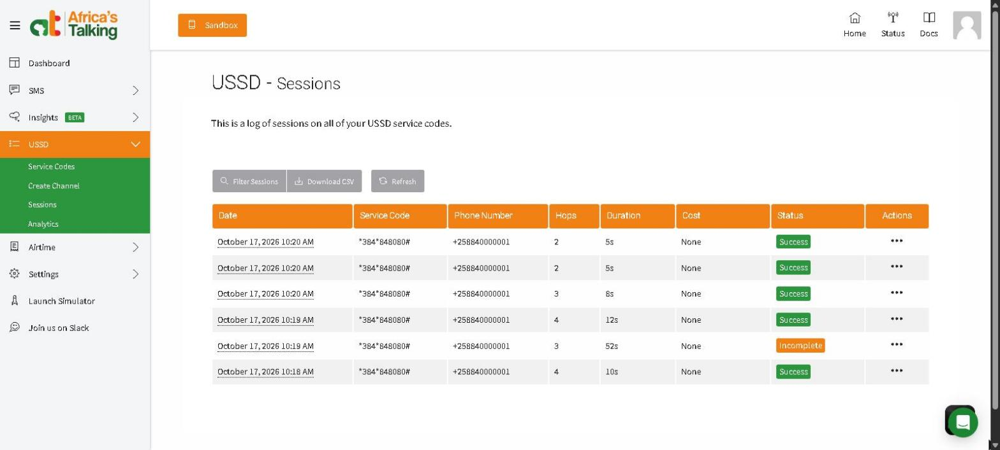

**Do lado da plataforma:** na Vercel, **transport-mz → Logs**, pesquisar `/api/ussd` ([Guia da Vercel → Registos](guia-vercel.md#registos)). Aparecem:

- um `POST` por tecla, com o seu `USSD Response`;
- os pedidos recusados por falta da chave (403, "USSD pedido recusado");
- os resultados dos SMS;
- clicar numa linha mostra o `USSD Request` que registou.

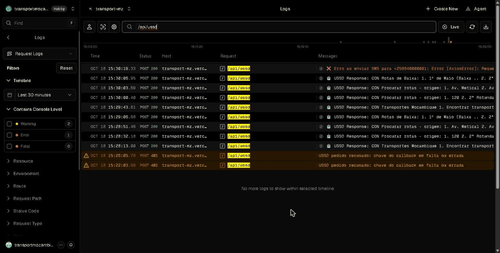

Os detalhes de um pedido na Vercel também mostram os [parâmetros](conceitos.md#parametros "As três formas de um pedido levar informação: no endereço, no conteúdo, ou em etiquetas à parte.") do URL, por isso a chave do callback fica visível a quem puder ler os registos do projecto. O acesso aos registos dá-se só a quem pode saber a chave, e não se fazem capturas dos detalhes de um pedido.

## Passar a produção

O código não precisa de mudar para ir ao vivo; a conta e a configuração sim. Por ordem:

1. **Cobertura.** Confirmar com a AT que o USSD e os SMS estão disponíveis nas redes moçambicanas pretendidas (Vodacom, Movitel, Tmcel), e com que tipo de código. Isto não estava confirmado quando esta página foi escrita.
2. **Aplicação de produção.** Na página inicial da AT, criar uma **Team**, e uma aplicação dentro dela. Apontar o nome de utilizador e gerar a chave da API.
3. **Código USSD.** Pedir um código USSD para essa aplicação (um código dedicado do regulador ou do operador, ou um canal num código partilhado). Pôr o URL do callback em `https://transport-mz.vercel.app/api/ussd?key=<USSD_CALLBACK_KEY>`.
4. **Remetente (opcional).** Pedir um remetente alfanumérico ou um código curto para os SMS, e pôr `AFRICASTALKING_SHORTCODE` com ele.
5. **Crédito.** Carregar a carteira da aplicação: as sessões USSD e os SMS ao vivo são pagos.
6. **Vercel.** Em `transport-mz`, pôr `AFRICASTALKING_USERNAME` com o nome de utilizador da aplicação e `AFRICASTALKING_API_KEY` com a sua chave, só em **Production** (as pré-visualizações ficam sem chave, para nunca enviarem SMS reais). Publicar outra vez ([Publicação](publicacao.md)).
7. **Testar** com um telemóvel real em cada rede: o menu principal, uma opção de cada tipo, um SMS de chegada e uma viagem de motorista.
8. **Limpar.** Revogar as chaves da API de contas que já não se usam ([Segurança → Mudar segredos](seguranca.md#mudar-segredos)).

<!-- navegação-fim: gerada por .github/scripts/docs-nav.py -->

---

Anterior: [Guia da Neon](guia-neon.md) · [Índice](README.md) · Seguinte: [Testes](testes.md)
<!-- /navegação-fim -->
