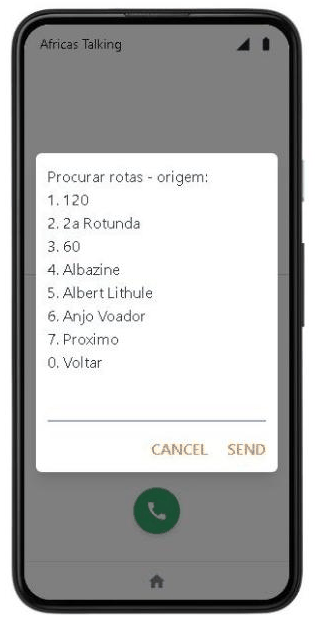
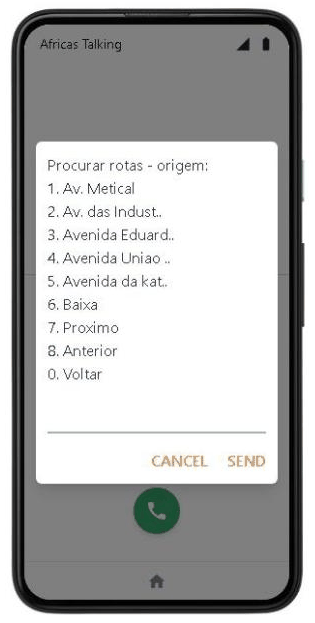
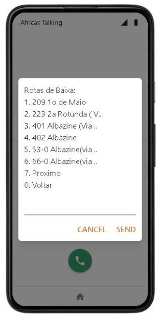
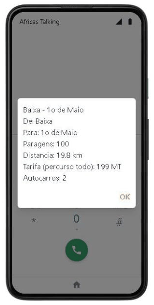
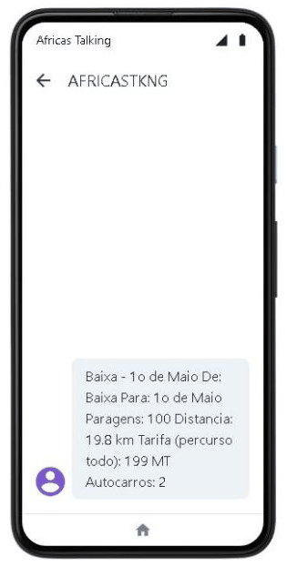

# Africa's Talking

[Africa's Talking](https://africastalking.com) (AT) is the gateway between phone networks and the platform. It carries two things:

- **USSD:** a phone dials the service code, and AT relays every keypress to `POST /api/ussd` on the passenger app ([USSD service](ussd.md)).
- **SMS:** the passenger app sends USSD results, arrival alerts and driver trip confirmations through AT's SMS API.

The platform runs on the **sandbox** today. Sandbox USSD and SMS only reach AT's web simulator, not real phones. This page shows:

- how the account was set up, step by step;
- how to use the USSD menu in the simulator, screen by screen;
- how a request reaches the code;
- where to read the logs;
- what going live involves.

**On this page:** [Current setup](#current-setup) · [How it was set up, step by step](#how-it-was-set-up-step-by-step) · [Use the menu in the simulator](#use-the-menu-in-the-simulator) · [How a request is handled](#how-a-request-is-handled) · [SMS](#sms) · [Logs and sessions](#logs-and-sessions) · [Going live](#going-live)

---

## Current setup

| Item | Value |
|---|---|
| AT account | the `transportmozambique` account |
| App | Sandbox, username `sandbox` |
| USSD service code | `*384*848080#` (channel `848080` on the shared sandbox code `*384#`) |
| Callback URL | `https://transport-mz.vercel.app/api/ussd?key=<USSD_CALLBACK_KEY>`. Requests without the key get 403 (since 2026-10-17). |
| Vercel project `transport-mz` | `AFRICASTALKING_USERNAME=sandbox`, `AFRICASTALKING_API_KEY` (sandbox key), `USSD_CALLBACK_KEY` (Secret, Production) |
| Sender ID (`AFRICASTALKING_SHORTCODE`) | not set: SMS go out from AT's default sender (`AFRICASTKNG` in the simulator) |
| Verified | USSD menus and SMS end to end in the simulator, 2026-10-18 |
| Live (real phones in Mozambique) | not set up ([Going live](#going-live)) |

## How it was set up, step by step

The order matters: the API key and the callback key go into Vercel before the channel points at the app, so the first request already finds them.

### 1. Sign in

Go to [account.africastalking.com](https://account.africastalking.com) and sign in, or **Register** to create an account.


### 2. Open the sandbox app

The home page offers **Go To Sandbox App** for free testing, and **Teams** for production apps. Each app has its own username and API key. The sandbox's username is `sandbox`.


### 3. Generate the API key

In the sandbox app: **Settings → API Key**.
1. Enter the account's password and click **Request**.
2. AT emails a link to the account's address. Open it to generate the key.

Then:
- The key is shown once: copy it straight into Vercel (next step), not into a file or a chat.
- Generating a new key invalidates the previous one.
- A fresh key can take a few minutes before the API accepts it. Until then AT answers "The supplied authentication is invalid".

### 4. Put the keys in Vercel

Open the Vercel project **transport-mz** → **Settings → Environment Variables** ([Vercel, step by step](vercel-guide.md#environment-variables)):


Click **Add Environment Variable** and add, for **Production**:

| Key | Type | Value |
|---|---|---|
| `AFRICASTALKING_USERNAME` | Config | `sandbox` (the app's username) |
| `AFRICASTALKING_API_KEY` | **Secret** | the key from step 3 |
| `USSD_CALLBACK_KEY` | **Secret** | a long random value, for example the output of `openssl rand -hex 32` |


A **Secret** cannot be read again after saving, not even by the project's members. Keep a copy of `USSD_CALLBACK_KEY` until step 5 uses it, then delete the copy.

### 5. Create the USSD channel

Back in AT's sandbox app: **USSD → Create Channel**.
- Pick the shared code `*384#` and a free channel number (here `848080`).
- Enter the callback URL with the key:

  ```text
  https://transport-mz.vercel.app/api/ussd?key=<USSD_CALLBACK_KEY>
  ```


**USSD → Service Codes** then lists the channel and its callback. The screenshot below was taken before the key was added; the URL now ends with `?key=…`.


AT offers two kinds of service code:
- **Dedicated** codes such as `*144#`, issued by the regulator or the operator;
- **Shared** codes such as `*384*848080#`: a channel number on AT's code. The sandbox only supports these.

A preview deployment's URL also works as a callback, to test a branch before merging. Put the production URL back afterwards.

### 6. Redeploy

Vercel functions read environment variables when they are deployed. In **transport-mz → Deployments**, open the menu (**⋯**) of the newest Production deployment and click **Redeploy** ([Vercel → Redeploy](vercel-guide.md#deployments)).

### 7. Test

- In the [simulator](#use-the-menu-in-the-simulator), the main menu appears.
- Without the key, the endpoint refuses:

  ```bash
  curl -s -o /dev/null -w "%{http_code}\n" -X POST https://transport-mz.vercel.app/api/ussd -d "text="
  # 403
  ```

When changing the key later, change the variable and the callback URL together, then redeploy ([Security → USSD callback](security.md#ussd-callback)).

## Use the menu in the simulator

The simulator needs no account. Every screen below is a real answer from production, on 2026-10-18.

1. Open the [simulator](https://developers.africastalking.com/simulator). Choose Mozambique (+258) at the flag if it is not already chosen, type a test number (here `84 000 0001`) and press **Connect**.
2. On the phone's home screen, tap the **phone** (left) to dial; the **messages** (middle) hold the SMS.
3. Dial `*384*848080#` on the keypad and press the green button.

  

4. The main menu appears. Type the option's number in the field at the bottom (here `2`, Procurar rotas) and press **SEND**.
5. Option 2 lists the places routes start from, 6 a page. `7` shows the next page, `8` the previous one, `0` goes back.

   

6. On page 2, `6` chooses Baixa. The routes from there start with their code, the number on the bus.
7. `1` chooses route 209. The final screen (`END`) closes the session: press **OK**.
8. Open **messages**: the same result arrives as an SMS from `AFRICASTKNG`.

  

**"This session has expired".** The simulator ends a session when an answer takes too long. Dial again and answer more quickly.


Notes:
- **The number is a real passenger in production.** The simulated phone number is what the app receives as `phoneNumber`. Options 2 to 5 and 7 only read. Option 1's result creates a passwordless passenger for that number and an arrival alert in the **production** database. Use a test number such as `+25884000000x`, and see [Database](database.md#passengers-created-by-ussd-no-password-yet) to find or remove what it created.
- **The driver menu.** To test option 6, connect with a driver's phone number and use the PIN the admin generated for that driver ([Admin dashboard → Drivers](admin-dashboard.md#drivers-motoristas)).
- **Every option.** All menus, with their screens, are in [USSD service](ussd.md#menu-tree).

## How a request is handled

For each answer, AT sends a form-encoded `POST` to the callback URL with `sessionId`, `serviceCode`, `phoneNumber`, `networkCode` and `text`. `text` holds every answer so far, joined with `*`. The app answers `text/plain` beginning with `CON` (show and wait for an answer) or `END` (show and close).

The server keeps no session. It replays `text` from the main menu on every request, so any instance can answer any keypress. The steps in the code are:
1. key check;
2. replay of `text`;
3. the option's database reads;
4. the screen cut to 182 GSM-7 characters;
5. the SMS after the answer.

Each step is in [USSD service → Inside the handler](ussd.md#inside-the-handler).


## SMS

`transport-client/lib/notifications.ts` sends every SMS with the `africastalking` SDK:

- **Recipient.** The phone is normalised to `+258…` first (`"84 123 4567"`, `"0841234567"` and `"258841234567"` all become `+258841234567`).
- **Sender.** `from` is `AFRICASTALKING_SHORTCODE` when it is set, otherwise AT's default.
- **No key.** Without `AFRICASTALKING_API_KEY`, nothing is sent and the log says `SMS não enviado para … AFRICASTALKING_API_KEY não configurada`.
- **Failures never break a flow.** A failed send is logged (`❌ Erro ao enviar SMS para …`) and the USSD screen or arrival check carries on.

What is sent:

| Trigger | Message | Where |
|---|---|---|
| USSD options 1 to 6, on the final screen | the screen's content (option 1 only when asked) | after the response, with `waitUntil` ([USSD](ussd.md)) |
| Arrival alert | "Autocarro {matrícula} está a {n} minutos da {paragem}!" | the arrival check ([Data flow](data-flow.md#arrival-alert-and-sms)) |
| Driver starts or ends a trip on USSD | "Viagem iniciada com sucesso! Veiculo: … Bons trabalhos!" / "Viagem encerrada com sucesso. …" | USSD option 6 |

**In the sandbox**, messages only reach phones open in the simulator. AT's sandbox messaging API is sometimes slow and can answer "The server was not able to produce a timely response" without anything being wrong on the platform's side. The send is then logged as an error and not retried, and the message may still arrive.

## Logs and sessions

**AT side:** USSD → **Sessions** lists every session with its number of hops, duration and status. "Incomplete" means the phone left the session before an `END` screen, or the callback did not answer in time.


**Platform side:** in Vercel, **transport-mz → Logs**, search for `/api/ussd` ([Vercel → Logs](vercel-guide.md#logs)). You will see:
- one `POST` per keypress, with its `📤 USSD Response`;
- requests refused for a missing key (403, "USSD pedido recusado");
- SMS results;
- clicking a row shows the `📱 USSD Request` it logged.


The request details in Vercel also show the URL's search parameters, so the callback key is visible to anyone who can read the project's logs. Give log access only to people who may know the key, and do not screenshot a request's details.

## Going live

The code needs no change to go live; the account and configuration do. In order:

1. **Coverage.** Confirm with AT that USSD and SMS are available on the Mozambican networks you need (Vodacom, Movitel, Tmcel), and on which kind of code. This was not confirmed at the time of writing.
2. **Production app.** On the AT home page, create a **Team**, then an app in it. Note its username, and generate its API key.
3. **Service code.** Request a USSD code for that app (a dedicated code from the regulator or operator, or a channel on a shared code). Set its callback URL to `https://transport-mz.vercel.app/api/ussd?key=<USSD_CALLBACK_KEY>`.
4. **Sender ID (optional).** Request an alphanumeric sender ID or short code for SMS, then set `AFRICASTALKING_SHORTCODE` to it.
5. **Credit.** Top up the app's wallet: live USSD sessions and SMS are billed.
6. **Vercel.** In `transport-mz`, set `AFRICASTALKING_USERNAME` to the app's username and `AFRICASTALKING_API_KEY` to its key, for **Production** only (keep previews keyless so they never send real SMS). Redeploy ([Deployment](deployment.md)).
7. **Test** with a real phone on each network: the main menu, one option of each kind, an arrival SMS, and a driver trip.
8. **Clean up.** Revoke API keys of accounts no longer used ([Security → Rotating secrets](security.md#rotating-secrets)).

---

[← Admin dashboard](admin-dashboard.md) · [Documentation index](README.md) · Next: [Viewing the data in Neon →](neon-guide.md)
