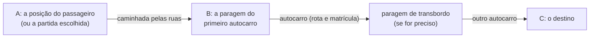

# Aplicação dos passageiros

<!-- navegação: gerada por .github/scripts/docs-nav.py, não editar à mão -->
[Documentação](README.md) › 4. Usar as aplicações › **Aplicação dos passageiros** (página 16 de 26)

Anterior: [Mapa do código](mapa-do-codigo.md) · [Índice](README.md) · Seguinte: [Portal do motorista](portal-motorista.md)

Todas as páginas

- 0. Começar do zero: [Conceitos básicos](conceitos.md) · [Preparar o computador](preparar-o-computador.md)
- 1. Conhecer o projecto: [Visão geral](visao-geral.md) · [Glossário](glossario.md) · [Fontes de dados](fontes-de-dados.md) · [Estado do projecto](estado-do-projecto.md)
- 2. Montar localmente: [Primeiros passos](primeiros-passos.md) · [Base de dados](base-de-dados.md) · [Configuração](configuracao.md)
- 3. Perceber como funciona: [Fluxos de dados](fluxos-de-dados.md) · [Localização e GPS](localizacao-gps.md) · [Serviço USSD](ussd.md) · [Segurança](seguranca.md) · [Referência da API](referencia-api.md) · [Mapa do código](mapa-do-codigo.md)
- 4. Usar as aplicações: **Aplicação dos passageiros** · [Portal do motorista](portal-motorista.md) · [Painel de administração](painel-admin.md)
- 5. Pôr online: [Publicação](publicacao.md) · [Guia da Vercel](guia-vercel.md) · [Guia da Neon](guia-neon.md) · [Africa's Talking](africas-talking.md) · [Guia do cron-job.org](guia-cron-job.md)
- 6. Manter: [Testes](testes.md) · [Resolução de problemas](resolucao-de-problemas.md) · [Limitações](limitacoes.md)

<!-- /navegação -->

> **Em palavras simples:** O site dos passageiros: um mapa com os autocarros, onde se escolhe de onde se parte e para onde se vai, e se recebem as opções de viagem com a hora de chegada e o preço. Esta página mostra cada ecrã, passo a passo, com imagens.

| | |
|---|---|
| Ao vivo | https://transport-mz.vercel.app |
| Localmente | http://localhost:3000 ([Primeiros passos](primeiros-passos.md#7-correr-as-aplicações)) |
| Código | [`transport-client/app`](../transport-client/app); o mapa é [`TripPlanner.tsx`](../transport-client/app/components/TripPlanner.tsx) |

Funciona como uma aplicação de boleias (Uber, Bolt, Yango), mas para os transportes públicos. A partida é a posição do passageiro, ou um local escolhido. A aplicação lista todos os locais a que se chega a partir dali, pela hora a que se chegaria, e diz a que paragem ir a pé para o primeiro autocarro. Escolhido um destino C, a viagem aparece como **A → B → C**:

- **A** é onde o passageiro está;
- **B** é a paragem onde apanha o primeiro autocarro;
- **C** é onde sai, com as mudanças de autocarro pelo meio quando um só não chega.

Porquê assim: quem usa os [chapas](glossario.md#transportes-em-maputo "Os minibuses que levam a maior parte dos passageiros de Maputo") sabe para onde quer ir, mas muitas vezes não sabe que rota apanhar nem onde. Começar pelos destinos alcançáveis responde às duas perguntas de uma vez.

Pode-se acompanhar o autocarro até chegar, e guardar uma paragem para receber um [SMS](conceitos.md#sms "As mensagens de texto curtas dos telemóveis.") quando um autocarro estiver perto. Ver o mapa e planear não precisam de conta; guardar alertas e a página da conta precisam. Cada ecrã abaixo é seguido dos pedidos que faz. Os formatos completos estão na [Referência da API](referencia-api.md#aplicação-dos-passageiros-transport-client).

**Nesta página:** [Passo a passo](#passo-a-passo) · [O mapa](#o-mapa--e-search) · [Partida e destinos](#partida-e-destinos) · [Paragens perto](#paragens-perto) · [Os destinos de uma paragem](#os-destinos-de-uma-paragem) · [Viagens](#viagens) · [Acompanhar uma viagem](#acompanhar-uma-viagem-viagem) · [Conta e entrada](#conta-e-entrada) · [Página da conta e alertas](#página-da-conta-e-alertas-user-info) · [O que o navegador guarda](#o-que-o-navegador-guarda)

---

## Passo a passo

Estas capturas foram feitas a conduzir a aplicação num [navegador](conceitos.md#navegador "O programa com que se abrem sites: Chrome, Firefox, Edge, Safari.") ([Playwright](conceitos.md#testes "Programas que experimentam as aplicações sozinhos e avisam quando algo deixou de funcionar.")) contra uma cópia da [base de dados](conceitos.md#base-de-dados "O sítio organizado onde a plataforma guarda tudo o que tem de durar: rotas, paragens, veículos, contas."), às 07:40 de um dia útil, com a posição a poucos passos da paragem Portão.

**1. Abrir a aplicação.** O navegador pede a localização. O painel mostra então:

- **Partida**: "A sua localização";
- **Para onde ir**: todos os locais alcançáveis, a chegada mais cedo primeiro.

Cada linha diz onde apanhar o primeiro autocarro ("Apanhe em Portão · 70 m a pé"), "Directo" ou quantos autocarros leva, as rotas, a hora de chegada e os minutos a partir de agora.

**2. Escolher um destino**, da lista ou escrevendo em "Para onde quer ir?". Os resultados mostram a distância de cada local à partida.

**3. Ver a viagem: A → B → C.** Mostra a caminhada até à paragem (A → B), o autocarro com a matrícula, quando vem, e onde e quando sair (B → C). O mapa desenha a caminhada a tracejado pelas ruas e o autocarro na cor da sua rota. As outras opções ficam por baixo, a chegada mais cedo primeiro.

**4. Acompanhar a viagem.** "Acompanhar viagem" abre a viagem inteira num só mapa:

- a posição do passageiro;
- a caminhada até à paragem, a tracejado pelas ruas;
- cada troço de autocarro na cor da sua rota;
- todos os autocarros da viagem, a andar.

O cartão escuro diz o que fazer agora: "Caminhe até Portão", depois "Espere em Portão" com os minutos até o autocarro chegar, depois "Saia em Makalela às …" já a bordo. Todos os passos aparecem por baixo, com as horas ao vivo.

**5. Destinos que levam mais de um autocarro** estão na mesma lista ("2 autocarros", com o código de cada rota). "Ver mais destinos" mostra mais.

Ao abrir um, aparece cada autocarro à vez: caminhar até à primeira paragem, seguir até à mudança, esperar lá o autocarro seguinte, e continuar. Todas as horas são calculadas para o momento em que se chega a cada paragem.

**6. Partir de outro sítio.** Tocar em **Partida** e escrever uma paragem ou um local. A lista de destinos passa a ser calculada a partir dali, e cada linha diz onde apanhar o primeiro autocarro: uma das paragens desse local, para a viagem começar num autocarro e não com uma caminhada.

"A sua localização" (por baixo do campo Partida) volta a pôr a partida na posição do passageiro.

**7. As paragens perto.** O separador "Paragens perto" lista-as. Tocar numa mostra tudo o que essa paragem alcança, e as suas rotas ([Os destinos de uma paragem](#os-destinos-de-uma-paragem)).

Num telemóvel, o painel é uma folha em baixo, por cima do mapa. Arrastar o topo para cima enche o ecrã inteiro (o mapa esconde-se; o título e "Voltar" passam para a folha); arrastar para baixo deixa ver só o topo. Um toque na barra do topo sobe-a um nível, ou volta a meio ecrã a partir do ecrã inteiro. Porquê uma folha: num ecrã pequeno, o mapa e a lista não cabem lado a lado, e a folha deixa escolher quanto de cada se vê.

  

## O mapa (`/` e `/search`)

`/` e `/search` são a mesma página ([`app/components/TripPlanner.tsx`](../transport-client/app/components/TripPlanner.tsx)); `/search` é para onde levam a entrada e o registo. O cartão do título mostra o número de autocarros e "Entrar", ou o avatar do passageiro com [sessão](conceitos.md#sessao "Depois de entrar, o servidor dá uma prova de quem se é (um token), e o navegador mostra-a a cada pedido para não ter de pedir a palavra-passe outra vez.").

- **Autocarros.** Cada autocarro na posição de agora: a posição [GPS](conceitos.md#gps "O sistema de satélites com que um telemóvel ou um aparelho sabe as suas coordenadas.") real quando é recente, senão a posição pela viagem do motorista ([Localização e GPS](localizacao-gps.md#como-se-escolhe-uma-posição)). Um autocarro cujo motorista não iniciou a viagem fica parado, mais claro, com o estado "Fora de serviço". Os marcadores deslizam para a posição nova a cada 5 segundos. Tocar num autocarro desenha a sua rota e abre um cartão com "Acompanhar".
- **A posição do passageiro.** O navegador pede a localização ao abrir a página. Com ela, o mapa centra-se no passageiro uma vez, e um pino azul segue-o: mostra as iniciais com sessão, senão um ícone de pessoa. O botão redondo em baixo à direita volta a centrar o mapa, ou pede outra vez depois de uma recusa. As posições a mais de 80 km de Maputo não centram o mapa (porquê: quem testa a partir de outro país veria um mapa vazio).
- **Paragens.** Todas as paragens estão no mapa em todos os níveis de zoom, e tocar numa abre-a:
  - as paragens perto do passageiro são pontos verdes;
  - as paragens onde passam autocarros são pontos brancos;
  - as paragens que nenhum autocarro serve agora (nenhuma das suas rotas tem veículo) são cinzentas. A sua página diz isso, e não aparecem na pesquisa nem na lista das perto.
- **O painel** é um cartão à esquerda num computador, com o título (número de autocarros, "Entrar" ou o avatar) no topo. Num telemóvel é a folha de três alturas: em baixo (só o topo), meio ecrã e ecrã inteiro ([`app/components/Sheet.tsx`](../transport-client/app/components/Sheet.tsx)).

| Quando | Pedido |
|---|---|
| A página abre | `GET /api/stops` (todas as paragens servidas, com as rotas, e as que nenhum autocarro serve agora; em cache 5 min) |
| A página abre | `GET /api/buses?fields=map` (todos os autocarros: matrícula, nome da rota, posição, estado; cerca de 20 KB) |
| Toca-se num autocarro | `GET /api/bus/{id}` (a linha da rota, desenhada no mapa; guardada para o toque seguinte) |
| A cada 5 s | `GET /api/buses?fields=position` (leve: id, [latitude](conceitos.md#coordenadas "Dois números que dizem onde está um ponto na Terra."), longitude, fonte, rumo; também faz a verificação dos SMS de chegada) |

Porquê dois pedidos de autocarros: a primeira carga traz o que cada marcador mostra; depois, a cada 5 s, só as coordenadas, para gastar poucos dados numa ligação móvel.

## Partida e destinos

O topo do painel tem dois campos:

- **Partida** é onde a viagem começa. É "A sua localização" quando a posição é conhecida. Tocar nela deixa escrever uma paragem ou um local; a lista diz a distância de cada resultado. "A sua localização" volta a pôr a posição, e "Cancelar" mantém a partida actual. A partida escolhida fica marcada no mapa, e o mapa vai até ela.
- **"Para onde quer ir?"** procura todas as paragens pelo nome, sem acentos nem maiúsculas, com a mesma pesquisa tolerante do [USSD](conceitos.md#ussd "Os menus que aparecem num telemóvel quando se marca um código como *384*848080#; funcionam em qualquer telemóvel, sem internet.") ([Serviço USSD → Pesquisa tolerante](ussd.md#pesquisa-tolerante)): "av ind" encontra "Av. das Indústrias", "chipamanine" encontra "Xipamanine". As paragens com o mesmo nome a menos de 400 m contam como um local. Um número de rota entre parênteses no fim do nome não conta, por isso as 41 baias do [terminal](conceitos.md#terminal "A janela onde se escrevem instruções para o computador em texto, em vez de clicar.") do Museu ("Museu (X39)", "Museu (109)", …) são um só "Museu"; a viagem ainda diz a baia onde entrar. Cada resultado mostra a distância à partida, e o nome da rota quando dois locais têm o mesmo nome. Código: [`lib/places.ts`](../transport-client/lib/places.ts).

Por baixo, o separador **"Para onde ir"** lista todos os locais alcançáveis a partir da partida com até 4 autocarros, a chegada mais cedo primeiro. Cada linha tem:

- **onde apanhar o primeiro autocarro**: "Apanhe em Portão · 70 m a pé". A partir da posição do passageiro, é a paragem a menos de 800 m de onde se chega mais cedo, contando a caminhada. Quando o mesmo autocarro passa numa paragem mais perto no máximo 2 minutos depois, escolhe-se a mais perto (porquê: 2 minutos de espera valem menos do que uma caminhada mais longa). A partir de um local ou de uma paragem escolhidos, é esse local ou paragem: o primeiro autocarro apanha-se lá.
- "Directo", ou quantos autocarros leva ("2 autocarros");
- os códigos das rotas, nas suas cores;
- a chegada ("Chega 07:54", "Chega amanhã 05:37") e o tempo a partir de agora.

Mostram-se os primeiros 25, e "Ver mais destinos" junta 50 de cada vez. Os locais a uma caminhada curta da partida ficam de fora.

Escolher um destino, da lista ou da pesquisa, planeia a viagem a partir da partida. Sem posição e sem partida escolhida, a lista de destinos não aparece; a pesquisa planeia então a partir da paragem mais perto do centro do mapa.

| Quando | Pedido |
|---|---|
| Posição conhecida, ou partida escolhida | `GET /api/destinos?lat=…&lng=…` (outra vez depois de cerca de 100 m) ou `GET /api/destinos?from={ids das paragens}` |

## Paragens perto

**"Onde vai apanhar o autocarro?"**: as paragens onde se pode apanhar um autocarro. O painel lista até 8 paragens a menos de 1,5 km, a mais perto primeiro, com a distância, o tempo a pé (4,5 km/h, mais um quarto pelas ruas) e o número de rotas. Sem nenhuma tão perto, lista as 3 mais próximas em "Paragens mais próximas", com uma linha a dizer que nenhuma está a menos de 1,5 km, e sem tempos a pé. Com uma partida escolhida, a lista é sobre essa partida ("Paragens perto da partida"). Sem posição (recusada, indisponível, ou longe de Maputo), a lista é sobre o centro do mapa e segue-o quando se move o mapa, com uma linha a dizer porquê. Esta lista é o segundo separador, "Paragens perto", quando há partida.

## Os destinos de uma paragem

Tocar numa paragem (na lista ou no mapa) mostra:

- o nome, o número de rotas e, com posição, a distância ao passageiro; "Apanhe o autocarro aqui" lembra que é aqui que se entra;
- a Partida (esta paragem) e a pesquisa de destino, onde cada resultado diz **"Directo"** (um autocarro desta paragem vai lá) ou **"Com [transbordo](glossario.md#palavras-dos-ecrãs "Mudança de autocarro a meio de uma viagem")"** (precisa de uma mudança). Mudar a Partida aqui faz da nova partida a partida do painel;
- **"Todos os destinos"** (o primeiro separador): todos os locais alcançáveis desta paragem com até 4 autocarros, pela ordem a que se chegaria.
  - Cada linha tem a chegada ("Chega 10:17", "Chega amanhã 05:37") e o tempo a partir de agora.
  - Mostra "Directo", ou quantos autocarros leva ("3 autocarros"), e os códigos dessas rotas nas suas cores.
  - Mostram-se os primeiros 25; "Ver mais destinos" junta 50 de cada vez.

  Tocar numa linha abre essa viagem: a chegada é a mesma da linha, ou mais cedo.
- **"Por rota"** (o segundo separador): todas as rotas que passam na paragem, com um cabeçalho na cor da rota. Para cada sentido ("Sentido Antena"):
  - a chegada do próximo autocarro ("Próximo autocarro 27 min", "às 17:58", "amanhã às 05:12");
  - a matrícula, desenhada como uma chapa à direita, para ser fácil de comparar com o autocarro na rua ([`Plate.tsx`](../transport-client/app/components/Plate.tsx));
  - as paragens para onde vai, por ordem, numa linha na cor da rota; cada uma tem um botão "Ir".

  Paragens seguidas com o mesmo nome aparecem uma vez; "Ver as N paragens" mostra-as todas.

Tocar numa dessas paragens, ou num resultado da pesquisa, planeia a viagem a partir desta paragem.

| Quando | Pedido |
|---|---|
| Abre-se a paragem | `GET /api/stops/{id}` |

## Viagens

O topo do painel mostra a Partida e o destino. Seguem-se até três opções, a chegada mais cedo primeiro.

- A partir de uma paragem ou de um local escolhido, todas as opções apanham o primeiro autocarro lá: directo ao destino, ou até à paragem da mudança. Só quando nenhum autocarro de lá chega ao destino é que as opções começam com uma caminhada até uma paragem perto, e uma nota diz isso ("Nenhum autocarro de Pandora chega lá…").
- A partir da posição do passageiro, a viagem começa com a caminhada até à melhor paragem.
- Quando outra opção leva o mesmo número de autocarros, tem menos caminhada e chega no máximo 2 minutos depois, vem primeiro. Normalmente é o mesmo autocarro apanhado numa paragem mais perto, e é o que a lista de destinos mostrava.

Cada cartão mostra a chegada ("Chega às 16:51", ou "Chega amanhã às 06:32"), a tarifa total, "Directo" ou o número de mudanças ("2 transbordos"), o tempo total a partir de agora e a distância a pé, e as rotas em etiquetas coloridas. A opção escolhida fica desenhada no mapa: cada autocarro na cor da sua rota, as caminhadas a tracejado pelas ruas ([Caminhadas pelas ruas](#caminhadas-pelas-ruas)), e só os autocarros dessa viagem ficam no mapa.

A opção escolhida lista os seus passos:

- **Caminhadas**: "Caminhe 100 m (2 min) até Portão", da posição do passageiro até à primeira paragem, entre duas paragens para mudar de autocarro (até 400 m), ou a partir da última paragem.
- **Autocarros**: a rota e o sentido, com a matrícula como uma chapa à direita; onde e quando apanhar ("Apanhe em Portão às 16:47 (daqui a 5 min)", e nos autocarros seguintes a espera na paragem: "espera 35 min"); onde e quando sair; o número de paragens, o tempo a bordo, a distância e a tarifa. "Acompanhar viagem" por baixo dos passos acompanha a viagem inteira, todos os seus autocarros ([Acompanhar uma viagem](#acompanhar-uma-viagem-viagem)).
- Quando a viagem só acaba na manhã seguinte (os autocarros andam das 05:00 às 21:00), uma nota diz isso.

Cada autocarro cobra a sua tarifa, pela regra de tarifa (max(10 MT, ⌈km × 10 MT⌉) por omissão, [Configuração](configuracao.md#regra-de-tarifa-tarifa)). Porquê por autocarro: é assim que se paga nos chapas. As horas usam o mesmo modelo de todo o lado: GPS real quando é recente, senão a posição pela viagem do motorista, calculadas para o momento em que se chega a cada paragem. Só contam os autocarros em viagem. Como se encontram as opções está em [Fluxos de dados → Planear uma viagem](fluxos-de-dados.md#planear-uma-viagem). Quando não há nenhuma cadeia de autocarros entre os dois locais (algumas rotas formam grupos separados), o painel diz "Não há ligação de autocarro entre estes dois locais".

| Quando | Pedido |
|---|---|
| A partir de uma paragem ou de uma partida escolhida | `POST /api/journeys` `{"from": [ids], "to": [ids]}` |
| A partir da posição do passageiro | `POST /api/journeys` `{"lat", "lng", "to": [ids]}`: a posição vai no corpo, por isso não fica nos [registos](conceitos.md#registos "As linhas de texto que um programa escreve sobre o que está a fazer, para se perceber depois o que aconteceu.") dos pedidos |

### Caminhadas pelas ruas

O mapa desenha cada caminhada pelas ruas, como uma pessoa iria. A página pede a `GET /api/walk` o caminho de cada caminhada mostrada; até ele chegar, ou quando não há, a caminhada é uma linha recta a tracejado. O caminho vem do [router](conceitos.md#router "Um serviço que, dados dois ou mais pontos, responde com o caminho pelas ruas entre eles e a distância.") OSRM a pé da FOSSGIS (`routing.openstreetmap.de`, dados do [OpenStreetMap](conceitos.md#openstreetmap "Um mapa do mundo inteiro feito por voluntários, como uma Wikipédia dos mapas, que qualquer pessoa pode usar e corrigir.")), através do [servidor](conceitos.md#servidor "Um computador sempre ligado que recebe pedidos e responde a eles.") da aplicação ([Referência da API](referencia-api.md#get-apiwalk); código em [`walkPaths.ts`](../transport-client/app/components/walkPaths.ts) e [`lib/walkRoute.ts`](../transport-client/lib/walkRoute.ts)).

- Os pontos arredondam-se a cerca de 45 m no navegador e a cerca de 11 m no servidor, e depois o caminho corta-se nas pontas exactas. Enquanto o passageiro anda, a página só pede outra vez a cada algumas dezenas de metros. Porquê arredondar: passageiros perto uns dos outros pedem o mesmo caminho, que a cache já tem, e a posição exacta não sai do navegador.
- A distância e os minutos a pé nos cartões continuam a vir do planeador (linha recta, a 4,5 km/h mais um quarto pelas ruas), por isso a linha pode ser um pouco mais comprida do que o "Caminhe 300 m" que acompanha.
- A FOSSGIS só permite uso leve, um pedido por segundo. O servidor espera a sua vez, guarda os caminhos em memória, e a CDN guarda cada resposta uma semana. Quando o router está ocupado ou em baixo, as caminhadas voltam a ser linhas rectas ([Limitações → Viagens](limitacoes.md#viagens)).

## Acompanhar uma viagem (`/viagem`)

"Acompanhar viagem" numa viagem abre `/viagem` ([`app/components/JourneyFollow.tsx`](../transport-client/app/components/JourneyFollow.tsx), com os dados de [`/api/viagem`](referencia-api.md#getpost-apiviagem)). O mapa ocupa o ecrã inteiro, como numa aplicação de boleias.

**No mapa:**

- a posição do passageiro, com as iniciais ou o ícone de pessoa;
- as caminhadas, a tracejado pelas ruas;
- cada troço de autocarro na cor da sua rota, cortado nas paragens onde se entra e sai, com as paragens do meio;
- o destino, como um ponto escuro;
- todos os autocarros da viagem que ainda faltam, com a matrícula, a andar.

"Ver a viagem toda" põe a viagem inteira no ecrã, e o botão redondo centra o mapa no passageiro.

**O cartão escuro** é o passo em que o passageiro está:

| Passo | O que diz |
|---|---|
| A caminho da paragem | "Caminhe até Portão", a distância e os minutos, e o autocarro: "O autocarro chega à paragem em 10 min · a 4.6 km". Quando o autocarro vai passar antes de o passageiro lá estar: "Chega antes de si: apanha-o na passagem seguinte, às 08:31". |
| Na paragem (a menos de 50 m) | "Espere em Portão", com a mesma linha sobre o autocarro |
| A bordo | "Saia em Laurentina às 07:52", os minutos e as paragens que faltam, e o sentido |
| Depois do último autocarro | "Caminhe até …", depois "Chegou ao destino" |

**Avança sozinha.** A página sabe o passo pela posição do passageiro e pela do autocarro:

- está a bordo quando o autocarro já passou a sua paragem e ele está a menos de 120 m do autocarro;
- saiu quando o autocarro já passou a paragem de saída, ou quando está nessa paragem e o autocarro seguiu.

Sem posição, parte do princípio de que o passageiro apanhou o autocarro à hora. "Já entrei no autocarro", "Já saí" e "Ainda não entrei" corrigem-no. O passo guarda-se no separador do navegador (`sessionStorage`), por isso recarregar a página não o perde. Porquê deduzir o passo: com o telemóvel no bolso, o passageiro não tem de tocar em nada para a página acompanhar.

**Por baixo do cartão**, todos os passos da viagem com um ponto de estado (feito, agora, depois). Cada autocarro tem o código e a cor da rota, a matrícula, onde e quando entrar e sair, paragens, minutos, distância e tarifa. Num autocarro ainda por vir: "Este autocarro está a 7 min da paragem agora".

**Botões:**

- "Avisar-me por SMS quando o autocarro estiver perto de Portão" guarda um alerta de chegada para a primeira paragem de entrada. Chega um SMS quando o próximo autocarro em viagem chega à paragem em 5 minutos ou menos ([Fluxos de dados → Alerta de chegada](fluxos-de-dados.md#alerta-de-chegada-e-sms)). Sem sessão, pede para entrar, e uma sessão expirada apaga a conta guardada no navegador.
- "Terminar viagem" volta ao mapa.

**Um autocarro sozinho.** "Acompanhar" num autocarro do mapa abre `/viagem?b={id do autocarro}`. Mostra a rota desse autocarro, onde está, e as 12 paragens seguintes com os minutos até cada uma. Os alertas da página da conta abrem `/track/{id}?paragem={id da paragem}`, que redirecciona para aqui e junta "A sua paragem": a próxima passagem do autocarro por lá, em qualquer sentido. As ligações antigas `/track/{id}?paragem=…&destino=…` redireccionam para uma viagem de um só autocarro ([`app/track/[id]/page.tsx`](../transport-client/app/track/[id]/page.tsx)).

 

| Quando | Pedido |
|---|---|
| Ao abrir, a cada 10 s, e quando o passo muda | `POST /api/viagem?b=AUTOCARRO~DE~PARA,…&a=PASSO&bordo=0\|1&para=PARAGEM` com `{"lat", "lng"}` no corpo |
| Um autocarro sozinho | `GET /api/viagem?b=AUTOCARRO` ou `?b=AUTOCARRO~PARAGEM` |
| O botão do alerta | `POST /api/user/missions/save` (Bearer) `{"transporteId", "paragemId"}` |

## Conta e entrada

`/auth` ([`app/auth/page.tsx`](../transport-client/app/auth/page.tsx)) entra com **número de telefone e palavra-passe**, ou regista com nome, email, telefone e palavra-passe ("Registe-se").

- O telefone pode escrever-se com ou sem `+258`, com ou sem espaços. O registo guarda-o sem espaços, com `+258` à frente de um número móvel moçambicano (`+258840000000`), como o USSD. As contas antigas guardadas com espaços também se encontram ([`lib/phones.ts`](../transport-client/lib/phones.ts)).
- Quem só usou o USSD já tem uma conta sem palavra-passe (criada pela opção 1). Registar-se com o mesmo telefone **completa essa conta** e mantém os alertas. Entrar antes de se registar responde "Este número ainda não tem senha. Faça o registo para criar uma."
- A palavra-passe precisa de pelo menos 6 caracteres e guarda-se como [hash](conceitos.md#hash "Uma 'impressão digital' de um texto, que se calcula num sentido e não se consegue desfazer.") bcrypt.
- A entrada e o registo devolvem um **token de sessão** (assinado com HMAC, válido 90 dias). Cada pedido `/api/user/*` envia-o como `Authorization: Bearer <token>` e só pode ler ou mudar os dados desse passageiro ([Segurança → Passageiros](seguranca.md#passageiros)).

| Acção | Pedido |
|---|---|
| "Entrar" | `POST /api/auth/login` `{"telefone", "senha"}` |
| "Registar" | `POST /api/auth/register` `{"nome", "email", "telefone", "senha"}` |

## Página da conta e alertas (`/user-info`)

Três separadores, cada um com endereço directo por `?tab=` ([`app/user-info/page.tsx`](../transport-client/app/user-info/page.tsx)):

| Separador | `?tab=` | O que faz | Pedidos |
|---|---|---|---|
| **Perfil** | `perfil` | Mostra o perfil; o nome pode mudar-se | `GET /api/user/{id}`, `PUT /api/user/{id}` `{"nome"}` |
| **Missões** | `missoes` | Paragens guardadas (alertas de chegada). "Ver Detalhes" acompanha o primeiro autocarro que serve essa paragem, com a próxima passagem por lá; "Remover" apaga o alerta. | `GET /api/user/missions`, `DELETE /api/user/missions/{id}`, `GET /api/buses?servesStop=…` |
| **Segurança** | `seguranca` | Muda a palavra-passe (pede a actual) | `POST /api/user/{id}/change-password` |

`/my-transports` é um endereço antigo. Redirecciona ([HTTP](conceitos.md#http "A forma combinada como o navegador (ou outro programa) pede algo a um servidor, e como o servidor responde.") 307) para `/user-info?tab=missoes`.

## O que o navegador guarda

| Chave do `localStorage` | Conteúdo | Posta por |
|---|---|---|
| `utente` | O perfil do passageiro (id, nome, email, telefone, subscrição) e o `token` da sessão | entrada e registo; actualizada pela página da conta |

Sair (menu do avatar) apaga-a. Um token expirado, ou assinado com um [segredo](conceitos.md#segredo "Um valor que só a plataforma deve saber, como uma palavra-passe: quem o tiver pode agir em nome dela.") que mudou, faz `/api/user/*` responder [401](conceitos.md#codigos-de-resposta "O número de três algarismos com que o servidor diz como correu o pedido."). A página da conta e o botão do alerta apagam então a conta guardada, e o passageiro entra outra vez.

Porquê um token num cabeçalho e não um cookie: passageiros e motoristas usam o mesmo tipo de token ([`lib/signedToken.ts`](../transport-client/lib/signedToken.ts)), e o portal do motorista, que está noutro domínio, não pode usar os cookies da aplicação dos passageiros.

<!-- navegação-fim: gerada por .github/scripts/docs-nav.py -->

---

Anterior: [Mapa do código](mapa-do-codigo.md) · [Índice](README.md) · Seguinte: [Portal do motorista](portal-motorista.md)
<!-- /navegação-fim -->
