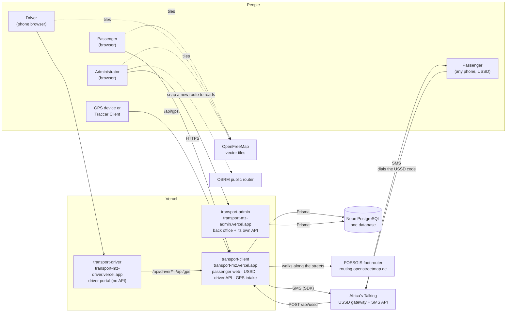

# Architecture

Transport Mozambique is three Next.js applications sharing one PostgreSQL database. There is no message bus and no background worker. Two things connect the apps:

- **The shared database.** Every app reads and writes it through Prisma.
- **One HTTP dependency.** The driver portal calls the passenger app's API.

Outside services are Africa's Talking (USSD and SMS), OpenFreeMap (map tiles), the public OSRM router (for drawing new routes in the admin) and the FOSSGIS foot router (walks along the streets on the passenger maps).

**On this page:** [System diagram](#system-diagram) · [Components](#components) · [How the parts connect](#how-the-parts-connect) · [Design decisions](#design-decisions) · [Tech stack](#tech-stack) · [Repository layout](#repository-layout) · [Not deployed](#not-deployed-legacy-code)

---

## System diagram



## Components

| | Passenger app | Admin dashboard | Driver portal |
|---|---|---|---|
| Folder | `transport-client/` | `transport-admin/` | `transport-driver/` |
| Production URL | https://transport-mz.vercel.app | https://transport-mz-admin.vercel.app | https://transport-mz-driver.vercel.app |
| Vercel project | `transport-mz` | `transport-mz-admin` | `transport-mz-driver` |
| Pages | `/` and `/search` (live map and journey planner), `/viagem` (following a journey), `/track/[id]` (redirect), `/auth`, `/user-info`, `/my-transports` (redirect) | 46 pages: list, detail, new and edit for each entity, plus dashboard, reports, profile | `/` (sign-in), `/dashboard` |
| API routes | 22 (`app/api/**/route.ts`) | 33 | none |
| Database access | Prisma, read/write | Prisma, read/write | none, via the passenger app's API |
| Who calls it | Browsers, Africa's Talking, the driver portal, GPS devices | Administrators' browsers | Drivers' browsers |
| Authentication | Passenger and driver: signed Bearer tokens | Admin: signed `HttpOnly` cookie, checked by `proxy.ts` on every `/api/*` | Holds the driver token from the passenger app |
| Details | [Passenger web app](passenger-web.md), [USSD](ussd.md), [GPS](gps-tracking.md) | [Admin dashboard](admin-dashboard.md) | [Driver portal](driver-portal.md) |

The passenger app does more than its name says. Besides the passenger web pages it hosts:

- the **USSD endpoint** (`/api/ussd`);
- the **driver API** (`/api/driver/login`, `/api/driver/trip`, `/api/driver/seguidores`);
- **GPS ingestion** (`/api/gps`);
- the **arrival SMS check**.

It is the platform's public backend.

## How the parts connect

- **One database.** All three schemas map the same tables. The source of truth is `prisma/schema.prisma` at the repository root. The client's copy is identical; the admin's adds `previewFeatures = ["omitApi"]`. The admin writes the network (routes, stops, vehicles, drivers, PINs, GPS device codes). The passenger app reads it and writes passengers, alerts (`MISSION`), trip state and GPS positions. See [Database](database.md).
- **Driver portal → passenger app.** The portal is a static front end. Its base URL comes from `NEXT_PUBLIC_API_URL`, inlined at build time. Those endpoints answer `Access-Control-Allow-Origin: *` and authenticate with the driver's Bearer token.
- **Africa's Talking → passenger app.** Each keypress in a USSD session is a `POST /api/ussd` with form fields `sessionId`, `serviceCode`, `phoneNumber`, `text`. The reply is plain text starting with `CON` (continue) or `END`. See [USSD](ussd.md).
- **Passenger app → Africa's Talking.** SMS go out through the `africastalking` SDK (`lib/notifications.ts`). They are sent after the USSD reply with `waitUntil` from `@vercel/functions`, so the phone never waits for the SMS. See [Africa's Talking](africas-talking.md).
- **GPS devices → passenger app.** A phone running Traccar Client, any tracker forwarded by a Traccar server, or the driver portal itself posts positions to `/api/gps` with a per-vehicle device code. See [GPS tracking](gps-tracking.md).
- **Admin → passenger app: none.** The admin computes vehicle positions with its own copy of the position code (`transport-admin/lib/vehiclePosition.ts`). Its only reference to the passenger app is the GPS server URL it shows when a device code is created (`GPS_SERVER_URL`).
- **Maps.** All three apps draw maps with MapLibre GL and OpenFreeMap vector tiles. Some admin forms use OpenStreetMap raster tiles. The admin's "Nova Via" page asks the public OSRM router to snap the points you click to the road network. Everywhere else, maps draw the stored path, which already follows the roads. Walks on the passenger maps are drawn along the streets with paths from the FOSSGIS foot router, asked by the passenger app's server (`/api/walk`).

## Design decisions

These choices explain most of the code's shape.

1. **Vehicle positions are computed on read; nothing runs in the background.** `lib/vehiclePosition.ts` gives a vehicle's position for any instant:
   - a real GPS fix if one arrived in the last 3 minutes;
   - otherwise a timetable position. Each bus shuttles along its route's path from 05:00 to 21:00 (Maputo time), at the fare rule's travel speed, with a 5-minute stop at each terminal, phase-shifted by a hash of its id.

   Every endpoint, every serverless instance and the USSD menus get the same answer, and no loop has to keep positions up to date. An in-process loop could not run reliably on serverless anyway. See [GPS tracking](gps-tracking.md#how-a-position-is-chosen).
2. **The USSD service is stateless.** Africa's Talking resends the whole input history in `text` (`1*3*1`). The server rebuilds the menu path from it on every request, so it keeps no session storage. See [USSD](ussd.md#how-a-session-works).
3. **Sessions are signed tokens, not database rows.** Passengers (90 days) and drivers (30 days) get `id.expiry.signature` tokens, signed with HMAC-SHA256. Admins get the same kind of token in an `HttpOnly` cookie (12 hours). Without the secret in production, sign-in is refused (fails closed). See [Security](security.md).
4. **Prices and speeds live in the database.** The active `Tarifa` row sets the minimum fare, the price per km, the road factor and the speeds. The web and USSD share it through `getFareRule()`, cached for 60 s. Distances are measured along the route's road path. See [Configuration → Fare rule](configuration.md#fare-rule-tarifa).
5. **Periodic work rides on traffic.** The arrival SMS check (`checkAndNotifyUsers`) runs when the live map polls positions (`/api/buses?fields=position`) and when a stop or a journey is requested (`/api/stops/{id}`, `/api/journeys`). It runs at most once every 30 s per server instance, so no cron job is needed. See [Data flow → Arrival alert](data-flow.md#arrival-alert-and-sms).
6. **Secrets are stored hashed where possible.** Driver PINs and passenger and admin passwords are bcrypt hashes. GPS device codes are stored as SHA-256 hashes. The PIN and the device code are shown once, when the admin creates them.

## Tech stack

| Layer | Technology | Where |
|---|---|---|
| Framework | Next.js 16.2.4 (App Router, Turbopack), React 19.2, TypeScript 5 | all three apps |
| Styling | Tailwind CSS 4 | all three apps |
| Database | PostgreSQL 18 on Neon (production); 16+ locally | shared |
| ORM | Prisma 5.22 | passenger app, admin |
| Maps | MapLibre GL 5 with OpenFreeMap tiles (`liberty` style, `planet` vector tiles) | all three apps |
| Charts | Recharts 3 | admin |
| USSD and SMS | Africa's Talking (`africastalking` SDK 0.7) | passenger app |
| Background work after a response | `waitUntil` from `@vercel/functions` | passenger app |
| Hashing | bcryptjs (passwords, PINs), SHA-256 (GPS device codes), HMAC-SHA256 (session tokens) | passenger app, admin |
| Tests | Jest 29 (API and database), Playwright 1.64 (end-to-end CRUD, PIN, GPS) | admin |
| Hosting | Vercel, one project per app | all three apps |

## Repository layout

```text
.
├── transport-client/          Passenger app (deployed as transport-mz)
│   ├── app/                   Pages: / search viagem track/[id] auth user-info my-transports
│   │   ├── api/               ussd, buses, bus/[id], stops, stops/[id], destinos, journeys, viagem, gps,
│   │   │                      auth/*, user/*, driver/*, startup, simulation, ussd-telerivet
│   │   └── components/        TripPlanner (map and planner), JourneyFollow (following a journey),
│   │                          mapKit and Plate (shared by both), walkPaths, Sheet,
│   │                          UserAvatar, LoadingScreen, Bus3D*
│   ├── lib/                   vehiclePosition (positions, arrival times), fares (fare rule,
│   │                          distances), busSimulator (arrival SMS check), notifications (SMS),
│   │                          signedToken / userSession / driverSession, driverTrips, eta,
│   │                          journeys (journey planner), places (stop names and search)
│   └── prisma/                schema.prisma (copy of the root schema), seed.ts
├── transport-admin/           Admin dashboard (deployed as transport-mz-admin)
│   ├── app/                   Pages per entity: transportes vias paragens motoristas
│   │   │                      proprietarios provincias municipios utentes administradores
│   │   │                      + dashboard relatorios perfil login
│   │   ├── api/               CRUD per entity, auth/admin/*, dashboard/stats, relatorios/stats,
│   │   │                      transportes/[id]/{gps,posicao,operacao}, motoristas/[id]/pin
│   │   └── components/        Sidebar, Header, GpsTrackerCard, DriverPinCard, ConfirmDialog
│   ├── lib/                   adminSession, vehiclePosition (admin copy), routeOrder, prisma
│   ├── proxy.ts               Session check on every /api/* call
│   ├── __tests__/api/         Jest suites
│   └── e2e/                   Playwright suites (local database only)
├── transport-driver/          Driver portal (deployed as transport-mz-driver)
│   ├── app/page.tsx           Sign-in (phone + PIN)
│   ├── app/dashboard/         Trip, map, GPS sharing, waiting passengers
│   └── lib/api.ts             API_BASE = NEXT_PUBLIC_API_URL
├── prisma/                    Source of truth: schema.prisma, migrations/, seed.ts
├── docs/                      This documentation (images in docs/images)
├── docker-compose.yml         Local PostgreSQL 16 on port 5433
├── app/, lib/, vercel.json    Legacy root app, not deployed (see below)
└── *.js, scripts/             One-off data scripts from the initial data import
```

## Not deployed (legacy code)

- **Root app (`app/`, `lib/`, root `package.json` and `vercel.json`).** An older variant of the passenger app. No Vercel project builds it. It has diverged from `transport-client`, so fixes made in one do not reach the other.
- **`transport-client/app/api/ussd-telerivet`.** The USSD flow for the Telerivet gateway. Africa's Talking is the gateway in use. `TELERIVET_SECRET` is still set in Vercel, but no Telerivet service points at the endpoint.
- **Root `*.js` and `scripts/`, plus 38 scripts in `transport-admin/` root and 84 in `transport-admin/scripts/`.** One-off scripts from the initial data import (`check-*`, `fix-*`, `create-*`, `seed-*`). Several of them write to whatever `DATABASE_URL` points at. Read one before running it.

The full list of known gaps is in [Known limitations](known-limitations.md).

---

[← Getting started](getting-started.md) · [Documentation index](README.md) · Next: [Data flow →](data-flow.md)
