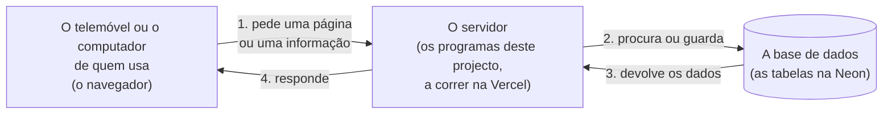
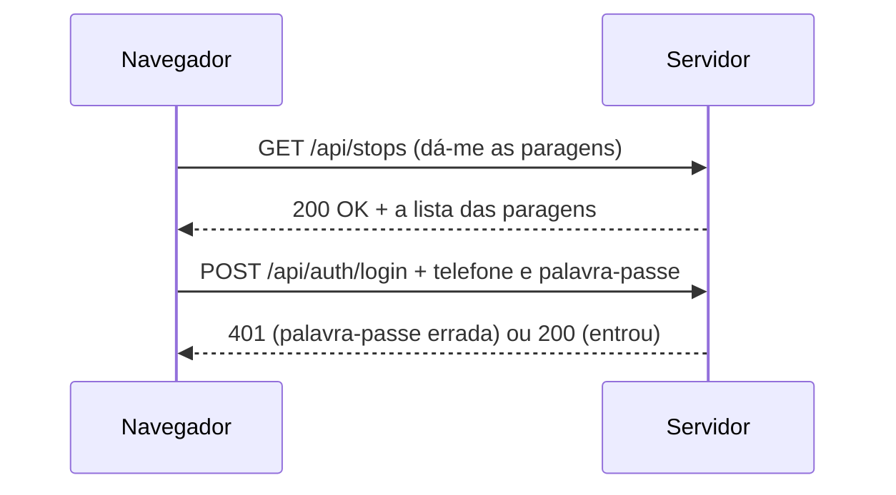

# Conceitos básicos

<!-- navegação: gerada por .github/scripts/docs-nav.py, não editar à mão -->
[Documentação](README.md) › 0. Começar do zero › **Conceitos básicos** (página 1 de 25)

[Índice](README.md) · Seguinte: [Preparar o computador](preparar-o-computador.md)

<details>
<summary>Todas as páginas</summary>

- 0. Começar do zero: **Conceitos básicos** · [Preparar o computador](preparar-o-computador.md)
- 1. Conhecer o projecto: [Visão geral](visao-geral.md) · [Glossário](glossario.md) · [Fontes de dados](fontes-de-dados.md) · [Estado do projecto](estado-do-projecto.md)
- 2. Montar localmente: [Primeiros passos](primeiros-passos.md) · [Base de dados](base-de-dados.md) · [Configuração](configuracao.md)
- 3. Perceber como funciona: [Fluxos de dados](fluxos-de-dados.md) · [Localização e GPS](localizacao-gps.md) · [Serviço USSD](ussd.md) · [Segurança](seguranca.md) · [Referência da API](referencia-api.md) · [Mapa do código](mapa-do-codigo.md)
- 4. Usar as aplicações: [Aplicação dos passageiros](app-passageiros.md) · [Portal do motorista](portal-motorista.md) · [Painel de administração](painel-admin.md)
- 5. Pôr online: [Publicação](publicacao.md) · [Guia da Vercel](guia-vercel.md) · [Guia da Neon](guia-neon.md) · [Africa's Talking](africas-talking.md)
- 6. Manter: [Testes](testes.md) · [Resolução de problemas](resolucao-de-problemas.md) · [Limitações](limitacoes.md)

</details>
<!-- /navegação -->

Esta página explica, em palavras simples, cada ideia técnica que aparece na documentação. Não é preciso saber programar. Cada conceito tem:

- **uma frase curta**, que é também a que aparece ao passar o rato por cima de uma ligação para aqui;
- **uma comparação** com algo do dia a dia;
- **um exemplo deste projecto**, e onde se volta a encontrar.

Nas outras páginas, a primeira vez que uma destas palavras aparece é uma ligação para a sua explicação aqui. Lê-se esta página uma vez de seguida (cerca de 40 minutos), ou salta-se para uma palavra quando ela aparece.

**Nesta página:** [A imagem geral](#a-imagem-geral) · [A web](#a-web) · [Programas e código](#programas-e-código) · [Dados](#dados) · [Guardar e partilhar o código](#guardar-e-partilhar-o-código) · [Pôr online](#pôr-online) · [Telemóveis: USSD e SMS](#telemóveis-ussd-e-sms) · [Mapas e posições](#mapas-e-posições)

---

## A imagem geral

Toda a plataforma é feita de três peças, que conversam umas com as outras:



1. Quem usa abre um endereço no telemóvel ou no computador, ou marca `*384*848080#` num telemóvel simples.
2. Esse pedido chega ao **servidor**: um computador ligado à internet o tempo todo, onde correm os programas deste repositório.
3. O servidor vai buscar ou guardar dados na **base de dados**: as rotas, as paragens, os autocarros, as contas.
4. O servidor responde com uma página, uma lista de autocarros ou um ecrã de USSD.

Todo o resto desta página são os nomes das partes deste caminho.

## A web

### Internet

<a id="internet"></a>

**Em uma frase:** a rede que liga milhões de computadores e telemóveis, por onde passam os pedidos e as respostas.

É como a rede de estradas de um país: não é nenhuma cidade em particular, é o que deixa chegar de uma a outra. Os telemóveis dos passageiros, os servidores da Vercel e a base de dados da Neon estão em sítios diferentes do mundo e falam através dela.

### Servidor

<a id="servidor"></a>

**Em uma frase:** um computador sempre ligado que recebe pedidos e responde a eles.

É como o balcão de informações de um terminal: as pessoas chegam com perguntas ("quando passa o próximo autocarro para Zimpeto?"), e o funcionário procura nos registos e responde. Neste projecto, os servidores são da [Vercel](#vercel); os programas que correm neles são as três aplicações deste repositório. "Servidor" também se diz do próprio programa que responde (por exemplo, "o servidor de desenvolvimento" que corre no computador de quem programa).

### Navegador

<a id="navegador"></a>

**Em uma frase:** o programa com que se abrem sites: Chrome, Firefox, Edge, Safari.

É a janela por onde se vê a web. Escreve-se um endereço, o navegador faz o pedido ao servidor, e mostra a página que vem na resposta. As três aplicações deste projecto abrem-se no navegador, no telemóvel ou no computador; não há nada para instalar.

### Aplicação web

<a id="aplicacao-web"></a>

**Em uma frase:** um site que se usa como um programa: tem botões, mapas e contas, e muda conforme o que se faz.

Um site simples mostra sempre o mesmo texto, como um panfleto. Uma aplicação web responde a quem a usa, como um balcão de atendimento. Este projecto tem três: a dos passageiros (o mapa e as viagens), o portal do motorista, e o painel de administração ([Visão geral → As três aplicações](visao-geral.md#as-três-aplicações)).

### Endereço (URL)

<a id="url"></a>

**Em uma frase:** o texto que diz ao navegador onde está uma página ou informação, como `https://transport-mz.vercel.app/viagem`.

É como a morada de uma carta. Um endereço tem partes:

```text
https://transport-mz.vercel.app/api/buses?fields=position
└─┬─┘   └──────────┬──────────┘└───┬────┘└──────┬───────┘
  │                │               │            └ os parâmetros: pedidos extra, depois do "?"
  │                │               └ o caminho: que página ou informação, dentro do site
  │                └ o domínio: o nome do site
  └ o protocolo: https é a forma segura (cifrada) de falar com o site
```

Os **parâmetros** escrevem-se `nome=valor`, separados por `&`: `?lat=-25.96&lon=32.57` são dois parâmetros, `lat` e `lon`. O **domínio** é o nome que se compra ou que a Vercel dá (`transport-mz.vercel.app`).

### Localhost e porta

<a id="localhost"></a>

**Em uma frase:** `localhost` quer dizer "este mesmo computador", e a porta (o número depois de `:`) escolhe qual dos programas dele responde.

Quando se corre uma aplicação no próprio computador para a experimentar, ela não está na internet: abre-se em `http://localhost:3000`. É como um prédio com vários apartamentos: `localhost` é a morada do prédio, e `3000`, `3001` e `3002` são os números das portas. Neste projecto, a aplicação dos passageiros usa a porta 3000, o portal do motorista a 3001, e o painel a 3002 ([Primeiros passos → 7](primeiros-passos.md#7-correr-as-aplicações)). A base de dados local também tem a sua porta (5432, ou 5433 com o Docker).

### Pedido e resposta (HTTP)

<a id="http"></a>

**Em uma frase:** a forma combinada como o navegador (ou outro programa) pede algo a um servidor, e como o servidor responde.

HTTP é como o formulário de um correio: cada pedido diz **o que se quer fazer** (o método), **onde** (o endereço), pode levar **informação extra** (os cabeçalhos) e **um conteúdo** (o corpo). A resposta traz **um código** que diz se correu bem, e o conteúdo pedido.



HTTPS é o mesmo, mas cifrado: ninguém pelo caminho consegue ler o que vai dentro. Todos os endereços públicos deste projecto são HTTPS.

### GET e POST (métodos)

<a id="get-e-post"></a>

**Em uma frase:** GET pede para ver uma coisa; POST envia dados para o servidor fazer algo com eles.

- **GET** é como perguntar no balcão: "que autocarros há?". Não muda nada. Abrir um endereço no navegador é sempre um GET.
- **POST** é como entregar um formulário preenchido: "registe-me com este telefone", "comece a minha viagem". Leva dados no **corpo** do pedido, e o servidor pode guardar ou mudar coisas.

Há outros métodos com o mesmo espírito: **PUT** e **PATCH** (alterar algo que existe), **DELETE** (apagar) e **OPTIONS** (perguntar o que é permitido, usado pelos navegadores antes de alguns pedidos). A [Referência da API](referencia-api.md) diz, para cada endereço, que método usa.

Um POST não se faz escrevendo um endereço no navegador; faz-se com um botão de uma aplicação, ou à mão com [`curl`](#curl).

### Parâmetros, corpo e cabeçalhos

<a id="parametros"></a>

**Em uma frase:** as três formas de um pedido levar informação: no endereço, no conteúdo, ou em etiquetas à parte.

- **Parâmetros no endereço** (`?lat=-25.96&lon=32.57`): bons para pedidos curtos. Ficam nos registos dos servidores, por isso não servem para palavras-passe nem para a posição exacta de alguém.
- **Corpo** (body): o conteúdo do pedido, como a carta dentro do envelope. Vai escrito como [JSON](#json) (`{"telefone": "840000001"}`) ou como um formulário (`telefone=840000001&senha=...`).
- **Cabeçalhos** (headers): etiquetas no envelope. Os que aparecem nesta documentação: `Content-Type` (em que formato vai o corpo), `Authorization` (a prova de quem pede, por exemplo `Bearer <código>`) e `Cookie` (a sessão guardada pelo navegador).

### Códigos de resposta

<a id="codigos-de-resposta"></a>

**Em uma frase:** o número de três algarismos com que o servidor diz como correu o pedido.

| Código | Quer dizer | Exemplo neste projecto |
|---|---|---|
| 200 | correu bem | a lista das paragens chegou |
| 201 | correu bem e criou-se algo novo | uma rota nova no painel |
| 204 | correu bem, sem nada para mostrar | a resposta a um `OPTIONS` |
| 400 | o pedido está mal feito | faltou o destino de uma viagem |
| 401 | falta provar quem é | entrar sem PIN, ou com a sessão expirada |
| 403 | sabe-se quem é, mas não pode | o USSD sem a chave do callback |
| 404 | não existe | um endereço escrito mal |
| 500 | o servidor falhou | um erro no código |
| 503 | o servidor não consegue atender agora | a base de dados não responde |

Como regra: 2xx correu bem, 4xx o problema está no pedido, 5xx o problema está no servidor.

### API e endpoint

<a id="api"></a>

**Em uma frase:** uma API é a lista de pedidos que um servidor aceita de outros programas; cada um desses pedidos, com o seu endereço, é um endpoint.

É como o menu de um restaurante: diz o que se pode pedir e como pedir. As páginas web são para pessoas; a API é para programas. Por exemplo, o mapa dos passageiros pede ao endpoint `/api/buses` as posições dos autocarros, e desenha-as. A Africa's Talking chama o endpoint `/api/ussd` a cada tecla de um passageiro. Todos os endpoints estão na [Referência da API](referencia-api.md).

### JSON

<a id="json"></a>

**Em uma frase:** uma forma de escrever dados em texto que qualquer programa lê: nomes entre aspas, valores depois de dois pontos, listas entre parênteses rectos.

```json
{"matricula": "ADA-213M", "lugares": 15, "emViagem": false, "paragens": ["Museu", "Zimpeto"]}
```

Lê-se: um veículo com a matrícula "ADA-213M", 15 lugares, que não está em viagem, e uma lista de duas paragens. `{ }` agrupa campos de uma coisa; `[ ]` é uma lista; o texto vai entre aspas, os números e `true`/`false` não. Quase todas as respostas da API deste projecto são JSON.

### Cookie, sessão e token

<a id="sessao"></a>

**Em uma frase:** depois de entrar, o servidor dá uma prova de quem se é (um token), e o navegador mostra-a a cada pedido para não ter de pedir a palavra-passe outra vez.

É como a pulseira de um festival: mostra-se o bilhete uma vez à entrada, recebe-se a pulseira, e depois basta mostrar a pulseira. O **token** é a pulseira: um texto comprido, assinado pelo servidor com um [segredo](#segredo) para ninguém o conseguir falsificar. A **sessão** é o tempo em que a pulseira vale (12 horas no painel, até 90 dias nos passageiros). O **cookie** é o bolso do navegador onde ele guarda a pulseira e a mostra sozinho a cada pedido. Como funciona neste projecto: [Segurança](seguranca.md).

A palavra "sessão" também se usa no USSD, com outro sentido: uma conversa de menus, do momento em que se marca o código até o ecrã fechar ([USSD](#ussd)).

### CORS

<a id="cors"></a>

**Em uma frase:** a regra dos navegadores que só deixa uma página falar com o servidor de outro site se esse servidor o permitir.

O portal do motorista (`transport-mz-driver.vercel.app`) envia o GPS do telemóvel para a aplicação dos passageiros (`transport-mz.vercel.app`): dois sites diferentes. O navegador só o deixa porque a resposta de `/api/gps` traz o cabeçalho `Access-Control-Allow-Origin: *` ("qualquer site pode enviar") ([Localização e GPS → Protocolo](localizacao-gps.md#protocolo)).

## Programas e código

### Código-fonte

<a id="codigo-fonte"></a>

**Em uma frase:** o texto, escrito por pessoas, com as instruções que o computador segue; os ficheiros deste repositório.

É como a receita de um prato: a receita (o código) não é o prato (a aplicação a funcionar), mas diz exactamente como o fazer. Os ficheiros que acabam em `.ts`, `.tsx`, `.js` e `.mjs` são código; o [Mapa do código](mapa-do-codigo.md) diz o que faz cada um. As linhas que começam por `//` ou estão entre `/*` e `*/` são **comentários**: notas para pessoas, que o computador ignora. Neste projecto estão em português e explicam o porquê.

### JavaScript e TypeScript

<a id="typescript"></a>

**Em uma frase:** as linguagens em que o código deste projecto está escrito; TypeScript é JavaScript com verificações extra.

JavaScript é a linguagem que os navegadores entendem. TypeScript junta-lhe "tipos": diz-se, por exemplo, que um campo é um número, e o computador avisa antes de correr se alguém lhe puser um texto. Porquê TypeScript: apanha muitos erros antes de chegarem aos passageiros. A verificação de tipos corre em cada pull request ([Testes](testes.md)).

### Node.js

<a id="nodejs"></a>

**Em uma frase:** o programa que corre JavaScript fora do navegador, num computador ou num servidor.

Sem o Node.js, o JavaScript só correria dentro de um navegador. Com ele, o mesmo tipo de código corre no servidor: recebe pedidos, fala com a base de dados, envia SMS. Instala-se uma vez no computador ([Preparar o computador](preparar-o-computador.md#instalar-o-nodejs)). Os comandos `node`, `npm` e `npx` vêm com ele.

### npm, pacotes e dependências

<a id="npm"></a>

**Em uma frase:** o npm descarrega e instala os pacotes (código feito por outros) de que cada aplicação precisa.

Ninguém escreve tudo do zero: para desenhar mapas, guardar palavras-passe em segurança ou falar com a Africa's Talking, usam-se pacotes já feitos. São as **dependências**. Cada aplicação tem um ficheiro `package.json` com a lista; `npm install` lê-a e descarrega tudo para a pasta `node_modules` (grande, e fora do git). `npm run dev` corre um dos atalhos definidos no `package.json`. `npx` corre um programa de um pacote sem o instalar à parte (por exemplo `npx prisma studio`).

### Next.js e React

<a id="nextjs"></a>

**Em uma frase:** o Next.js é a "estrutura" sobre a qual as três aplicações estão feitas; o React é a parte dele que desenha os ecrãs.

É como o esqueleto de uma casa pré-fabricada: já traz as paredes, as portas e a canalização, e só se põe o que é próprio. O Next.js já sabe servir páginas, receber pedidos de API e publicar-se na Vercel; este projecto só escreve as páginas (`page.tsx`) e os endpoints (`route.ts`). Porquê o Next.js: uma só ferramenta para as páginas e para a API, e publicação na Vercel sem configuração ([Visão geral → Tecnologias e porquê](visao-geral.md#tecnologias-e-porquê)).

### Prisma

<a id="prisma"></a>

**Em uma frase:** a ferramenta com que o código fala com a base de dados sem escrever SQL à mão.

É como um intérprete: o código pede em TypeScript ("dá-me os veículos da rota V086"), e o Prisma traduz para [SQL](#sql), pergunta à base de dados e devolve a resposta. O ficheiro `prisma/schema.prisma` descreve todas as tabelas ([Base de dados](base-de-dados.md)). `prisma generate` prepara o intérprete para esse esquema, e `prisma studio` abre as tabelas no navegador para as ver.

### Script

<a id="script"></a>

**Em uma frase:** um pequeno programa que se corre à mão, uma vez, para uma tarefa: importar dados, corrigir percursos, mostrar listas.

Ao contrário das aplicações, que estão sempre a correr, um script corre, faz o seu trabalho e acaba. Os deste projecto estão em [`transport-client/scripts`](../transport-client/scripts) e correm-se com `node scripts/<nome>.mjs` ou `npx tsx scripts/<nome>.ts` ([Base de dados](base-de-dados.md)). Os que escrevem na base de dados fazem primeiro um **ensaio**: mostram o que mudariam, sem mudar nada.

### Terminal e comandos

<a id="terminal"></a>

**Em uma frase:** a janela onde se escrevem instruções para o computador em texto, em vez de clicar.

É como falar com o computador por mensagens: escreve-se uma linha (um **comando**), carrega-se em Enter, e ele responde com texto. No Windows usa-se o **Git Bash** (que vem com o Git) ou o **PowerShell**; no macOS e no Linux, o **Terminal**. O terminal está sempre "dentro" de uma pasta, a **pasta actual**; `cd nome` entra numa pasta e `cd ..` volta à de cima. Como abrir um e como ler os comandos desta documentação: [Preparar o computador → O terminal](preparar-o-computador.md#o-terminal).

### curl

<a id="curl"></a>

**Em uma frase:** um comando que faz pedidos HTTP a partir do terminal, como um navegador sem janela.

Serve para experimentar a API, sobretudo os pedidos POST, que o navegador não faz sozinho. Exemplo:

```bash
curl -s "https://transport-mz.vercel.app/api/walk?de=-25.9655,32.58&para=-25.9642,32.5761"
```

Lê-se: "faz um GET a este endereço e mostra a resposta". As opções que aparecem nesta documentação: `-X POST` (usar o método POST), `-d "..."` ou `--data-urlencode "..."` (o corpo, como formulário), `-H "..."` (um cabeçalho), `-s` (sem barra de progresso), `-o /dev/null -w "%{http_code}"` (mostrar só o código da resposta). O `curl` já vem com o Windows 10 e 11, o macOS e o Linux. Atenção no PowerShell do Windows: lá, `curl` é outro comando com o mesmo nome; escreve-se `curl.exe`, ou usa-se o Git Bash, onde os comandos desta documentação funcionam como estão escritos.

### Variável de ambiente e ficheiro `.env`

<a id="variavel-de-ambiente"></a>

**Em uma frase:** uma definição que se dá a um programa de fora do código, como o endereço da base de dados ou uma palavra-passe.

É como as instruções que se deixam a quem fica a tomar conta da casa: a casa (o código) é a mesma, mas o número do canalizador muda de pessoa para pessoa. O mesmo código liga-se à base de dados local no computador de quem programa e à da Neon na produção; só muda a variável `DATABASE_URL`. No computador, as variáveis escrevem-se num ficheiro de texto chamado `.env` em cada aplicação (uma por linha, `NOME="valor"`), que nunca vai para o git. Na produção, estão na Vercel ([Guia da Vercel → Variáveis de ambiente](guia-vercel.md#variáveis-de-ambiente)). A lista de todas está em [Configuração](configuracao.md).

### Segredo e chave da API

<a id="segredo"></a>

**Em uma frase:** um valor que só a plataforma deve saber, como uma palavra-passe: quem o tiver pode agir em nome dela.

Exemplos: a palavra-passe da base de dados (dentro de `DATABASE_URL`), a **chave da API** da Africa's Talking (que deixa enviar SMS e gastar crédito), e os segredos das sessões (com que se assinam os [tokens](#sessao)). Um segredo nunca vai para o código nem para o git, nunca se mostra numa captura de ecrã, e muda-se logo que possa ter escapado ([Segurança → Mudar segredos](seguranca.md#mudar-segredos)). `openssl rand -base64 32` gera um aleatório.

### Hash (bcrypt, SHA-256)

<a id="hash"></a>

**Em uma frase:** uma "impressão digital" de um texto, que se calcula num sentido e não se consegue desfazer.

É como triturar um documento: com o mesmo documento sai sempre a mesma tira, mas da tira não se volta ao documento. A base de dados não guarda as palavras-passe nem os PIN, guarda o seu hash. Quando alguém entra, calcula-se o hash do que escreveu e compara-se. Assim, mesmo quem copiasse a base de dados não ficava a saber as palavras-passe. **bcrypt** é um hash feito para ser lento de propósito (contra quem experimenta milhões de palavras-passe); **SHA-256** é rápido, e serve para os códigos longos e aleatórios dos dispositivos GPS ([Segurança](seguranca.md)).

### Registos (logs)

<a id="registos"></a>

**Em uma frase:** as linhas de texto que um programa escreve sobre o que está a fazer, para se perceber depois o que aconteceu.

É como o diário de bordo de um navio. Na produção, os registos de cada pedido estão na Vercel ([Guia da Vercel → Registos](guia-vercel.md#registos)); no computador, aparecem no terminal onde a aplicação corre. Por exemplo, sem chave da Africa's Talking, cada SMS fica no registo como `SMS não enviado para ...`.

### Testes automáticos

<a id="testes"></a>

**Em uma frase:** programas que experimentam as aplicações sozinhos e avisam quando algo deixou de funcionar.

Em vez de alguém clicar em todos os botões depois de cada mudança, um teste faz isso e confirma o resultado. **Jest** experimenta a API do painel; **Playwright** abre um navegador a sério e clica no painel como uma pessoa ([Testes](testes.md)).

### Função serverless

<a id="serverless"></a>

**Em uma frase:** um pedaço de código que a Vercel arranca só quando chega um pedido, e desliga a seguir.

É como um táxi em vez de um carro próprio: não se paga um servidor ligado o dia todo, paga-se cada viagem. A desvantagem: a função não se lembra de nada entre dois pedidos. Por isso tudo o que tem de durar (as viagens dos motoristas, as posições GPS) fica na base de dados, e o USSD lê a conversa toda a cada tecla ([Serviço USSD → Leitura das teclas](ussd.md#leitura-das-teclas)).

## Dados

### Base de dados

<a id="base-de-dados"></a>

**Em uma frase:** o sítio organizado onde a plataforma guarda tudo o que tem de durar: rotas, paragens, veículos, contas.

É como um armário de pastas: cada **tabela** é uma pasta de um tipo de coisa ([`Paragem`](glossario.md#a-rede-e-as-pessoas "A tabela das paragens (stop)"), [`Via`](glossario.md#a-rede-e-as-pessoas "A tabela das rotas de autocarro (route)"), [`Transporte`](glossario.md#a-rede-e-as-pessoas "A tabela dos veículos (vehicle)")); cada **linha** é uma ficha (uma paragem); cada **coluna** é um campo da ficha (o nome, a posição). Se o servidor desligar, os dados continuam lá. As tabelas deste projecto, com o que significa cada coluna: [Base de dados](base-de-dados.md) e [Glossário](glossario.md).

### Chave e ligação entre tabelas

<a id="chave"></a>

**Em uma frase:** cada linha tem um identificador único (`id`), e uma linha aponta para outra guardando o `id` dela.

É como o número de bilhete de identidade: dois nomes podem repetir-se, o número não. Um veículo (`Transporte`) guarda em `viaId` o `id` da sua rota; para saber o nome da rota, vai-se à tabela `Via` buscar a linha com esse `id`. Uma coluna que guarda o `id` de outra tabela chama-se **chave estrangeira**. Os `id` deste projecto são textos como `cmoveu8as00yr14lnpndpwdqj`.

### SQL

<a id="sql"></a>

**Em uma frase:** a linguagem com que se fazem perguntas e alterações a uma base de dados.

Lê-se quase como inglês:

```sql
SELECT nome, codigo FROM "Paragem" WHERE nome ILIKE '%museu%';
```

"Mostra o nome e o código das paragens cujo nome tem 'museu'." As quatro palavras principais: **SELECT** (ver), **INSERT** (juntar linhas), **UPDATE** (mudar) e **DELETE** (apagar). `WHERE` escolhe as linhas, e `;` acaba a instrução. Os nomes das tabelas deste projecto vão entre aspas (`"Paragem"`) porque têm maiúsculas. Onde se corre: [Guia da Neon → Colar uma consulta](guia-neon.md#3-colar-uma-consulta-e-corrê-la). Consultas prontas: [Base de dados → Consultas de exemplo](base-de-dados.md#consultas-de-exemplo).

### PostgreSQL

<a id="postgresql"></a>

**Em uma frase:** o programa de base de dados que este projecto usa; gratuito e muito usado.

Há vários programas de base de dados (MySQL, SQLite, Oracle); todos falam SQL, com pequenas diferenças. Este usa o PostgreSQL: na produção, na [Neon](#neon); no computador, instalado à parte ou com o [Docker](#docker). `psql` é o programa de terminal que vem com ele para escrever SQL.

### Esquema e migração

<a id="migracao"></a>

**Em uma frase:** o esquema é a lista das tabelas e colunas; uma migração é uma alteração a essa lista, escrita em SQL para se poder repetir.

É como a planta de um armário e as obras para lhe juntar uma gaveta. O esquema deste projecto está em [`prisma/schema.prisma`](../prisma/schema.prisma); cada pasta de [`prisma/migrations`](../prisma/migrations) é uma obra, por ordem de data. Numa base de dados nova, `prisma migrate deploy` faz todas as obras de seguida ([Primeiros passos → 5](primeiros-passos.md#5-criar-o-esquema)).

### Dados de demonstração (semente)

<a id="semente"></a>

**Em uma frase:** um conjunto pequeno de dados inventados que se carrega numa base de dados vazia para a experimentar.

É como a fruta de plástico de uma montra. `npm run db:seed` carrega 18 rotas, 32 paragens, 25 veículos e algumas contas de teste. **Apaga tudo antes de carregar**, por isso nunca se corre contra a produção ([Primeiros passos → 6](primeiros-passos.md#6-carregar-os-dados-de-demonstração)).

### Cópia de segurança

<a id="copia-de-seguranca"></a>

**Em uma frase:** uma cópia dos dados feita antes de os mudar, para se poder voltar atrás.

Os scripts deste projecto que escrevem na base de dados guardam primeiro o que vão mudar num ficheiro `backup-*.json`. Na Neon, um **ramo** é uma cópia instantânea da base de dados inteira ([Guia da Neon](guia-neon.md)).

### Docker

<a id="docker"></a>

**Em uma frase:** um programa que corre outros programas dentro de "contentores" já preparados, sem os instalar no computador.

É como alugar uma cozinha já equipada em vez de montar uma em casa. Com o Docker, `docker compose up -d` arranca uma base de dados PostgreSQL pronta, definida no ficheiro [`docker-compose.yml`](../docker-compose.yml), e apagá-la não deixa nada para trás. É opcional: também se pode instalar o PostgreSQL directamente ([Preparar o computador](preparar-o-computador.md#uma-base-de-dados-local)).

## Guardar e partilhar o código

### Git

<a id="git"></a>

**Em uma frase:** o programa que guarda o histórico de todas as versões do código, e quem mudou o quê e quando.

É como o "controlo de alterações" de um documento, mas para uma pasta inteira e para sempre: qualquer versão antiga se recupera. Instala-se uma vez ([Preparar o computador → Instalar o Git](preparar-o-computador.md#instalar-o-git)).

### Repositório

<a id="repositorio"></a>

**Em uma frase:** a pasta do projecto com todo o seu histórico no git.

Este repositório é [github.com/transportmozambique/Transport-Mozambique](https://github.com/transportmozambique/Transport-Mozambique): as três aplicações, o esquema da base de dados, esta documentação e as verificações automáticas.

### Commit

<a id="commit"></a>

**Em uma frase:** uma fotografia guardada do código num momento, com uma frase a dizer o que mudou.

É como guardar um documento com uma nota "acrescentei o capítulo 3". Cada commit tem um código curto (por exemplo `bd007cf`) que o identifica para sempre; com ele vê-se o repositório exactamente como estava nesse momento.

### Ramo (branch)

<a id="ramo"></a>

**Em uma frase:** uma linha de trabalho separada, onde se fazem mudanças sem tocar na versão principal.

É como fazer um rascunho numa cópia do documento antes de passar a limpo. O ramo principal chama-se `main`: é o que está publicado. Uma alteração faz-se num ramo novo, e só entra no `main` depois de verificada, por um [pull request](#pull-request). A Neon usa a mesma palavra para uma cópia da base de dados ([Neon](#neon)).

### GitHub

<a id="github"></a>

**Em uma frase:** o site onde o repositório está guardado e partilhado, e onde se revêem as alterações.

O git guarda o histórico no computador; o GitHub guarda uma cópia na internet, para várias pessoas trabalharem no mesmo código e para a Vercel publicar sozinha cada mudança. Uma conta é gratuita ([Preparar o computador → Contas](preparar-o-computador.md#as-contas)).

### Clonar

<a id="clonar"></a>

**Em uma frase:** descarregar um repositório inteiro do GitHub para o computador, com o histórico.

`git clone <endereço>` cria uma pasta com o código ([Preparar o computador → Descarregar o código](preparar-o-computador.md#descarregar-o-código)).

### Pull request e merge

<a id="pull-request"></a>

**Em uma frase:** um pull request é o pedido para juntar um ramo ao `main`; o merge é a junção, quando o pedido é aceite.

É como entregar o rascunho a um revisor antes de passar a limpo. No GitHub, o pull request mostra o que muda, linha a linha, e as verificações automáticas ([CI](#ci)) correm sobre ele. Depois do merge, a Vercel publica a mudança. Cada pull request tem um número (`#46`); o [Estado do projecto → Histórico](estado-do-projecto.md#histórico) lista-os.

### CI (verificações automáticas)

<a id="ci"></a>

**Em uma frase:** verificações que o GitHub corre sozinho a cada pull request, para nenhum erro conhecido chegar ao `main`.

CI quer dizer "integração contínua". Neste projecto, o **GitHub Actions** confirma em cada pull request que o código das três aplicações não tem erros de tipos, que os três esquemas da base de dados são iguais, e que as ligações e a navegação desta documentação estão certas ([Testes → CI no GitHub](testes.md#ci-no-github)). Um X vermelho no pull request quer dizer que algo falhou.

### Agendamento (cron)

<a id="agendamento"></a>

**Em uma frase:** uma tarefa que corre sozinha a uma hora marcada, ou de tantos em tantos minutos.

É como um despertador. Neste projecto, o GitHub Actions chama a verificação das chegadas a cada 5 minutos, para os SMS de "o autocarro está perto" saírem mesmo quando ninguém está a usar o site ([Publicação](publicacao.md)). "cron" é o nome antigo destes agendamentos, e `*/5 * * * *` é a forma de escrever "a cada 5 minutos".

### Markdown

<a id="markdown"></a>

**Em uma frase:** a forma simples de escrever texto com formatação em que esta documentação está escrita (os ficheiros `.md`).

`**negrito**`, `# Título`, `- item de lista`, `[texto](endereço)` para uma ligação. O GitHub mostra-o já formatado. Os diagramas desta documentação escrevem-se em **Mermaid**, uma forma de descrever caixas e setas em texto que o GitHub desenha.

## Pôr online

### Publicação (deploy)

<a id="publicacao"></a>

**Em uma frase:** pôr uma versão nova do código a funcionar nos servidores, ao vivo, para toda a gente.

É como mudar as peças de uma montra: até se publicar, a mudança só existe no repositório. Neste projecto, cada merge no `main` faz a Vercel publicar sozinha as três aplicações ([Publicação](publicacao.md)). "Publicar outra vez" (redeploy) é repetir uma publicação sem mudar o código, por exemplo para ler uma variável de ambiente nova.

### Vercel

<a id="vercel"></a>

**Em uma frase:** a empresa cujos servidores correm as três aplicações e as publicam a cada merge.

Cada aplicação é um **projecto** da Vercel (`transport-mz`, `transport-mz-admin`, `transport-mz-driver`). **Production** é a versão ao vivo, no endereço público; **Preview** é uma publicação de experiência que a Vercel faz para cada pull request, num endereço próprio, para se ver a mudança antes do merge. O plano gratuito chega para este projecto ([Guia da Vercel](guia-vercel.md)).

### Neon

<a id="neon"></a>

**Em uma frase:** a empresa que guarda a base de dados PostgreSQL da produção, na internet.

A Neon tem uma **consola** (um site) com um **SQL Editor** onde se escreve e corre SQL directamente nos dados da produção ([Guia da Neon](guia-neon.md)). Um **ramo** da Neon é uma cópia instantânea da base de dados, para experimentar sem estragar a verdadeira. O endereço de ligação **pooled** é o que as aplicações usam (aguenta muitos pedidos ao mesmo tempo); o **directo** é para scripts e para `psql`.

## Telemóveis: USSD e SMS

### USSD

<a id="ussd"></a>

**Em uma frase:** os menus que aparecem num telemóvel quando se marca um código como `*384*848080#`; funcionam em qualquer telemóvel, sem internet.

É o mesmo tipo de menu que se usa para ver o saldo ou carregar o telemóvel. O telemóvel mostra um ecrã de texto com opções numeradas, a pessoa escreve um número ou um nome e carrega em "Enviar", e aparece o ecrã seguinte. Porquê USSD: muitos passageiros não têm telemóvel com internet, e o USSD não gasta dados.

Uma **sessão** USSD é a conversa inteira, do código marcado até o ecrã fechar. Cada resposta do servidor começa por `CON` (continua: mostra o ecrã e espera a tecla seguinte) ou `END` (mostra o ecrã e fecha). Como este projecto responde a cada tecla: [Serviço USSD](ussd.md).

### SMS

<a id="sms"></a>

**Em uma frase:** as mensagens de texto curtas dos telemóveis.

A plataforma envia SMS com os detalhes de uma viagem, a pedido, e quando um autocarro está a chegar à paragem de quem pediu o aviso ([Fluxos de dados → Alerta de chegada](fluxos-de-dados.md#alerta-de-chegada-e-sms)). Cada SMS custa crédito na Africa's Talking.

### Gateway

<a id="gateway"></a>

**Em uma frase:** a empresa que faz a ponte entre as redes dos telemóveis (Vodacom, Movitel, Tmcel) e a internet.

O servidor deste projecto está na internet e não fala directamente com as redes de telemóveis. O gateway recebe as teclas USSD da rede e passa-as ao servidor, e recebe os SMS do servidor e entrega-os na rede. O gateway deste projecto é a Africa's Talking.

### Africa's Talking

<a id="africas-talking"></a>

**Em uma frase:** o gateway de USSD e SMS usado por este projecto.

Tem dois modos. **Sandbox** é o modo de testes gratuito: o USSD e os SMS só funcionam num **simulador**, um telemóvel de mentira num site, onde qualquer pessoa experimenta o menu ([Africa's Talking → Usar o menu no simulador](africas-talking.md#usar-o-menu-no-simulador)). **Produção** é o modo pago, com um código USSD verdadeiro nas redes moçambicanas ([Africa's Talking → Passar a produção](africas-talking.md#passar-a-produção)). Este projecto está em sandbox.

### Callback (webhook)

<a id="callback"></a>

**Em uma frase:** um endereço que se dá a outro serviço para ele chamar sempre que algo acontece.

É como deixar o número de telefone na farmácia para ligarem quando o medicamento chegar. Neste projecto, a Africa's Talking tem o endereço `https://transport-mz.vercel.app/api/ussd?key=...` e faz-lhe um POST a cada tecla de um passageiro. O `?key=...` é uma chave secreta que só ela sabe, para mais ninguém poder fingir ser a Africa's Talking ([Segurança → Resposta USSD](seguranca.md#resposta-ussd-callback)).

### GSM-7

<a id="gsm-7"></a>

**Em uma frase:** o conjunto de letras que todos os telemóveis mostram nos SMS e no USSD; não tem a maior parte das letras acentuadas.

Por isso os ecrãs USSD e os SMS deste projecto escrevem "Proximo" e "Paragem" sem acentos. Uma só letra fora do GSM-7 obrigaria a mensagem a outro formato, que leva menos de metade dos caracteres.

## Mapas e posições

### Coordenadas: latitude e longitude

<a id="coordenadas"></a>

**Em uma frase:** dois números que dizem onde está um ponto na Terra.

A **latitude** diz quão a norte ou a sul (negativa a sul do equador: Maputo está perto de -25,97). A **longitude** diz quão a leste ou a oeste (positiva a leste de Greenwich: Maputo está perto de 32,57). Juntas, `-25.9692, 32.5732` é um ponto na Baixa de Maputo. Os programas escrevem-nas com ponto decimal, não com vírgula. Atenção: umas partes do projecto escrevem latitude primeiro (`lat,lng`) e outras longitude primeiro (`lng,lat`) ([Glossário → Campos](glossario.md#campos-que-precisam-de-explicação)).

### GPS

<a id="gps"></a>

**Em uma frase:** o sistema de satélites com que um telemóvel ou um aparelho sabe as suas coordenadas.

Um autocarro com GPS envia a sua posição real à plataforma a cada poucos segundos. Um autocarro sem GPS aparece no mapa numa posição **estimada** a partir do horário ([Localização e GPS → Como se escolhe uma posição](localizacao-gps.md#como-se-escolhe-uma-posição)). Hoje, nenhum veículo tem GPS.

### Rastreador GPS e código do dispositivo

<a id="rastreador"></a>

**Em uma frase:** um aparelho (ou um telemóvel com uma aplicação) que envia a posição de um veículo pela internet; o código do dispositivo é a sua "palavra-passe".

O painel gera para cada veículo um código de 20 caracteres, mostrado uma só vez. O rastreador envia esse código com cada posição, e é assim que o servidor sabe de que veículo é e que a posição é verdadeira ([Localização e GPS → Ligar um dispositivo](localizacao-gps.md#ligar-um-dispositivo)).

### Protocolo OsmAnd

<a id="osmand"></a>

**Em uma frase:** uma forma combinada de um aparelho enviar a sua posição: abre um endereço com a posição escrita nos parâmetros.

"Protocolo" quer dizer só "regras combinadas para dois programas se entenderem", como o formato de um envelope (destinatário em cima, remetente atrás). Neste, o aparelho faz um pedido a um endereço assim:

```text
https://transport-mz.vercel.app/api/gps?id=CODIGO&lat=-25.9692&lon=32.5732&speed=10&bearing=90
```

- `id`: o código do dispositivo (quem envia);
- `lat` e `lon`: a latitude e a longitude (onde está);
- `speed`: a velocidade, em nós (1 nó = 1,852 km/h);
- `bearing`: para onde vai, em graus (0 = norte, 90 = este).

O nome vem da aplicação de mapas OsmAnd, que o criou; muitos rastreadores e o Traccar Client usam-no, e é por isso que esta plataforma o aceita: qualquer um deles serve sem programar nada ([Localização e GPS → Protocolo](localizacao-gps.md#protocolo)).

### Traccar Client

<a id="traccar"></a>

**Em uma frase:** uma aplicação gratuita para telemóvel que envia a posição do telemóvel pelo protocolo OsmAnd.

Instalada no telemóvel do motorista, com o endereço do servidor e o código do dispositivo do seu veículo, transforma o telemóvel em rastreador GPS ([Localização e GPS → Traccar Client num telemóvel](localizacao-gps.md#traccar-client-num-telemóvel)).

### OpenStreetMap

<a id="openstreetmap"></a>

**Em uma frase:** um mapa do mundo inteiro feito por voluntários, como uma Wikipédia dos mapas, que qualquer pessoa pode usar e corrigir.

As ruas, muitas paragens e as linhas de [chapas](glossario.md#transportes-em-maputo "Os minibuses que levam a maior parte dos passageiros de Maputo") de Maputo vêm do OpenStreetMap ([Fontes de dados](fontes-de-dados.md)). Uma **relação** do OpenStreetMap é o registo de uma linha de autocarro num sentido. **Overpass** é o serviço com que se descarregam esses dados. A licença (ODbL) deixa usá-los com a menção "© contribuidores do OpenStreetMap".

### Mapa de fundo (mosaicos)

<a id="mosaicos"></a>

**Em uma frase:** as imagens das ruas por baixo dos autocarros e das paragens, que o mapa descarrega aos bocados (mosaicos) conforme se mexe.

As três aplicações usam os mosaicos gratuitos do **OpenFreeMap**, feitos a partir do OpenStreetMap, e desenham-nos com a biblioteca **MapLibre**. As rotas, as paragens e os autocarros são desenhados por cima pelo código deste projecto.

### Router de caminhos (OSRM)

<a id="router"></a>

**Em uma frase:** um serviço que, dados dois ou mais pontos, responde com o caminho pelas ruas entre eles e a distância.

É o que um GPS de carro faz para dizer "vire à esquerda". Este projecto usa o **OSRM** (um router gratuito), nos servidores públicos da FOSSGIS e de demonstração do OSRM, para pôr os percursos das rotas nas ruas e para desenhar as caminhadas a pé ([Base de dados → Pôr os percursos nas estradas](base-de-dados.md#pôr-os-percursos-das-rotas-nas-estradas)).

### Geocodificação (Nominatim)

<a id="geocodificacao"></a>

**Em uma frase:** transformar coordenadas no nome de um sítio (ou o contrário).

As primeiras paragens só tinham coordenadas; o **Nominatim**, o serviço de geocodificação do OpenStreetMap, deu a cada uma o nome da sua rua. É por isso que várias paragens partilham o nome de uma avenida ([Fontes de dados](fontes-de-dados.md)).

<!-- navegação-fim: gerada por .github/scripts/docs-nav.py -->

---

[Índice](README.md) · Seguinte: [Preparar o computador](preparar-o-computador.md)
<!-- /navegação-fim -->
