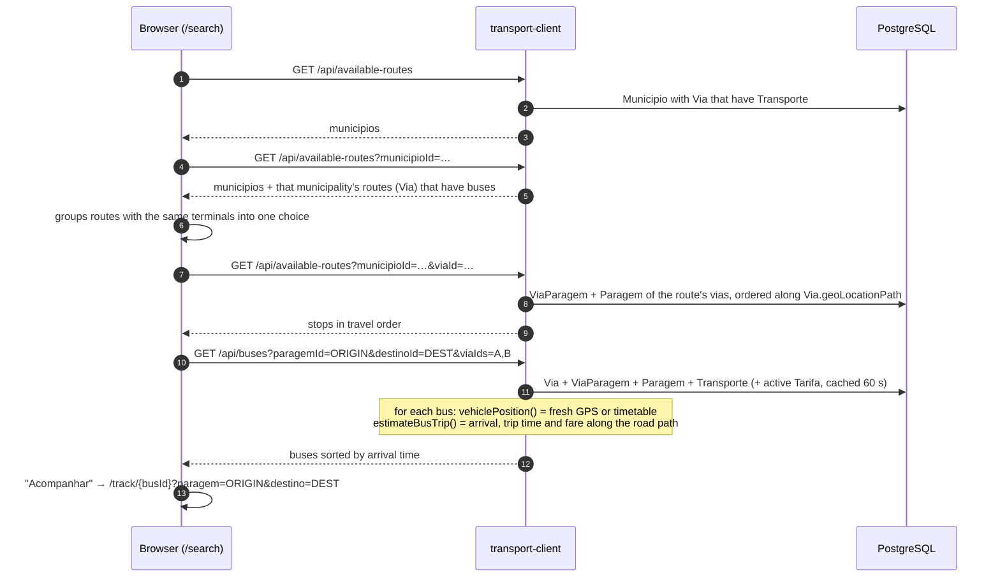
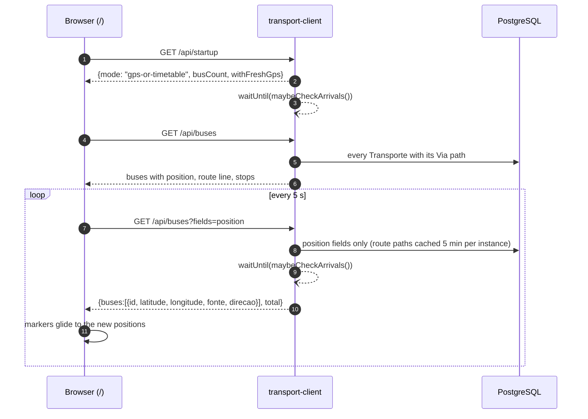
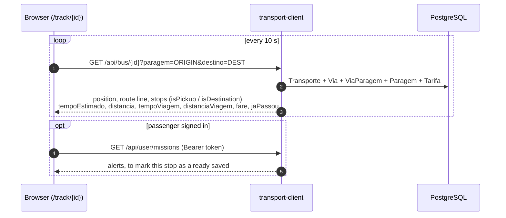
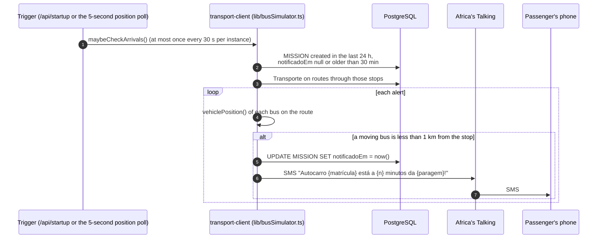
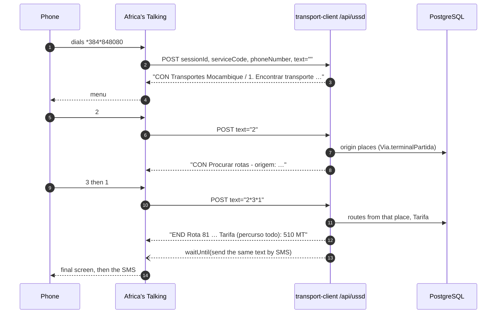
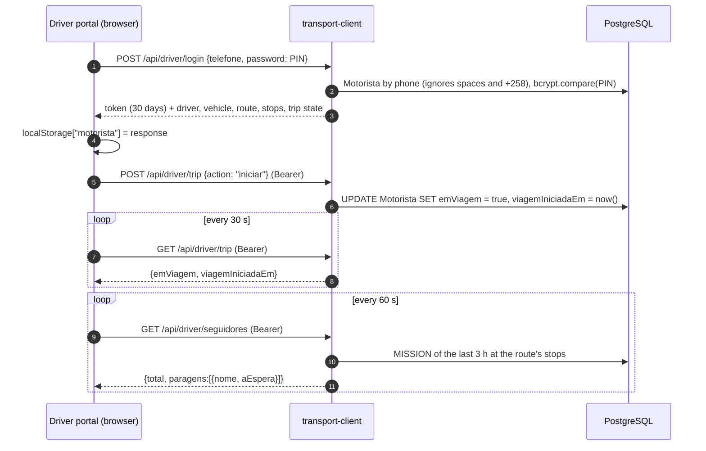
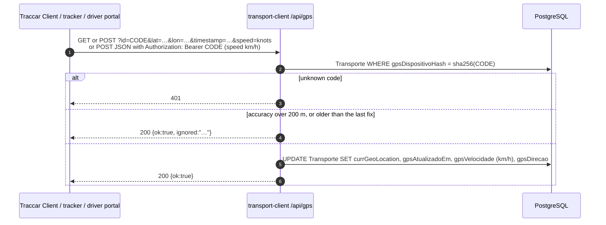
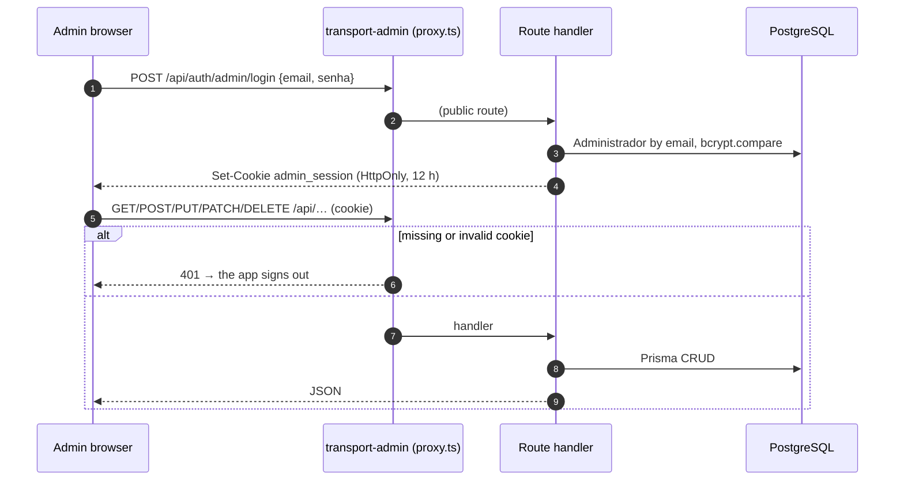

# Data flow

This page follows the data through each flow of the platform, from the first request to the rows it reads or writes. Each flow names the endpoint, the code that handles it (`transport-client/...` or `transport-admin/...`) and the tables involved. Table and field meanings are in [Database](database.md).

**On this page:** [Search and arrival time](#search-and-arrival-time) · [Live map](#live-map) · [Tracking page](#tracking-page) · [Arrival alert and SMS](#arrival-alert-and-sms) · [USSD session](#ussd-session) · [Driver sign-in and trip](#driver-sign-in-and-trip) · [GPS position](#gps-position) · [Admin changes](#admin-changes) · [PIN and device code](#driver-pin-and-gps-device-code) · [Who writes what](#who-writes-each-table)

---

## Search and arrival time

The search form narrows municipality → route → origin stop → destination. It only offers choices that have buses. The search then asks for every bus on the chosen route.

How the numbers are made (`lib/vehiclePosition.ts`, `lib/fares.ts`):

- **Stop order.** `ViaParagem` has no order column. Stops are ordered by projecting each one onto the route's path (`orderStopsAlongRoute`). Trips can run either way: a destination before the origin is a trip on the return leg.
- **Arrival ("Chega em").** The distance the bus still drives until it passes the origin in the right direction, plus a 5-minute stop at each terminal it turns around at, divided by the fare rule's travel speed (`velocidadeViagemKmh`, 30 km/h by default). Buses only run 05:00–21:00 (Maputo time). A pass that would come after 21:00, or a search made at night, gets the bus's first pass of the next morning. Waits of 60 minutes or more are shown as a clock time ("às 11:56", "amanhã às 05:12").
- **Trip distance, time and fare.** Measured along the road path between the origin and the destination. Fare = max(`tarifaMinima`, ⌈km × `precoPorKm`⌉), which is 10 MT minimum and 10 MT/km by default. A route with no path falls back to the stop-to-stop chain.

## Live map

`fonte` is `"gps"` when a real fix younger than 3 minutes exists, otherwise `"horario"` (timetable). The map opens on the area where the buses are: the 10th–90th percentile of their positions.

## Tracking page

The same `estimateBusTrip()` serves `/api/buses`, `/api/bus/[id]` and USSD option 1, so the web and USSD always agree.

## Arrival alert and SMS

A `MISSION` row is "this passenger is waiting at this stop". There are two ways to create one:

- on the web: the tracking page's "Adicionar aos Meus Transportes" calls `POST /api/user/missions/save` with the passenger's token;
- by USSD: option 1's result screen. That screen also creates a passwordless `Utente` for the phone number if none exists.

The alert is marked before the SMS is sent, so a failing SMS is not retried every 30 s. Asking again on the web for the same stop restarts the alert (new `createdAt`, `notificadoEm` cleared). USSD reuses an alert for that stop from the last 24 h, or creates a new one. `POST /api/simulation {"action":"check"}` runs the check on demand.

## USSD session

Every request carries the full input history in `text`. The server splits it on `*`, replays navigation keys (`7` next page, `8` previous, `0` back), and answers within 182 characters. The full menu is in [USSD service](ussd.md).

## Driver sign-in and trip

USSD option 6 (`6*PIN*1*1`) writes the same two fields, so a trip started on one side shows on the other within 30 s. See [Driver portal](driver-portal.md).

## GPS position

Readers do not change. For 3 minutes after a fix, `vehiclePosition()` returns the GPS point instead of the timetable point, in every endpoint and in the admin. See [GPS tracking](gps-tracking.md).

## Admin changes

The admin never calls the passenger app. A change to a route, stop, vehicle or fare shows up in the passenger app, USSD and driver portal on their next read. The fare rule is cached 60 s per instance, and route paths for the live map are cached 5 minutes per instance.

## Driver PIN and GPS device code

| Action (admin) | Endpoint | Stored | Returned once |
|---|---|---|---|
| "Gerar PIN" / "Gerar novo PIN" | `POST /api/motoristas/{id}/pin` | `Motorista.password` = bcrypt(6-digit PIN from `crypto.randomInt`) | `{"pin": "123456"}` |
| Remove PIN | `DELETE /api/motoristas/{id}/pin` | `Motorista.password` = null (driver cannot sign in) | `{"definido": false}` |
| "Gerar código do dispositivo" / "Gerar novo código" | `POST /api/transportes/{id}/gps` | `Transporte.gpsDispositivoHash` = sha256(20-character code, 120 random bits) | `{"codigo": "…", "servidor": GPS_SERVER_URL}` |
| "Revogar dispositivo" | `DELETE /api/transportes/{id}/gps` | hash and GPS fields cleared; the vehicle returns to timetable positions | `{"ok": true}` |

A new PIN or code replaces the old one at once.

## Who writes each table

| Table | Written by | Read by |
|---|---|---|
| `Administrador` | admin | admin |
| `Provincia`, `Cidade`, `Municipio` | admin (`Cidade` has no UI and is empty) | admin; passenger app (`Municipio` for the search filter) |
| `Via`, `Paragem`, `ViaParagem` | admin | everything |
| `Transporte` (network fields) | admin | everything |
| `Transporte` (GPS fields) | passenger app `/api/gps`; admin clears them on revoke | everything |
| `Motorista` (profile, PIN) | admin | admin; passenger app (sign-in, USSD) |
| `Motorista.emViagem`, `viagemIniciadaEm` | passenger app (`/api/driver/trip`, USSD option 6) | passenger app, admin |
| `Proprietario`, `TransporteProprietario` | admin | admin |
| `Utente` | passenger app (registration, profile, USSD option 1); admin | both |
| `MISSION` | passenger app (web alert, USSD option 1; `notificadoEm` by the arrival check) | passenger app, driver portal (waiting count), admin (passenger and stop pages) |
| `GeoLocation` | initial data import only | only the legacy Telerivet USSD route (positions now come from `Transporte`) |
| `Tarifa` | SQL by hand (no UI) | passenger app, admin |

---

[← Architecture](architecture.md) · [Documentation index](README.md) · Next: [Database →](database.md)
