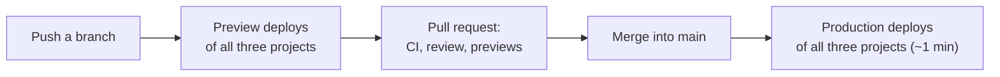

# Deployment

The three apps run on Vercel, one project each, all connected to the GitHub repository `transportmozambique/Transport-Mozambique`. A push deploys; there is no separate release step. The database is on Neon and is changed by hand, with idempotent SQL, as described below.

**On this page:** [Projects](#projects) · [How a change reaches production](#how-a-change-reaches-production) · [Builds](#builds) · [Database changes in production](#database-changes-in-production) · [Checking a deploy](#checking-a-deploy) · [Rolling back](#rolling-back) · [Deploying by hand](#deploying-by-hand)

---

## Projects

| Vercel project (team `transportmozambique`) | Root Directory | Production URL | Environment variables |
|---|---|---|---|
| `transport-mz` | `transport-client` | https://transport-mz.vercel.app | [passenger app](configuration.md#transport-client-passenger-app-ussd-driver-api-gps-intake) |
| `transport-mz-admin` | `transport-admin` | https://transport-mz-admin.vercel.app | [admin](configuration.md#transport-admin-back-office) |
| `transport-mz-driver` | `transport-driver` | https://transport-mz-driver.vercel.app | [driver portal](configuration.md#transport-driver-driver-portal) |

All three use the Next.js preset with the default commands (`npm install`, `npm run build`) and Node.js 24.x. Functions run in Vercel's `iad1` region (Washington, D.C.), near the Neon database in `us-east-2` (Ohio).

The root `vercel.json` belongs to the legacy root app; no project builds it ([Architecture → Not deployed](architecture.md#not-deployed-legacy-code)).

**Scheduled job.** `.github/workflows/arrival-check.yml` calls `POST https://transport-mz.vercel.app/api/simulation {"action":"check"}` every 5 minutes from GitHub Actions, so arrival SMS go out without web traffic ([Data flow → Arrival alert](data-flow.md#arrival-alert-and-sms)). Vercel's Hobby plan only allows daily cron jobs. Its runs are under the repository's Actions tab → "Arrival SMS check", where "Run workflow" also starts one by hand. GitHub pauses schedules after 60 days without activity in the repository; "Enable workflow" on the same page turns it back on.

## How a change reaches production



1. **Branch.** Every push to any branch builds a **preview** of each of the three projects, with its own URL (`transport-<hash>-transportmozambique.vercel.app`, plus a stable `…-git-<branch>-…` alias). Vercel links them from the pull request.
2. **Review** the change on the previews. Previews use the **Preview** environment variables: the passenger app's preview has no Africa's Talking key (no SMS), and its `DATABASE_URL` is a separate sensitive value; check which database it points to before testing anything that writes ([Configuration → Where values live](configuration.md#where-values-live)).
3. **Checks.** GitHub's CI type-checks the three apps, compares the three schemas and checks the documentation's links ([Testing → CI](testing.md#ci-on-github)). Merge when they and the three Vercel previews are green.
4. **Merge into `main`.** Each project builds a **production** deployment and moves its production domain to it when the build succeeds. Builds take 30–60 s.

Every push rebuilds all three projects, even if only one app's folder changed.

The driver portal reads `NEXT_PUBLIC_API_URL` at build time. A preview of the portal therefore talks to whatever that variable says for previews, normally the production passenger app, not the passenger app's preview of the same branch.

## Builds

| Project | `npm run build` | Notes |
|---|---|---|
| `transport-mz` | `prisma generate && next build` | `postinstall` also runs `prisma generate`. |
| `transport-mz-admin` | `prisma generate && next build` with `NODE_OPTIONS=--max-old-space-size=4096` | Needs `DATABASE_URL` at build time: Next.js evaluates the API modules while collecting page data, and the Prisma client refuses an undefined URL ("Invalid value undefined for datasource \"db\""). |
| `transport-mz-driver` | `next build` | Static pages; no database. |

Run the same build locally before pushing to catch type errors, which fail the Vercel build:

```bash
cd transport-admin && npx tsc --noEmit && npm run build
```

## Database changes in production

The production database was created with `prisma db push` and by hand, so it has **no `_prisma_migrations` table**. `prisma migrate status` lists every migration as unapplied, and **`prisma migrate deploy` would try to recreate existing tables. Never run it against production.** The migration files under `prisma/migrations` are written to be idempotent (`IF NOT EXISTS`) and are applied one by one:

1. Write the migration in `prisma/migrations/<timestamp>_<name>/migration.sql`, idempotently, and update `prisma/schema.prisma` (then copy the schema to `transport-client/prisma/schema.prisma`; the admin's copy differs only in its `generator` block).
2. Test it on a copy of production: a Neon branch or a local restore ([Getting started → Production data](getting-started.md#working-with-a-copy-of-production-data)).
3. See what production is missing, using the **direct** host (the `DATABASE_URL` without `-pooler`):

   ```bash
   cd transport-client
   npx prisma migrate diff --from-url "$PROD_DIRECT_URL" --to-schema-datamodel ../prisma/schema.prisma --script
   ```

4. Apply only the new migration:

   ```bash
   npx prisma db execute --url "$PROD_DIRECT_URL" --file ../prisma/migrations/<timestamp>_<name>/migration.sql
   ```

5. Run the diff again. It should print an empty migration.

**Order with the code deploy.** Prisma selects every column of a model by default, so code that knows about a new column fails on a database without it. Apply **additive** changes (new tables, nullable columns, columns with defaults) **before** merging the code that uses them. Apply **removals** after the code that stopped using them is in production.

Keep the URL out of shell history and logs: pull it with `vercel env pull` into a git-ignored file and read it from there. Back up any rows a data fix overwrites before running it.

## Checking a deploy

**Status and logs.**

```bash
vercel ls transport-mz                     # recent deployments, newest first
vercel inspect <deployment url>            # target, aliases, build output
vercel logs <deployment url>               # function logs (USSD requests, SMS results, errors)
```

The same are in the Vercel dashboard under each project's **Deployments** and **Logs**.

**Smoke test after a production deploy** (read-only, except the USSD call, which sends nothing on the first screen):

```bash
curl -s https://transport-mz.vercel.app/api/simulation                       # {"success":true,"status":{"mode":"gps-or-timetable","busCount":111,…}}
curl -s "https://transport-mz.vercel.app/api/buses?fields=position" | head -c 200
curl -s -X POST https://transport-mz.vercel.app/api/ussd --data-urlencode "sessionId=check-1" \
  --data-urlencode "phoneNumber=+258840000001" --data-urlencode "text="   # CON Transportes Mocambique …
curl -s -o /dev/null -w "%{http_code}\n" https://transport-mz-admin.vercel.app/api/transportes   # 401 (session required)
curl -s -o /dev/null -w "%{http_code}\n" https://transport-mz-driver.vercel.app/                 # 200
```

Then open each app in a browser: the live map, an admin sign-in, a driver sign-in with a PIN.

## Rolling back

Vercel keeps every deployment. To put a previous one back on the production domain:

- **Dashboard:** project → Deployments → the last good production deployment → "Instant Rollback" (or "Promote to Production").
- **CLI:** `vercel rollback <deployment url>`.

A rollback only changes code. Database changes stay, so roll back the code only to a version that works with the current schema, or revert the schema with a new idempotent migration. Rolling back does not move `main`: revert the bad commit on GitHub too, or the next merge redeploys it.

## Deploying by hand

Normally unnecessary: pushes deploy. To redeploy without a code change (for example after changing an environment variable, which only applies to new deployments), use the dashboard's "Redeploy" on the current production deployment, or:

```bash
vercel redeploy <production deployment url>
```

---

[← API reference](api-reference.md) · [Documentation index](README.md) · Next: [Testing →](testing.md)
