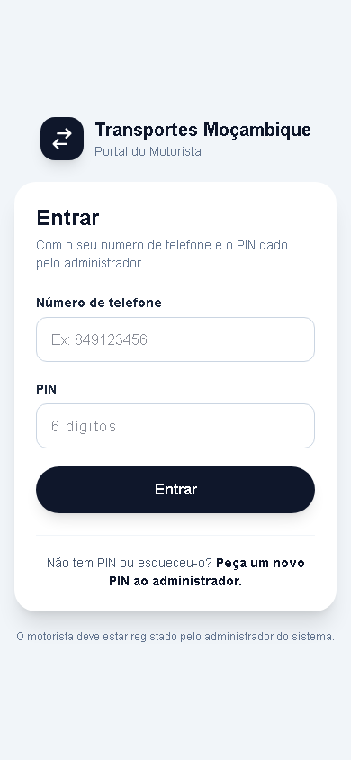
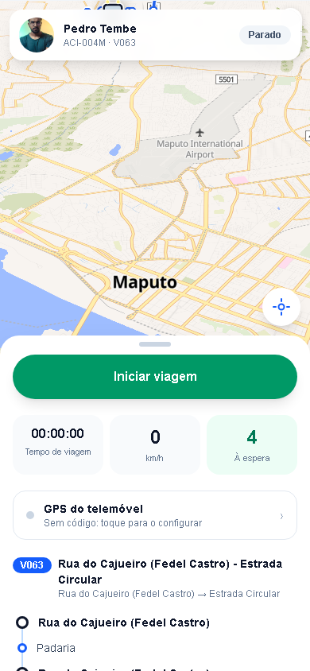
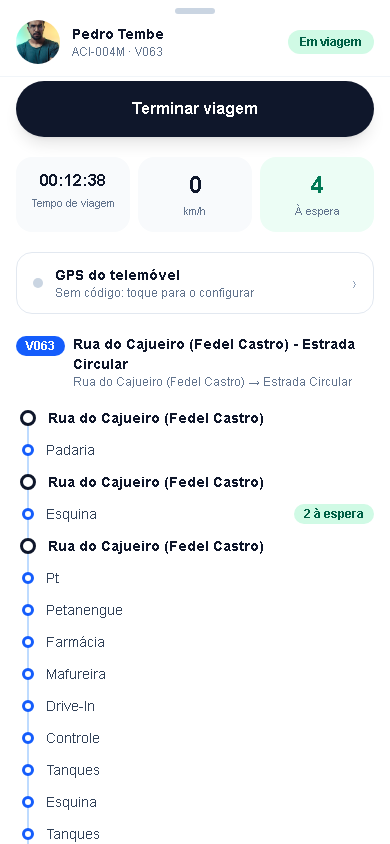
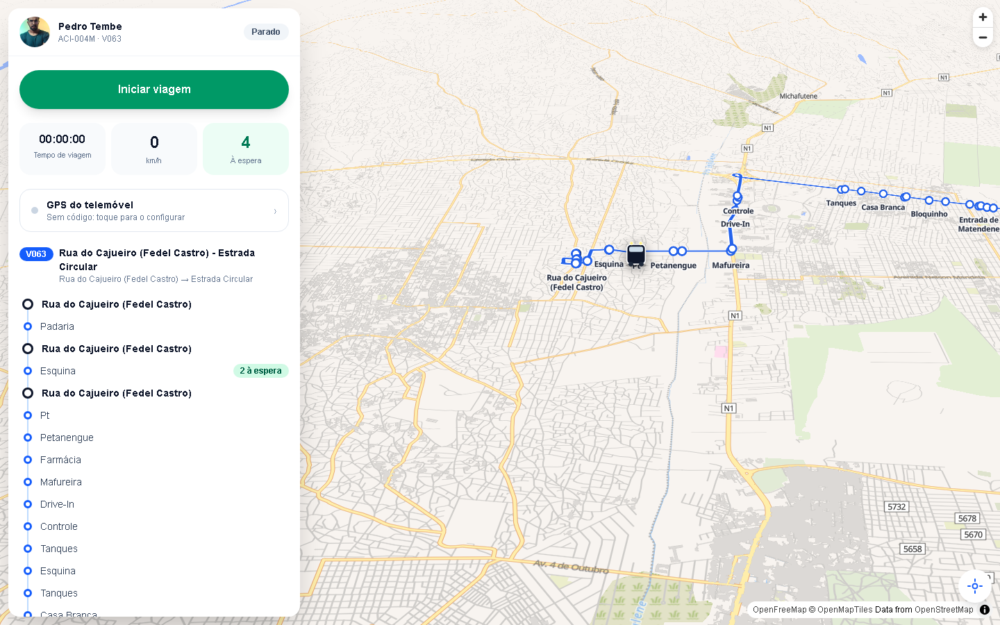
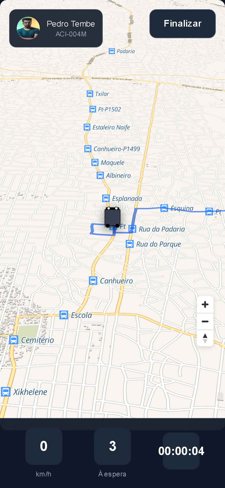
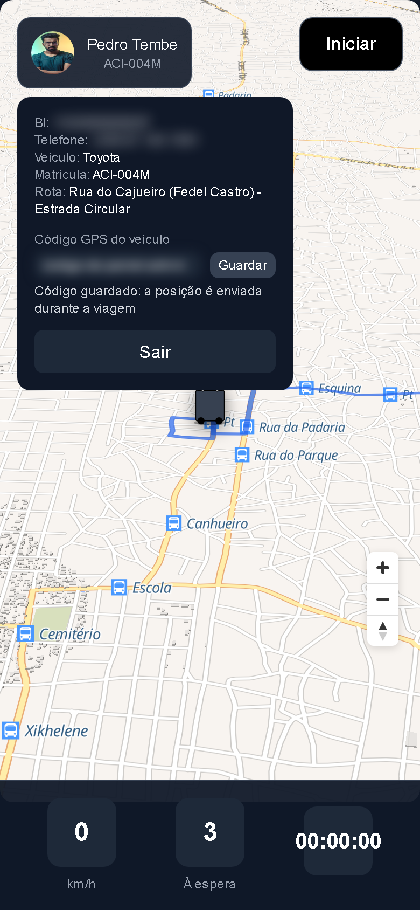

# Driver portal

**Live:** https://transport-mz-driver.vercel.app · **Code:** `transport-driver/app` · **Runs locally on:** http://localhost:3001

A phone web app for drivers. The driver signs in with a PIN, starts and ends trips, can share the phone's GPS as the vehicle's position, and sees how many passengers are waiting at the stops of the route. The portal has no API or database of its own: every request goes to the passenger app (`transport-mz`), whose base URL is `NEXT_PUBLIC_API_URL` ([Configuration](configuration.md#transport-driver-driver-portal)).

The same trip flag can be changed from any phone through USSD option 6 ([USSD → Driver menu](ussd.md#6-area-do-motorista)). The portal and USSD always agree because both read and write `Motorista.emViagem`.

**On this page:** [Before the first sign-in](#before-the-first-sign-in) · [A driver's day](#a-drivers-day-step-by-step) · [Sign-in](#sign-in-) · [Dashboard](#dashboard-dashboard) · [Trips](#starting-and-ending-a-trip) · [Phone as GPS](#sharing-the-phones-gps) · [Waiting passengers](#passengers-waiting-on-the-route) · [Browser storage](#what-the-browser-stores) · [Errors](#errors)

---

## Before the first sign-in

A driver cannot register. An administrator must:

1. Create the driver in the admin (**Motoristas → Novo**) and assign them to a vehicle (**Motoristas → Atribuir Motoristas**). The vehicle's route (`Via`) is the route the portal shows.
2. Open the driver's page and press **"Gerar PIN"** in the "PIN de Acesso" card ([Admin dashboard → Drivers](admin-dashboard.md#drivers-motoristas)). The 6-digit PIN is shown once ("só é mostrado agora"). Only its bcrypt hash is stored in `Motorista.password`.
3. Give the PIN to the driver. **"Gerar novo PIN"** replaces it and the old one stops working; that is also how a forgotten PIN is reset.

For a GPS-sharing phone, the administrator also creates the vehicle's **device code** (**Transportes → vehicle → Rastreador GPS**, see [GPS tracking](gps-tracking.md#1-create-the-device-code)).

## A driver's day, step by step

What a driver does, on a phone. The administrator must have done [the steps before the first sign-in](#before-the-first-sign-in).

1. **Open the portal** at https://transport-mz-driver.vercel.app. On Android, Chrome's menu → "Adicionar ao ecrã principal" puts it on the home screen like an app.
2. **Sign in** with the phone number the administrator registered (with or without `+258`, spaces do not matter) and the 6-digit PIN. The portal remembers the driver for 30 days.
3. **Check the top of the screen:** your name, the vehicle's plate and the route's code. If they are wrong, ask the administrator; once they change it, the portal shows the new vehicle and route within 5 minutes.
4. **Optional, once per phone: share the phone's GPS.** Tap your name → paste the vehicle's GPS code from the administrator in "Código GPS do veículo" → **Guardar**. Allow location when the browser asks ([details](#sharing-the-phones-gps)).
5. **At the first terminal, tap "Iniciar viagem".** The button turns dark, "Em viagem" shows at the top and the clock starts. With a GPS code saved, the phone now sends its position: keep the portal open and the screen on.
6. **During the trip,** "À espera" shows how many passengers asked to be told about this route's stops in the last 3 hours, and the stop list shows where ("2 à espera"). Drag the panel up to see all the stops.
7. **At the end, tap "Terminar viagem".**
8. **No data or no smartphone?** Dial the USSD code, choose 6, type the PIN, and 1 → 1 starts or ends the trip ([USSD → Driver menu](ussd.md#6-area-do-motorista)). The portal shows the same state within 30 seconds.
9. **Sign out** (tap your name → **Sair**) on a shared phone. A forgotten PIN is reset by the administrator ("Gerar novo PIN").

## Sign-in (`/`)



"Número de telefone" and "PIN", then "Entrar".

- The phone matches with or without `+258` and spaces. Driver phones are stored in mixed formats (`+258 87 123 4567`, `841234567`), so the server normalises both sides before comparing.
- On success, the server returns the driver's profile, vehicle, route (with its stops in travel order and its road path) and a **session token** valid 30 days, signed with `DRIVER_SESSION_SECRET`. The portal stores all of it in `localStorage` and opens `/dashboard`.

| Action | Request |
|---|---|
| "Entrar" | `POST {API}/api/driver/login` `{"telefone": "871234567", "password": "<PIN>"}` |

`{API}` is `NEXT_PUBLIC_API_URL`, `https://transport-mz.vercel.app` in production. The endpoints answer with `Access-Control-Allow-Origin: *` because the portal runs on another domain.

## Dashboard (`/dashboard`)

 

The map takes the whole screen, with a panel over it: a bottom sheet on a phone, a card on the left on a computer. It looks like the passenger app.

- **Top:** the driver's photo (or initials), name, plate and route code, with "Parado" or "Em viagem". Tapping it opens the profile ([below](#sharing-the-phones-gps)). On a computer this is the top of the card.
- **Map:** MapLibre with an OpenFreeMap style, tilted 60° with 3D buildings from zoom 15. It draws the route's road path (`Via.geoLocationPath`) in blue, its stops (terminals as dark dots) with their names, and the bus. The bus is at the **phone's position** once the browser gives it, and at the start of the path until then. The round button centres the map on it.
- **The panel**, from the top:
  - **"Iniciar viagem"** (green) or **"Terminar viagem"** (dark) ([Trips](#starting-and-ending-a-trip));
  - three numbers: **Tempo de viagem**, time since the trip started, counted from `viagemIniciadaEm` on the server, so it is right after reloading the page or starting the trip by USSD; **km/h**, the phone's own speed from the browser Geolocation API; and **À espera**, passengers waiting along the route ([below](#passengers-waiting-on-the-route));
  - **GPS do telemóvel:** whether the phone shares its position, with the last send ("GPS enviado às 10:31") or "Sem código: toque para o configurar". Tapping it opens the profile;
  - the route: its code, name and terminals, then its stops in travel order with "2 à espera" where passengers wait. Stops in a row with the same name (both sides of a street) are listed once.
- **On a phone** the sheet has three heights, like the passenger app: lowered (only the trip button shows), half the screen, and the whole screen (the map hidden). Drag its top, or tap the bar on it.



| When | Request |
|---|---|
| Page opens, then every 30 s | `GET {API}/api/driver/trip` (Bearer session token) → `{"emViagem", "viagemIniciadaEm"}` |
| Page opens, then every 5 min | `GET {API}/api/driver/me` (Bearer session token) → the driver, vehicle and route as the admin has them now; the map is redrawn only when they changed |
| Page opens, then every 60 s | `GET {API}/api/driver/seguidores` (Bearer session token) |
| During a trip, at most every 15 s | `POST {API}/api/gps` (Bearer **device code**), only if a device code is saved |

## Starting and ending a trip



"Iniciar viagem" sends `POST {API}/api/driver/trip` with `{"action": "iniciar"}`; "Terminar viagem" sends `{"action": "encerrar"}`. The response is the new state, and the button, the "Em viagem" label and the clock follow it. An error shows under the button.

| Action | Database change |
|---|---|
| `iniciar` | `Motorista.emViagem = true`, `viagemIniciadaEm = now()`. If a trip is already running (started by USSD, for example), nothing changes and the original start time is kept. |
| `encerrar` | `emViagem = false`, `viagemIniciadaEm = NULL` |

What the trip flag does and does not do:

- It **gates GPS sharing** from this portal: positions are sent only during a trip.
- It is **shared with USSD**: a trip started on `*6` shows here within 30 s, and the other way round.
- It does **not** change where the bus appears to passengers. Positions come from a fresh GPS fix or, without one, from the timetable ([GPS tracking](gps-tracking.md#how-a-position-is-chosen)).
- The portal sends no SMS for a trip. The USSD driver menu does ("Viagem iniciada com sucesso! …").
- The admin does not show the flag. Query it directly:

```sql
SELECT nome, telefone, "emViagem", "viagemIniciadaEm" FROM "Motorista" WHERE "emViagem";
```

## Sharing the phone's GPS



Tap the name (or the "GPS do telemóvel" line) to open the profile: ID number and phone (blurred above), vehicle and route, the **"Código GPS do veículo"** field, and **"Sair"** (sign out). "Fechar" or a tap outside closes it.

To make the phone the vehicle's GPS tracker:

1. Paste the vehicle's device code from the admin and tap **"Guardar"**. The panel answers "Código guardado: a posição é enviada durante a viagem". The code stays on this phone (`localStorage['gpsCodigo']`); an empty value removes it.
2. Allow location access when the browser asks. The page watches the position with high accuracy.
3. Tap **"Iniciar viagem"**. From then on, every new position (at most one every 15 s) is posted:

```http
POST https://transport-mz.vercel.app/api/gps
Authorization: Bearer <device code>
Content-Type: application/json

{"latitude": -25.9655, "longitude": 32.5832, "speed": 23.4, "heading": 87, "accuracy": 12, "timestamp": 1792225800000}
```

`speed` is in km/h (the browser's m/s × 3.6), `accuracy` in metres, `timestamp` in milliseconds. The server stores it on the vehicle (`Transporte.currGeoLocation`, `gpsAtualizadoEm`, `gpsVelocidade`, `gpsDirecao`). From then on, passengers see that position instead of the timetable one for 3 minutes after each fix. The full rules (accuracy limit, old and future timestamps) are in [GPS tracking → JSON](gps-tracking.md#json-with-a-bearer-code).

The status line under the field, and the "GPS do telemóvel" line in the panel, report each send:

| Status | Meaning |
|---|---|
| "GPS enviado às 10:31" | Stored (or ignored as older than the last fix or less precise than 200 m; both answer 200). |
| "Código GPS inválido" | 401: no vehicle has this code. It was mistyped, or the admin generated a new one. |
| "Erro ao enviar GPS" | Another HTTP error. |
| "Sem ligação: GPS não enviado" | No network. The next position is tried at the next interval. |
| "Localização do telemóvel indisponível" | Location permission denied, or no position available. |

Browsers stop sending when the page is in the background or the screen is off. For continuous tracking, use a dedicated tracker or the Traccar Client app instead ([GPS tracking → Traccar Client](gps-tracking.md#traccar-client-on-a-phone)).

## Passengers waiting on the route

"À espera" in the panel is the total. The route's stop list under it shows, at each stop, the number of arrival alerts (`MISSION` rows) created there in the **last 3 hours**, from the web or USSD ("2 à espera"); stops without one show nothing. Alerts already answered by an arrival SMS still count, because a passenger who was told the bus is 1 km away is still waiting. Stops in a row with the same name are listed once, with their counts added up. The numbers refresh every minute.

`GET {API}/api/driver/seguidores` answers:

```json
{"total": 3, "paragens": [{"nome": "Rua do Cajueiro (Fedel Castro)", "aEspera": 0}, {"nome": "Padaria", "aEspera": 1}]}
```

The same numbers with SQL, for one route:

```sql
SET TIME ZONE 'UTC';
SELECT p.nome, count(m.id) AS a_espera
FROM "ViaParagem" vp
JOIN "Paragem" p ON p.id = vp."paragemId"
LEFT JOIN "MISSION" m ON m."paragemId" = p.id AND m."createdAt" >= now() - interval '3 hours'
WHERE vp."viaId" = '<via id>'
GROUP BY p.id, p.nome ORDER BY a_espera DESC;
```

## What the browser stores

| `localStorage` key | Content | Set by | Removed by |
|---|---|---|---|
| `motorista` | The sign-in response: profile, vehicle, route with stops and path, session `token`; refreshed from `/api/driver/me` when the admin changes the vehicle or route | sign-in | "Sair", or any 401 from `/api/driver/trip` or `/api/driver/me` |
| `gpsCodigo` | The vehicle's device code | "Guardar" | saving an empty value |

When the admin moves the driver to another vehicle, or edits the vehicle's route or its stops, the portal picks it up within 5 minutes (or at once on reload), without signing out.

## Errors

| Message | Cause | Fix |
|---|---|---|
| "Motorista não encontrado. Contacte o administrador." | No driver has this phone number. | Check the number in **Motoristas**. |
| "Ainda não tem PIN. Peça ao administrador para gerar o seu PIN." | `Motorista.password` is empty. | "Gerar PIN" in the admin. |
| "PIN incorreto" | Wrong PIN. | Retype it, or "Gerar novo PIN" in the admin. |
| "Sessão indisponível. Contacte o administrador." (500) | `DRIVER_SESSION_SECRET` is not set on the passenger app. | Set it on Vercel and redeploy ([Configuration](configuration.md#environment-variables)). |
| "Erro de conexão. Verifique se o servidor está a funcionar." | The portal cannot reach `NEXT_PUBLIC_API_URL`. | Check the variable (it is fixed at build time) and that the passenger app is up. |
| Sent back to sign-in | The session token expired (30 days), was signed with a rotated secret, or the driver was deleted. | Sign in again. |

---

[← USSD service](ussd.md) · [Documentation index](README.md) · Next: [Admin dashboard →](admin-dashboard.md)
