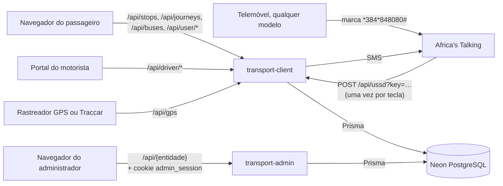
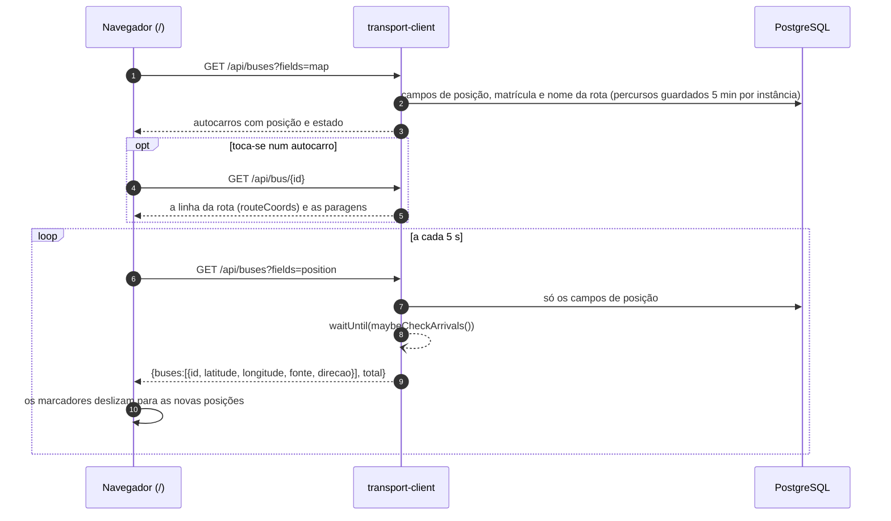
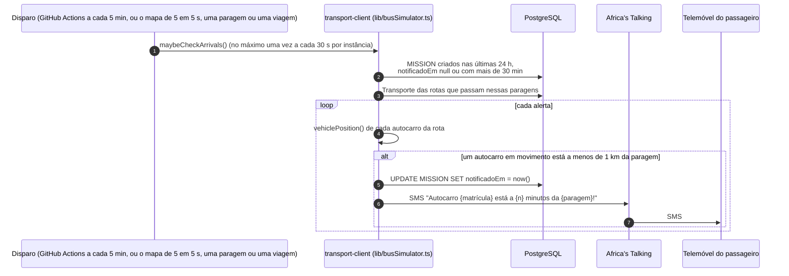
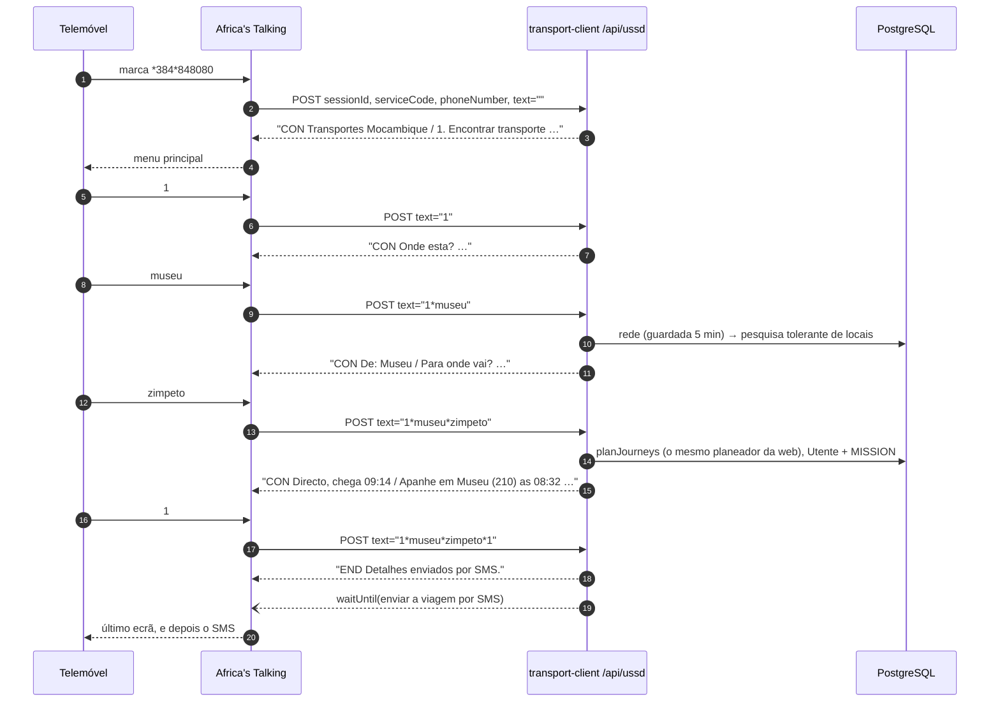
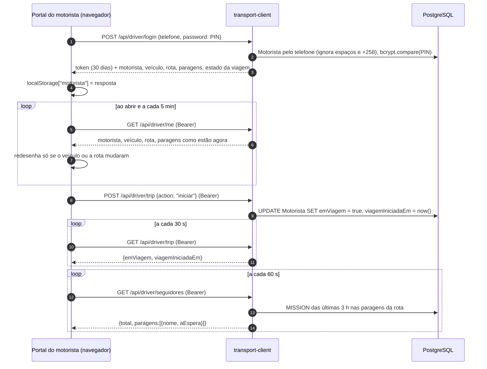
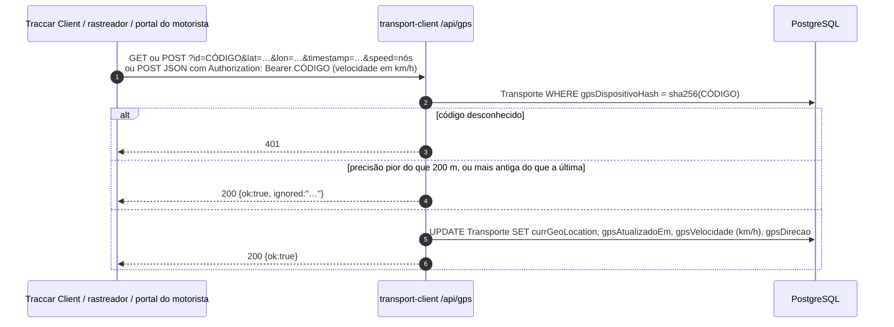
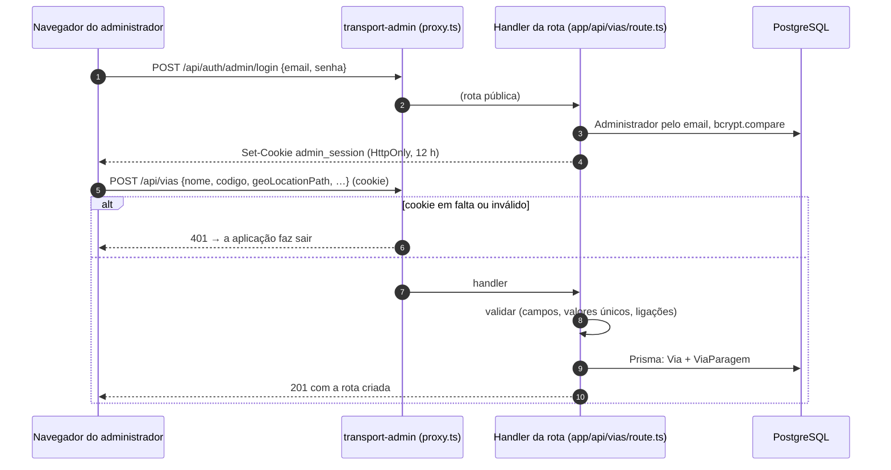

# Fluxos de dados

<!-- navegação: gerada por .github/scripts/docs-nav.py, não editar à mão -->
[Documentação](README.md) › 3. Perceber como funciona › **Fluxos de dados** (página 8 de 23)

Anterior: [Configuração](configuracao.md) · [Índice](README.md) · Seguinte: [Localização e GPS](localizacao-gps.md)

<details>
<summary>Todas as páginas</summary>

- 1. Conhecer o projecto: [Visão geral](visao-geral.md) · [Glossário](glossario.md) · [Fontes de dados](fontes-de-dados.md) · [Estado do projecto](estado-do-projecto.md)
- 2. Montar localmente: [Primeiros passos](primeiros-passos.md) · [Base de dados](base-de-dados.md) · [Configuração](configuracao.md)
- 3. Perceber como funciona: **Fluxos de dados** · [Localização e GPS](localizacao-gps.md) · [Serviço USSD](ussd.md) · [Segurança](seguranca.md) · [Referência da API](referencia-api.md) · [Mapa do código](mapa-do-codigo.md)
- 4. Usar as aplicações: [Aplicação dos passageiros](app-passageiros.md) · [Portal do motorista](portal-motorista.md) · [Painel de administração](painel-admin.md)
- 5. Pôr online: [Publicação](publicacao.md) · [Guia da Vercel](guia-vercel.md) · [Guia da Neon](guia-neon.md) · [Africa's Talking](africas-talking.md)
- 6. Manter: [Testes](testes.md) · [Resolução de problemas](resolucao-de-problemas.md) · [Limitações](limitacoes.md)

</details>
<!-- /navegação -->

Esta página segue os dados em cada fluxo da plataforma, do primeiro pedido às linhas que lê ou escreve. Cada fluxo diz o endpoint, o código que o trata (com ligação) e as tabelas envolvidas, e porque é que foi feito assim. O significado das tabelas e campos está em [Base de dados](base-de-dados.md).

**Nesta página:** [Guardado ou calculado](#o-que-é-guardado-e-o-que-é-calculado) · [Quem faz o quê](#quem-faz-o-quê-e-o-que-se-lê-e-escreve) · [Planear uma viagem](#planear-uma-viagem) · [Hora de chegada](#hora-de-chegada) · [Mapa ao vivo](#mapa-ao-vivo) · [Acompanhar uma viagem](#acompanhar-uma-viagem) · [Alerta de chegada e SMS](#alerta-de-chegada-e-sms) · [Sessão USSD](#sessão-ussd) · [Motorista](#entrada-e-viagem-do-motorista) · [Posição GPS](#posição-gps) · [Alterações no painel](#alterações-no-painel) · [PIN e código GPS](#pin-do-motorista-e-código-do-dispositivo-gps) · [Quem escreve cada tabela](#quem-escreve-cada-tabela)

---

## O que é guardado e o que é calculado

Todos os pedidos passam por duas aplicações de servidor, e as duas lêem e escrevem a mesma base de dados. Nada é copiado entre elas, por isso uma alteração guardada no painel é o que a aplicação dos passageiros, o USSD e o portal do motorista lêem no pedido seguinte.



Alguns valores **nunca são guardados**: calculam-se a cada pedido a partir do que está guardado. Porquê: numa plataforma serverless não há um processo sempre ligado para os manter actualizados, e um valor calculado nunca fica desactualizado.

| Valor | Calculado a partir de | Código |
|---|---|---|
| Onde está um autocarro agora | a última posição GPS se tiver menos de 3 minutos, senão o modelo de horário: vai e volta ao longo do percurso da rota das 05:00 às 21:00 à velocidade da tarifa | [`lib/vehiclePosition.ts`](../transport-client/lib/vehiclePosition.ts) |
| Quando um autocarro chega a uma paragem, tempo de viagem | essa posição, o percurso da rota e as velocidades da tarifa | `estimateBusTrip` no mesmo ficheiro |
| Tarifa | distância ao longo do percurso × `Tarifa.precoPorKm`, pelo menos `Tarifa.tarifaMinima` | `fareFor` em [`lib/fares.ts`](../transport-client/lib/fares.ts) |
| Ordem das paragens de uma rota | cada paragem projectada no percurso da rota (`ViaParagem` não tem coluna de ordem) | `orderStopsAlongRoute` em [`lib/fares.ts`](../transport-client/lib/fares.ts) |
| Viagens com transbordos | a rede de rotas e paragens, guardada 5 minutos por instância | [`lib/journeys.ts`](../transport-client/lib/journeys.ts) ([abaixo](#planear-uma-viagem)) |

## Quem faz o quê, e o que se lê e escreve

Cada linha resume um fluxo; a coluna "Explicado em" leva à explicação completa, com diagrama.

| Quem, a fazer o quê | O que se lê | O que se escreve | Explicado em |
|---|---|---|---|
| Passageiro abre o mapa | `GET /api/stops` (todas as paragens servidas, com as rotas) e `GET /api/buses` (todos os autocarros, na posição de agora); depois as posições a cada 5 s | nada; o pedido de 5 em 5 s também dispara a verificação de chegadas | [Mapa ao vivo](#mapa-ao-vivo) |
| Tem uma posição, ou escolhe uma partida | `GET /api/destinos?lat=…&lng=…` (ou `from=`): todos os locais a que se chega, a chegada mais cedo primeiro, cada um com a paragem onde se apanha o primeiro autocarro | nada | [Planear uma viagem](#planear-uma-viagem) |
| Toca numa paragem | `GET /api/stops/{id}`: as rotas que passam, o próximo autocarro de cada sentido e todos os locais a que se chega dali | nada | [Planear uma viagem](#planear-uma-viagem) |
| Escolhe um destino | `POST /api/journeys {to, lat, lng}` (ou `from`): até 3 viagens, cada autocarro com hora para o momento em que o passageiro chega à paragem. A posição vai no corpo, para ficar fora dos registos de pedidos. | nada | [Planear uma viagem](#planear-uma-viagem) |
| Acompanha a viagem | `POST /api/viagem?b=BUS~DE~PARA,…&a=…&bordo=…` com `{lat, lng}` no corpo, a cada 10 s | um `MISSION` se guardar o alerta | [Acompanhar uma viagem](#acompanhar-uma-viagem) |
| Usa o menu USSD | Cada tecla vai do telemóvel à Africa's Talking, que a envia num `POST /api/ussd`. O pedido traz **todas** as teclas da sessão em `text` (`1*museu*zimpeto`); o servidor refaz o caminho desde o menu principal para saber que ecrã mostrar, por isso não guarda nada entre teclas | opção 1: um `MISSION` (e um `Utente` para um telefone novo); opção 6: `Motorista.emViagem`; SMS pela Africa's Talking | [Sessão USSD](#sessão-ussd), e passo a passo com ecrãs em [Serviço USSD](ussd.md#leitura-das-teclas) |
| Motorista entra e inicia uma viagem | `POST /api/driver/login` (telefone e PIN; token de 30 dias); `GET /api/driver/me` a cada 5 min; `GET /api/driver/seguidores` | `Motorista.emViagem`, `viagemIniciadaEm` | [Entrada e viagem do motorista](#entrada-e-viagem-do-motorista) |
| Um dispositivo GPS envia | `POST /api/gps` com o código do dispositivo. Posições com precisão pior do que 200 m, ou mais antigas do que a guardada, são ignoradas. | `Transporte.currGeoLocation`, `gpsAtualizadoEm`, velocidade, rumo | [Posição GPS](#posição-gps) |
| Verificação de chegadas (a cada 5 min pelo GitHub Actions, e no máximo a cada 30 s por instância enquanto a web é usada) | alertas das últimas 24 h e as posições dos autocarros | `MISSION.notificadoEm`; um SMS pela Africa's Talking | [Alerta de chegada e SMS](#alerta-de-chegada-e-sms) |
| Administrador cria, lê, altera ou apaga | `GET /api/{entidade}` com o cookie de sessão | a tabela da entidade, e as ligações dela | [Alterações no painel](#alterações-no-painel) |

## Planear uma viagem

O mapa do passageiro (`/`, `/search`) carrega todas as paragens uma vez e encontra as paragens perto do passageiro no próprio navegador. Pede ao servidor os destinos a partir do início (a posição do passageiro ou um local escolhido), os destinos de uma paragem, e as viagens. [`lib/journeys.ts`](../transport-client/lib/journeys.ts) faz o planeamento, para a web e para as opções 1 e 4 do USSD. Porquê o mesmo código: a web e o USSD dão sempre a mesma resposta.

```mermaid
sequenceDiagram
  autonumber
  participant B as Navegador (/ ou /search)
  participant C as transport-client
  participant DB as PostgreSQL
  B->>C: GET /api/stops
  C->>DB: vias com Transporte + ViaParagem + Paragem (rede guardada 5 min por instância)
  C-->>B: todas as paragens servidas, com as rotas
  B->>B: posição (navegador) → paragens mais próximas, pesquisa por nome, locais
  B->>C: GET /api/destinos?lat,lng ou from={paragens}
  C->>DB: todos os Transporte (campos de posição)
  C-->>B: todos os locais alcançáveis, a chegada mais cedo primeiro,<br/>cada um com a paragem onde se apanha o primeiro autocarro
  B->>C: GET /api/stops/{id}
  C->>DB: todos os Transporte (campos de posição)
  C-->>B: rotas × sentidos: próximo autocarro, paragens alcançadas;<br/>todos os locais alcançáveis, a chegada mais cedo primeiro
  B->>C: POST /api/journeys {from: paragens, ou lat, lng; to: paragens}
  Note over C: candidatas ordenadas com velocidades fixas + 10 min por autocarro,<br/>depois cronometradas com estimateBusTrip() à hora de chegada a cada paragem
  C->>DB: Transporte das rotas candidatas (+ Tarifa activa, guardada 60 s)
  C-->>B: até 3 viagens: caminhadas + autocarros com horas, tarifas, percursos
  B->>B: desenha a viagem escolhida; "Acompanhar viagem" → /viagem?b=BUS~DE~PARA,…
```

**A rede** (`loadNetwork`) é construída uma vez por instância do servidor e guardada 5 minutos: cada rota com autocarro, o seu percurso, as suas paragens ordenadas ao longo do percurso com a distância, e para cada paragem as paragens a menos de 400 m (uma grelha de células de ~500 m). Paragens com o mesmo nome a menos de 400 m umas das outras formam um *local* ([`lib/places.ts`](../transport-client/lib/places.ts)), que é o que a pesquisa por nome devolve. Porquê guardar a rede: lê-la da base de dados a cada pedido levaria mais tempo do que o próprio cálculo.

**Encontrar viagens** (`planJourneys`), passo a passo:

1. **Início e fim.** No início, as paragens escolhidas: o primeiro autocarro apanha-se lá. Só quando nenhuma viagem a partir delas é encontrada se repete a pesquisa com todas as paragens a menos de 300 m. A partir da posição do passageiro, as 8 paragens mais próximas a menos de 800 m. No fim, as paragens do destino e todas as paragens a menos de 300 m delas. A caminhada conta a 1 m/s em linha recta (4,5 km/h com um quarto a mais pelas ruas).
2. **Directas**: todas as rotas que passam numa paragem de início e numa de fim (os autocarros vão e voltam, por isso qualquer sentido serve).
3. **Um transbordo**: cada par de rotas, uma por uma paragem de início e outra por uma de fim, que se cruzam numa paragem comum ou em duas paragens a menos de 400 m. Cada troço de autocarro anda pelo menos 300 m. Guarda-se o melhor ponto de transbordo por par de rotas.
4. **Chegada mais cedo com as horas reais** (`earliestArrivals`): uma pesquisa por rondas dependente do tempo (RAPTOR) a partir das paragens de início, até 4 autocarros.
   - Cada ronda percorre todas as rotas que passam numa paragem melhorada na ronda anterior, nos dois sentidos.
   - Em cada paragem onde o passageiro pode estar, pergunta a cada autocarro da rota quando chega depois desse momento (`estimateBusTrip`), e fica no autocarro já apanhado a não ser que outro chegue antes.
   - Depois de cada ronda, uma caminhada de até 400 m para uma paragem próxima.
   - A partir da posição do passageiro, uma paragem de início mais longe perde para uma mais perto quando o autocarro da mesma rota chega lá no máximo 2 minutos mais tarde (`BOARD_SLACK_MS`): as duas estimativas são normalmente o mesmo autocarro, e andar menos é melhor.

   A sua viagem mais rápida até ao destino junta-se às candidatas. A mesma pesquisa, corrida até todas as paragens, dá a lista de todos os destinos (`reachFrom`, cerca de 60 a 80 ms). Porquê o RAPTOR: é o algoritmo dos planeadores de transportes públicos, rápido nesta rede e natural para contar transbordos (uma ronda = um autocarro).
5. **Mais transbordos**, só quando 2 e 3 não encontram nada: uma pesquisa por rondas, um autocarro a mais por ronda (até 5), com a forma mais barata de chegar a cada paragem por ronda. O resultado é a viagem com menos autocarros, e mais um autocarro quando isso poupa mais de 15 minutos.
6. **Ordenação**: as candidatas ordenam-se pelo tempo a bordo à velocidade da tarifa, a caminhada, e 10 minutos por autocarro. Quando há um autocarro directo, as viagens com transbordos só ficam se forem pelo menos 10 minutos melhores nestas estimativas. As 8 melhores são **cronometradas**: em cada troço, cada autocarro da rota diz quando chega à paragem *no momento em que o passageiro lá chega* (`estimateBusTrip` com essa hora), e apanha-se o primeiro.
7. **Resultado**: a chegada mais cedo primeiro. Uma opção com o mesmo número de autocarros, menos caminhada e chegada no máximo 2 minutos mais tarde passa para cima, o que coincide com a lista de destinos. As opções que nenhuma outra bate na chegada e no número de transbordos vêm primeiro, depois outras rotas, até 3.

A rede de produção tem 1 855 paragens servidas e 261 rotas. Uma viagem ou uma lista de destinos demora cerca de 0,3 s num servidor local aquecido; contra a produção, medido de fora, 1 a 1,5 s. 256 das 261 rotas estão ligadas por paragens partilhadas ou próximas. Dois grupos pequenos (4 rotas, e 1 rota) não estão, e não há viagens entre eles e o resto.

## Hora de chegada

Os mesmos números servem as viagens, o "próximo autocarro" de uma paragem, a viagem acompanhada e o USSD. Vêm de [`lib/vehiclePosition.ts`](../transport-client/lib/vehiclePosition.ts) e [`lib/fares.ts`](../transport-client/lib/fares.ts):

- **Ordem das paragens.** `ViaParagem` não tem coluna de ordem. As paragens ordenam-se pela projecção de cada uma no percurso da rota (`orderStopsAlongRoute`). As viagens podem ir num sentido ou no outro: um destino antes da origem é uma viagem no regresso.
- **Chegada ("Chega em").** A distância que o autocarro ainda percorre até passar na origem no sentido certo, mais 5 minutos em cada terminal onde dá a volta, a dividir pela velocidade de viagem da tarifa (`velocidadeViagemKmh`, 30 km/h por omissão). Os autocarros só andam das 05:00 às 21:00 (hora de Maputo): uma passagem que seria depois das 21:00, ou uma pesquisa feita de noite, recebe a primeira passagem do autocarro na manhã seguinte. Esperas de 60 minutos ou mais mostram-se como hora ("às 11:56", "amanhã às 05:12", [`lib/eta.ts`](../transport-client/lib/eta.ts)).
- **Distância, tempo e tarifa da viagem.** Medidos ao longo do percurso entre a origem e o destino. Tarifa = máx(`tarifaMinima`, ⌈km × `precoPorKm`⌉), 10 MT mínimo e 10 MT/km por omissão. Uma rota sem percurso usa a cadeia de paragem em paragem.

## Mapa ao vivo



`fonte` é `"gps"` quando há uma posição real com menos de 3 minutos, senão `"horario"`. O mapa abre sobre a área onde estão os autocarros: do percentil 10 ao 90 das suas posições. Porquê só os campos de posição de 5 em 5 s: a primeira carga traz o que os marcadores mostram (cerca de 20 KB), e o percurso de um autocarro só vem quando é tocado ([`app/api/buses/route.ts`](../transport-client/app/api/buses/route.ts), [`app/api/bus/[id]/route.ts`](../transport-client/app/api/bus/[id]/route.ts)).

## Acompanhar uma viagem

```mermaid
sequenceDiagram
  autonumber
  participant B as Navegador (/viagem)
  participant C as transport-client
  participant DB as PostgreSQL
  B->>B: watchPosition (a posição do passageiro)
  loop a cada 10 s, e quando o passo muda
    B->>C: POST /api/viagem?b=BUS~DE~PARA,…&a=PASSO&bordo=0|1 {lat, lng}
    C->>DB: os Transporte da viagem (campos de posição) + Tarifa; rede guardada 5 min
    C-->>B: cada caminhada e autocarro: feito / agora / depois, horas a partir de agora,<br/>posições dos autocarros, onde está cada autocarro no seu troço (antes / entre / depois)
    B->>B: a bordo quando o autocarro passou a paragem e o passageiro está com ele;<br/>fora quando o autocarro passou a paragem de saída
  end
```

`follow` ([`lib/follow.ts`](../transport-client/lib/follow.ts)) cronometra os autocarros escolhidos por ordem, a partir do momento em que o passageiro pode estar em cada paragem:

- a caminhada até ao autocarro seguinte mede-se a partir da posição do passageiro;
- a próxima passagem de cada autocarro depois desse momento vem de `estimateBusTrip`;
- para o autocarro em que o passageiro vai, a chegada à paragem de saída é a sua passagem lá (`minutesUntilPass`).

O mesmo `estimateBusTrip()` serve `/api/buses`, `/api/viagem`, `/api/stops/{id}`, `/api/journeys` e o USSD, por isso a web e o USSD estão sempre de acordo.

## Alerta de chegada e SMS

Uma linha `MISSION` quer dizer "este passageiro está à espera nesta paragem". Há duas formas de a criar:

- na web: "Avisar-me por SMS…" na página que acompanha uma viagem chama `POST /api/user/missions/save` com o token do passageiro ([`app/api/user/missions/save/route.ts`](../transport-client/app/api/user/missions/save/route.ts));
- por USSD: o ecrã de viagem da opção 1, na paragem onde se apanha o primeiro autocarro. Esse ecrã também cria um `Utente` sem palavra-passe para o número de telefone, se não houver ([`app/api/ussd/route.ts`](../transport-client/app/api/ussd/route.ts), `createMissionForUser`).



**O que dispara a verificação.** Um workflow do GitHub Actions ([`.github/workflows/arrival-check.yml`](../.github/workflows/arrival-check.yml), "Verificação de chegadas (SMS)") chama `POST /api/simulation {"action":"check"}` a cada 5 minutos, para quem espera por USSD receber o SMS mesmo sem ninguém com a web aberta. O GitHub pode começar uma corrida agendada uns minutos tarde, e pausa os agendamentos de um repositório sem actividade durante 60 dias (volta-se a ligar em Actions → Verificação de chegadas (SMS) → Enable workflow). Enquanto a web é usada, o pedido de posições de 5 em 5 s e os pedidos de paragens e viagens também a correm, no máximo a cada 30 s por instância. Porquê o GitHub: o plano Hobby da Vercel só permite cron jobs uma vez por dia.

O alerta é marcado antes de o SMS sair, para um SMS falhado não ser repetido a cada 30 s. Pedir outra vez na web para a mesma paragem recomeça o alerta (novo `createdAt`, `notificadoEm` limpo). O USSD reutiliza um alerta dessa paragem das últimas 24 h, ou cria um novo. `POST /api/simulation {"action":"check"}` corre a verificação a pedido.

## Sessão USSD

O USSD não guarda sessão: a cada tecla, a Africa's Talking envia de novo **tudo o que foi escrito desde que o código foi marcado**, separado por `*`. O servidor repete esse caminho desde o menu principal e responde com o ecrã seguinte. Uma sessão real da opção 1, tecla a tecla:



Cada pedido traz o histórico completo em `text`. Cada tecla é lida como o ecrã a que respondeu a pede: num ecrã de pergunta é texto, numa lista é o número de um item (7 e 8 mudam de página, 0 volta). A explicação completa, com a tabela de cada tecla e todos os ecrãs, está em [Serviço USSD → Leitura das teclas](ussd.md#leitura-das-teclas).

## Entrada e viagem do motorista



A opção 6 do USSD (`6*PIN*1*1`) escreve os mesmos dois campos ([`lib/driverTrips.ts`](../transport-client/lib/driverTrips.ts)), por isso uma viagem iniciada de um lado aparece do outro em 30 s. Porquê no servidor e não no telemóvel: o motorista pode usar os dois meios no mesmo dia. Ver [Portal do motorista](portal-motorista.md).

## Posição GPS



Os leitores não mudam. Durante 3 minutos depois de uma posição, `vehiclePosition()` devolve o ponto GPS em vez do ponto do horário, em todos os endpoints e no painel. Ver [Localização e GPS](localizacao-gps.md) e [`app/api/gps/route.ts`](../transport-client/app/api/gps/route.ts).

## Alterações no painel

Todos os registos do painel passam pelos mesmos passos. Por exemplo, criar uma rota:



1. **Página.** O formulário (`/vias/novo`) envia `POST /api/vias` com um corpo JSON. O navegador junta o cookie `admin_session` sozinho.
2. **Verificação da sessão.** [`transport-admin/proxy.ts`](../transport-admin/proxy.ts) corre antes de cada rota `/api/*`. Verifica a assinatura HMAC e a validade do cookie (12 horas) e responde 401 `Sessão expirada. Inicie sessão novamente.` se falhar. Só a entrada e a saída passam sem ele. Porquê num só sítio: uma rota nova fica protegida sem ninguém se lembrar de o fazer.
3. **Validação.** O handler ([`app/api/vias/route.ts`](../transport-admin/app/api/vias/route.ts)) verifica:
   - os campos obrigatórios: 400 com o que falta;
   - que os valores únicos estão livres (código da rota, matrícula, BI, email…): 400 `Já existe …`;
   - que os registos ligados existem: 404 `Município não encontrado`.

   As palavras-passe e os PINs passam a hash bcrypt, e os códigos GPS a SHA-256, antes de serem guardados.
4. **Escrita.** O Prisma transforma a chamada em SQL na Neon. Quando uma acção toca em várias tabelas, escrevem-se juntas; por exemplo, uma rota nova cria também as ligações `ViaParagem`.
5. **Resposta.** `201` com o registo novo; `200` para leituras, alterações e apagamentos. Os erros são JSON `{"error", "details"}` em português. A página mostra a mensagem como notificação e volta à lista.
6. **Os outros vêem.** A aplicação dos passageiros, o USSD e o portal do motorista lêem a base de dados directamente, por isso vêem a alteração no pedido seguinte. Algumas leituras ficam guardadas: a rede do planeador e `GET /api/stops` até 5 minutos; os números do painel 5 minutos; a tarifa 60 s.

Cada entidade tem os mesmos endpoints: `GET /api/{entidade}` (uma página da lista, com `search`), `POST /api/{entidade}` (criar), e `GET`, `PUT` ou `PATCH`, e `DELETE` em `/api/{entidade}/{id}`. Também tem as mesmas quatro páginas: lista, detalhe, novo e editar. O que muda está abaixo; carregar num registo para o abrir.

<details>
<summary><b>Via</b> (rota): código, nome, cor, terminais, percurso, município</summary>

| | |
|---|---|
| **POST** `/api/vias` | Precisa de `nome`, `codigo` (único), `municipioId` e `geoLocationPath`: o percurso pelas estradas desenhado no mapa do formulário, com pelo menos dois pontos. Guarda-se como `"lng,lat;lng,lat;…"`. `paragensIds` cria as ligações às paragens. |
| **GET** | Lista: 10 por página; `search` também procura o município. Cada rota vem com o número de paragens e veículos, mais totais da pesquisa. Uma rota: com o município, as paragens e os veículos. |
| **PATCH** `/api/vias/{id}` | Nome, terminais, cor, município e o percurso (`geoLocationPath`, pelo menos dois pontos válidos). `paragensIds` faz as paragens da rota passarem a ser exactamente essa lista, mantendo as ligações que ficam. |
| **DELETE** | Apaga as ligações às paragens (cascata). Os veículos ficam, sem rota (`viaId = NULL`): saem do mapa até receberem outra. |
| **Aparece** | Mapa dos passageiros (a linha da rota quando se toca num autocarro, as etiquetas coloridas numa paragem e nas viagens, o percurso de cada troço). O mapa de uma viagem acompanhada. Opções 1 a 4 do USSD. Mapa do portal do motorista. Painel `/vias`, com o percurso no mapa. |
| **Código** | [`app/api/vias/route.ts`](../transport-admin/app/api/vias/route.ts), [`app/api/vias/[id]/route.ts`](../transport-admin/app/api/vias/[id]/route.ts) |
</details>

<details>
<summary><b>Paragem</b> e <b>ViaParagem</b> (que rotas a servem)</summary>

| | |
|---|---|
| **POST** `/api/paragens` | Precisa de `nome`, `codigo` (único), `geoLocation` (`"lat,lng"`) e pelo menos uma rota em `viaIds`. Cria a paragem e uma `ViaParagem` por rota; `isTerminal` marca-a como terminal nelas. |
| **GET** | Lista: 10 por página, com `search`. Uma: com as rotas. |
| **PATCH** `/api/paragens/{id}` | Nome, código, posição. `viaIds` substitui as ligações às rotas; numa rota em que fica, mantém a marca de terminal. |
| **DELETE** | Numa só transacção, apaga também as ligações às rotas e os alertas de chegada nela. A resposta diz quantos alertas foram apagados (`alertasRemovidos`). |
| **Aparece** | Mapa dos passageiros em todos os zooms: pontos verdes perto do passageiro, brancos onde passam autocarros, cinzentos onde nenhum passa. A lista de próximas, a pesquisa por nome, a página de uma paragem com os destinos, cada passo de uma viagem. Listas de locais e SMS do USSD. Portal do motorista: passageiros à espera por paragem. Painel `/paragens`. Uma paragem sem autocarros em nenhuma das suas rotas fica cinzenta no mapa e fora da pesquisa e da lista de próximas. |
| **Código** | [`app/api/paragens/route.ts`](../transport-admin/app/api/paragens/route.ts), [`app/api/paragens/[id]/route.ts`](../transport-admin/app/api/paragens/[id]/route.ts) |
</details>

<details>
<summary><b>Transporte</b> (veículo): matrícula, marca, modelo, rota, GPS</summary>

| | |
|---|---|
| **POST** `/api/transportes` | Precisa de `matricula` (única), `modelo`, `marca` e `viaId`. Recebe um `codigo` numérico e uma posição inicial. |
| **GET** | Lista com `search` na matrícula, modelo, marca e rota. Também:<br>• `/api/transportes/estado`: a coluna "Agora" da lista;<br>• `/{id}/posicao`: a posição calculada;<br>• `/{id}/operacao`: o dia pelo horário. |
| **PUT** `/api/transportes/{id}` | Todos os campos; uma matrícula nova é verificada contra duplicados. **PATCH** muda só a rota (`{"viaId"}`, ou `null` para a tirar). |
| **DELETE** | Recusado enquanto houver motorista ou proprietário atribuído (400: tirá-los primeiro). Apaga também as linhas `GeoLocation` importadas do veículo. |
| **GPS** | `POST /{id}/gps` cria um código de dispositivo, mostrado uma vez e guardado como hash SHA-256. O dispositivo envia posições para `/api/gps` da aplicação dos passageiros, que escreve `currGeoLocation`, `gpsAtualizadoEm`, velocidade e rumo. `DELETE /{id}/gps` revoga o código e limpa-os. |
| **Aparece** | Mapa dos passageiros: um marcador por autocarro, a deslizar a cada 5 s; a matrícula nos troços das viagens. Os autocarros de uma viagem acompanhada. Opção 5 do USSD (pela matrícula) e ecrãs de viagem. Portal do motorista. Painel `/transportes`, com o que cada autocarro está a fazer agora. |
| **Código** | [`app/api/transportes/`](../transport-admin/app/api/transportes) |
</details>

<details>
<summary><b>Motorista</b></summary>

| | |
|---|---|
| **POST** `/api/motoristas` | Precisa de nome, BI, carta, telefone, email, data de nascimento, morada, contacto de emergência, e as datas do BI e da carta. BI, carta e email têm de ser únicos. Um veículo só pode ter um motorista. |
| **GET** | Lista com `search` (nome, BI, carta, telefone) e `filter` (`ativos`, `inativos`, `comTransporte`). O hash do PIN nunca é devolvido. |
| **PUT** `/api/motoristas/{id}` | Todos os campos, com as mesmas verificações. |
| **DELETE** | Recusado enquanto tiver veículo. A página de detalhe envia `?force=true`, que tira primeiro o veículo. |
| **PIN** | `POST /{id}/pin` cria um PIN de 6 algarismos, mostrado uma vez e guardado como hash bcrypt; o antigo deixa de funcionar. O motorista entra com o telefone e o PIN no portal ou na opção 6 do USSD. "Iniciar viagem" e "Terminar viagem" escrevem `emViagem`. |
| **Aparece** | Portal do motorista: o veículo, a rota e o município. Painel `/motoristas`, a página do veículo, o estado da viagem. |
| **Código** | [`app/api/motoristas/`](../transport-admin/app/api/motoristas), PIN em [`app/api/motoristas/[id]/pin/route.ts`](../transport-admin/app/api/motoristas/[id]/pin/route.ts) |
</details>

<details>
<summary><b>Proprietario</b> e <b>TransporteProprietario</b></summary>

| | |
|---|---|
| **POST** `/api/proprietarios` | Precisa de nome, BI ou NUIT (único), nacionalidade, data de início, morada e um contacto. Os veículos ligam-se a partir da página do veículo (`POST /api/transportes/{id}/atribuir-proprietario`). |
| **PUT** `/api/proprietarios/{id}` | Todos os campos. |
| **DELETE** | Recusado enquanto o proprietário tiver veículos. As páginas enviam `?force=true`, que tira as ligações proprietário–veículo mas não os veículos. |
| **Aparece** | Só no painel: `/proprietarios` e a página do veículo. |
</details>

<details>
<summary><b>Utente</b> (passageiro) e <b>MISSION</b> (alerta de chegada)</summary>

| | |
|---|---|
| **Criado** | Na web, ao registar (`POST /api/auth/register`): palavra-passe em bcrypt, token de sessão de 90 dias. Por USSD, sem palavra-passe, quando a opção 1 mostra uma viagem; registar depois com esse telefone completa a mesma conta. Pelo painel (`POST /api/utentes`). |
| **Lido e alterado** | A página do próprio passageiro (`/user-info`): nome e palavra-passe, por `/api/user/*` com o seu token, que só chega ao seu registo. O painel: `/utentes`, `PUT /api/utentes/{id}`. O hash da palavra-passe nunca é devolvido. |
| **Alertas** | Guardados como `MISSION` numa paragem, a partir de "Avisar-me por SMS…" ao acompanhar uma viagem (`POST /api/user/missions/save`) ou do ecrã de viagem do USSD. Guardar a mesma paragem outra vez recomeça-o. A verificação de chegadas envia um SMS quando um autocarro está a menos de 1 km e regista `notificadoEm`; alertas com mais de 24 horas são ignorados. "Remover" apaga o alerta. |
| **DELETE** (painel) | Recusado enquanto o passageiro tiver alertas. A página de detalhe envia `?force=true`, que apaga primeiro os alertas. |
| **Aparece** | Página da conta do passageiro (perfil, "Missões"). SMS. Portal do motorista: passageiros à espera ao longo da rota. Páginas de passageiro e de paragem do painel. |
</details>

<details>
<summary><b>Provincia</b>, <b>Municipio</b>, <b>Administrador</b>, <b>Tarifa</b>, <b>GeoLocation</b></summary>

| Registo | Criar, alterar, apagar | Aparece |
|---|---|---|
| `Provincia` | `POST` precisa de `nome` e de um `codigo` único. `PATCH`. `DELETE` recusado enquanto tiver municípios; o `?force=true` da página de detalhe desliga-os primeiro. | painel |
| `Municipio` | `POST` precisa de `nome`, de um `codigo` único e de `provinciaId`. `PATCH`. `DELETE` recusado enquanto tiver rotas: movê-las ou apagá-las primeiro. | painel; pesquisa de rotas; portal do motorista |
| `Administrador` | `POST` precisa de nome, email (único) e palavra-passe (bcrypt). `PATCH`. `DELETE`. Mudar a própria palavra-passe verifica a actual. | entrada no painel, `/administradores` |
| `Tarifa` | Uma linha activa, mudada na página "Tarifa" do painel (`PUT /api/tarifa`, com os valores verificados dentro de limites) ([Configuração → Regra de tarifa](configuracao.md#regra-de-tarifa-tarifa)). Guardada 60 s. | todas as tarifas, velocidades e horas de chegada |
| `GeoLocation` | Escrita uma vez pela importação inicial. As posições vivem agora em `Transporte`. | nada actual |
</details>

## PIN do motorista e código do dispositivo GPS

| Acção (painel) | Endpoint | Guardado | Devolvido uma vez |
|---|---|---|---|
| "Gerar PIN" / "Gerar novo PIN" | `POST /api/motoristas/{id}/pin` | `Motorista.password` = bcrypt(PIN de 6 algarismos de `crypto.randomInt`) | `{"pin": "123456"}` |
| Remover PIN | `DELETE /api/motoristas/{id}/pin` | `Motorista.password` = null (o motorista não pode entrar) | `{"definido": false}` |
| "Gerar código do dispositivo" / "Gerar novo código" | `POST /api/transportes/{id}/gps` | `Transporte.gpsDispositivoHash` = sha256(código de 20 caracteres, 120 bits aleatórios) | `{"codigo": "…", "servidor": GPS_SERVER_URL}` |
| "Revogar dispositivo" | `DELETE /api/transportes/{id}/gps` | hash e campos GPS limpos; o veículo volta às posições pelo horário | `{"ok": true}` |

Um PIN ou código novo substitui o antigo logo. Porquê só uma vez: o servidor guarda só o hash, por isso não o pode mostrar outra vez; perdido o PIN, gera-se outro.

## Quem escreve cada tabela

| Tabela | Escrita por | Lida por |
|---|---|---|
| `Administrador` | painel | painel |
| `Provincia`, `Cidade`, `Municipio` | painel (`Cidade` não tem interface e está vazia) | painel; entrada do motorista (o nome do município) |
| `Via`, `Paragem`, `ViaParagem` | painel | tudo |
| `Transporte` (campos da rede) | painel | tudo |
| `Transporte` (campos GPS) | aplicação dos passageiros `/api/gps`; o painel limpa-os ao revogar | tudo |
| `Motorista` (perfil, PIN) | painel | painel; aplicação dos passageiros (entrada, USSD) |
| `Motorista.emViagem`, `viagemIniciadaEm` | aplicação dos passageiros (`/api/driver/trip`, opção 6 do USSD) | aplicação dos passageiros, painel |
| `Proprietario`, `TransporteProprietario` | painel | painel |
| `Utente` | aplicação dos passageiros (registo, perfil, opção 1 do USSD); painel | os dois |
| `MISSION` | aplicação dos passageiros (alerta na web, opção 1 do USSD; `notificadoEm` pela verificação de chegadas) | aplicação dos passageiros, portal do motorista (contagem de quem espera), painel (páginas de passageiro e de paragem) |
| `GeoLocation` | só a importação inicial | nada (as posições vêm agora de `Transporte`) |
| `Tarifa` | painel (página "Tarifa", `PUT /api/tarifa`) | aplicação dos passageiros, painel |

<!-- navegação-fim: gerada por .github/scripts/docs-nav.py -->

---

Anterior: [Configuração](configuracao.md) · [Índice](README.md) · Seguinte: [Localização e GPS](localizacao-gps.md)
<!-- /navegação-fim -->
