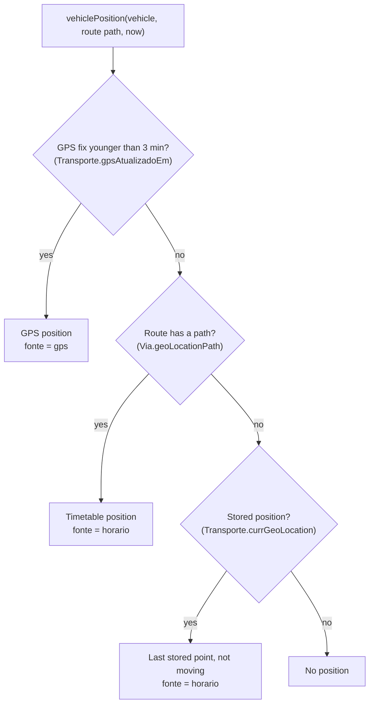
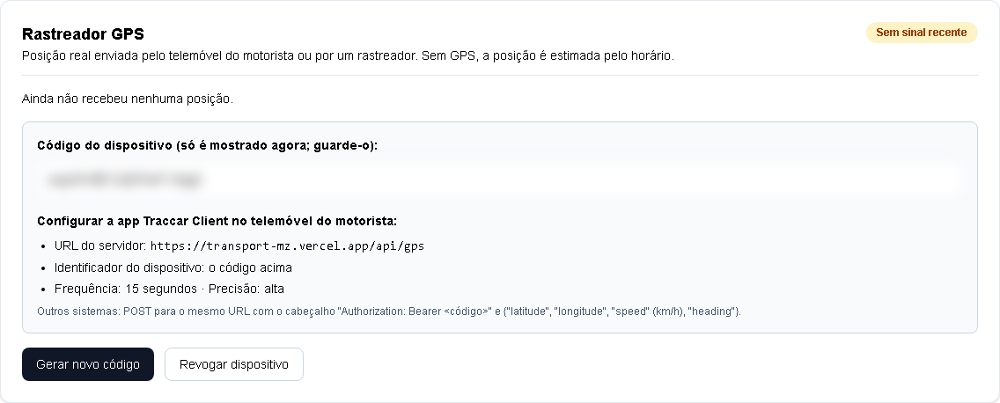
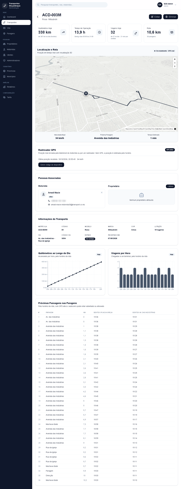

# GPS tracking

Every vehicle always has a position. It comes from a real GPS device when one has reported in the last 3 minutes. Otherwise it comes from the **timetable**: a deterministic estimate of where the bus would be if it shuttled along its route all day. This page explains how the position is chosen, how to connect a phone or a tracker to a vehicle, and the protocol the passenger app accepts.

**On this page:** [How a position is chosen](#how-a-position-is-chosen) · [Where positions are used](#where-positions-are-used) · [Connecting a device](#connecting-a-device) · [Protocol](#protocol) · [Checking that it works](#checking-that-it-works) · [Revoking a device](#revoking-a-device) · [Limits](#limits)

---

## How a position is chosen

`vehiclePosition()` (`transport-client/lib/vehiclePosition.ts`, with a copy in `transport-admin/lib/vehiclePosition.ts`) decides, for any vehicle and any instant:



**1. Real GPS.** If `gpsAtualizadoEm` is less than 3 minutes old (`GPS_FRESH_MS`), the vehicle is at `currGeoLocation`:

- it is **moving** when its reported speed is above 0.5 km/h (or unknown);
- its place along the route is the nearest point of the route's path;
- its **direction** compares the reported heading with the path's own bearing there: within 90° means "towards the end of the path", otherwise "back";
- its speed is `gpsVelocidade`.

**2. Timetable.** Without a fresh fix, the bus shuttles along its route's path at the fare rule's travel speed (`Tarifa.velocidadeViagemKmh`, 30 km/h by default):

| Rule | Value |
|---|---|
| Service hours | 05:00–21:00, Maputo time (UTC+2 all year) |
| One cycle | outbound leg, 5 min at the far terminal, return leg, 5 min at the first terminal |
| Leg duration | path length ÷ travel speed |
| Where each bus is in its cycle | offset by a hash (FNV-1a) of the vehicle's id, so buses on the same route are spread out |
| Outside service hours | parked until 05:00, half of the buses at each terminal (also by the hash) |

The result depends only on the time, the vehicle's id, the path and the speed. Every endpoint, every serverless instance and the USSD menus therefore compute the same position without talking to each other, and nothing runs in the background. The timetable is an estimate, not a published schedule ([Known limitations](known-limitations.md)).

**3. No path.** A route without a stored path cannot be followed. The vehicle is shown, not moving, at its last stored `currGeoLocation`. Without one, it has no position (the admin shows "Sem rota").

A GPS fix does not change the route's shape or the timetable. When the fix becomes older than 3 minutes, the vehicle simply returns to its timetable position, which can be somewhere else on the route.

## Where positions are used

| Consumer | Endpoint or code | Uses |
|---|---|---|
| Passenger live map | `GET /api/buses`, `GET /api/buses?fields=position` | position, `fonte` (`gps` or `horario`), heading |
| Search results, following a journey | `GET /api/buses?paragemId=…`, `GET /api/viagem` | position, direction and place along the path → arrival time |
| USSD options 1 and 5 | `/api/ussd` | arrival time; nearest stop to the bus |
| Arrival SMS | `checkAndNotifyUsers()` (`lib/busSimulator.ts`) | distance from moving buses to the waiting stop |
| Admin vehicle list, vehicle page | `GET /api/transportes/estado`, `/posicao` | "Agora" column, live map, badge |
| Admin "Próximas Passagens", charts | `GET /api/transportes/{id}/operacao` | timetable only |

Arrival times use the same rules: a bus that already passed your stop, or is heading the other way, first turns around at a terminal (5 minutes there), and a pass after 21:00 becomes the next morning's ([Data flow → Arrival time](data-flow.md#arrival-time)).

## Connecting a device

Three kinds of device can report a vehicle's position. All of them use the vehicle's **device code**.

### 1. Create the device code

In the admin, open **Transportes → the vehicle → "Rastreador GPS"** and press **"Gerar código do dispositivo"** ([Admin dashboard → GPS tracker card](admin-dashboard.md#gps-tracker-card)).



- The code is 20 characters (15 random bytes in base64url, 120 bits).
- It is shown **once**, together with the server URL and the Traccar Client settings. Only its SHA-256 hash is stored, in `Transporte.gpsDispositivoHash` (unique).
- "Gerar novo código" replaces it: the old code stops working at once, and every device using it gets 401 until it is reconfigured.

The server URL shown is `GPS_SERVER_URL` of the admin, by default `https://transport-mz.vercel.app/api/gps` ([Configuration](configuration.md#transport-admin-back-office)).

### Traccar Client on a phone

[Traccar Client](https://www.traccar.org/client/) is a free app (Android and iOS) that sends the phone's position in the background, also with the screen off. It is the recommended way to track a vehicle with the driver's phone.

| Traccar Client setting | Value |
|---|---|
| Server URL | `https://transport-mz.vercel.app/api/gps` |
| Device identifier | the vehicle's device code |
| Location accuracy | High |
| Frequency | 15 seconds |

Then start the tracking service in the app. It sends each position with the OsmAnd protocol ([below](#osmand-query-parameters)) and queues positions while offline. When it resends them, the server ignores any position older than the last one it stored, so the vehicle ends up at the newest.

### The driver portal

The driver portal can use the phone's browser as the tracker during a trip: the driver saves the device code in the portal's info panel. The browser sends at most one position every 15 s, and only while the page is open in the foreground ([Driver portal → Sharing the phone's GPS](driver-portal.md#sharing-the-phones-gps)). For continuous tracking, prefer Traccar Client.

### A hardware tracker

Vehicle trackers usually speak their own binary protocols to a tracking server, not HTTP. Run them through a [Traccar server](https://www.traccar.org/) and forward each position from it to `/api/gps` with the vehicle's device code as `id`, using the [OsmAnd parameters](#osmand-query-parameters). The forwarding setting and its placeholder names depend on the Traccar version; check its documentation for position forwarding. This path has not been tested with a hardware tracker yet.

## Protocol

`/api/gps` on the passenger app (`transport-client/app/api/gps/route.ts`) accepts `GET` and `POST`. Every answer carries `Access-Control-Allow-Origin: *`, so a browser on another domain (the driver portal) can post to it. `OPTIONS` answers 204.

### OsmAnd query parameters

Used by Traccar Client and Traccar forwarding. The fields can be in the query string or in a form-encoded body.

```http
GET https://transport-mz.vercel.app/api/gps?id=<device code>&lat=-25.9692&lon=32.5732&timestamp=1792225800&speed=10&bearing=90&accuracy=12
```

| Field | Also accepted as | Unit |
|---|---|---|
| `id` | `deviceid` | the device code |
| `lat`, `lon` | `latitude`, `lng`, `longitude` | decimal degrees |
| `timestamp` | `time` | seconds or milliseconds since 1970, or an ISO 8601 date; optional |
| `speed` | | **knots** (multiplied by 1.852 to store km/h) |
| `bearing` | `heading`, `course` | degrees, 0 = north |
| `accuracy` | | metres; optional |

### JSON with a bearer code

For your own integrations. The code goes in the `Authorization` header and the body is JSON:

```http
POST https://transport-mz.vercel.app/api/gps
Authorization: Bearer <device code>
Content-Type: application/json

{"latitude": -25.9655, "longitude": 32.5832, "timestamp": "2026-10-17T08:30:00Z", "speed": 23.4, "heading": 87, "accuracy": 12}
```

Same fields and aliases as above, except that `speed` is in **km/h**. `timestamp` is optional (ISO 8601, or seconds or milliseconds since 1970).

### What the server does

| Case | Answer | Stored |
|---|---|---|
| No code (no `Authorization: Bearer`, no `id`) | 401 `{"error": "Código do dispositivo em falta"}` | nothing |
| Latitude or longitude missing, out of range, or exactly 0,0 | 400 `{"error": "Coordenadas inválidas"}` | nothing |
| No vehicle has this code | 401 `{"error": "Dispositivo desconhecido"}` | nothing |
| `accuracy` over 200 m | 200 `{"ok": true, "ignored": "precisão insuficiente"}` | nothing |
| Timestamp not newer than the last stored fix | 200 `{"ok": true, "ignored": "posição mais antiga do que a última"}` | nothing |
| Otherwise | 200 `{"ok": true}` | see below |

On success the vehicle row is updated:

| Column | Value |
|---|---|
| `Transporte.currGeoLocation` | `"lat,lng"` with 6 decimals |
| `gpsAtualizadoEm` | the fix's timestamp; the server time if it was missing or more than 2 minutes in the future |
| `gpsVelocidade` | km/h, one decimal, or `NULL` if no speed was sent |
| `gpsDirecao` | 0–360°, or `NULL` |

The arrival-time readers decide freshness from `gpsAtualizadoEm`, so a fix that arrives late with its original timestamp is stored but may already count as stale.

## Checking that it works

**With `curl`**, from any machine (replace the code; use `http://localhost:3000` locally):

```bash
curl -s "https://transport-mz.vercel.app/api/gps?id=<device code>&lat=-25.9692&lon=32.5732&speed=10&bearing=90"
# {"ok":true}
```

**In the admin**, the vehicle's "Rastreador GPS" badge turns **"GPS ativo"** within 30 s and shows "Última posição recebida", and the map badge says "GPS real". On the passenger map the bus jumps to the reported point.



**In the database:**

```sql
SELECT matricula, "currGeoLocation", "gpsAtualizadoEm", "gpsVelocidade", "gpsDirecao",
       now() - "gpsAtualizadoEm" < interval '3 minutes' AS fresca
FROM "Transporte"
WHERE "gpsDispositivoHash" IS NOT NULL
ORDER BY "gpsAtualizadoEm" DESC NULLS LAST;
```

**In the Vercel logs** of `transport-mz`, failed requests are logged as "Erro ao receber posição GPS". Rejections (400, 401) are not logged; use the HTTP status in the request log.

## Revoking a device

"Revogar dispositivo" on the vehicle's GPS card (`DELETE /api/transportes/{id}/gps`) clears the code hash and `gpsAtualizadoEm`, `gpsVelocidade` and `gpsDirecao`. The device gets 401 from then on, and the vehicle goes back to its timetable position immediately. To move a phone to another vehicle, generate a code on the new vehicle and enter it on the phone.

## Limits

- **Freshness is 3 minutes.** A device that reports less often than that makes the bus jump between its GPS point and its timetable point. Traccar Client's 15 s is well inside the limit.
- **The trip flag does not gate trackers.** Traccar Client and trackers report whenever they run. Only the driver portal's browser sharing waits for "Iniciar viagem".
- **One device per vehicle.** A new code replaces the previous one.
- **No history.** Each fix overwrites the previous one; no track is kept. (`GeoLocation` holds data from the initial import only.)
- **Off-route fixes are shown where they are.** The arrival time projects them onto the nearest point of the route's path.

---

[← Admin dashboard](admin-dashboard.md) · [Documentation index](README.md) · Next: [Africa's Talking →](africas-talking.md)
