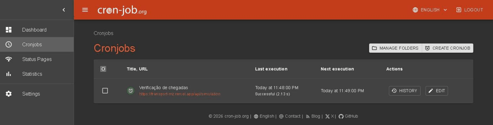
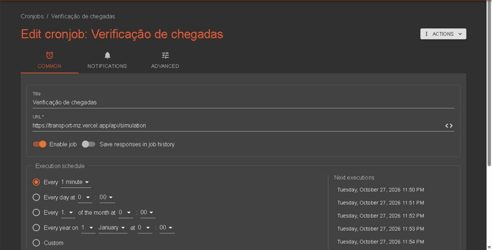
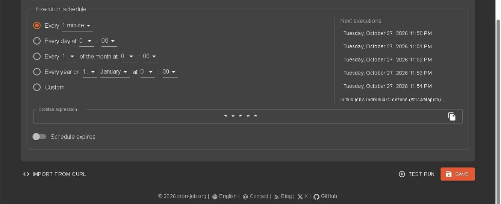
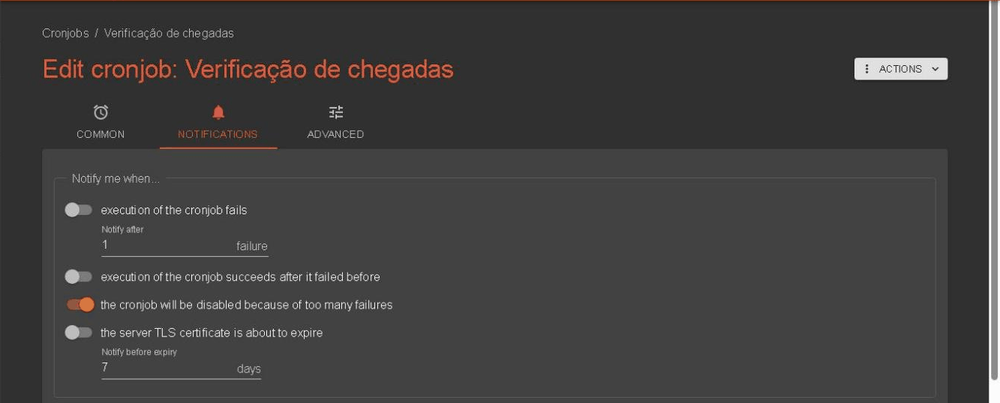
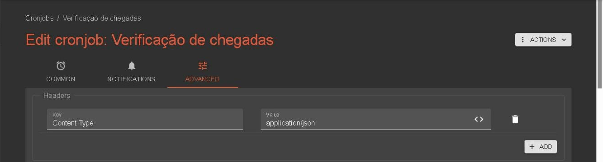
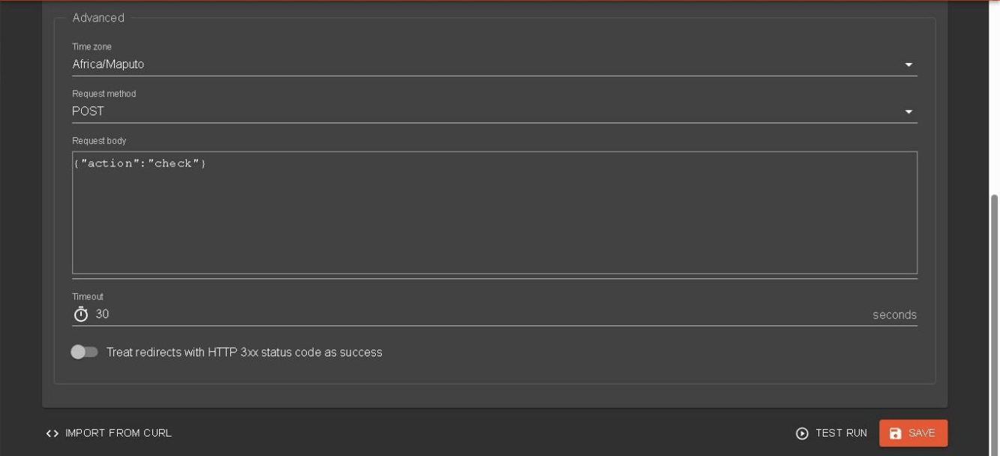
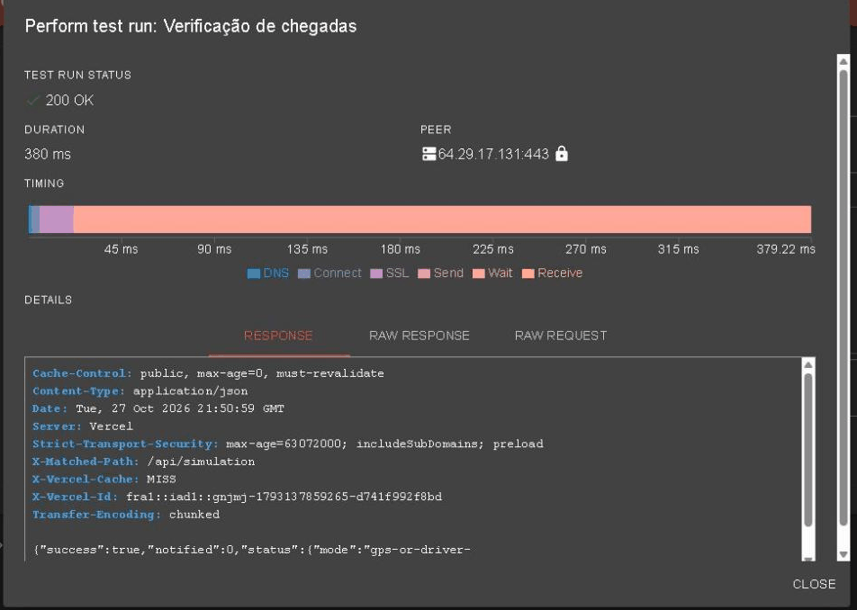
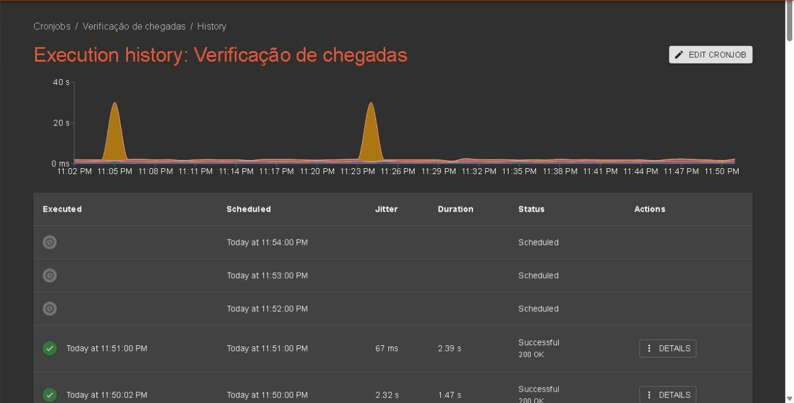
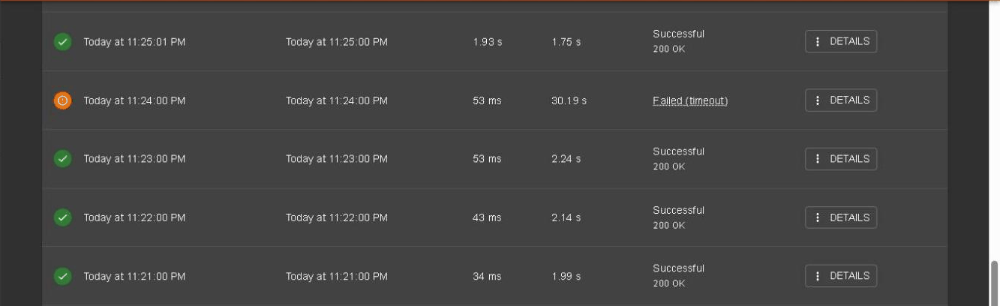

# Guia do cron-job.org

<!-- navegação: gerada por .github/scripts/docs-nav.py, não editar à mão -->
[Documentação](README.md) › 5. Pôr online › **Guia do cron-job.org** (página 23 de 26)

Anterior: [Africa's Talking](africas-talking.md) · [Índice](README.md) · Seguinte: [Testes](testes.md)

<details>
<summary>Todas as páginas</summary>

- 0. Começar do zero: [Conceitos básicos](conceitos.md) · [Preparar o computador](preparar-o-computador.md)
- 1. Conhecer o projecto: [Visão geral](visao-geral.md) · [Glossário](glossario.md) · [Fontes de dados](fontes-de-dados.md) · [Estado do projecto](estado-do-projecto.md)
- 2. Montar localmente: [Primeiros passos](primeiros-passos.md) · [Base de dados](base-de-dados.md) · [Configuração](configuracao.md)
- 3. Perceber como funciona: [Fluxos de dados](fluxos-de-dados.md) · [Localização e GPS](localizacao-gps.md) · [Serviço USSD](ussd.md) · [Segurança](seguranca.md) · [Referência da API](referencia-api.md) · [Mapa do código](mapa-do-codigo.md)
- 4. Usar as aplicações: [Aplicação dos passageiros](app-passageiros.md) · [Portal do motorista](portal-motorista.md) · [Painel de administração](painel-admin.md)
- 5. Pôr online: [Publicação](publicacao.md) · [Guia da Vercel](guia-vercel.md) · [Guia da Neon](guia-neon.md) · [Africa's Talking](africas-talking.md) · **Guia do cron-job.org**
- 6. Manter: [Testes](testes.md) · [Resolução de problemas](resolucao-de-problemas.md) · [Limitações](limitacoes.md)

</details>
<!-- /navegação -->

> **Em palavras simples:** os avisos por [SMS](conceitos.md#sms "As mensagens de texto curtas dos telemóveis.") ("o autocarro chega em 5 min") só saem quando a plataforma verifica onde estão os autocarros. Ninguém a manda verificar a uma hora calma, por isso um serviço gratuito, o cron-job.org, faz-lhe um pedido a cada minuto, a toda a hora. Esta página mostra, com imagens, como esse pedido está configurado, como foi criado e como se vê se está a funcionar.

Desde 2026-10-27, um **cronjob** do [cron-job.org](https://cron-job.org) chama a verificação de chegadas da plataforma a cada minuto. Um cronjob é um [agendamento](conceitos.md#agendamento "Uma tarefa que corre sozinha a uma hora marcada, ou de tantos em tantos minutos."): um pedido feito sozinho, de tantos em tantos minutos. As capturas são da conta do cron-job.org do projecto, em 2026-10-27; a entrada na conta não aparece aqui.

**Porquê um serviço de fora.** Os avisos de 15, 10 e 5 minutos ([Fluxos de dados → Os avisos de uma viagem acompanhada](fluxos-de-dados.md#os-avisos-de-uma-viagem-acompanhada)) precisam que a verificação corra pelo menos a cada minuto. As outras formas não chegam:

- **O tráfego.** A web, o [USSD](conceitos.md#ussd "Os menus que aparecem num telemóvel quando se marca um código como *384*848080#; funcionam em qualquer telemóvel, sem internet.") e o portal do motorista também disparam a verificação, no máximo a cada 30 s por instância ([`CHECK_INTERVAL_MS`](../transport-client/lib/busSimulator.ts)), mas só quando alguém os usa.
- **O [GitHub Actions](conceitos.md#ci "Verificações que o GitHub corre sozinho a cada pull request, para nenhum erro conhecido chegar ao main.").** O [workflow](../.github/workflows/arrival-check.yml) "Verificação de chegadas (SMS)" pede 5 minutos, mas o [GitHub](conceitos.md#github "O site onde o repositório está guardado e partilhado, e onde se revêem as alterações.") atrasa os agendamentos gratuitos: em Outubro de 2026 corria a cada 40 a 50 minutos. Fica como reserva.
- **A Vercel.** No plano Hobby, um cron job da Vercel só pode correr uma vez por dia.

O cron-job.org é gratuito, corre a cada minuto e guarda o histórico de cada pedido.

**Nesta página:** [A configuração](#a-configuração) · [Como foi criado](#como-foi-criado-passo-a-passo) · [Confirmar que funciona](#confirmar-que-funciona) · [Ler o histórico](#ler-o-histórico) · [O que o pedido faz na plataforma](#o-que-o-pedido-faz-na-plataforma) · [Mudar, pausar ou apagar](#mudar-pausar-ou-apagar) · [Se os avisos chegarem tarde](#se-os-avisos-chegarem-tarde)

## A configuração

Em resumo:

| Campo | Valor | Porquê |
|---|---|---|
| Title | `Verificação de chegadas` | O nome que aparece na lista e nos emails |
| [URL](conceitos.md#url "O texto que diz ao navegador onde está uma página ou informação, como https://transport-mz.vercel.app/viagem.") | `https://transport-mz.vercel.app/api/simulation` | O [endpoint](conceitos.md#api "Uma API é a lista de pedidos que um servidor aceita de outros programas; cada um desses pedidos, com o seu endereço, é um endpoint.") da verificação, no projecto `transport-mz` ([Referência da API](referencia-api.md)) |
| Enable job | ligado | Desligado, o cronjob fica guardado mas não corre |
| Save responses in job history | desligado | O histórico guarda o estado de cada corrida (200, falha, duração); a resposta inteira não faz falta |
| Execution schedule | Every 1 minute (`* * * * *`) | Os avisos de 5 minutos precisam de uma verificação por minuto |
| Time zone | Africa/Maputo | As horas do histórico ficam na hora de Moçambique |
| Notifications | só "the cronjob will be disabled because of too many failures" | Um email só quando o cronjob vai ser desligado; um email por cada falha ocasional seria ruído |
| Request method | [`POST`](conceitos.md#get-e-post "GET pede para ver uma coisa; POST envia dados para o servidor fazer algo com eles.") | O endpoint só corre a verificação com `POST`; um `GET` só mostra o estado |
| Headers | `Content-Type: application/json` | Diz ao [servidor](conceitos.md#servidor "Um computador sempre ligado que recebe pedidos e responde a eles.") que o corpo é [JSON](conceitos.md#json) |
| Request body | `{"action":"check"}` | A acção pedida; outra responde 400 |
| Timeout | 30 seconds | O máximo do plano gratuito; uma corrida normal leva cerca de 2 s |
| Treat redirects with [HTTP](conceitos.md#http "A forma combinada como o navegador (ou outro programa) pede algo a um servidor, e como o servidor responde.") 3xx status code as success | desligado | O endpoint responde 200; um redireccionamento seria um erro a ver |

### A lista de cronjobs

**Cronjobs** na barra lateral mostra o cronjob, a última corrida e a seguinte:



**EDIT** abre a configuração, em três separadores: **COMMON**, **NOTIFICATIONS** e **ADVANCED**.

### Separador COMMON

O nome, o endereço, e se está ligado:



Mais abaixo, no mesmo separador, o horário:



- **Every 1 minute.** A expressão crontab equivalente é `* * * * *`: os cinco asteriscos querem dizer "todos os minutos, todas as horas, todos os dias".
- **Next executions** mostra as próximas horas, no fuso do cronjob (escolhido no separador ADVANCED).
- **Schedule expires** desligado: o cronjob corre sem data de fim.

### Separador NOTIFICATIONS

Quando o cron-job.org manda um email para a conta:



Só está ligado o aviso de que o cronjob **vai ser desligado** por falhar muitas vezes seguidas. Porquê não avisar a cada falha: de vez em quando uma corrida passa dos 30 s sem nada estar errado ([Ler o histórico](#ler-o-histórico)), e cada uma daria um email.

### Separador ADVANCED

O cabeçalho do pedido:



E, mais abaixo, o fuso, o método, o corpo e o tempo máximo:



O pedido que o cronjob faz a cada minuto é o mesmo que este comando ([curl](conceitos.md#curl "Um comando que faz pedidos HTTP a partir do terminal, como um navegador sem janela.")):

```bash
curl -X POST https://transport-mz.vercel.app/api/simulation \
  -H "Content-Type: application/json" \
  -d '{"action":"check"}'
```

## Como foi criado, passo a passo

Com a conta do cron-job.org aberta:

1. Barra lateral → **Cronjobs** → **CREATE CRONJOB**. Abre o mesmo formulário das capturas acima, vazio.
2. Separador **COMMON**:
   - **Title:** `Verificação de chegadas`;
   - **URL:** `https://transport-mz.vercel.app/api/simulation`;
   - **Enable job** ligado (já vem ligado);
   - **Execution schedule:** escolher **Every** e, na lista, **1 minute**.
3. Separador **NOTIFICATIONS:** deixar como vem (só o aviso de que o cronjob vai ser desligado).
4. Separador **ADVANCED**:
   - **Headers** → **ADD** → **Key** `Content-Type`, **Value** `application/json`;
   - **Time zone:** `Africa/Maputo`;
   - **Request method:** `POST`;
   - **Request body:** `{"action":"check"}`;
   - **Timeout:** deixar `30`.
5. **TEST RUN** → **START TEST RUN**. Tem de responder **200 OK** ([abaixo](#confirmar-que-funciona)). Se responder 400, o corpo ou o cabeçalho estão mal escritos.
6. **CREATE** (numa edição, **SAVE**).
7. Um minuto depois, **HISTORY** tem a primeira corrida "Successful".

A primeira corrida agendada, às 22:30 de 2026-10-27, respondeu 200 OK.

## Confirmar que funciona

**Pelo cron-job.org.** Na configuração, **TEST RUN** → **START TEST RUN** faz o pedido uma vez, já, e mostra a resposta:



- **200 OK** e o corpo a começar por `{"success":true` querem dizer que a verificação correu.
- **`notified`** é o número de SMS enviados nesta corrida (0 quando nenhum aviso estava na hora).
- **PEER** é o servidor da Vercel que respondeu.
- Porquê é seguro carregar em TEST RUN: é o mesmo pedido que corre a cada minuto, e a verificação nunca envia o mesmo aviso duas vezes ([abaixo](#o-que-o-pedido-faz-na-plataforma)).
- O separador **RAW REQUEST** mostra o endereço IP de quem carregou em TEST RUN (o cron-job.org passa-o no cabeçalho `X-Forwarded-For`): não o pôr em capturas partilhadas.

**Pela plataforma.** Abrir `https://transport-mz.vercel.app/api/simulation` no [navegador](conceitos.md#navegador "O programa com que se abrem sites: Chrome, Firefox, Edge, Safari."). A resposta tem `lastArrivalCheck.checkedAt`, a hora da última verificação naquela instância do servidor. Como cada instância guarda a sua, a hora pode variar de um pedido para outro.

## Ler o histórico

**HISTORY**, na lista, mostra um gráfico da duração de cada corrida e uma linha por corrida:



| Coluna | O que é |
|---|---|
| Executed | Quando o pedido saiu |
| Scheduled | Quando estava marcado |
| Jitter | O atraso entre as duas; às horas certas (:00, :05, …) é maior, porque muitos cronjobs de outras pessoas correm nesse momento |
| Duration | Quanto tempo a plataforma levou a responder |
| Status | "Successful" com o código (200 OK), "Failed" com o motivo, ou "Scheduled" para as próximas |

O que é normal e o que não é:

- **"Successful", "200 OK", cerca de 2 s:** o normal.
- **"Failed (timeout)" aos 30 s, de vez em quando:** os picos do gráfico. Em 2026-10-27 foram 2 em cerca de 60 corridas, às 23:05 e às 23:24. As duas eram corridas que enviavam um aviso por SMS: a plataforma espera pela resposta da API de SMS da [Africa's Talking](conceitos.md#africas-talking "O gateway de USSD e SMS usado por este projecto."), e o sandbox às vezes demora ([Africa's Talking → SMS](africas-talking.md#sms)). O SMS saiu na mesma, e a corrida do minuto seguinte foi normal.

  

- **Muitas falhas seguidas:** a plataforma não responde. Abrir `https://transport-mz.vercel.app/api/simulation` no navegador (deve responder `"success":true`) e seguir [Resolução de problemas](resolucao-de-problemas.md).

**DETAILS**, numa linha, mostra o mesmo que o TEST RUN para essa corrida (sem o corpo da resposta, porque "Save responses in job history" está desligado).

## O que o pedido faz na plataforma

O `POST` chega a [`transport-client/app/api/simulation/route.ts`](../transport-client/app/api/simulation/route.ts), que chama `checkAndNotifyUsers()` em [`lib/busSimulator.ts`](../transport-client/lib/busSimulator.ts). Esta faz duas coisas:

1. os SMS dos alertas de paragem da web, quando o próximo autocarro em viagem chega em 5 minutos ou menos;
2. o aviso seguinte de cada viagem acompanhada por SMS (opção 1 do USSD), em `checkJourneyAlerts()` de [`lib/journeyAlerts.ts`](../transport-client/lib/journeyAlerts.ts).

**Porquê pode ser chamado a mais.** Cada viagem acompanhada guarda o último aviso enviado, e um aviso só se envia depois de a linha ser actualizada com sucesso (`claim()`). Por isso, quando o cronjob, uma visita à web e o GitHub Actions correm a verificação ao mesmo tempo, só um envia cada SMS. Chamá-la a mais só gasta um pouco de tempo de servidor. O caminho inteiro está em [Fluxos de dados → O que dispara a verificação](fluxos-de-dados.md#o-que-dispara-a-verificação).

### O cronjob não sabe onde estão os autocarros

O cronjob é só o relógio: dispara a cada minuto, sempre, esteja um autocarro perto ou longe de uma paragem. A localização entra **dentro** de cada verificação:

1. Para cada viagem acompanhada, calcula-se a posição do autocarro anunciado naquele momento: pelo [GPS](conceitos.md#gps) quando há uma posição recente, senão pela viagem do motorista (a hora a que carregou em "Iniciar viagem" e a velocidade da regra de tarifa, 30 km/h, ao longo do percurso) ([Localização e GPS](localizacao-gps.md)).
2. Daí saem os minutos que faltam até à paragem de entrada (à espera) ou até à paragem de saída (a bordo), pela distância ao longo do percurso.
3. Os minutos escolhem o aviso, em [`waitLevel()` e `rideLevel()`](../transport-client/lib/journeyAlerts.ts):

   | À espera, até à paragem de entrada | Aviso |
   |---|---|
   | 15 min ou menos | "chega a … em N min" (15) |
   | 10 min ou menos | "chega a … em N min" (10) |
   | 5 min ou menos | "chega a … em N min" (5) |
   | 1 min ou menos, ou a 150 m ou menos | "esta a chegar … Entre e saia em … daqui a N min" |

   | A bordo, até à paragem de saída | Aviso |
   |---|---|
   | 15, 10 ou 5 min ou menos | "Chega a … em N min" ("Prepare-se para sair" aos 5) |
   | 1 min ou menos, ou já passou | "Saia agora em …": o destino, ou o [transbordo](glossario.md#palavras-dos-ecrãs "Mudança de autocarro a meio de uma viagem") para o autocarro seguinte |

4. Só sai um SMS quando o aviso calculado é mais adiantado do que o último enviado; senão, a verificação não faz nada.

**Porquê um relógio e não a posição a disparar.** A maior parte dos autocarros não envia posições: a posição calcula-se no momento em que alguém a pede, e entre dois pedidos nenhum programa está a correr (a [Vercel](conceitos.md#vercel) só corre código quando chega um pedido). Alguém tem de perguntar "e agora?" de tempos a tempos, e o cronjob é esse alguém. Hoje, mesmo uma posição de GPS real que chega a `/api/gps` não dispara a verificação: fica guardada até à próxima.

**O que isto quer dizer na prática.** Um aviso sai na primeira verificação depois de o autocarro passar o limiar, por isso pode chegar até 1 minuto depois: o de "5 min" pode dizer "chega em 4 min". O "Saia agora" sai quando falta 1 minuto ou menos, para não chegar depois de o autocarro passar a paragem.

**Porquê o endpoint é público.** A verificação só envia os avisos que já estão na hora, e nunca o mesmo duas vezes, por isso quem a chamar não consegue enviar SMS a mais.

## Mudar, pausar ou apagar

- **Mudar:** **Cronjobs** → **EDIT** → mudar o campo → **SAVE**. Por exemplo, se o endereço da plataforma mudar, mudar o **URL**.
- **Pausar:** **EDIT** → desligar **Enable job** → **SAVE**. O cronjob fica guardado e volta com o mesmo interruptor.
- **Se o cron-job.org o desligar sozinho** (depois de muitas falhas seguidas, com o email do separador NOTIFICATIONS): corrigir primeiro a causa, e depois **EDIT** → ligar **Enable job** → **SAVE**.
- **Apagar:** **EDIT** → **ACTIONS** → **Delete**. O mesmo menu tem **Execution history**, **Clone** (uma cópia, por exemplo para outra plataforma de teste) e **Export**.

Enquanto o cronjob está pausado ou desligado, a verificação só corre com as visitas à web, ao USSD e ao portal, e com o GitHub Actions, por isso os avisos chegam tarde.

## Se os avisos chegarem tarde

1. **HISTORY** no cron-job.org: as corridas dos últimos minutos dizem "Successful"? Se dizem "Failed", ver o motivo em **DETAILS**.
2. A lista de cronjobs: o ícone do cronjob está verde (ligado)? Se não, ver o email do cron-job.org e ligar outra vez ([acima](#mudar-pausar-ou-apagar)).
3. A plataforma: há autocarros em viagem? Sem motoristas em viagem não há avisos a enviar ([Portal do motorista](portal-motorista.md)).
4. O resto da lista está em [Resolução de problemas](resolucao-de-problemas.md).

<!-- navegação-fim: gerada por .github/scripts/docs-nav.py -->

---

Anterior: [Africa's Talking](africas-talking.md) · [Índice](README.md) · Seguinte: [Testes](testes.md)
<!-- /navegação-fim -->
