# Guia da Neon

<!-- navegação: gerada por .github/scripts/docs-nav.py, não editar à mão -->
[Documentação](README.md) › 5. Pôr online › **Guia da Neon** (página 19 de 23)

Anterior: [Guia da Vercel](guia-vercel.md) · [Índice](README.md) · Seguinte: [Africa's Talking](africas-talking.md)

<details>
<summary>Todas as páginas</summary>

- 1. Conhecer o projecto: [Visão geral](visao-geral.md) · [Glossário](glossario.md) · [Fontes de dados](fontes-de-dados.md) · [Estado do projecto](estado-do-projecto.md)
- 2. Montar localmente: [Primeiros passos](primeiros-passos.md) · [Base de dados](base-de-dados.md) · [Configuração](configuracao.md)
- 3. Perceber como funciona: [Fluxos de dados](fluxos-de-dados.md) · [Localização e GPS](localizacao-gps.md) · [Serviço USSD](ussd.md) · [Segurança](seguranca.md) · [Referência da API](referencia-api.md) · [Mapa do código](mapa-do-codigo.md)
- 4. Usar as aplicações: [Aplicação dos passageiros](app-passageiros.md) · [Portal do motorista](portal-motorista.md) · [Painel de administração](painel-admin.md)
- 5. Pôr online: [Publicação](publicacao.md) · [Guia da Vercel](guia-vercel.md) · **Guia da Neon** · [Africa's Talking](africas-talking.md)
- 6. Manter: [Testes](testes.md) · [Resolução de problemas](resolucao-de-problemas.md) · [Limitações](limitacoes.md)

</details>
<!-- /navegação -->

A base de dados de produção está na [Neon](https://neon.tech). Esta página é um guia passo a passo da consola da Neon no navegador:

- criar o projecto e tirar o endereço de ligação (para montar a plataforma noutra conta);
- abrir o projecto;
- colar uma consulta SQL e corrê-la, e ler, descarregar e encontrar os resultados;
- ver uma tabela sem SQL;
- seguir os fluxos de dados da plataforma pelas tabelas;
- repor a palavra-passe da base de dados.

Todas as consultas desta página só lêem, e as capturas foram feitas na produção em 2026-10-18, por isso os números são reais.

As tabelas e as suas convenções estão em [Base de dados](base-de-dados.md); os fluxos por trás delas, em [Fluxos de dados](fluxos-de-dados.md). Porquê a Neon: PostgreSQL sem servidor para gerir, com plano gratuito, editor de SQL no navegador, ramos (cópias instantâneas da base de dados para testar) e ligação directa à Vercel.

**Nesta página:** [Antes de começar](#antes-de-começar) · [0. Criar o projecto](#0-criar-o-projecto) · [1. Abrir o projecto](#1-abrir-o-projecto) · [2. Abrir o SQL Editor](#2-abrir-o-sql-editor) · [3. Colar uma consulta e corrê-la](#3-colar-uma-consulta-e-corrê-la) · [4. Várias instruções de uma vez](#4-várias-instruções-de-uma-vez) · [5. Descarregar, histórico e consultas guardadas](#5-descarregar-histórico-e-consultas-guardadas) · [6. Ver uma tabela sem SQL](#6-ver-uma-tabela-sem-sql) · [7. Seguir os dados pelas tabelas](#7-seguir-os-dados-pelas-tabelas) · [8. Repor a palavra-passe](#8-repor-a-palavra-passe)

---

## Antes de começar

- **`production` são os dados ao vivo.** As aplicações lêem-nos e escrevem-nos a toda a hora. Ali só se corre `SELECT` (e `SET`). Um `INSERT`, `UPDATE`, `DELETE`, `CREATE` ou `DROP` muda logo as aplicações ao vivo, sem forma de desfazer. Para experimentar algo que escreve, cria-se primeiro um ramo ([Base de dados → Consola da Neon](base-de-dados.md#consola-da-neon)).
- **Algumas colunas são dados pessoais:**
  - `Utente`: nome, email e telefone dos passageiros;
  - `MISSION.geoLocationUtente`: onde o passageiro estava quando pediu um alerta;
  - `Motorista`: telefone e BI dos motoristas;
  - `Administrador`: emails.

  As consultas abaixo contam linhas em vez de listar pessoas. Estas colunas não se fotografam nem se partilham.
- **É preciso acesso ao projecto da Neon.** O dono do projecto convida em **People** na consola.

## 0. Criar o projecto

Só para montar a plataforma do zero, noutra conta:

1. Em [console.neon.tech](https://console.neon.tech), criar uma conta e **New Project**.
2. Escolher o nome, a versão do PostgreSQL (aqui 18) e a região. A região deve ser a mesma onde correm as funções da Vercel (aqui AWS `us-east-2`, Ohio, perto de `iad1`), porque cada pedido faz várias consultas ([Publicação](publicacao.md#os-três-projectos)).
3. Em **Connect**, copiar os dois endereços de ligação:
   - o **pooled** (o servidor tem `-pooler` no nome) vai para `DATABASE_URL` das aplicações. Porquê: as funções da Vercel abrem muitas ligações curtas, e o pooler partilha-as;
   - o **directo** (sem `-pooler`) usa-se em `pg_dump`, `prisma migrate diff` e `prisma db execute` ([Publicação → Alterações à base de dados](publicacao.md#alterações-à-base-de-dados-em-produção)).
4. Criar as tabelas a partir do esquema e carregar os dados ([Primeiros passos](primeiros-passos.md#5-criar-o-esquema), contra o endereço directo), e pôr `DATABASE_URL` nos projectos da Vercel ([Guia da Vercel](guia-vercel.md#variáveis-de-ambiente)).

## 1. Abrir o projecto

1. Ir a [console.neon.tech](https://console.neon.tech) e entrar. Abre-se a lista dos projectos. Clicar em **TransportMZ**.

   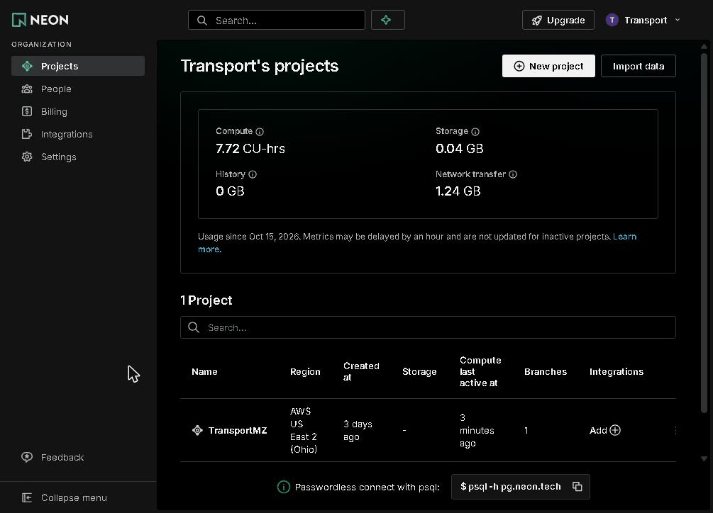

2. Abre-se a vista geral do ramo. Confirmar a caixa no canto superior esquerdo: tem de dizer **TransportMZ** e **production**. Todas as páginas abertas a partir daqui trabalham nesse ramo.

   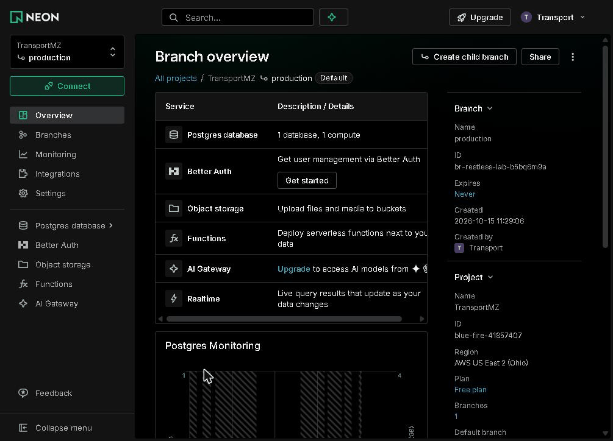

## 2. Abrir o SQL Editor

1. No menu da esquerda, abrir **Postgres database**, e clicar em **SQL Editor**. **Tables**, logo acima, é o [visualizador de tabelas](#6-ver-uma-tabela-sem-sql).

   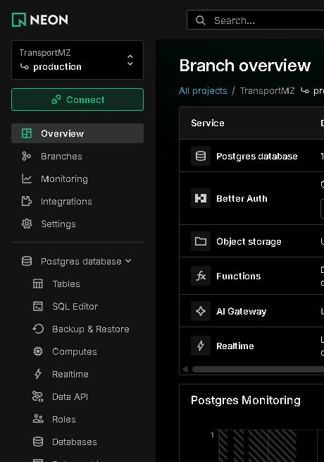

2. Abre-se o editor. Confirmar a barra por cima dele:

   | Parte | Deve mostrar | Porquê |
   |---|---|---|
   | Compute | **Primary**, **Active** | A base de dados. Dorme quando ninguém a usa e acorda na primeira consulta, que então demora mais alguns segundos. |
   | Database | **neondb** | As tabelas da plataforma estão nesta base de dados. Outra não tem nenhuma. |
   | **Saved** / **History** (à esquerda) | as consultas corridas antes | [Abaixo](#5-descarregar-histórico-e-consultas-guardadas). |

   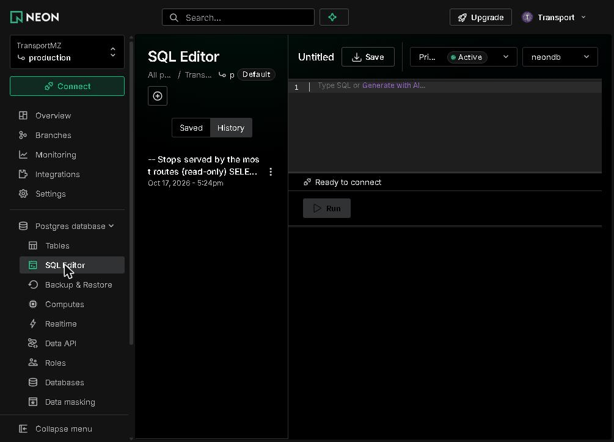

## 3. Colar uma consulta e corrê-la

1. **Copiar a consulta.** No GitHub, o botão de copiar no canto superior direito de um bloco de código copia-o todo. Começar por esta, que conta as linhas das tabelas principais:

   ```sql
   -- Quantas linhas tem cada tabela (só lê)
   SELECT 'Via' AS tabela, count(*) FROM "Via"
   UNION ALL SELECT 'Paragem', count(*) FROM "Paragem"
   UNION ALL SELECT 'ViaParagem', count(*) FROM "ViaParagem"
   UNION ALL SELECT 'Transporte', count(*) FROM "Transporte"
   UNION ALL SELECT 'Motorista', count(*) FROM "Motorista"
   UNION ALL SELECT 'Utente', count(*) FROM "Utente"
   UNION ALL SELECT 'MISSION', count(*) FROM "MISSION"
   UNION ALL SELECT 'Tarifa', count(*) FROM "Tarifa";
   ```

2. **Colá-la.** Clicar no editor e colar com **Ctrl+V** (**Cmd+V** num Mac).
   - Se o editor já tiver texto, seleccioná-lo todo com **Ctrl+A** primeiro, para a colagem o substituir. Esse texto pode ser uma consulta anterior, ou o exemplo da Neon `CREATE TABLE … INSERT …`.
   - Nunca se corre o exemplo: criaria uma tabela na produção.
   - Os nomes das tabelas e das colunas mantêm as aspas (`"Via"`, `"paragemId"`). O PostgreSQL precisa delas nos nomes com maiúsculas.

   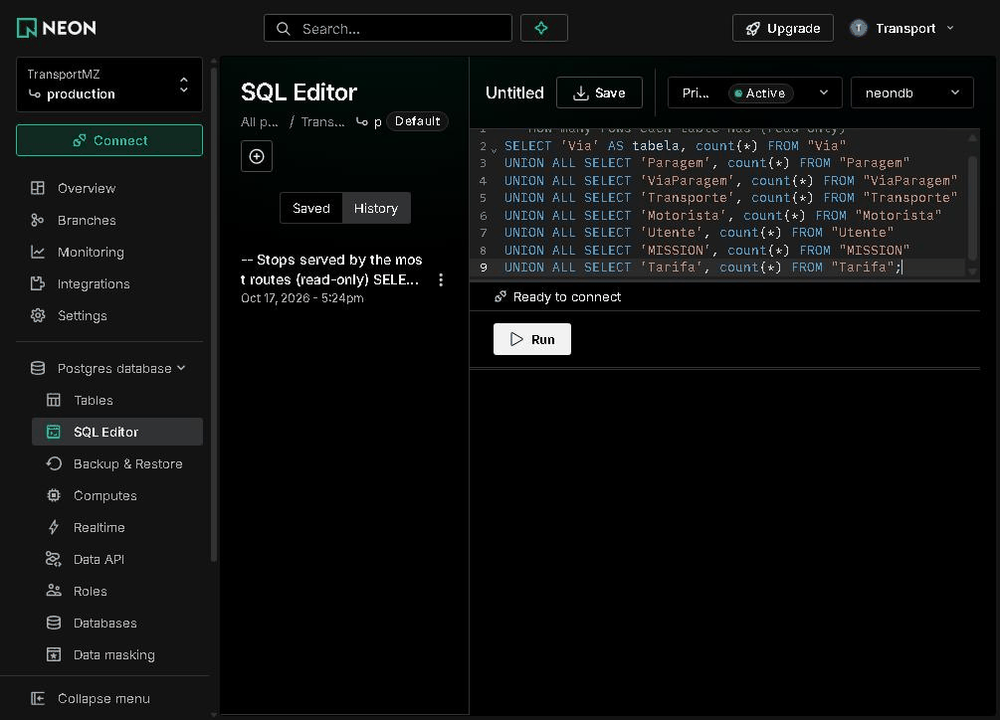

3. **Corrê-la.** Clicar em **Run**.
   - A linha por baixo do editor passa a **Connected (1 query)**.
   - O tempo e o número de linhas aparecem à direita.
   - O resultado enche a tabela por baixo.

   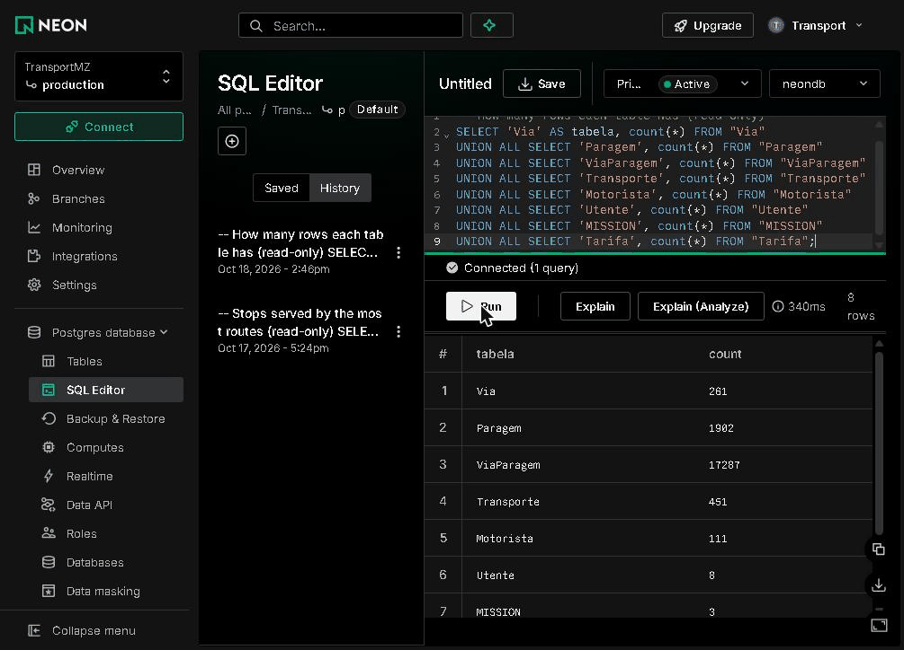

   Em 2026-10-18 a produção tinha 261 rotas, 1 902 paragens, 17 287 ligações rota–paragem, 451 veículos, 451 motoristas, 8 passageiros e 3 alertas de chegada. A captura foi feita mais cedo nesse dia, antes de se juntarem os 340 motoristas de demonstração.

**Se falhar,** aparece o erro em vez da tabela:

| Erro | Causa |
|---|---|
| `relation "via" does not exist` | As aspas à volta do nome de uma tabela perderam-se: o PostgreSQL passou `Via` a minúsculas. |
| `column "paragemid" does not exist` | O mesmo, numa coluna. |
| `syntax error at or near …` | Parte da consulta não foi copiada, muitas vezes a primeira ou a última linha. Colar outra vez. |
| Nada acontece durante alguns segundos | A base de dados estava a dormir e está a acordar. |

## 4. Várias instruções de uma vez

O editor corre todas as instruções coladas, por ordem, e dá a cada uma o seu separador de resultado. As horas estão guardadas em UTC sem fuso horário ([convenções](base-de-dados.md#convenções-ler-antes-de-consultar)). Uma consulta que as compare com `now()` começa por isso com `SET TIME ZONE 'UTC';`:

```sql
SET TIME ZONE 'UTC';

-- A regra de tarifa activa (só lê)
SELECT nome, "tarifaMinima", "precoPorKm", "velocidadeViagemKmh", "velocidadeChegadaKmh", ativa
FROM "Tarifa" WHERE ativa;
```

O resultado mostra dois separadores: **1: SET** ("Statement executed successfully") e **2: SELECT 1**. Clicar no segundo para ver as linhas:

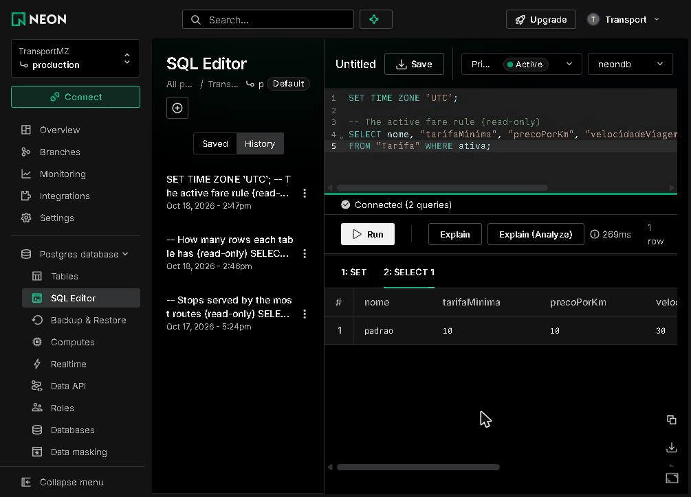

A regra de tarifa é 10 MT de mínimo, 10 MT por km, e 30 km/h de velocidade de viagem para o horário.

## 5. Descarregar, histórico e consultas guardadas

**Descarregar ou copiar um resultado.** Os ícones no canto inferior direito do resultado são:

- copiar (dois quadrados), que copia as linhas;
- descarregar (seta), que oferece **JSON**, **CSV** ou **XLSX**, este último para o Excel;
- expandir (quadrado), que mostra o resultado no ecrã inteiro.

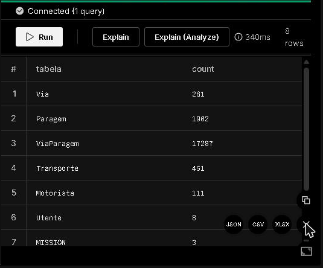

**Histórico.** Cada consulta corrida fica em **History**, a mais nova primeiro, com a data. Cada entrada mostra o início da consulta; passar o rato por cima mostra-a toda. Um comentário na primeira linha (`-- Quantas linhas …`) dá por isso o nome da consulta na lista.

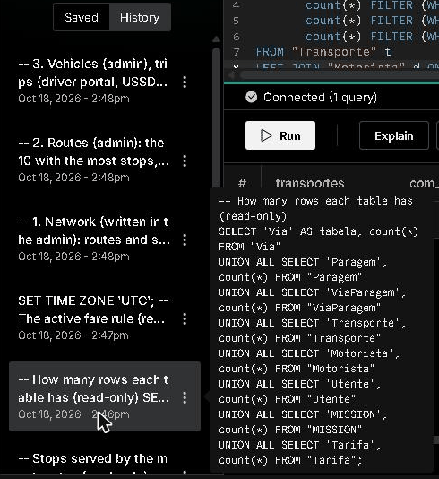

**Guardar.** **Save**, ao lado do nome da consulta, pede um nome e guarda a consulta em **Saved**, para as consultas que se correm muitas vezes.

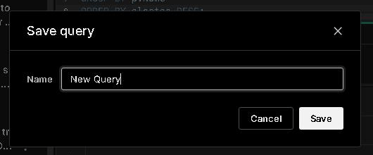

## 6. Ver uma tabela sem SQL

1. Menu da esquerda → **Postgres database** → **Tables**, e clicar numa tabela, por exemplo **Paragem**. As linhas aparecem 50 por página; as setas no canto superior direito mudam de página.
2. **Filtrar.** Clicar no ícone do filtro (três linhas, à esquerda das setas de ordenar). Aparece uma linha: **where** · coluna · operador · valor.
   - Escolher a coluna (`nome`) e o operador (`ilike`: contém, sem contar as maiúsculas).
   - Escrever o valor com `%` à volta: `%Eduardo Mondlane%`.
   - Carregar em **Enter**.
   - O contador mostra os resultados (16 paragens aqui). O **×** à esquerda do filtro tira-o.

   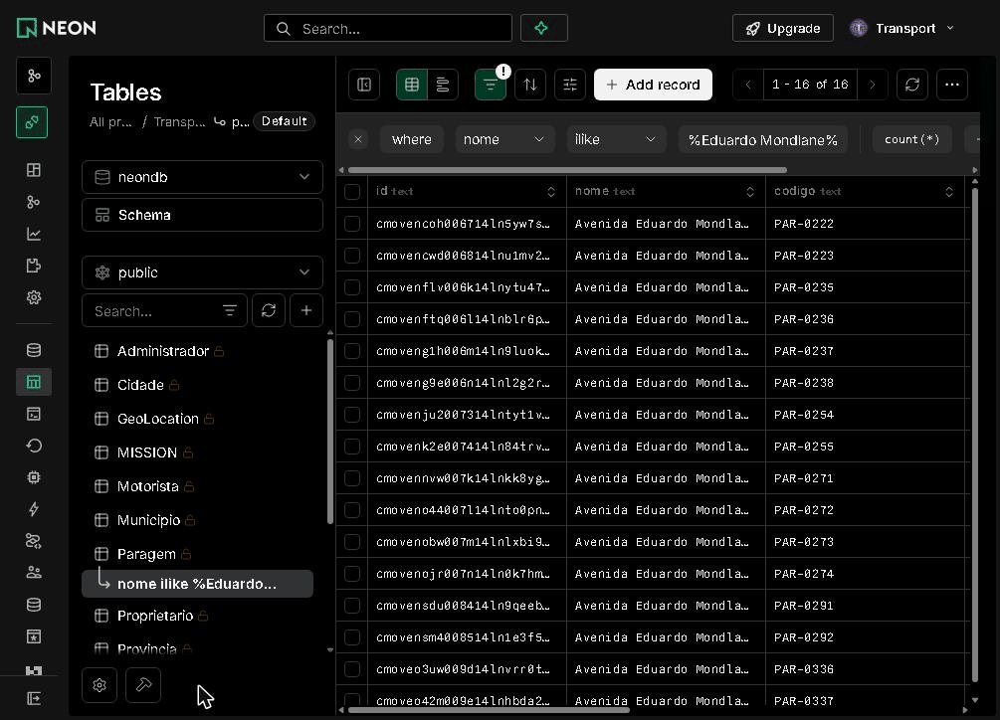

As setas ao lado do nome de uma coluna ordenam por ela. **Na produção não se usa "Add record" nem se editam células.** As alterações feitas aqui saltam as verificações que o painel de administração faz. Por exemplo, uma paragem criada aqui não está em nenhuma rota, por isso nenhuma aplicação a mostra. Os dados mudam-se no [painel de administração](painel-admin.md).

## 7. Seguir os dados pelas tabelas

Cada parte da plataforma escreve nas suas tabelas, e todas as outras as lêem:

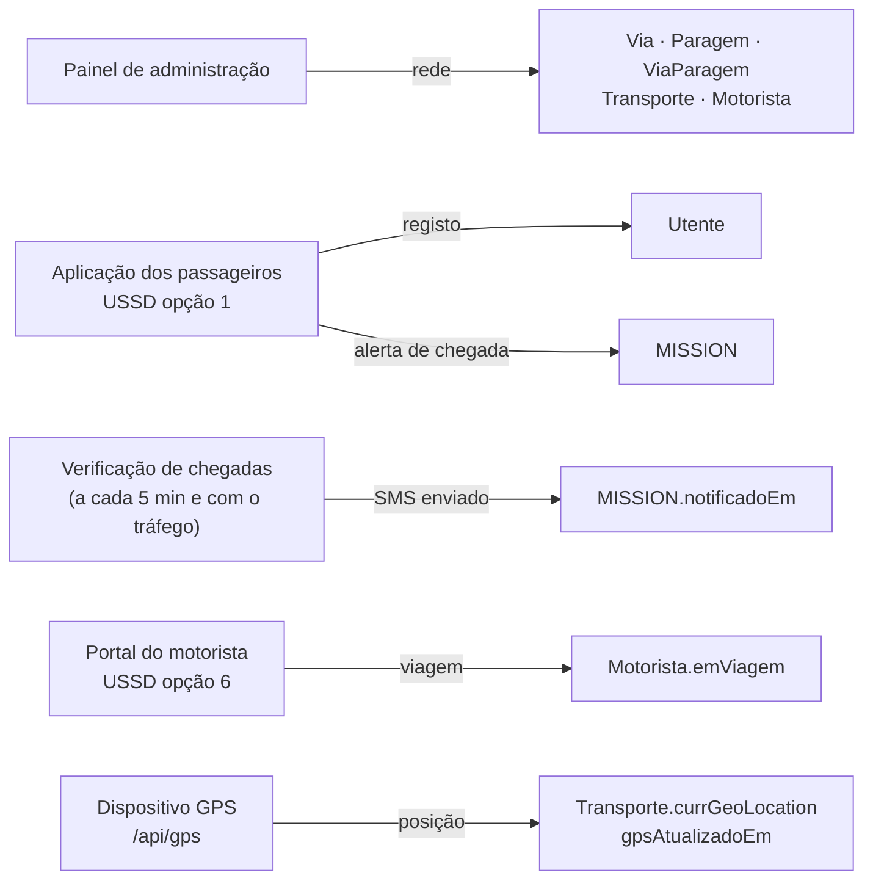

As consultas abaixo seguem esse fluxo. Corre-se uma, faz-se na aplicação a acção que ela descreve, e corre-se outra vez: a alteração aparece logo. A sequência completa de cada fluxo está em [Fluxos de dados](fluxos-de-dados.md).

### 7.1 A rede: municípios, rotas e paragens

O painel cria a rede: municípios, depois rotas (`Via`) e paragens (`Paragem`), ligadas por `ViaParagem`.

```sql
-- 1. Rede (escrita no painel): rotas e paragens por município
SELECT m.nome AS municipio,
       count(DISTINCT v.id)          AS vias,
       count(DISTINCT vp."paragemId") AS paragens
FROM "Municipio" m
LEFT JOIN "Via" v         ON v."municipioId" = m.id
LEFT JOIN "ViaParagem" vp ON vp."viaId" = v.id
GROUP BY m.nome
ORDER BY vias DESC;
```

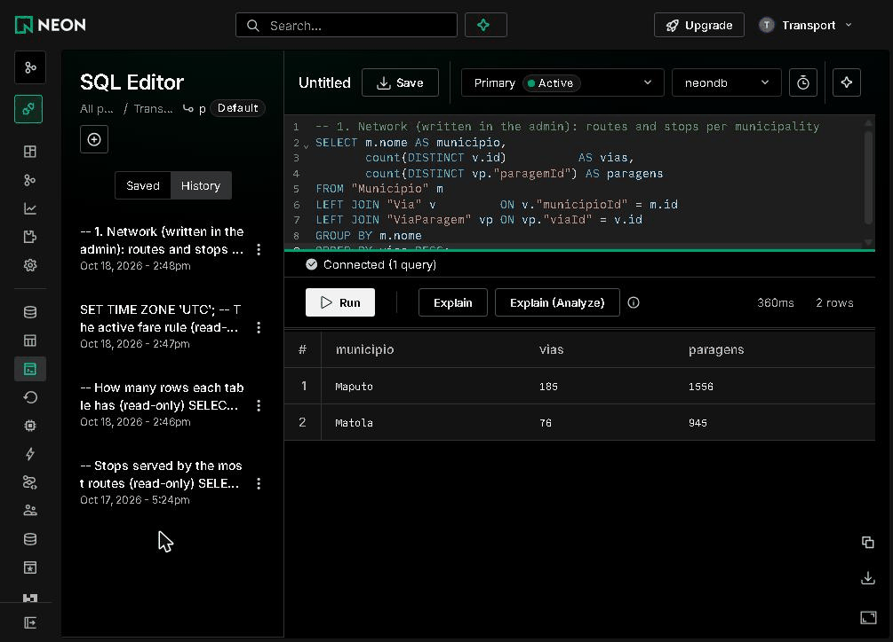

**Ver a mudança:** criar uma rota no painel ([Painel → Criar uma rota](painel-admin.md#tarefa-rota)) e correr a consulta outra vez. O seu município tem mais uma rota, e as suas paragens contam.

### 7.2 Rotas: paragens e veículos

O planeador de viagens só usa rotas com um veículo (`Transporte.viaId`). As paragens de cada rota são as suas linhas `ViaParagem`.

```sql
-- 2. Rotas (painel): as 10 com mais paragens, e os seus veículos
SELECT v.codigo, left(v.nome, 38) AS nome,
       count(DISTINCT vp."paragemId") AS paragens,
       count(DISTINCT t.id)          AS transportes
FROM "Via" v
LEFT JOIN "ViaParagem" vp ON vp."viaId" = v.id
LEFT JOIN "Transporte" t  ON t."viaId" = v.id
GROUP BY v.id
ORDER BY paragens DESC
LIMIT 10;
```

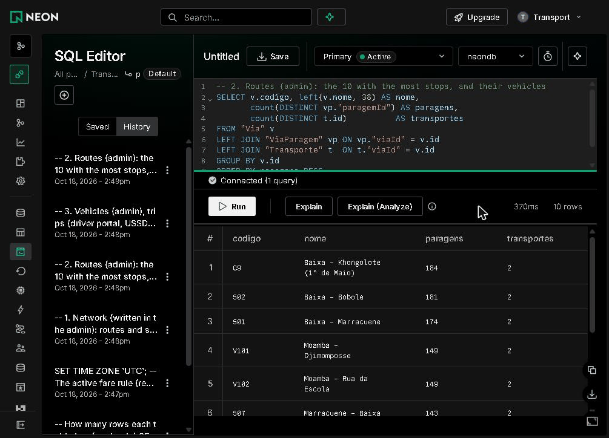

**Ver a mudança:** no painel, "Atribuir Transporte" numa rota põe lá um veículo: o seu `transportes` sobe um. "Redesenhar percurso" muda as paragens da rota.

### 7.3 Veículos, motoristas, viagens e GPS

O painel atribui um motorista a cada veículo (`Motorista.transporteId`). O motorista inicia uma viagem no [portal do motorista](portal-motorista.md) ou na opção 6 do USSD (`Motorista.emViagem`). Um dispositivo GPS envia posições para `/api/gps` (`Transporte.gpsAtualizadoEm`, `currGeoLocation`); uma posição conta como ao vivo durante 3 minutos.

```sql
-- 3. Veículos (painel), viagens (portal do motorista, USSD opção 6), GPS (/api/gps)
SELECT count(*)                              AS transportes,
       count(d.id)                           AS com_motorista,
       count(*) FILTER (WHERE d."emViagem")   AS em_viagem,
       count(*) FILTER (WHERE t."gpsAtualizadoEm" > (now() AT TIME ZONE 'UTC') - interval '3 minutes') AS gps_ativo
FROM "Transporte" t
LEFT JOIN "Motorista" d ON d."transporteId" = t.id;
```

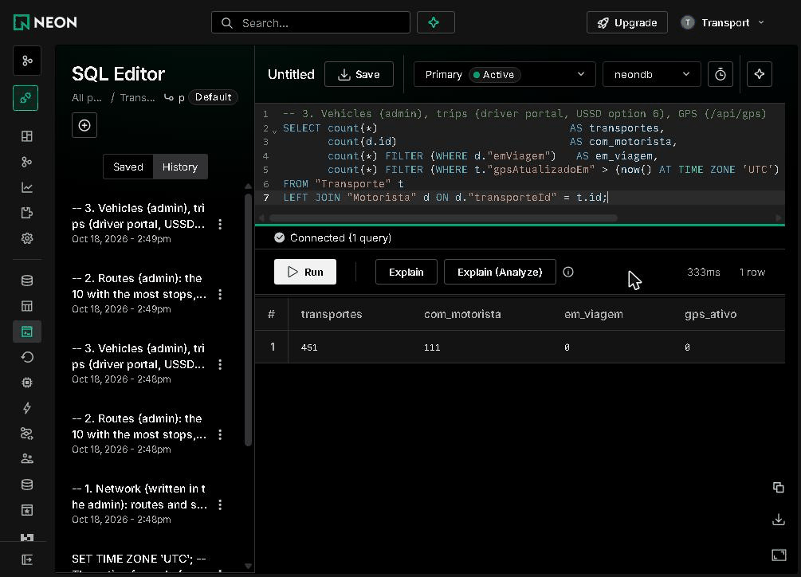

Lê-se assim:

- 340 veículos, os das rotas do OpenStreetMap, não tinham motorista quando a captura foi feita. Os motoristas de demonstração juntaram-se no mesmo dia, por isso os 451 têm hoje um ([Base de dados → Motoristas para os veículos importados](base-de-dados.md#motoristas-para-os-veículos-importados));
- nenhum motorista está em viagem;
- nenhum veículo tem posição GPS ao vivo, por isso todos os autocarros do mapa vêm do horário ([Localização e GPS](localizacao-gps.md#como-se-escolhe-uma-posição)).

**Ver a mudança:**

- Um motorista toca em "Iniciar viagem": `em_viagem` sobe um.
- Um rastreador envia uma posição ([Localização e GPS → Verificar que funciona](localizacao-gps.md#verificar-que-funciona)): `gps_ativo` sobe um, e desce 3 minutos depois da última posição.

A consulta não lê `currGeoLocation`. Quando o rastreador é o telemóvel de um motorista, essa coluna é onde o motorista está.

### 7.4 Passageiros e os seus alertas de chegada

Um passageiro regista-se na web, com palavra-passe, ou é criado pela opção 1 do USSD sem ela; registar-se na web com o mesmo telefone completa essa conta. Pedir para ser avisado quando um autocarro está perto de uma paragem cria um alerta (`MISSION`). A verificação de chegadas preenche `notificadoEm` quando envia o SMS ([Fluxos de dados → Alerta de chegada e SMS](fluxos-de-dados.md#alerta-de-chegada-e-sms)).

```sql
-- 4. Passageiros (registo na web, USSD opção 1) e os seus alertas de chegada
SELECT CASE WHEN left(u.senha, 4) IN ('$2a$', '$2b$', '$2y$') THEN 'web' ELSE 'USSD' END AS registo,
       count(DISTINCT u.id)    AS utentes,
       count(m.id)             AS alertas,
       count(m."notificadoEm") AS sms_enviados
FROM "Utente" u
LEFT JOIN "MISSION" m ON m."utenteId" = u.id
GROUP BY 1;
```

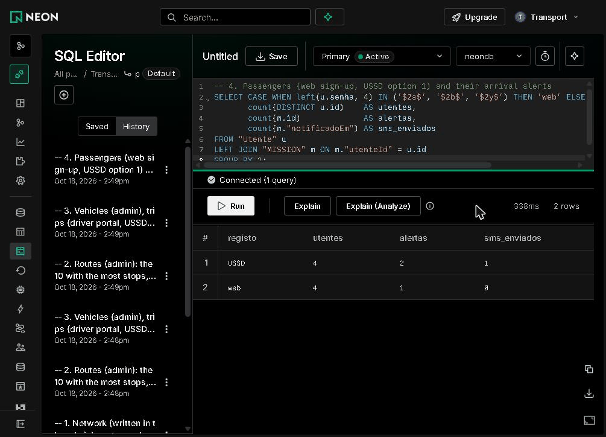

Uma palavra-passe da web guarda-se como hash bcrypt (`$2a$…`, `$2b$…`), por isso a consulta separa os dois tipos sem ler os dados de ninguém.

### 7.5 Alertas de chegada por paragem

```sql
-- 5. Alertas de chegada por paragem: pedidos na web ou pelo USSD, SMS enviados pela verificação de chegadas
SELECT p.nome                 AS paragem,
       count(*)                AS alertas,
       count(m."notificadoEm") AS sms_enviados
FROM "MISSION" m
JOIN "Paragem" p ON p.id = m."paragemId"
GROUP BY p.nome
ORDER BY alertas DESC;
```

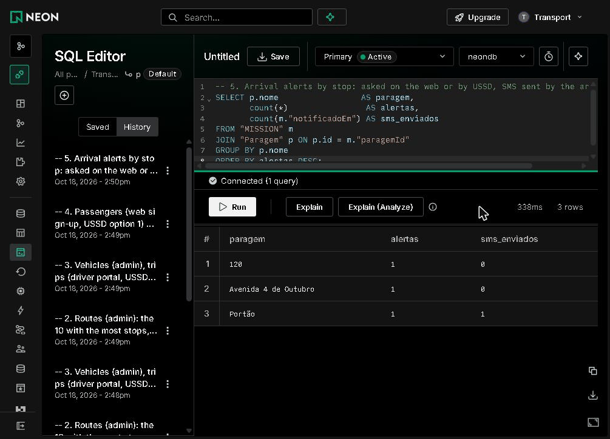

**Ver a mudança:**

- Na aplicação dos passageiros, entrar, planear uma viagem e tocar em "Avisar-me por SMS quando o autocarro estiver perto…". A linha da paragem aparece aqui, com `alertas` 1 e `sms_enviados` 0.
- Quando um autocarro está a menos de 1 km e a verificação de chegadas corre, `sms_enviados` passa a 1.
- O mesmo pela opção 1 do USSD no [simulador da Africa's Talking](africas-talking.md#usar-o-menu-no-simulador) também junta um passageiro USSD em 7.4. Usa-se um número de teste; [Base de dados → Passageiros criados por USSD](base-de-dados.md#passageiros-criados-por-ussd-ainda-sem-palavra-passe) mostra como os encontrar e apagar.

### Mais consultas

[Base de dados → Consultas de exemplo](base-de-dados.md#consultas-de-exemplo) tem mais consultas testadas: as paragens de uma rota com coordenadas, paragens perto de um ponto, veículos com o motorista, os alertas das últimas 24 horas, as viagens dos motoristas. Colam-se da mesma forma.

## 8. Repor a palavra-passe

Quando a palavra-passe da base de dados pode ter escapado (por exemplo, apareceu num registo ou numa conversa), repõe-se:

1. Na consola, abrir o projecto e o ramo **production**.
2. Abrir **Roles** (na vista geral do ramo, ou em **Settings → Roles**), escolher o papel das aplicações (`neondb_owner`) e **Reset password**. A Neon mostra a palavra-passe nova uma só vez, dentro dos endereços de ligação novos.
3. A partir deste momento, as aplicações deixam de conseguir ligar-se. Pôr logo os endereços novos em `DATABASE_URL` de `transport-mz` e `transport-mz-admin` (Production e Preview) e nos `.env` locais ([Guia da Vercel → Variáveis de ambiente](guia-vercel.md#variáveis-de-ambiente)).
4. Publicar outra vez os dois projectos, e confirmar o mapa e uma entrada no painel ([Publicação → Confirmar uma publicação](publicacao.md#confirmar-uma-publicação)).

Faz-se a uma hora calma: entre os passos 2 e 4, as aplicações dão erro ([Segurança → Mudar segredos](seguranca.md#mudar-segredos)).

<!-- navegação-fim: gerada por .github/scripts/docs-nav.py -->

---

Anterior: [Guia da Vercel](guia-vercel.md) · [Índice](README.md) · Seguinte: [Africa's Talking](africas-talking.md)
<!-- /navegação-fim -->
