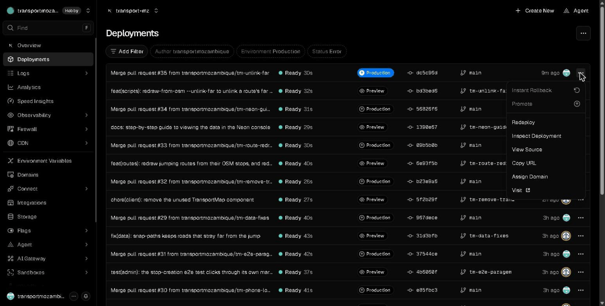
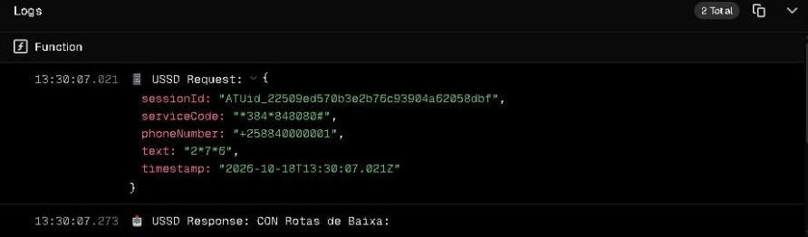

# Guia da Vercel

<!-- navegação: gerada por .github/scripts/docs-nav.py, não editar à mão -->
[Documentação](README.md) › 5. Pôr online › **Guia da Vercel** (página 20 de 25)

Anterior: [Publicação](publicacao.md) · [Índice](README.md) · Seguinte: [Guia da Neon](guia-neon.md)

<details>
<summary>Todas as páginas</summary>

- 0. Começar do zero: [Conceitos básicos](conceitos.md) · [Preparar o computador](preparar-o-computador.md)
- 1. Conhecer o projecto: [Visão geral](visao-geral.md) · [Glossário](glossario.md) · [Fontes de dados](fontes-de-dados.md) · [Estado do projecto](estado-do-projecto.md)
- 2. Montar localmente: [Primeiros passos](primeiros-passos.md) · [Base de dados](base-de-dados.md) · [Configuração](configuracao.md)
- 3. Perceber como funciona: [Fluxos de dados](fluxos-de-dados.md) · [Localização e GPS](localizacao-gps.md) · [Serviço USSD](ussd.md) · [Segurança](seguranca.md) · [Referência da API](referencia-api.md) · [Mapa do código](mapa-do-codigo.md)
- 4. Usar as aplicações: [Aplicação dos passageiros](app-passageiros.md) · [Portal do motorista](portal-motorista.md) · [Painel de administração](painel-admin.md)
- 5. Pôr online: [Publicação](publicacao.md) · **Guia da Vercel** · [Guia da Neon](guia-neon.md) · [Africa's Talking](africas-talking.md)
- 6. Manter: [Testes](testes.md) · [Resolução de problemas](resolucao-de-problemas.md) · [Limitações](limitacoes.md)

</details>
<!-- /navegação -->

> **Em palavras simples:** A [Vercel](conceitos.md#vercel "A empresa cujos servidores correm as três aplicações e as publicam a cada merge.") é a empresa cujos computadores mantêm os três sites ligados. Esta página mostra, com imagens, as partes do site da Vercel que se usam: criar os projectos, guardar as definições secretas, ver as [publicações](conceitos.md#publicacao "Pôr uma versão nova do código a funcionar nos servidores, ao vivo, para toda a gente.") e os [registos](conceitos.md#registos "As linhas de texto que um programa escreve sobre o que está a fazer, para se perceber depois o que aconteceu.") de erros.

As três aplicações correm na [Vercel](https://vercel.com), na equipa `transportmozambique`. Esta página mostra as partes do painel da Vercel que o projecto usa, com capturas de 2026-10-18:

- as [variáveis de ambiente](conceitos.md#variavel-de-ambiente "Uma definição que se dá a um programa de fora do código, como o endereço da base de dados ou uma palavra-passe."), onde estão as chaves;
- as publicações (deployments), que põem uma alteração no ar ou a tiram;
- os registos (logs), que mostram cada pedido e o que o código escreveu.

Como uma alteração vai de um [ramo](conceitos.md#ramo "Uma linha de trabalho separada, onde se fazem mudanças sem tocar na versão principal.") até à produção, e como se confirma, está em [Publicação](publicacao.md). Porquê a Vercel: publica um projecto [Next.js](conceitos.md#nextjs "O Next.js é a 'estrutura' sobre a qual as três aplicações estão feitas; o React é a parte dele que desenha os ecrãs.") a partir do [GitHub](conceitos.md#github "O site onde o repositório está guardado e partilhado, e onde se revêem as alterações.") sem configuração, com uma pré-visualização por [pull request](conceitos.md#pull-request "Um pull request é o pedido para juntar um ramo ao main; o merge é a junção, quando o pedido é aceite.") e um plano gratuito.

**Nesta página:** [Criar os projectos](#criar-os-projectos) · [Os três projectos](#os-três-projectos) · [Variáveis de ambiente](#variáveis-de-ambiente) · [Publicações](#publicações) · [Registos](#registos)

---

## Criar os projectos

Para montar a plataforma noutra conta, cada aplicação é um projecto da Vercel criado assim, uma vez:

1. Em [vercel.com](https://vercel.com), entrar com a conta do GitHub e escolher a equipa (ou criar uma).
2. **Add New → Project** e importar o [repositório](conceitos.md#repositorio "A pasta do projecto com todo o seu histórico no git.") do GitHub.
3. Em **Root Directory**, escolher a pasta da aplicação (`transport-client`, `transport-admin` ou `transport-driver`). A predefinição (Framework Preset) é detectada como Next.js; os comandos ficam os de origem.
4. Abrir **Environment Variables** e juntar as variáveis da aplicação ([Configuração](configuracao.md#variáveis-de-ambiente)). O painel precisa de `DATABASE_URL` já na compilação ([Publicação → Compilações](publicacao.md#compilações)).
5. **Deploy.** Repetir para as outras duas pastas.
6. Em **Settings → Functions**, escolher a região mais perto da [base de dados](conceitos.md#base-de-dados "O sítio organizado onde a plataforma guarda tudo o que tem de durar: rotas, paragens, veículos, contas.") (aqui `iad1`, Washington, para a [Neon](conceitos.md#neon "A empresa que guarda a base de dados PostgreSQL da produção, na internet.") em `us-east-2`).

A ligação à Neon pode fazer-se pela integração da Vercel (Storage → Neon), que cria `DATABASE_URL` sozinha, ou colando o [URL](conceitos.md#url "O texto que diz ao navegador onde está uma página ou informação, como https://transport-mz.vercel.app/viagem.") da Neon à mão ([Guia da Neon](guia-neon.md)).

## Os três projectos

Entrar em [vercel.com](https://vercel.com) e escolher a equipa **transportmozambique** no canto superior esquerdo. Cada aplicação é um projecto, compilado a partir da sua pasta do repositório:

| Projecto | Pasta | URL | As suas variáveis |
|---|---|---|---|
| `transport-mz` | `transport-client` | https://transport-mz.vercel.app | [passageiros, USSD, GPS](configuracao.md#transport-client-passageiros-ussd-api-do-motorista-gps) |
| `transport-mz-admin` | `transport-admin` | https://transport-mz-admin.vercel.app | [painel](configuracao.md#transport-admin-painel-de-administração) |
| `transport-mz-driver` | `transport-driver` | https://transport-mz-driver.vercel.app | [portal do motorista](configuracao.md#transport-driver-portal-do-motorista) |

Abre-se um projecto a partir da vista geral da equipa. O menu da esquerda tem as páginas abaixo.

## Variáveis de ambiente

**Projecto → Environment Variables** lista todas as variáveis, os ambientes a que se aplicam, e quando mudaram. Os valores ficam escondidos.


**Juntar uma.** Clicar em **Add Environment Variable**:


1. **Tipo.**
   - **Secret:** o valor não se pode ver outra vez depois de gravado. Para palavras-passe, chaves de [API](conceitos.md#api "Uma API é a lista de pedidos que um servidor aceita de outros programas; cada um desses pedidos, com o seu endereço, é um endpoint."), [tokens](conceitos.md#sessao "Depois de entrar, o servidor dá uma prova de quem se é (um token), e o navegador mostra-a a cada pedido para não ter de pedir a palavra-passe outra vez.") e [segredos](conceitos.md#segredo "Um valor que só a plataforma deve saber, como uma palavra-passe: quem o tiver pode agir em nome dela.") de sessão. Só em Production e Preview: a Vercel não aceita Secret em Development.
   - **Config:** os membros do projecto podem lê-lo. Para valores que não são segredo, como `AFRICASTALKING_USERNAME`.
2. **Key** e **Value.** Os nomes que o código lê estão em [Configuração](configuracao.md).
3. **Ambientes.**
   - **Production:** o URL ao vivo.
   - **Preview:** as publicações dos ramos e dos pull requests.
   - **Development:** `vercel dev` num computador.

   As chaves que enviam [SMS](conceitos.md#sms "As mensagens de texto curtas dos telemóveis.") reais ou escrevem na produção ficam fora de Preview. Porquê: qualquer ramo, mesmo um em teste, tem uma pré-visualização.
4. **Save**, depois [publicar outra vez](#publicações). As funções em execução ficam com os valores com que arrancaram até à publicação seguinte.

**"Needs Attention".** A Vercel marca os segredos guardados como Config. `USER_SESSION_SECRET` e `DRIVER_SESSION_SECRET` de `transport-mz` estiveram marcados até 2026-10-18; foram corrigidos assim, e o mesmo serve para qualquer outro:

1. juntar cada um outra vez como **Secret**, com um valor aleatório novo (`openssl rand -base64 32`);
2. apagar o de tipo Config;
3. publicar outra vez.

Os segredos de sessão novos fazem todos os passageiros e motoristas sair da conta uma vez ([Segurança → Mudar segredos](seguranca.md#mudar-segredos)).

O mesmo pela [CLI da Vercel](https://vercel.com/docs/cli), numa pasta ligada ao projecto (`vercel link --project transport-mz`). O valor vai directo do gerador para a Vercel, sem aparecer no ecrã:

```bash
openssl rand -base64 32 | tr -d '\r\n' | vercel env add USER_SESSION_SECRET production --sensitive --force --yes
```

Porquê o `tr`: no Windows o `openssl` termina a linha com `\r\n`, e a Vercel guardaria esses caracteres no segredo. `--sensitive` é o tipo Secret; `--force` substitui o valor que existe. Repete-se para `preview`.

**Mudar `DATABASE_URL`** (depois de repor a palavra-passe da Neon, por exemplo) é igual: juntá-la outra vez como Secret em `transport-mz` e `transport-mz-admin`, apagar as linhas antigas, e publicar os dois outra vez.

## Publicações

**Projecto → Deployments** lista todas as compilações, a mais nova primeiro:

- **Preview:** um ramo ou um pull request, cada um com o seu URL;
- **Production:** a `main`, servida no URL do projecto.

Um pull request recebe as suas pré-visualizações sozinho. O merge na `main` publica Production em cerca de 30 segundos por projecto. Cada linha mostra o [commit](conceitos.md#commit "Uma fotografia guardada do código num momento, com uma frase a dizer o que mudou."), o estado (**Ready**, **Building**, **Error**) e o tempo de compilação.



O menu **⋯** de uma publicação:

| Item | O que faz |
|---|---|
| **Redeploy** | compila outra vez o mesmo commit. Necessário depois de mudar variáveis de ambiente. |
| **Instant Rollback** | (Production) serve logo uma publicação anterior, sem compilar. Usa-se quando uma versão estraga algo; depois corrige-se e faz-se merge. |
| **Promote** | faz de uma publicação Preview a de Production. |
| **Inspect Deployment** | o registo da compilação e as funções dessa publicação. |
| **Visit** | abre o URL da publicação. |

Depois de uma publicação de produção de `transport-mz`, confirma-se que o [callback](conceitos.md#callback "Um endereço que se dá a outro serviço para ele chamar sempre que algo acontece.") [USSD](conceitos.md#ussd "Os menus que aparecem num telemóvel quando se marca um código como *384*848080#; funcionam em qualquer telemóvel, sem internet.") continua a recusar pedidos sem a chave ([Segurança → Resposta USSD](seguranca.md#resposta-ussd-callback)) e fazem-se as verificações de [Publicação → Confirmar uma publicação](publicacao.md#confirmar-uma-publicação).

## Registos

**Projecto → Logs** mostra todos os pedidos das últimas horas: hora, estado, [servidor](conceitos.md#servidor "Um computador sempre ligado que recebe pedidos e responde a eles."), caminho, e a primeira mensagem que o código escreveu.

- Escrever um caminho na caixa de pesquisa (`/api/ussd`, `/api/gps`, `/api/buses`) mostra só esses pedidos.
- **Contains Console Level** deixa só os pedidos que escreveram um aviso ou um erro.
- **Live** segue os pedidos novos à medida que chegam.


Clicar numa linha abre o pedido: o tempo, a rota, e tudo o que a função escreveu. No USSD é `USSD Request` com o `text` da sessão, depois `USSD Response`:



O que as aplicações escrevem nos registos, e onde procurar cada problema, está em [Resolução de problemas](resolucao-de-problemas.md).

**Os registos são sensíveis:**

- Têm números de telefone (USSD, SMS).
- Os detalhes de um pedido mostram os [parâmetros](conceitos.md#parametros "As três formas de um pedido levar informação: no endereço, no conteúdo, ou em etiquetas à parte.") do URL, que incluem a chave do callback USSD. As capturas dos detalhes de um pedido não se partilham.
- O acesso aos registos dá-se só a quem pode saber estas coisas.

<!-- navegação-fim: gerada por .github/scripts/docs-nav.py -->

---

Anterior: [Publicação](publicacao.md) · [Índice](README.md) · Seguinte: [Guia da Neon](guia-neon.md)
<!-- /navegação-fim -->
