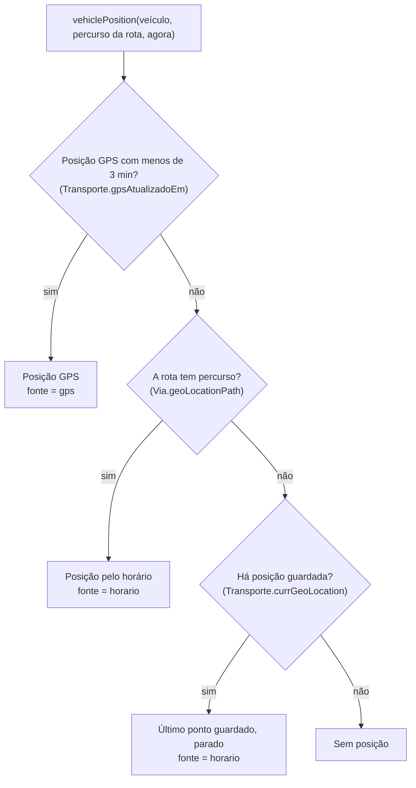

# Localização e GPS

<!-- navegação: gerada por .github/scripts/docs-nav.py, não editar à mão -->
[Documentação](README.md) › 3. Perceber como funciona › **Localização e GPS** (página 9 de 23)

Anterior: [Fluxos de dados](fluxos-de-dados.md) · [Índice](README.md) · Seguinte: [Serviço USSD](ussd.md)

<details>
<summary>Todas as páginas</summary>

- 1. Conhecer o projecto: [Visão geral](visao-geral.md) · [Glossário](glossario.md) · [Fontes de dados](fontes-de-dados.md) · [Estado do projecto](estado-do-projecto.md)
- 2. Montar localmente: [Primeiros passos](primeiros-passos.md) · [Base de dados](base-de-dados.md) · [Configuração](configuracao.md)
- 3. Perceber como funciona: [Fluxos de dados](fluxos-de-dados.md) · **Localização e GPS** · [Serviço USSD](ussd.md) · [Segurança](seguranca.md) · [Referência da API](referencia-api.md) · [Mapa do código](mapa-do-codigo.md)
- 4. Usar as aplicações: [Aplicação dos passageiros](app-passageiros.md) · [Portal do motorista](portal-motorista.md) · [Painel de administração](painel-admin.md)
- 5. Pôr online: [Publicação](publicacao.md) · [Guia da Vercel](guia-vercel.md) · [Guia da Neon](guia-neon.md) · [Africa's Talking](africas-talking.md)
- 6. Manter: [Testes](testes.md) · [Resolução de problemas](resolucao-de-problemas.md) · [Limitações](limitacoes.md)

</details>
<!-- /navegação -->

Cada veículo tem sempre uma posição. Vem de um dispositivo GPS real quando um enviou posição nos últimos 3 minutos; senão vem do **horário**: uma estimativa determinística de onde o autocarro estaria se fosse e voltasse ao longo da sua rota o dia inteiro. Esta página explica como se escolhe a posição e porquê, como ligar um telemóvel ou um rastreador a um veículo, e o protocolo que a aplicação dos passageiros aceita.

**Nesta página:** [Como se escolhe uma posição](#como-se-escolhe-uma-posição) · [Onde se usam as posições](#onde-se-usam-as-posições) · [Ligar um dispositivo](#ligar-um-dispositivo) · [Protocolo](#protocolo) · [Verificar que funciona](#verificar-que-funciona) · [Revogar um dispositivo](#revogar-um-dispositivo) · [Limites](#limites)

---

## Como se escolhe uma posição

`vehiclePosition()` ([`transport-client/lib/vehiclePosition.ts`](../transport-client/lib/vehiclePosition.ts), com uma cópia em [`transport-admin/lib/vehiclePosition.ts`](../transport-admin/lib/vehiclePosition.ts)) decide, para qualquer veículo e qualquer momento:



**1. GPS real.** Se `gpsAtualizadoEm` tem menos de 3 minutos (`GPS_FRESH_MS`), o veículo está em `currGeoLocation`:

- está **em movimento** quando a velocidade enviada é maior do que 0,5 km/h (ou desconhecida);
- o seu sítio na rota é o ponto mais próximo do percurso da rota;
- o **sentido** compara o rumo enviado com o rumo do próprio percurso nesse ponto: até 90° quer dizer "para o fim do percurso", senão "de volta";
- a velocidade é `gpsVelocidade`.

**2. Horário.** Sem posição recente, o autocarro vai e volta ao longo do percurso da rota à velocidade de viagem da tarifa (`Tarifa.velocidadeViagemKmh`, 30 km/h por omissão):

| Regra | Valor |
|---|---|
| Horas de serviço | 05:00–21:00, hora de Maputo (UTC+2 todo o ano) |
| Um ciclo | ida, 5 min no terminal do fim, volta, 5 min no primeiro terminal |
| Duração de cada sentido | comprimento do percurso ÷ velocidade de viagem |
| Onde está cada autocarro no ciclo | desfasado por um número tirado do id do veículo (FNV-1a), para os autocarros da mesma rota ficarem espalhados |
| Fora das horas de serviço | parado até às 05:00, metade dos autocarros em cada terminal (também pelo número) |

O autocarro segue exactamente o percurso guardado: onde um percurso corta quarteirões, o autocarro no mapa também. Corrigir um percurso ([Base de dados → Pôr os percursos nas estradas](base-de-dados.md#pôr-os-percursos-das-rotas-nas-estradas), ou "Redesenhar percurso" no painel) muda logo as posições pelo horário e as horas de chegada.

O resultado depende só da hora, do id do veículo, do percurso e da velocidade. **Porquê assim:** todos os endpoints, todas as instâncias serverless e os menus USSD calculam a mesma posição sem falarem uns com os outros, e nada corre em segundo plano (a Vercel não tem processos sempre ligados). **O que se perde:** o horário é uma estimativa, não um horário publicado; o GPS real resolve-o ([Limitações](limitacoes.md)).

**3. Sem percurso.** Uma rota sem percurso guardado não se pode seguir. O veículo aparece parado no último `currGeoLocation` guardado; sem ele, não tem posição (o painel mostra "Sem rota").

Uma posição GPS não muda a forma da rota nem o horário. Quando a posição passa os 3 minutos, o veículo volta simplesmente à posição pelo horário, que pode ser noutro sítio da rota.

## Onde se usam as posições

| Quem usa | Endpoint ou código | Usa |
|---|---|---|
| Mapa ao vivo dos passageiros | `GET /api/buses?fields=map`, depois `GET /api/buses?fields=position` | posição, `fonte` (`gps` ou `horario`), rumo |
| Resultados de pesquisa, acompanhar uma viagem | `GET /api/buses?paragemId=…`, `POST /api/viagem` | posição, sentido e sítio no percurso → hora de chegada |
| Opções 1, 4 e 5 do USSD | `/api/ussd` | hora de chegada; paragem mais próxima do autocarro |
| SMS de chegada | `checkAndNotifyUsers()` ([`lib/busSimulator.ts`](../transport-client/lib/busSimulator.ts)) | distância dos autocarros em movimento à paragem onde se espera |
| Lista de veículos e página do veículo no painel | `GET /api/transportes/estado`, `/posicao` | coluna "Agora", mapa ao vivo, etiqueta |
| "Próximas Passagens" e gráficos do painel | `GET /api/transportes/{id}/operacao` | só o horário |

As horas de chegada usam as mesmas regras: um autocarro que já passou a paragem, ou que vai no outro sentido, primeiro dá a volta num terminal (5 minutos lá), e uma passagem depois das 21:00 passa a ser a da manhã seguinte ([Fluxos de dados → Hora de chegada](fluxos-de-dados.md#hora-de-chegada)).

## Ligar um dispositivo

Há três tipos de dispositivo que podem enviar a posição de um veículo. Todos usam o **código do dispositivo** do veículo.

### 1. Criar o código do dispositivo

No painel, abrir **Transportes → o veículo → "Rastreador GPS"** e carregar em **"Gerar código do dispositivo"** ([Painel → Ligar um rastreador GPS](painel-admin.md#tarefa-gps)).


- O código tem 20 caracteres (15 bytes aleatórios em base64url, 120 bits).
- É mostrado **uma vez**, com o endereço do servidor e a configuração do Traccar Client. Só o seu hash SHA-256 fica guardado, em `Transporte.gpsDispositivoHash` (único). Porquê: quem ler a base de dados não consegue enviar posições falsas.
- "Gerar novo código" substitui-o: o código antigo deixa de funcionar logo, e todos os dispositivos que o usam recebem 401 até serem configurados outra vez.

O endereço do servidor mostrado é `GPS_SERVER_URL` do painel, por omissão `https://transport-mz.vercel.app/api/gps` ([Configuração](configuracao.md#transport-admin-painel-de-administração)).

### Traccar Client num telemóvel

O [Traccar Client](https://www.traccar.org/client/) é uma aplicação gratuita (Android e iOS) que envia a posição do telemóvel em segundo plano, também com o ecrã desligado. É a forma recomendada de seguir um veículo com o telemóvel do motorista. Porquê esta: é aberta, gratuita, e fala o protocolo OsmAnd, que a plataforma aceita sem nada a mais.

| Configuração do Traccar Client | Valor |
|---|---|
| Server URL | `https://transport-mz.vercel.app/api/gps` |
| Device identifier | o código do dispositivo do veículo |
| Location accuracy | High |
| Frequency | 15 segundos |

Depois, ligar o serviço de seguimento na aplicação. Envia cada posição com o protocolo OsmAnd ([abaixo](#parâmetros-osmand)) e guarda as posições em fila quando está sem rede. Quando as reenvia, o servidor ignora as mais antigas do que a última guardada, por isso o veículo fica na mais recente.

### O portal do motorista

O portal do motorista pode usar o navegador do telemóvel como rastreador durante uma viagem: o motorista guarda o código do dispositivo no painel de informações do portal. O navegador envia no máximo uma posição a cada 15 s, e só enquanto a página está aberta e à frente ([Portal do motorista → Partilhar o GPS do telemóvel](portal-motorista.md#partilhar-o-gps-do-telemóvel)). Para seguimento contínuo, preferir o Traccar Client: os navegadores param de enviar com o ecrã desligado.

### Um rastreador de hardware

Os rastreadores de veículos falam normalmente protocolos binários próprios para um servidor de seguimento, não HTTP. Passam por um [servidor Traccar](https://www.traccar.org/), que reencaminha cada posição para `/api/gps` com o código do veículo como `id`, nos [parâmetros OsmAnd](#parâmetros-osmand). A configuração do reencaminhamento e os nomes dos campos dependem da versão do Traccar (ver a sua documentação de "position forwarding"). Este caminho ainda não foi testado com um rastreador real.

## Protocolo

`/api/gps` da aplicação dos passageiros ([`transport-client/app/api/gps/route.ts`](../transport-client/app/api/gps/route.ts)) aceita `GET` e `POST`. Todas as respostas levam `Access-Control-Allow-Origin: *`, para um navegador noutro domínio (o portal do motorista) poder enviar. `OPTIONS` responde 204.

### Parâmetros OsmAnd

Usados pelo Traccar Client e pelo reencaminhamento do Traccar. Os campos podem vir na query ou num corpo de formulário.

```http
GET https://transport-mz.vercel.app/api/gps?id=<código>&lat=-25.9692&lon=32.5732&timestamp=1792225800&speed=10&bearing=90&accuracy=12
```

| Campo | Também aceite como | Unidade |
|---|---|---|
| `id` | `deviceid` | o código do dispositivo |
| `lat`, `lon` | `latitude`, `lng`, `longitude` | graus decimais |
| `timestamp` | `time` | segundos ou milissegundos desde 1970, ou uma data ISO 8601; opcional |
| `speed` | | **nós** (multiplicados por 1,852 para guardar km/h) |
| `bearing` | `heading`, `course` | graus, 0 = norte |
| `accuracy` | | metros; opcional |

### JSON com o código como "Bearer"

Para integrações próprias. O código vai no cabeçalho `Authorization` e o corpo é JSON:

```http
POST https://transport-mz.vercel.app/api/gps
Authorization: Bearer <código>
Content-Type: application/json

{"latitude": -25.9655, "longitude": 32.5832, "timestamp": "2026-10-17T08:30:00Z", "speed": 23.4, "heading": 87, "accuracy": 12}
```

Os mesmos campos e nomes alternativos, mas `speed` em **km/h**. `timestamp` é opcional (ISO 8601, ou segundos ou milissegundos desde 1970).

### O que o servidor faz

| Caso | Resposta | Guardado |
|---|---|---|
| Sem código (sem `Authorization: Bearer`, sem `id`) | 401 `{"error": "Código do dispositivo em falta"}` | nada |
| Latitude ou longitude em falta, fora dos limites, ou exactamente 0,0 | 400 `{"error": "Coordenadas inválidas"}` | nada |
| Nenhum veículo tem este código | 401 `{"error": "Dispositivo desconhecido"}` | nada |
| `accuracy` acima de 200 m | 200 `{"ok": true, "ignored": "precisão insuficiente"}` | nada |
| Hora não mais recente do que a última posição guardada | 200 `{"ok": true, "ignored": "posição mais antiga do que a última"}` | nada |
| Caso contrário | 200 `{"ok": true}` | ver abaixo |

Porquê 200 nas posições ignoradas: o Traccar Client reenvia uma posição enquanto não receber 200, e uma posição antiga ou imprecisa não vale a pena reenviar.

Quando corre bem, a linha do veículo é actualizada:

| Coluna | Valor |
|---|---|
| `Transporte.currGeoLocation` | `"lat,lng"` com 6 casas decimais |
| `gpsAtualizadoEm` | a hora da posição; a hora do servidor se faltava ou estava mais de 2 minutos no futuro |
| `gpsVelocidade` | km/h, uma casa decimal, ou `NULL` se não veio velocidade |
| `gpsDirecao` | 0–360°, ou `NULL` |

Os leitores decidem se a posição é recente por `gpsAtualizadoEm`, por isso uma posição que chega tarde com a sua hora original fica guardada mas pode já contar como antiga.

## Verificar que funciona

**Com `curl`**, de qualquer máquina (substituir o código; localmente usar `http://localhost:3000`):

```bash
curl -s "https://transport-mz.vercel.app/api/gps?id=<código>&lat=-25.9692&lon=32.5732&speed=10&bearing=90"
# {"ok":true}
```

**No painel**, a etiqueta "Rastreador GPS" do veículo passa a **"GPS ativo"** em 30 s e mostra "Última posição recebida", e a etiqueta do mapa diz "GPS real". No mapa dos passageiros o autocarro salta para o ponto enviado.


**Na base de dados:**

```sql
SELECT matricula, "currGeoLocation", "gpsAtualizadoEm", "gpsVelocidade", "gpsDirecao",
       now() - "gpsAtualizadoEm" < interval '3 minutes' AS recente
FROM "Transporte"
WHERE "gpsDispositivoHash" IS NOT NULL
ORDER BY "gpsAtualizadoEm" DESC NULLS LAST;
```

**Nos registos da Vercel** de `transport-mz`, os pedidos falhados aparecem como "Erro ao receber posição GPS". As recusas (400, 401) não ficam no registo da função; ver o estado HTTP no registo de pedidos ([Guia da Vercel → Registos](guia-vercel.md#registos)).

## Revogar um dispositivo

"Revogar dispositivo" no cartão GPS do veículo (`DELETE /api/transportes/{id}/gps`) limpa o hash do código e `gpsAtualizadoEm`, `gpsVelocidade` e `gpsDirecao`. O dispositivo passa a receber 401, e o veículo volta logo à posição pelo horário. Para passar um telemóvel para outro veículo, gerar um código no veículo novo e escrevê-lo no telemóvel.

## Limites

- **Recente quer dizer 3 minutos.** Um dispositivo que envia com menos frequência faz o autocarro saltar entre o ponto GPS e o ponto do horário. Os 15 s do Traccar Client ficam bem dentro do limite.
- **O estado da viagem não trava os rastreadores.** O Traccar Client e os rastreadores enviam sempre que estão ligados. Só a partilha pelo navegador do portal do motorista espera por "Iniciar viagem".
- **Um dispositivo por veículo.** Um código novo substitui o anterior.
- **Sem histórico.** Cada posição substitui a anterior; não se guarda o trajecto. (`GeoLocation` só tem dados da importação inicial.)
- **Posições fora da rota aparecem onde estão.** A hora de chegada projecta-as no ponto mais próximo do percurso da rota.

<!-- navegação-fim: gerada por .github/scripts/docs-nav.py -->

---

Anterior: [Fluxos de dados](fluxos-de-dados.md) · [Índice](README.md) · Seguinte: [Serviço USSD](ussd.md)
<!-- /navegação-fim -->
