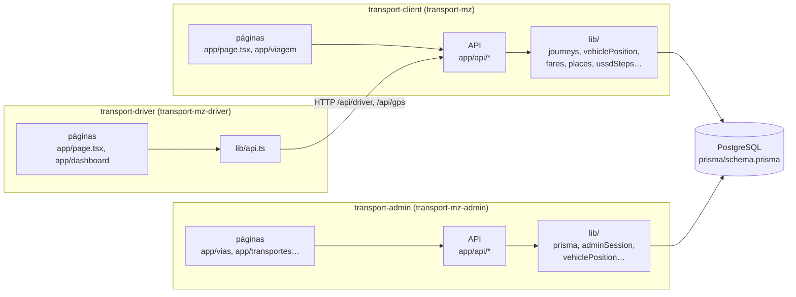

# Mapa do código

<!-- navegação: gerada por .github/scripts/docs-nav.py, não editar à mão -->
[Documentação](README.md) › 3. Perceber como funciona › **Mapa do código** (página 15 de 26)

Anterior: [Referência da API](referencia-api.md) · [Índice](README.md) · Seguinte: [Aplicação dos passageiros](app-passageiros.md)

Todas as páginas

- 0. Começar do zero: [Conceitos básicos](conceitos.md) · [Preparar o computador](preparar-o-computador.md)
- 1. Conhecer o projecto: [Visão geral](visao-geral.md) · [Glossário](glossario.md) · [Fontes de dados](fontes-de-dados.md) · [Estado do projecto](estado-do-projecto.md)
- 2. Montar localmente: [Primeiros passos](primeiros-passos.md) · [Base de dados](base-de-dados.md) · [Configuração](configuracao.md)
- 3. Perceber como funciona: [Fluxos de dados](fluxos-de-dados.md) · [Localização e GPS](localizacao-gps.md) · [Serviço USSD](ussd.md) · [Segurança](seguranca.md) · [Referência da API](referencia-api.md) · **Mapa do código**
- 4. Usar as aplicações: [Aplicação dos passageiros](app-passageiros.md) · [Portal do motorista](portal-motorista.md) · [Painel de administração](painel-admin.md)
- 5. Pôr online: [Publicação](publicacao.md) · [Guia da Vercel](guia-vercel.md) · [Guia da Neon](guia-neon.md) · [Africa's Talking](africas-talking.md) · [Guia do cron-job.org](guia-cron-job.md)
- 6. Manter: [Testes](testes.md) · [Resolução de problemas](resolucao-de-problemas.md) · [Limitações](limitacoes.md)

<!-- /navegação -->

> **Em palavras simples:** O código está dividido em muitos ficheiros. Esta página é o mapa: para cada pasta e ficheiro importante, diz o que faz e onde está explicado. Serve para encontrar onde se muda uma coisa.

Cada pasta e ficheiro que conta, o que faz, e a página que o explica. Para ler o código pela primeira vez, a ordem sugerida é a das secções: a [base de dados](conceitos.md#base-de-dados "O sítio organizado onde a plataforma guarda tudo o que tem de durar: rotas, paragens, veículos, contas."), depois as bibliotecas partilhadas da aplicação dos passageiros (onde está quase toda a lógica), depois as rotas da [API](conceitos.md#api "Uma API é a lista de pedidos que um servidor aceita de outros programas; cada um desses pedidos, com o seu endereço, é um endpoint."), e por fim as páginas.

**Nesta página:** [Raiz do repositório](#raiz-do-repositório) · [Base de dados](#base-de-dados) · [Aplicação dos passageiros](#aplicação-dos-passageiros-transport-client) ([bibliotecas](#bibliotecas-lib) · [API](#api-appapi) · [páginas](#páginas-e-componentes) · [scripts](#scripts-de-dados-scripts)) · [Portal do motorista](#portal-do-motorista-transport-driver) · [Painel de administração](#painel-de-administração-transport-admin) · [CI e agendamentos](#ci-e-agendamentos-github) · [Código antigo](#código-antigo)

---

## Como o código está organizado

Cada aplicação é um projecto [Next.js](conceitos.md#nextjs "O Next.js é a 'estrutura' sobre a qual as três aplicações estão feitas; o React é a parte dele que desenha os ecrãs.") com a mesma forma: `app/` tem as páginas (`page.tsx`) e as rotas da API (`app/api/**/route.ts`, uma pasta por [URL](conceitos.md#url "O texto que diz ao navegador onde está uma página ou informação, como https://transport-mz.vercel.app/viagem.")), e `lib/` tem o código partilhado por elas. Porquê esta forma: é a convenção do Next.js App Router, por isso o URL de uma página ou endpoint diz onde está o ficheiro (`/api/stops/{id}` está em `app/api/stops/[id]/route.ts`). Ver [Visão geral → Tecnologias e porquê](visao-geral.md#tecnologias-e-porquê).

## Raiz do repositório

| Caminho | O que é | Explicado em |
|---|---|---|
| [`README.md`](../README.md) | A entrada: o que é, as aplicações ao vivo, e onde começar a ler | |
| [`docs/`](README.md) | Esta documentação; [`docs/images/`](images) tem as capturas de ecrã | [Índice](README.md) |
| [`prisma/schema.prisma`](../prisma/schema.prisma) | A referência do [esquema](conceitos.md#migracao "O esquema é a lista das tabelas e colunas; uma migração é uma alteração a essa lista, escrita em SQL para se poder repetir.") da base de dados | [Base de dados](base-de-dados.md) |
| [`prisma/migrations/`](../prisma/migrations) | O histórico das alterações ao esquema, em [SQL](conceitos.md#sql "A linguagem com que se fazem perguntas e alterações a uma base de dados.") | [Base de dados → Alterações ao esquema e migrações](base-de-dados.md#alterações-ao-esquema-e-migrações) |
| [`docker-compose.yml`](../docker-compose.yml) | [PostgreSQL](conceitos.md#postgresql "O programa de base de dados que este projecto usa; gratuito e muito usado.") 16 local na porta 5433, para desenvolvimento | [Primeiros passos → 2](primeiros-passos.md#2-arrancar-uma-base-de-dados) |
| [`start-all.bat`](../start-all.bat) | Abre as três aplicações no Windows (portas 3000, 3001, 3002) | [Primeiros passos → 7](primeiros-passos.md#7-correr-as-aplicações) |
| [`.github/`](../.github) | [CI](conceitos.md#ci "Verificações que o GitHub corre sozinho a cada pull request, para nenhum erro conhecido chegar ao main."), o [agendamento](conceitos.md#agendamento "Uma tarefa que corre sozinha a uma hora marcada, ou de tantos em tantos minutos.") da verificação de chegadas, e os [scripts](conceitos.md#script "Um pequeno programa que se corre à mão, uma vez, para uma tarefa: importar dados, corrigir percursos, mostrar listas.") de verificação | [CI e agendamentos](#ci-e-agendamentos-github) |
| [`LICENSE`](../LICENSE) | A licença do código | |

## Base de dados

| Caminho | O que é | Porquê |
|---|---|---|
| [`prisma/schema.prisma`](../prisma/schema.prisma) | Tabelas, campos e relações | Uma referência só; as outras duas cópias têm de ser iguais |
| [`transport-client/prisma/schema.prisma`](../transport-client/prisma/schema.prisma) | Cópia igual | Cada projecto da [Vercel](conceitos.md#vercel "A empresa cujos servidores correm as três aplicações e as publicam a cada merge.") só vê a sua pasta e gera o seu cliente [Prisma](conceitos.md#prisma "A ferramenta com que o código fala com a base de dados sem escrever SQL à mão.") |
| [`transport-admin/prisma/schema.prisma`](../transport-admin/prisma/schema.prisma) | Cópia com `previewFeatures = ["omitApi"]` | Para o painel nunca ler o [hash](conceitos.md#hash "Uma 'impressão digital' de um texto, que se calcula num sentido e não se consegue desfazer.") do PIN ([Segurança](seguranca.md#painel-de-administração)) |
| [`transport-client/prisma/seed.ts`](../transport-client/prisma/seed.ts) | [Dados de demonstração](conceitos.md#semente "Um conjunto pequeno de dados inventados que se carrega numa base de dados vazia para a experimentar.") para uma base de dados local | [Primeiros passos → 6](primeiros-passos.md#6-carregar-os-dados-de-demonstração) |
| [`.github/scripts/check-schemas.mjs`](../.github/scripts/check-schemas.mjs) | Falha o CI quando as três cópias diferem | |

## Aplicação dos passageiros (`transport-client`)

Publicada como `transport-mz`. Tem a web dos passageiros, o [USSD](conceitos.md#ussd "Os menus que aparecem num telemóvel quando se marca um código como *384*848080#; funcionam em qualquer telemóvel, sem internet."), a API do motorista e a entrada das posições [GPS](conceitos.md#gps "O sistema de satélites com que um telemóvel ou um aparelho sabe as suas coordenadas."). Porquê tudo junto: todas estas partes lêem a mesma rede e o mesmo estado das viagens, e uma só cópia do código de posições e tarifas dá as mesmas respostas na web e no USSD.

### Bibliotecas (`lib/`)

Quase toda a lógica está aqui; as rotas da API só lêem o pedido, chamam estas funções e respondem.

| Ficheiro | O que faz | Explicado em |
|---|---|---|
| [`vehiclePosition.ts`](../transport-client/lib/vehiclePosition.ts) | Onde está um veículo agora (GPS recente, senão a viagem do motorista; parado sem viagem), o seu estado, e quando chega a cada paragem | [Localização e GPS](localizacao-gps.md#como-se-escolhe-uma-posição) |
| [`journeys.ts`](../transport-client/lib/journeys.ts) | A rede em memória (guardada 5 min), os destinos de uma paragem e as viagens com [transbordos](glossario.md#palavras-dos-ecrãs "Mudança de autocarro a meio de uma viagem") entre dois locais | [Fluxos de dados → Planear uma viagem](fluxos-de-dados.md#planear-uma-viagem) |
| [`follow.ts`](../transport-client/lib/follow.ts) | Acompanhar uma viagem escolhida, troço a troço, com as horas de agora | [Fluxos de dados → Acompanhar uma viagem](fluxos-de-dados.md#acompanhar-uma-viagem) |
| [`fares.ts`](../transport-client/lib/fares.ts) | A regra de tarifa activa (guardada 60 s), a tarifa e o tempo de um troço | [Configuração → Regra de tarifa](configuracao.md#regra-de-tarifa-tarifa) |
| [`eta.ts`](../transport-client/lib/eta.ts) | Como se escreve uma espera: "10 min", ou a hora com "amanhã" | [Fluxos de dados → Hora de chegada](fluxos-de-dados.md#hora-de-chegada) |
| [`places.ts`](../transport-client/lib/places.ts) | Juntar paragens com o mesmo nome em locais, e a pesquisa tolerante de nomes; corre também no [navegador](conceitos.md#navegador "O programa com que se abrem sites: Chrome, Firefox, Edge, Safari.") | [Serviço USSD → Pesquisa tolerante](ussd.md#pesquisa-tolerante) |
| [`ussdSteps.ts`](../transport-client/lib/ussdSteps.ts) | Ler as teclas USSD de `text` ecrã a ecrã, paginar listas, fazer o texto do ecrã | [Serviço USSD → Leitura das teclas](ussd.md#leitura-das-teclas) |
| [`busSimulator.ts`](../transport-client/lib/busSimulator.ts) | A verificação de chegadas: os avisos das viagens acompanhadas (por `journeyAlerts.ts`) e os [SMS](conceitos.md#sms "As mensagens de texto curtas dos telemóveis.") dos alertas de paragem da web, quando o próximo autocarro em viagem chega em 5 minutos ou menos | [Fluxos de dados → Alerta de chegada e SMS](fluxos-de-dados.md#alerta-de-chegada-e-sms) |
| [`journeyAlerts.ts`](../transport-client/lib/journeyAlerts.ts) | Os avisos por SMS de uma viagem acompanhada (opção 1 do USSD): 15, 10 e 5 min, "a chegar", a bordo, transbordo e destino, cada um enviado uma só vez | [Fluxos de dados → Os avisos de uma viagem acompanhada](fluxos-de-dados.md#os-avisos-de-uma-viagem-acompanhada) |
| [`notifications.ts`](../transport-client/lib/notifications.ts) | Enviar um SMS pela [Africa's Talking](conceitos.md#africas-talking "O gateway de USSD e SMS usado por este projecto.") | [Africa's Talking](africas-talking.md) |
| [`walkRoute.ts`](../transport-client/lib/walkRoute.ts) | Caminhos a pé pelas ruas, do [router](conceitos.md#router "Um serviço que, dados dois ou mais pontos, responde com o caminho pelas ruas entre eles e a distância.") da FOSSGIS, um pedido por segundo no máximo | [Fontes de dados → Serviços](fontes-de-dados.md#serviços) |
| [`signedToken.ts`](../transport-client/lib/signedToken.ts) | Assinar e verificar [tokens](conceitos.md#sessao "Depois de entrar, o servidor dá uma prova de quem se é (um token), e o navegador mostra-a a cada pedido para não ter de pedir a palavra-passe outra vez.") de sessão (HMAC-SHA256) | [Segurança → Sessões assinadas](seguranca.md#sessões-assinadas) |
| [`userSession.ts`](../transport-client/lib/userSession.ts), [`driverSession.ts`](../transport-client/lib/driverSession.ts) | As sessões de passageiros (90 dias) e de motoristas (30 dias) | [Segurança](seguranca.md) |
| [`driverTrips.ts`](../transport-client/lib/driverTrips.ts) | Encontrar um motorista pelo telefone, iniciar e encerrar a viagem (o [terminal](conceitos.md#terminal "A janela onde se escrevem instruções para o computador em texto, em vez de clicar.") de partida, a posição onde fica) e recusar quem não tem veículo ou rota activa; partilhado pelo USSD e pelo portal | [Fluxos de dados → Entrada e viagem do motorista](fluxos-de-dados.md#entrada-e-viagem-do-motorista) |
| [`driverProfile.ts`](../transport-client/lib/driverProfile.ts) | O que o portal mostra: o motorista, o veículo e a rota com as paragens por ordem | [Portal do motorista](portal-motorista.md) |
| [`phones.ts`](../transport-client/lib/phones.ts) | Comparar números de telefone escritos de formas diferentes | [Glossário](glossario.md) |
| [`prisma.ts`](../transport-client/lib/prisma.ts) | Um só cliente Prisma por processo | [Base de dados → Prisma Client num script](base-de-dados.md#prisma-client-num-script) |

### API (`app/api/`)

Cada pasta é um URL. Todos os endpoints, com exemplos, estão na [Referência da API](referencia-api.md#aplicação-dos-passageiros-transport-client).

| Pasta | Endpoint | Para quê |
|---|---|---|
| [`stops`](../transport-client/app/api/stops) | `/api/stops`, `/api/stops/{id}` | As paragens do mapa; as rotas e destinos de uma paragem |
| [`destinos`](../transport-client/app/api/destinos/route.ts) | `/api/destinos` | "Para onde ir" a partir da posição do passageiro |
| [`journeys`](../transport-client/app/api/journeys/route.ts) | `/api/journeys` | Viagens até um destino |
| [`viagem`](../transport-client/app/api/viagem/route.ts) | `/api/viagem` | Acompanhar uma viagem |
| [`buses`](../transport-client/app/api/buses/route.ts), [`bus`](../transport-client/app/api/bus) | `/api/buses`, `/api/bus/{id}` | Os autocarros no mapa; um autocarro |
| [`walk`](../transport-client/app/api/walk/route.ts) | `/api/walk` | Caminhadas pelas ruas |
| [`auth`](../transport-client/app/api/auth), [`user`](../transport-client/app/api/user) | `/api/auth/*`, `/api/user/*` | Conta do passageiro e alertas de chegada |
| [`driver`](../transport-client/app/api/driver) | `/api/driver/*` | A API do portal do motorista |
| [`gps`](../transport-client/app/api/gps/route.ts) | `/api/gps` | Entrada das posições dos dispositivos GPS |
| [`ussd`](../transport-client/app/api/ussd/route.ts) | `/api/ussd` | Os menus USSD ([Serviço USSD](ussd.md)) |
| [`simulation`](../transport-client/app/api/simulation/route.ts), [`startup`](../transport-client/app/api/startup/route.ts) | `/api/simulation`, `/api/startup` | Estado e verificação de chegadas |

### Páginas e componentes

| Ficheiro | O que mostra | Explicado em |
|---|---|---|
| [`app/page.tsx`](../transport-client/app/page.tsx) | A página inicial: o mapa com o planeador | [Aplicação dos passageiros](app-passageiros.md) |
| [`app/components/TripPlanner.tsx`](../transport-client/app/components/TripPlanner.tsx) | O mapa do passageiro: autocarros ao vivo, paragens perto, "Para onde ir", partida e destino, opções de viagem | [Aplicação dos passageiros](app-passageiros.md) |
| [`app/viagem/page.tsx`](../transport-client/app/viagem/page.tsx), [`app/components/JourneyFollow.tsx`](../transport-client/app/components/JourneyFollow.tsx) | Acompanhar uma viagem num só mapa | [Aplicação dos passageiros → Acompanhar uma viagem](app-passageiros.md#acompanhar-uma-viagem-viagem) |
| [`app/components/Sheet.tsx`](../transport-client/app/components/Sheet.tsx) | O painel das páginas de mapa: cartão no computador, folha arrastável no telemóvel | |
| [`app/components/mapKit.ts`](../transport-client/app/components/mapKit.ts), [`walkPaths.ts`](../transport-client/app/components/walkPaths.ts) | Peças de mapa partilhadas; caminhadas desenhadas pelas ruas | |
| [`app/components/Bus3D.tsx`](../transport-client/app/components/Bus3D.tsx), [`Bus3DMarker.tsx`](../transport-client/app/components/Bus3DMarker.tsx), [`Plate.tsx`](../transport-client/app/components/Plate.tsx) | O autocarro desenhado em 3D no mapa, e a matrícula como uma [chapa](glossario.md#transportes-em-maputo "Os minibuses que levam a maior parte dos passageiros de Maputo") | |
| [`app/auth/page.tsx`](../transport-client/app/auth/page.tsx), [`app/user-info/page.tsx`](../transport-client/app/user-info/page.tsx) | Entrar e registar-se; a conta do passageiro e os alertas | [Aplicação dos passageiros → Conta e entrada](app-passageiros.md#conta-e-entrada) |
| [`app/search`](../transport-client/app/search/page.tsx), [`app/my-transports`](../transport-client/app/my-transports/page.tsx), [`app/track/[id]`](../transport-client/app/track/[id]/page.tsx) | Endereços antigos que levam às páginas novas | |

### Scripts de dados (`scripts/`)

Correm-se com [`node`](conceitos.md#nodejs "O programa que corre JavaScript fora do navegador, num computador ou num servidor.") ou [`npx tsx`](conceitos.md#npm "O npm descarrega e instala os pacotes (código feito por outros) de que cada aplicação precisa.") dentro de `transport-client`, contra a base de dados de `DATABASE_URL`.

| Script | O que faz | Escreve? | Explicado em |
|---|---|---|---|
| [`import-osm.mjs`](../transport-client/scripts/import-osm.mjs) | Importa paragens e rotas do [OpenStreetMap](conceitos.md#openstreetmap "Um mapa do mundo inteiro feito por voluntários, como uma Wikipédia dos mapas, que qualquer pessoa pode usar e corrigir.") | sim | [Base de dados → Importar do OpenStreetMap](base-de-dados.md#importar-paragens-e-rotas-do-openstreetmap) |
| [`snap-paths.mjs`](../transport-client/scripts/snap-paths.mjs) | Põe nas estradas os percursos que cortam pelo mapa | sim | [Base de dados → Pôr os percursos nas estradas](base-de-dados.md#pôr-os-percursos-das-rotas-nas-estradas) |
| [`redraw-from-osm.mjs`](../transport-client/scripts/redraw-from-osm.mjs) | Redesenha rotas a partir das suas paragens do OpenStreetMap | sim | [Base de dados → Redesenhar rotas](base-de-dados.md#redesenhar-rotas-a-partir-das-suas-paragens-do-openstreetmap) |
| [`roads.mjs`](../transport-client/scripts/roads.mjs) | Partilhado pelos três acima: geometria e pedidos ao router | | |
| [`add-drivers.mjs`](../transport-client/scripts/add-drivers.mjs) | Dá um motorista de demonstração a cada veículo sem motorista | sim | [Base de dados → Motoristas para os veículos importados](base-de-dados.md#motoristas-para-os-veículos-importados) |
| [`queries.ts`](../transport-client/scripts/queries.ts) | Listas só de leitura (rotas, veículos, motoristas…) | não | [Base de dados → Prisma Client num script](base-de-dados.md#prisma-client-num-script) |
| [`ussd-ecras.ts`](../transport-client/scripts/ussd-ecras.ts) | Mostra os ecrãs USSD de cada `text`, sem [servidor](conceitos.md#servidor "Um computador sempre ligado que recebe pedidos e responde a eles.") | opção 1 sim | [Serviço USSD → Testar](ussd.md#testar) |
| [`load-env.ts`](../transport-client/scripts/load-env.ts) | Lê o [`.env`](conceitos.md#variavel-de-ambiente "Uma definição que se dá a um programa de fora do código, como o endereço da base de dados ou uma palavra-passe.") para os scripts | | |
| [`verify-prisma.ts`](../transport-client/scripts/verify-prisma.ts) | Confirma que o Prisma liga e lê | não | |

## Portal do motorista (`transport-driver`)

Publicado como `transport-mz-driver`. Só interface: toda a API está na aplicação dos passageiros. Porquê: o menu USSD do motorista e o portal mudam o mesmo estado de viagem.

| Ficheiro | O que faz | Explicado em |
|---|---|---|
| [`app/page.tsx`](../transport-driver/app/page.tsx) | Entrada com telefone e PIN | [Portal do motorista](portal-motorista.md) |
| [`app/dashboard/page.tsx`](../transport-driver/app/dashboard/page.tsx) | O mapa da rota, iniciar e encerrar a viagem, passageiros à espera, partilha do GPS do telemóvel | [Portal do motorista](portal-motorista.md) |
| [`app/components/Sheet.tsx`](../transport-driver/app/components/Sheet.tsx) | O mesmo painel arrastável da aplicação dos passageiros | |
| [`lib/api.ts`](../transport-driver/lib/api.ts) | O endereço da API (`NEXT_PUBLIC_API_URL`) e o token da sessão | [Configuração](configuracao.md#transport-driver-portal-do-motorista) |

## Painel de administração (`transport-admin`)

Publicado como `transport-mz-admin`. Gere a rede, a frota e as pessoas. Uma pasta por entidade em `app/` (páginas) e em `app/api/` (API).

| Caminho | O que faz | Explicado em |
|---|---|---|
| [`proxy.ts`](../transport-admin/proxy.ts) | Recusa com [401](conceitos.md#codigos-de-resposta "O número de três algarismos com que o servidor diz como correu o pedido.") qualquer `/api/*` sem sessão de administrador | [Segurança → Painel de administração](seguranca.md#painel-de-administração) |
| [`lib/adminSession.ts`](../transport-admin/lib/adminSession.ts) | O cookie de sessão assinado | [Segurança → Sessões assinadas](seguranca.md#sessões-assinadas) |
| [`lib/prisma.ts`](../transport-admin/lib/prisma.ts) | Cliente Prisma que omite `Motorista.password` | |
| [`lib/vehiclePosition.ts`](../transport-admin/lib/vehiclePosition.ts) | As mesmas regras de posição da aplicação dos passageiros (cópia a manter igual) | [Localização e GPS](localizacao-gps.md) |
| [`lib/routeOrder.ts`](../transport-admin/lib/routeOrder.ts) | Converte um percurso para o formato guardado `lng,lat;…` | [Base de dados → Convenções](base-de-dados.md#convenções-ler-antes-de-consultar) |
| [`lib/phoneSearch.ts`](../transport-admin/lib/phoneSearch.ts) | Pesquisar telefones guardados com espaços | |
| [`app/dashboard/page.tsx`](../transport-admin/app/dashboard/page.tsx) | O início: contadores, o cartão "Agora", o mapa das rotas | [Painel de administração](painel-admin.md) |
| [`app/vias`](../transport-admin/app/vias), [`app/components/RouteDrawer.tsx`](../transport-admin/app/components/RouteDrawer.tsx) | Rotas; desenhar e redesenhar um percurso pelas estradas | [Painel → Redesenhar o percurso de uma rota](painel-admin.md#tarefa-redesenhar) |
| [`app/transportes`](../transport-admin/app/transportes), [`app/components/GpsTrackerCard.tsx`](../transport-admin/app/components/GpsTrackerCard.tsx) | Veículos; ligar um dispositivo GPS | [Painel → Ligar um GPS](painel-admin.md#tarefa-gps) |
| [`app/motoristas`](../transport-admin/app/motoristas), [`app/components/DriverPinCard.tsx`](../transport-admin/app/components/DriverPinCard.tsx) | Motoristas; gerar o PIN | [Painel → Dar um PIN a um motorista](painel-admin.md#tarefa-pin) |
| [`app/tarifa/page.tsx`](../transport-admin/app/tarifa/page.tsx) | A regra de tarifa | [Painel → Tarifa](painel-admin.md#tarifa) |
| `app/paragens`, `app/proprietarios`, `app/utentes`, `app/provincias`, `app/municipios`, `app/administradores`, `app/relatorios`, `app/perfil` | As outras entidades, os relatórios e o perfil | [Painel de administração](painel-admin.md) |
| [`app/components/Sidebar.tsx`](../transport-admin/app/components/Sidebar.tsx), [`Header.tsx`](../transport-admin/app/components/Header.tsx), [`AdminLayout.tsx`](../transport-admin/app/components/AdminLayout.tsx) | O menu, a pesquisa global e a moldura das páginas | |
| [`app/contexts/AuthContext.tsx`](../transport-admin/app/contexts/AuthContext.tsx) | Quem tem sessão; sai da conta num 401 | |
| [`create-admin.js`](../transport-admin/create-admin.js) | Cria o primeiro administrador (ou muda a palavra-passe de um) | [Publicação](publicacao.md) |
| [`__tests__/`](../transport-admin/__tests__) | Testes [Jest](conceitos.md#testes "Programas que experimentam as aplicações sozinhos e avisam quando algo deixou de funcionar.") da API e da base de dados | [Testes](testes.md) |
| [`e2e/`](../transport-admin/e2e) | Testes Playwright da interface | [Testes → Testes ponta a ponta do painel](testes.md#testes-ponta-a-ponta-do-painel-playwright) |

## CI e agendamentos (`.github/`)

| Ficheiro | O que faz | Explicado em |
|---|---|---|
| [`workflows/ci.yml`](../.github/workflows/ci.yml) | "Verificações": em cada [pull request](conceitos.md#pull-request "Um pull request é o pedido para juntar um ramo ao main; o merge é a junção, quando o pedido é aceite.") e push para a `main`, `tsc` nas três aplicações, os esquemas iguais, e as ligações e a navegação da documentação (os testes Jest e Playwright correm-se à mão, porque precisam de uma base de dados) | [Testes → CI no GitHub](testes.md#ci-no-github) |
| [`workflows/arrival-check.yml`](../.github/workflows/arrival-check.yml) | "Verificação de chegadas (SMS)": a cada 5 minutos, `POST /api/simulation` | [Fluxos de dados → Alerta de chegada e SMS](fluxos-de-dados.md#alerta-de-chegada-e-sms) |
| [`scripts/check-schemas.mjs`](../.github/scripts/check-schemas.mjs) | As três cópias do esquema são iguais | |
| [`scripts/check-doc-links.py`](../.github/scripts/check-doc-links.py) | As ligações e âncoras da documentação existem | [Testes](testes.md#ci-no-github) |
| [`scripts/docs-nav.py`](../.github/scripts/docs-nav.py) | Escreve a navegação no topo e no fim de cada página da documentação | [Índice](README.md) |
| [`scripts/docs-termos.py`](../.github/scripts/docs-termos.py) | Liga a primeira vez que cada termo técnico aparece em cada página à sua explicação em Conceitos básicos | [Índice → Língua e convenções](README.md#língua-e-convenções) |

## Código antigo

Apagado em 2026-10-19: a aplicação antiga da raiz, a rota Telerivet, os scripts de uso único e as cópias `*.backup` e `*.old` ([Visão geral → Código antigo](visao-geral.md#código-antigo-apagado), que diz onde os encontrar no histórico). Os scripts de dados mantidos estão em [`transport-client/scripts`](#scripts-de-dados-scripts).

<!-- navegação-fim: gerada por .github/scripts/docs-nav.py -->

---

Anterior: [Referência da API](referencia-api.md) · [Índice](README.md) · Seguinte: [Aplicação dos passageiros](app-passageiros.md)
<!-- /navegação-fim -->
