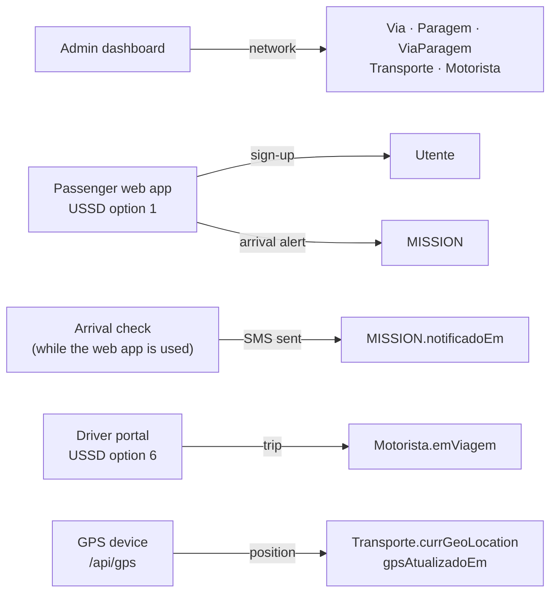

# Viewing the data in Neon

The production database is on [Neon](https://neon.tech). This page is a step-by-step guide to the Neon console in the browser:

- opening the project;
- pasting a SQL query and running it, and reading, downloading and finding the results;
- browsing a table without SQL;
- following the platform's data flows through the tables.

Every query here only reads, and every screenshot was taken on production on 2026-10-18, so the numbers are real.

For the tables and their conventions see [Database](database.md); for the flows behind them, [Data flow](data-flow.md).

**On this page:** [Before you start](#before-you-start) · [1. Open the project](#1-open-the-project) · [2. Open the SQL Editor](#2-open-the-sql-editor) · [3. Paste a query and run it](#3-paste-a-query-and-run-it) · [4. Several statements at once](#4-several-statements-at-once) · [5. Download, history and saved queries](#5-download-history-and-saved-queries) · [6. Browse a table without SQL](#6-browse-a-table-without-sql) · [7. Follow the data through the tables](#7-follow-the-data-through-the-tables)

---

## Before you start

- **`production` is the live data.** The apps read and write it all the time. Run only `SELECT` (and `SET`) there. An `INSERT`, `UPDATE`, `DELETE`, `CREATE` or `DROP` changes the live apps at once, with no undo. To try something that writes, create a branch first ([Database → Neon console](database.md#neon-console)).
- **Some columns are personal data:**
  - `Utente`: passengers' name, email and phone;
  - `MISSION.geoLocationUtente`: where a passenger was when they asked for an alert;
  - `Motorista`: drivers' phone and ID;
  - `Administrador`: emails.

  The queries below count rows instead of listing people. Do not screenshot or share those columns.
- **You need access to the Neon project.** The project owner invites you under **People** in the console.

## 1. Open the project

1. Go to [console.neon.tech](https://console.neon.tech) and sign in. The project list opens. Click **TransportMZ**.

   

2. The branch overview opens. Check the box at the top left: it must say **TransportMZ** and **production**. Every page you open from here works on that branch.

   

## 2. Open the SQL Editor

1. In the left menu, open **Postgres database**, then click **SQL Editor**. **Tables**, just above, is the [table browser](#6-browse-a-table-without-sql).

   

2. The editor opens. Check the bar above it:

   | Part | Should show | Why |
   |---|---|---|
   | Compute | **Primary**, **Active** | The database. It sleeps when nobody uses it and wakes on the first query, which then takes a few seconds longer. |
   | Database | **neondb** | The platform's tables are in this database. Another one has none of them. |
   | **Saved** / **History** (left) | the queries run before | [Below](#5-download-history-and-saved-queries). |

   

## 3. Paste a query and run it

1. **Copy the query.** On GitHub, the copy button at the top right of a code block copies all of it. Start with this one, which counts the rows of the main tables:

   ```sql
   -- How many rows each table has (read-only)
   SELECT 'Via' AS tabela, count(*) FROM "Via"
   UNION ALL SELECT 'Paragem', count(*) FROM "Paragem"
   UNION ALL SELECT 'ViaParagem', count(*) FROM "ViaParagem"
   UNION ALL SELECT 'Transporte', count(*) FROM "Transporte"
   UNION ALL SELECT 'Motorista', count(*) FROM "Motorista"
   UNION ALL SELECT 'Utente', count(*) FROM "Utente"
   UNION ALL SELECT 'MISSION', count(*) FROM "MISSION"
   UNION ALL SELECT 'Tarifa', count(*) FROM "Tarifa";
   ```

2. **Paste it.** Click in the editor and paste with **Ctrl+V** (**Cmd+V** on a Mac).
   - If the editor already holds text, select it all with **Ctrl+A** first, so the paste replaces it. That text could be an earlier query, or Neon's sample `CREATE TABLE … INSERT …`.
   - Never run the sample: it would create a table in production.
   - Table and column names keep their double quotes (`"Via"`, `"paragemId"`). Postgres needs them for names with capital letters.

   

3. **Run it.** Click **Run**.
   - The line under the editor turns into **Connected (1 query)**.
   - The time and the number of rows appear on the right.
   - The result fills the table below.

   

   On 2026-10-18 production had 261 routes, 1,902 stops, 17,287 route–stop links, 451 vehicles, 451 drivers, 8 passengers and 3 arrival alerts. The screenshot was taken earlier that day, before the 340 demo drivers were added.

**If it fails,** the error appears instead of the table:

| Error | Cause |
|---|---|
| `relation "via" does not exist` | The double quotes around a table name were lost: Postgres lowercased `Via`. |
| `column "paragemid" does not exist` | The same, for a column. |
| `syntax error at or near …` | Part of the query was not copied, often its first or last line. Paste it again. |
| Nothing happens for a few seconds | The compute was asleep and is waking up. |

## 4. Several statements at once

The editor runs every statement you paste, in order, and gives each one its own result tab. The times are stored in UTC without a time zone ([conventions](database.md#conventions-read-this-before-querying)). A query that compares them with `now()` should therefore start with `SET TIME ZONE 'UTC';`:

```sql
SET TIME ZONE 'UTC';

-- The active fare rule (read-only)
SELECT nome, "tarifaMinima", "precoPorKm", "velocidadeViagemKmh", "velocidadeChegadaKmh", ativa
FROM "Tarifa" WHERE ativa;
```

The result shows two tabs: **1: SET** ("Statement executed successfully") and **2: SELECT 1**. Click the second one to see the rows:


The fare rule is 10 MT minimum, 10 MT per km, and 30 km/h travel speed for the timetable.

## 5. Download, history and saved queries

**Download or copy a result.** The icons at the bottom right of the result are:
- copy (two squares), which copies the rows;
- download (arrow), which offers **JSON**, **CSV** or **XLSX**, the last one for Excel;
- expand (square), which shows the result full screen.


**History.** Every query you run is listed under **History**, newest first, with its date. Each entry shows the start of the query; hover over it to read the whole query. A comment on the first line (`-- How many rows …`) therefore names the query in the list.


**Save.** **Save**, next to the query's name, asks for a name and keeps the query under **Saved**, for queries you run often.


## 6. Browse a table without SQL

1. Left menu → **Postgres database** → **Tables**, then click a table, for example **Paragem**. The rows appear 50 to a page; the arrows at the top right change page.
2. **Filter.** Click the filter icon (three lines, to the left of the sort arrows). A row appears: **where** · column · operator · value.
   - Choose the column (`nome`) and the operator (`ilike`: contains, ignoring case).
   - Type the value with `%` around it: `%Eduardo Mondlane%`.
   - Press **Enter**.
   - The counter shows the matches (16 stops here). The **×** at the left of the filter removes it.

   

The arrows beside a column's name sort by it. **Do not use "Add record", or edit cells, on production.** Changes made here skip the checks the admin dashboard makes. For example, a stop added here is on no route, so no app shows it. Use the [admin dashboard](admin-dashboard.md) to change data.

## 7. Follow the data through the tables

Each part of the platform writes to its own tables, and everything else reads them:



The queries below follow that flow. Run one, do the action it describes in the app, then run it again: the change shows up at once. The full sequence of each flow is in [Data flow](data-flow.md).

### 7.1 The network: municipalities, routes and stops

The admin creates the network: municipalities, then routes (`Via`) and stops (`Paragem`), joined by `ViaParagem`.

```sql
-- 1. Network (written in the admin): routes and stops per municipality
SELECT m.nome AS municipio,
       count(DISTINCT v.id)          AS vias,
       count(DISTINCT vp."paragemId") AS paragens
FROM "Municipio" m
LEFT JOIN "Via" v         ON v."municipioId" = m.id
LEFT JOIN "ViaParagem" vp ON vp."viaId" = v.id
GROUP BY m.nome
ORDER BY vias DESC;
```


**Watch it change:** create a route in the admin ([Vias → Nova Via](admin-dashboard.md#routes-vias)) and run the query again. Its municipality has one more route, and its stops are counted.

### 7.2 Routes: their stops and vehicles

The journey planner only uses routes that have a vehicle (`Transporte.viaId`). Each route's stops are its `ViaParagem` rows.

```sql
-- 2. Routes (admin): the 10 with the most stops, and their vehicles
SELECT v.codigo, left(v.nome, 38) AS nome,
       count(DISTINCT vp."paragemId") AS paragens,
       count(DISTINCT t.id)          AS transportes
FROM "Via" v
LEFT JOIN "ViaParagem" vp ON vp."viaId" = v.id
LEFT JOIN "Transporte" t  ON t."viaId" = v.id
GROUP BY v.id
ORDER BY paragens DESC
LIMIT 10;
```


**Watch it change:** in the admin, "Atribuir Transporte" on a route moves a vehicle onto it: its `transportes` goes up by one. "Redesenhar percurso" changes the route's stops.

### 7.3 Vehicles, drivers, trips and GPS

The admin assigns a driver to each vehicle (`Motorista.transporteId`). The driver starts a trip from the [driver portal](driver-portal.md) or USSD option 6 (`Motorista.emViagem`). A GPS device posts positions to `/api/gps` (`Transporte.gpsAtualizadoEm`, `currGeoLocation`); a position counts as live for 3 minutes.

```sql
-- 3. Vehicles (admin), trips (driver portal, USSD option 6), GPS (/api/gps)
SELECT count(*)                              AS transportes,
       count(d.id)                           AS com_motorista,
       count(*) FILTER (WHERE d."emViagem")   AS em_viagem,
       count(*) FILTER (WHERE t."gpsAtualizadoEm" > (now() AT TIME ZONE 'UTC') - interval '3 minutes') AS gps_ativo
FROM "Transporte" t
LEFT JOIN "Motorista" d ON d."transporteId" = t.id;
```


Read it as:
- 340 vehicles, those of the OpenStreetMap routes, had no driver when it was taken. Demo drivers were added the same day, so all 451 have one now ([Database → Drivers for the imported vehicles](database.md#drivers-for-the-imported-vehicles));
- no driver is on a trip;
- no vehicle has a live GPS position, so every bus on the map comes from the timetable ([GPS tracking](gps-tracking.md#how-a-position-is-chosen)).

**Watch it change:**
- A driver taps "Iniciar viagem": `em_viagem` goes up by one.
- A tracker sends a position ([GPS tracking → Checking that it works](gps-tracking.md#checking-that-it-works)): `gps_ativo` goes up by one, and back down 3 minutes after the last position.

The query does not select `currGeoLocation`. When the tracker is a driver's phone, that column is where the driver is.

### 7.4 Passengers and their arrival alerts

A passenger signs up on the web, with a password, or is created by USSD option 1 without one; registering on the web with the same phone completes that account. Asking to be told when a bus is near a stop creates an alert (`MISSION`). The arrival check fills `notificadoEm` when it sends the SMS ([Data flow → Arrival alert and SMS](data-flow.md#arrival-alert-and-sms)).

```sql
-- 4. Passengers (web sign-up, USSD option 1) and their arrival alerts
SELECT CASE WHEN left(u.senha, 4) IN ('$2a$', '$2b$', '$2y$') THEN 'web' ELSE 'USSD' END AS registo,
       count(DISTINCT u.id)    AS utentes,
       count(m.id)             AS alertas,
       count(m."notificadoEm") AS sms_enviados
FROM "Utente" u
LEFT JOIN "MISSION" m ON m."utenteId" = u.id
GROUP BY 1;
```


A web password is stored as a bcrypt hash (`$2a$…`, `$2b$…`), so the query tells the two kinds apart without reading anyone's details.

### 7.5 Arrival alerts by stop

```sql
-- 5. Arrival alerts by stop: asked on the web or by USSD, SMS sent by the arrival check
SELECT p.nome                 AS paragem,
       count(*)                AS alertas,
       count(m."notificadoEm") AS sms_enviados
FROM "MISSION" m
JOIN "Paragem" p ON p.id = m."paragemId"
GROUP BY p.nome
ORDER BY alertas DESC;
```


**Watch it change:**
- In the passenger app, sign in, plan a journey and tap "Avisar-me por SMS quando o autocarro estiver perto…". The stop's row appears here, with `alertas` 1 and `sms_enviados` 0.
- When a bus is under 1 km away and the arrival check runs, `sms_enviados` becomes 1.
- The same through USSD option 1 in the [Africa's Talking simulator](africas-talking.md#use-the-menu-in-the-simulator) also adds a USSD passenger in 7.4. Use a test number, and see [Database → Passengers created by USSD](database.md#passengers-created-by-ussd-no-password-yet) to find and remove them.

## More queries

[Database → Example queries](database.md#example-queries) has more tested queries: a route's stops with coordinates, stops near a point, vehicles with their driver, the alerts of the last 24 hours, drivers' trips. Paste them the same way. Their sample outputs come from before the OpenStreetMap import; production has more rows now.

---

[← Africa's Talking](africas-talking.md) · [Documentation index](README.md) · Next: [Vercel, step by step →](vercel-guide.md)
