# Painel de administração

<!-- navegação: gerada por .github/scripts/docs-nav.py, não editar à mão -->
[Documentação](README.md) › 4. Usar as aplicações › **Painel de administração** (página 18 de 25)

Anterior: [Portal do motorista](portal-motorista.md) · [Índice](README.md) · Seguinte: [Publicação](publicacao.md)

<details>
<summary>Todas as páginas</summary>

- 0. Começar do zero: [Conceitos básicos](conceitos.md) · [Preparar o computador](preparar-o-computador.md)
- 1. Conhecer o projecto: [Visão geral](visao-geral.md) · [Glossário](glossario.md) · [Fontes de dados](fontes-de-dados.md) · [Estado do projecto](estado-do-projecto.md)
- 2. Montar localmente: [Primeiros passos](primeiros-passos.md) · [Base de dados](base-de-dados.md) · [Configuração](configuracao.md)
- 3. Perceber como funciona: [Fluxos de dados](fluxos-de-dados.md) · [Localização e GPS](localizacao-gps.md) · [Serviço USSD](ussd.md) · [Segurança](seguranca.md) · [Referência da API](referencia-api.md) · [Mapa do código](mapa-do-codigo.md)
- 4. Usar as aplicações: [Aplicação dos passageiros](app-passageiros.md) · [Portal do motorista](portal-motorista.md) · **Painel de administração**
- 5. Pôr online: [Publicação](publicacao.md) · [Guia da Vercel](guia-vercel.md) · [Guia da Neon](guia-neon.md) · [Africa's Talking](africas-talking.md)
- 6. Manter: [Testes](testes.md) · [Resolução de problemas](resolucao-de-problemas.md) · [Limitações](limitacoes.md)

</details>
<!-- /navegação -->

> **Em palavras simples:** O painel é o site de gestão: nele criam-se as rotas, as paragens, os veículos e os motoristas, dá-se um PIN a cada motorista e mudam-se os preços. Esta página ensina as tarefas mais comuns, passo a passo, e depois cada página do painel.

| | |
|---|---|
| Ao vivo | https://transport-mz-admin.vercel.app |
| Localmente | http://localhost:3002 ([Primeiros passos](primeiros-passos.md#7-correr-as-aplicações)) |
| Código | [`transport-admin/app`](../transport-admin/app) (páginas) e [`transport-admin/app/api`](../transport-admin/app/api) ([API](conceitos.md#api "Uma API é a lista de pedidos que um servidor aceita de outros programas; cada um desses pedidos, com o seu endereço, é um endpoint.")) |

O escritório da plataforma. Os administradores gerem a rede (províncias, municípios, rotas e paragens), a frota (veículos, motoristas, proprietários), os passageiros e os outros administradores. Também acompanham cada veículo ao vivo, ligam [rastreadores GPS](conceitos.md#rastreador "Um aparelho (ou um telemóvel com uma aplicação) que envia a posição de um veículo pela internet; o código do dispositivo é a sua 'palavra-passe'."), dão os PIN aos motoristas e imprimem relatórios. O painel tem a sua própria API sobre a mesma [base de dados](conceitos.md#base-de-dados "O sítio organizado onde a plataforma guarda tudo o que tem de durar: rotas, paragens, veículos, contas.") da aplicação dos passageiros, e nunca chama a aplicação dos passageiros ([Visão geral → Como as partes se ligam](visao-geral.md#como-as-partes-se-ligam)). Porquê uma aplicação separada: um erro no painel não derruba o que os passageiros usam, e o painel pode exigir [sessão](conceitos.md#sessao "Depois de entrar, o servidor dá uma prova de quem se é (um token), e o navegador mostra-a a cada pedido para não ter de pedir a palavra-passe outra vez.") em toda a API sem excepções.

As capturas desta página foram feitas numa cópia local dos dados de produção, com os números de telefone e de BI desfocados.

**Nesta página:** [Entrada](#entrada-e-sessão) · [Tarefas comuns, passo a passo](#tarefas-comuns-passo-a-passo) · [Organização e pesquisa](#organização-e-pesquisa) · [Início](#início-dashboard) · [Veículos](#veículos-transportes) · [Rotas](#rotas-vias) · [Paragens](#paragens-paragens) · [Motoristas](#motoristas-motoristas) · [Proprietários](#proprietários-proprietarios) · [Províncias e municípios](#províncias-e-municípios) · [Passageiros](#passageiros-utentes) · [Administradores](#administradores-e-perfil) · [Relatórios](#relatórios-relatorios) · [Tarifa](#tarifa) · [API usada por cada página](#api-usada-por-cada-página)

---

## Entrada e sessão


`/login` pede email e palavra-passe. `POST /api/auth/admin/login` confirma o [hash](conceitos.md#hash "Uma 'impressão digital' de um texto, que se calcula num sentido e não se consegue desfazer.") bcrypt em `Administrador.senha` e põe o cookie `admin_session`: `HttpOnly`, válido 12 horas, assinado com `ADMIN_SESSION_SECRET` ([`lib/adminSession.ts`](../transport-admin/lib/adminSession.ts)).

- [`proxy.ts`](../transport-admin/proxy.ts) responde **[401](conceitos.md#codigos-de-resposta "O número de três algarismos com que o servidor diz como correu o pedido.")** a qualquer pedido `/api/*` sem um cookie válido, menos a entrada e a saída. A aplicação do [navegador](conceitos.md#navegador "O programa com que se abrem sites: Chrome, Firefox, Edge, Safari.") trata qualquer 401 da API do painel como sessão expirada: sai da conta e abre `/login` ([`AuthContext.tsx`](../transport-admin/app/contexts/AuthContext.tsx)).
- Sem `ADMIN_SESSION_SECRET` em produção, a entrada responde 500 "[Servidor](conceitos.md#servidor "Um computador sempre ligado que recebe pedidos e responde a eles.") sem configuração de sessão" e nenhuma sessão é aceite ([Configuração](configuracao.md#transport-admin-painel-de-administração)).
- `localStorage['admin']` só guarda o perfil mostrado no cabeçalho. Não dá acesso a nada.

Porquê um cookie `HttpOnly` aqui (e não um token no `localStorage`, como nas outras aplicações): o painel e a sua API estão no mesmo domínio, e um cookie que o [JavaScript](conceitos.md#typescript "As linguagens em que o código deste projecto está escrito; TypeScript é JavaScript com verificações extra.") não lê não pode ser roubado por um [script](conceitos.md#script "Um pequeno programa que se corre à mão, uma vez, para uma tarefa: importar dados, corrigir percursos, mostrar listas.") injectado na página.

**O primeiro administrador** cria-se num [terminal](conceitos.md#terminal "A janela onde se escrevem instruções para o computador em texto, em vez de clicar."), em `transport-admin`:

```bash
node create-admin.js   # pede nome, email e palavra-passe (pelo menos 10 caracteres, sem a mostrar)
```

Escreve na base de dados de `DATABASE_URL` (ambiente ou [`.env`](conceitos.md#variavel-de-ambiente "Uma definição que se dá a um programa de fora do código, como o endereço da base de dados ou uma palavra-passe.")). Corrido outra vez com um email que já existe, define uma palavra-passe nova. Depois disso, os administradores gerem-se no painel ([abaixo](#administradores-e-perfil)). Todos os administradores têm os mesmos direitos.

## Tarefas comuns, passo a passo

Cada tarefa é o caminho mais curto pelos ecrãs. As secções seguintes descrevem cada página por inteiro.

<a id="tarefa-rota"></a>**Criar uma rota**

1. Barra lateral → **Vias** → **Nova Via**.
2. Escrever o nome (por exemplo "Baixa - Museu"), um código que nenhuma outra rota use (`V120`) e escolher o município.
3. Clicar no mapa no primeiro terminal, depois em cada curva que o autocarro faz, até ao último terminal. A linha segue as estradas depois de cada clique. Arrastar um ponto move-o; clicar nele apaga-o.
4. Confirmar a lista "Paragens da Rota": as paragens a menos de 50 m da linha estão marcadas. Desmarcar as que o autocarro não serve.
5. Carregar em **Criar Via**. Se recusar com "Não foi possível calcular o percurso pelas estradas…", os [routers](conceitos.md#router "Um serviço que, dados dois ou mais pontos, responde com o caminho pelas ruas entre eles e a distância.") não responderam: mover um ponto para tentar outra vez ([detalhes](#rotas-vias)).

<a id="tarefa-activar-rotas"></a>**Activar ou desactivar rotas** (escolher as rotas que os passageiros vêem)

1. Barra lateral → **Vias**. Por omissão a lista mostra só as rotas **Activas**; o filtro ao lado da pesquisa muda para "Desactivadas" ou "Todas".
2. Na coluna **Estado**, carregar em **Activa** desactiva a rota; carregar em **Desactivada** activa-a. Aparece "Rota X19 activada" (ou desactivada).
3. A web, o [USSD](conceitos.md#ussd "Os menus que aparecem num telemóvel quando se marca um código como *384*848080#; funcionam em qualquer telemóvel, sem internet.") e os [SMS](conceitos.md#sms "As mensagens de texto curtas dos telemóveis.") usam as rotas novas em até 5 minutos (cada instância guarda a rede 5 minutos). Os motoristas de uma rota desactivada não conseguem iniciar a viagem ("A rota do seu veículo está desactivada").

Porquê desactivar em vez de apagar: a rota e as suas paragens ficam guardadas, e voltar atrás é um clique. Desde 2026-10-27 só estão activas a X19, a 411 e a X22 ([Base de dados → Rotas activas](base-de-dados.md#rotas-activas)). Uma rota activada só tem autocarros se tiver veículos com motorista: os das rotas desactivadas foram apagados nesse dia ([Base de dados → Veículos e motoristas das rotas desactivadas](base-de-dados.md#veículos-e-motoristas-das-rotas-desactivadas)), por isso uma rota nova precisa de veículos e motoristas criados aqui.

<a id="tarefa-redesenhar"></a>**Redesenhar o percurso de uma rota** (uma linha que corta quarteirões)

1. **Vias** → abrir a rota → **Redesenhar percurso**.
2. Carregar em **Começar pelo percurso atual**. A linha actual fica a tracejado cinzento, e a nova segue as estradas.
3. Onde a linha nova sai do caminho do autocarro, arrastar um ponto para a rua certa, ou clicar para juntar um.
4. Confirmar as duas listas de paragens (as paragens na linha nova; as paragens ligadas por onde ela já não passa) e carregar em **Guardar percurso**. As tarifas, os tempos e as posições passam logo a usar a linha nova ([detalhes](#rotas-vias)).

<a id="tarefa-paragem"></a>**Criar uma paragem**

1. **Paragens** → **Nova Paragem**.
2. Escrever o nome e um código, e clicar no mapa onde a paragem está. Aparecem as rotas que passam a menos de 100 m.
3. Marcar as rotas que param lá (e "Esta paragem é um terminal" se for um terminal) e carregar em **Criar Paragem**.

<a id="tarefa-veiculo"></a>**Criar um veículo e pô-lo numa rota**

1. **Transportes** → **Novo Transporte**.
2. Preencher matrícula, modelo, marca, cor, ano, lotação e estado, escolher a **rota**, e carregar em **Criar Transporte**.
3. A partir do minuto seguinte, o veículo aparece no mapa dos passageiros, parado nessa rota, se a rota estiver activa. Anda, e entra nas viagens, quando o motorista iniciar a viagem ([Localização e GPS](localizacao-gps.md#como-se-escolhe-uma-posição)).
4. Para passar um veículo existente para outra rota: **Vias** → a rota nova → **Editar** → **Atribuir Transporte**.

<a id="tarefa-motorista"></a>**Criar um motorista e deixá-lo entrar**

1. **Motoristas** → **Novo Motorista**. Preencher os dados pessoais, de documentos e de contacto e carregar em **Criar Motorista**.
2. Dar-lhe um veículo: **Motoristas** → **Atribuir Motoristas**. Escolher o veículo à esquerda e o motorista à direita, depois **Atribuir Motorista**. (Ou, na página do veículo, "Atribuir Motorista".)
3. Abrir a página do motorista e carregar em **Gerar PIN** no cartão "PIN de Acesso". Apontar os 6 algarismos: só se mostram uma vez.
4. Dar ao motorista o PIN e o endereço do portal, https://transport-mz-driver.vercel.app. Ele entra com o número de telefone e o PIN ([Portal do motorista](portal-motorista.md#o-dia-de-um-motorista-passo-a-passo)). O mesmo PIN funciona na opção 6 do USSD.

<a id="tarefa-pin"></a>**Dar um PIN a um motorista, ou repor um PIN esquecido**

Página do motorista → **Gerar PIN** (ou **Gerar novo PIN**). O PIN aparece uma só vez; o antigo, se havia, deixa logo de funcionar. Dar o PIN novo ao motorista ([detalhes](#motoristas-motoristas)).

<a id="tarefa-mudar-veiculo"></a>**Passar um motorista para outro veículo**

Na página do veículo antigo, carregar no × ao lado do motorista; depois atribuí-lo ao veículo novo como no passo 2 de [Criar um motorista](#tarefa-motorista). Um portal do motorista aberto mostra o veículo e a rota novos em 5 minutos, sem sair da conta.

<a id="tarefa-gps"></a>**Ligar um GPS a um veículo** (posições reais em vez das calculadas)

1. **Transportes** → abrir o veículo → cartão **Rastreador GPS** → **Gerar código do dispositivo**.
2. Copiar o código de 20 caracteres (só aparece uma vez) e a configuração por baixo.
3. Pôr o código num rastreador GPS ou na aplicação [Traccar Client](conceitos.md#traccar "Uma aplicação gratuita para telemóvel que envia a posição do telemóvel pelo protocolo OsmAnd.") de um telemóvel que vai no veículo ([Localização e GPS](localizacao-gps.md#1-criar-o-código-do-dispositivo)). Ou o motorista cola-o no perfil do portal do motorista ("Código [GPS](conceitos.md#gps "O sistema de satélites com que um telemóvel ou um aparelho sabe as suas coordenadas.") do veículo").
4. Quando as posições chegam, o cartão diz **GPS ativo** e os passageiros vêem a posição real em vez da calculada pela viagem.

<a id="tarefa-tarifa"></a>**Mudar as tarifas ou as velocidades**

1. Barra lateral → Configuração → **Tarifa**.
2. Mudar a tarifa mínima, o preço por km ou uma velocidade. A linha cinzenta mostra quanto custam 2, 5 e 15 km com os valores escritos.
3. Carregar em **Guardar tarifa**. A web e o USSD usam os valores novos em menos de um minuto ([detalhes](#tarifa)).

<a id="tarefa-procurar"></a>**Encontrar um veículo, uma rota ou um motorista**

Escrever na caixa de pesquisa no topo de qualquer página: uma matrícula (`ADA-1`), o código ou o nome de uma rota (`V062`, `Museu`), o nome ou o BI de um motorista, ou pelo menos 3 algarismos de um telefone com qualquer espaçamento (`8718315`). Enter abre o primeiro resultado.

<a id="tarefa-relatorio"></a>**Imprimir uma lista**

**Relatórios** → **Gerar PDF** no cartão pretendido → **Imprimir**, e escolher "Guardar como PDF" na janela de impressão.

<a id="tarefa-admin"></a>**Criar outro administrador**

**Administradores** → **Novo Administrador**: nome, email e uma palavra-passe escrita duas vezes, depois **Criar Administrador**. Qualquer administrador pode fazer tudo, incluindo isto.

## Organização e pesquisa

A barra lateral agrupa as secções ([`Sidebar.tsx`](../transport-admin/app/components/Sidebar.tsx)):

| Grupo | Secções |
|---|---|
| Rede | Dashboard, Transportes, Vias, Paragens |
| Pessoas | Proprietários, Motoristas, Utentes, Administradores |
| Território | Províncias, Municípios |
| Análise | Relatórios |
| Configuração | Tarifa |

Num computador (1024 px de largura ou mais) a barra lateral fica à esquerda; o botão na sua borda dobra-a até só mostrar os ícones. Num telemóvel, num tablet ou numa janela mais estreita não há barra lateral: o botão no canto superior esquerdo ("Abrir o menu") abre o menu por cima do ecrã inteiro, e escolher uma secção, o X no mesmo canto, ou Esc fecha-o. O menu do avatar no canto superior direito tem "Meu Perfil" e "Sair".

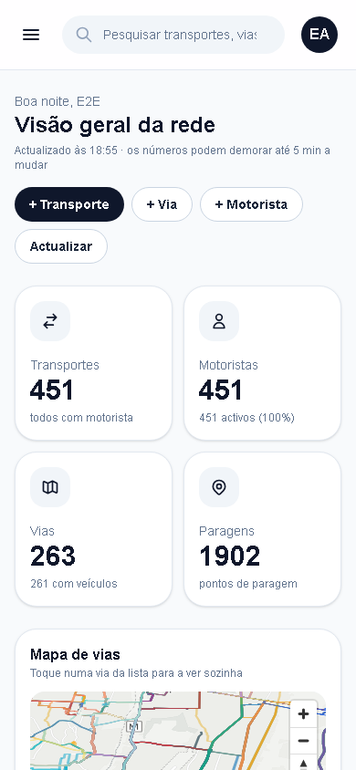 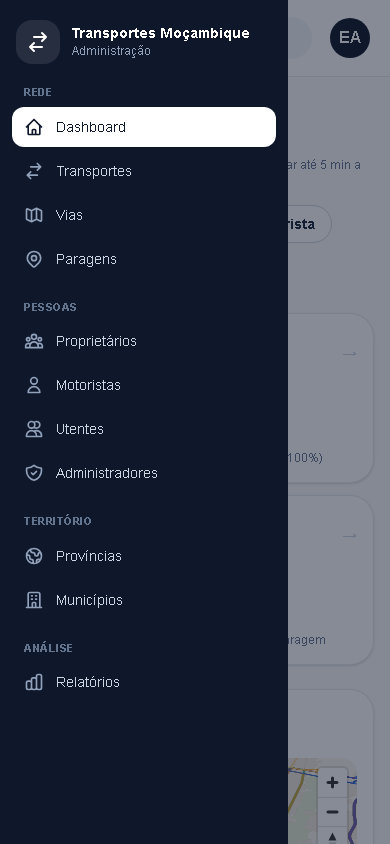

As tabelas das listas mostram menos colunas nos ecrãs mais estreitos, para caberem sem deslizar para o lado; a página de detalhe de cada linha tem tudo ([`ResponsiveTable.tsx`](../transport-admin/app/components/ResponsiveTable.tsx)). Num telemóvel, a lista de veículos passa a cartões.

**A caixa de pesquisa do cabeçalho** encontra veículos, rotas e motoristas a partir de qualquer página ([`Header.tsx`](../transport-admin/app/components/Header.tsx)). A partir de 2 caracteres, 300 ms depois da última tecla, mostra até 5 resultados de cada tipo (porquê a espera: não fazer um pedido por cada tecla):

| Grupo | Coincide em | Abre |
|---|---|---|
| Transportes | matrícula, modelo, marca, nome da rota | `/transportes/{id}` |
| Vias | nome, código, município | `/vias/{id}` |
| Motoristas | nome, número de BI, número da carta, telefone | `/motoristas/{id}` |

As maiúsculas não contam. Enter abre o primeiro resultado e Esc fecha a lista. Uma pesquisa de pelo menos 3 algarismos (com espaços, `+` e `-` permitidos) também coincide com os telefones dos motoristas pelos algarismos, seja qual for o espaçamento guardado e com ou sem `258`: `8718315`, `87 183 15` e `+258871831` encontram todos `+258 87 183 1581` ([`lib/phoneSearch.ts`](../transport-admin/lib/phoneSearch.ts)). As listas de Motoristas e Utentes pesquisam os telefones da mesma forma.

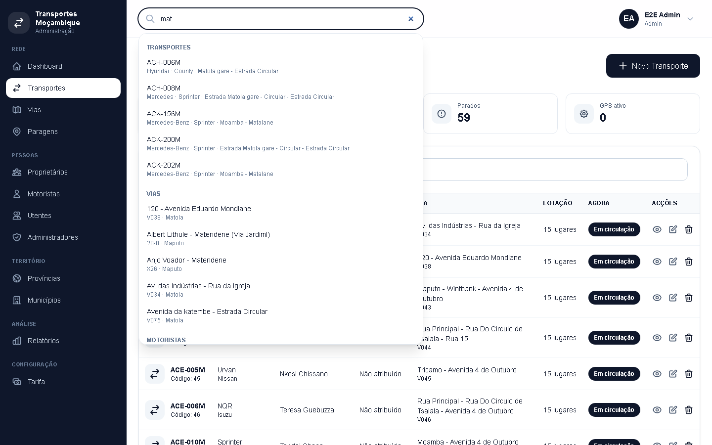

Cada página de lista tem também a sua caixa de pesquisa e paginação.

## Início (`/dashboard`)

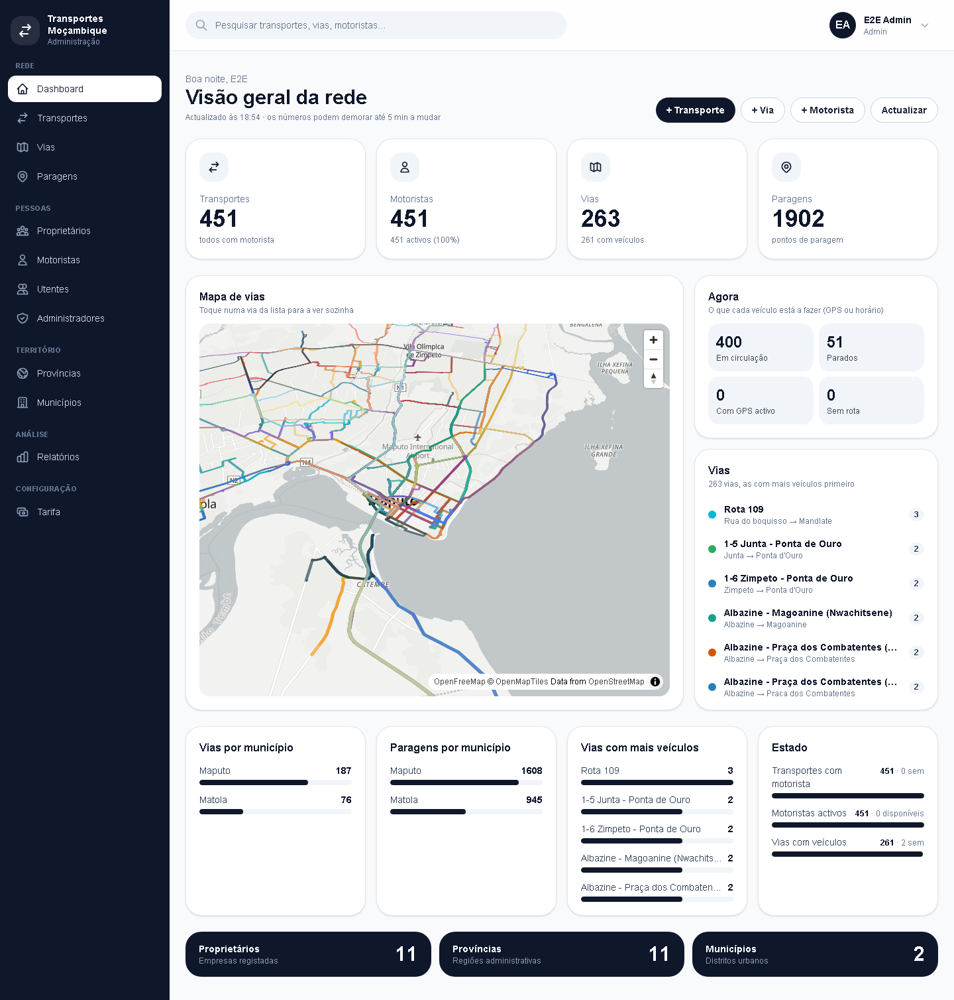

No topo: uma saudação com o primeiro nome do administrador e os atalhos "+ Transporte", "+ Via", "+ Motorista" (cada um abre o seu formulário) e "Actualizar" (carrega os números outra vez). Quando há veículos sem motorista, uma faixa diz quantos e leva a `/motoristas/atribuir`. Código: [`app/dashboard/page.tsx`](../transport-admin/app/dashboard/page.tsx).

Tudo menos "Agora" vem de um só pedido, `GET /api/dashboard/stats`, **guardado 5 minutos** por instância do servidor. Uma alteração pode demorar até 5 minutos a aparecer aqui, enquanto as páginas das listas a mostram logo. Porquê a cache: o pedido conta todas as tabelas e lê todos os percursos, e o início abre-se muitas vezes.

| Bloco | O que conta |
|---|---|
| Transportes / Motoristas / Vias activas / Paragens | As linhas de cada tabela. Em Transportes: quantos não têm motorista ("todos com motorista" quando nenhum). Em Motoristas: "activos" = motoristas com estado `ativo` **e** um veículo. Em Vias activas: as rotas que os passageiros vêem (`Via.ativa`), e quantas têm pelo menos um veículo. Cada cartão abre a sua lista. |
| Mapa de vias | O percurso guardado de cada rota activa, na cor da rota, no mapa de ruas da [OpenFreeMap](conceitos.md#mosaicos "As imagens das ruas por baixo dos autocarros e das paragens, que o mapa descarrega aos bocados (mosaicos) conforme se mexe."). Uma rota tocada na lista "Vias" aparece sozinha; tocar outra vez mostra todas. |
| Agora | O que cada veículo está a fazer agora, de `GET /api/transportes/estado` (GPS, ou a viagem do motorista), a cada 30 segundos: Em circulação, Parados (num terminal ou fora de serviço), Com GPS activo, Sem rota (sem percurso onde o pôr). Sem cache. |
| Vias | As rotas activas com os terminais e o número de veículos, as com mais veículos primeiro. |
| Vias por município | Rotas por município. |
| Paragens por município | Paragens distintas nas rotas de cada município. Uma paragem servida por rotas dos dois municípios conta nos dois, e uma paragem sem rotas não conta em nenhum. |
| Vias com mais veículos | As 5 rotas com mais veículos. |
| Estado | Transportes com motorista (e "sem"); Motoristas activos como acima (e "disponíveis" = motoristas activos sem veículo); Vias com veículos (e "sem"). |
| Proprietários, Províncias, Municípios | As linhas de cada tabela; cada cartão abre a sua lista. |

## Veículos (`/transportes`)

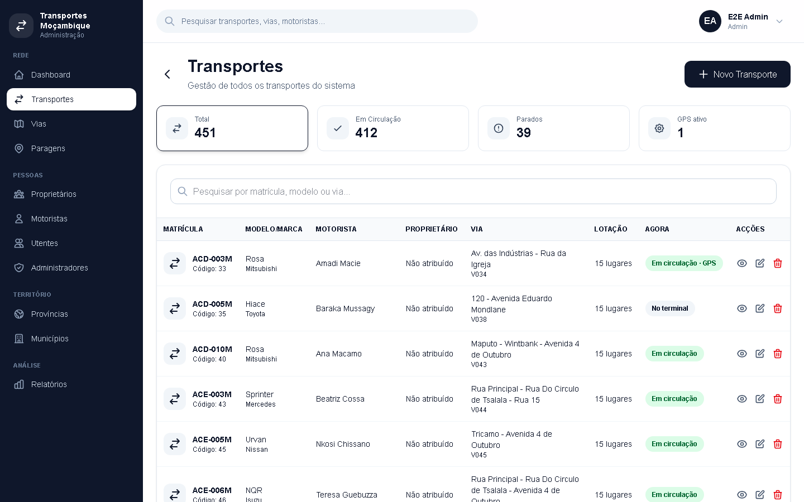

**Lista.** Uma linha por veículo: matrícula e número, modelo e marca, motorista, proprietário, rota, lotação e **"Agora"**, o que o veículo está a fazer neste momento (modelo, proprietário e lotação só nos ecrãs mais largos):

| "Agora" | Significado |
|---|---|
| Em circulação | O motorista iniciou a viagem e o autocarro anda na sua rota (pelo GPS recente, ou pela viagem). |
| No terminal | Em viagem, nos 5 minutos de espera num terminal entre dois sentidos. |
| Fora de serviço | O motorista não iniciou a viagem: o autocarro está parado e os passageiros não contam com ele. |
| Sem rota | A sua rota não tem percurso e não há posição guardada. |

A coluna vem de `GET /api/transportes/estado`, a cada 30 s. Usa as mesmas regras de posição da aplicação dos passageiros ([Localização e GPS](localizacao-gps.md#como-se-escolhe-uma-posição); [`lib/vehiclePosition.ts`](../transport-admin/lib/vehiclePosition.ts)). Os contadores no topo (Total, Em Circulação, Parados, GPS ativo) filtram a lista quando se clica neles.

**Detalhe (`/transportes/{id}`).**


| Bloco | Conteúdo | Fonte |
|---|---|---|
| Quilómetros na Viagem, Tempo de Operação, Chegadas a um Terminal | Quilómetros, horas e chegadas a terminais desde que o motorista iniciou a viagem, à velocidade da regra de tarifa ("Viagem iniciada às 08:05"). Sem viagem, zero e "O motorista não iniciou a viagem". | `GET /api/transportes/{id}/operacao`, a cada 60 s |
| Rota | O comprimento do percurso da rota e o número de paragens. | o mesmo |
| Localização e Rota | Mapa 3D com a rota e o veículo. A etiqueta diz de onde vem a posição: "Em movimento · GPS real", "Parado no terminal · estimado pela viagem", "Fora de serviço (viagem não iniciada) · onde parou", e assim por diante. Por baixo: velocidade actual, próxima paragem, minutos até ela. | `GET /api/transportes/{id}/posicao`, a cada 15 s |
| Rastreador GPS | O dispositivo GPS do veículo ([abaixo](#cartão-do-rastreador-gps)). | `GET /api/transportes/{id}/gps`, a cada 30 s |
| Pessoas Associadas | O motorista (× retira-o do veículo) e os proprietários ("+ Atribuir"). | |
| Informações do Transporte | Matrícula, número, modelo, marca, cor, lotação, rota, estado, data de registo. | |
| Quilómetros na Viagem, Chegadas por Hora | Quilómetros acumulados e chegadas a terminais por hora, desde o início da viagem. Escondidos sem viagem. | `operacao` |
| Próximas Passagens nas Paragens | Para cada paragem, pela ordem de viagem: a distância ao início do percurso, e a próxima vez que o veículo lá passa em cada sentido, pela viagem em curso. Sem viagem, "—" e "Sem passagens: o motorista não iniciou a viagem". Com GPS ao vivo o veículo pode ir adiantado ou atrasado. | `operacao` |

### Cartão do rastreador GPS


Código: [`GpsTrackerCard.tsx`](../transport-admin/app/components/GpsTrackerCard.tsx) e [`app/api/transportes/[id]/gps/route.ts`](../transport-admin/app/api/transportes/[id]/gps/route.ts).

| Etiqueta | Significado |
|---|---|
| Não configurado | Ainda sem código de dispositivo. O veículo usa a posição calculada pela viagem do motorista. |
| Sem sinal recente | Há um código, mas nenhuma posição chegou nos últimos 3 minutos. |
| GPS ativo | Chegou uma posição nos últimos 3 minutos. Os passageiros vêem-na em vez da calculada pela viagem. |

- **"Gerar código do dispositivo"** / **"Gerar novo código"** cria um código de 20 caracteres (`POST /api/transportes/{id}/gps`). Aparece **uma vez** ("só é mostrado agora; guarde-o"), com a configuração para a aplicação Traccar Client. Só se guarda o seu SHA-256. Um código novo pára logo o antigo.
- **"Revogar dispositivo"** (com confirmação) apaga o código e os campos de GPS guardados (`DELETE`). O veículo volta à posição calculada pela viagem.

Como preparar o telemóvel ou o rastreador está em [Localização e GPS](localizacao-gps.md#1-criar-o-código-do-dispositivo).

**Novo e editar (`/transportes/novo`, `/transportes/{id}/editar`).** Matrícula, modelo, marca, cor, ano, lotação, estado e rota são obrigatórios. Números de chassis e de motor, tipo de combustível, capacidade do depósito, quilómetros totais, datas da próxima revisão e inspecção, e uma posição inicial são opcionais. Uma matrícula só se pode usar uma vez.

## Rotas (`/vias`)

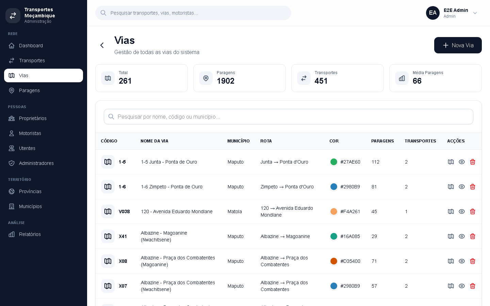

**Lista.** Código, nome, município, terminais, cor, número de paragens e de veículos, e **Estado**: "Activa" (os passageiros vêem-na) ou "Desactivada". Carregar no estado muda-o ([Activar ou desactivar rotas](#tarefa-activar-rotas)); o filtro ao lado da pesquisa mostra as activas (por omissão), as desactivadas ou todas. Os contadores no topo são totais sobre todas as rotas que coincidem com a pesquisa e o filtro: rotas, paragens (todas as paragens do sistema), veículos em rotas, e a média de paragens por rota. A pesquisa coincide com o nome, o código ou o município, sem contar as maiúsculas.

**Detalhe (`/vias/{id}`).**

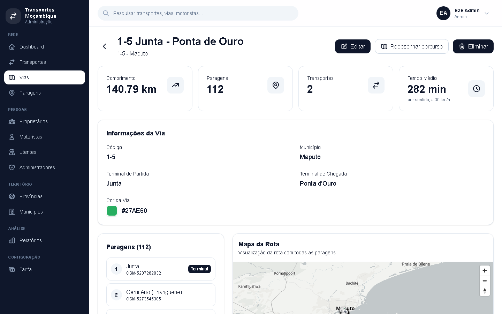

- **Comprimento:** o comprimento do percurso guardado.
- **Tempo Médio:** o tempo de um sentido à velocidade de viagem da regra de tarifa ("por sentido, a 30 km/h").
- **Paragens:** todas as paragens pela **ordem de viagem** (projectadas no percurso, porque [`ViaParagem`](glossario.md#a-rede-e-as-pessoas "A ligação de uma paragem a uma rota") não tem coluna de ordem), com os terminais marcados.
- **Mapa da Rota:** o percurso guardado e as paragens.
- **Transportes Atribuídos:** os veículos da rota, com o motorista.

**Desenhar uma rota (`/vias/novo`).**

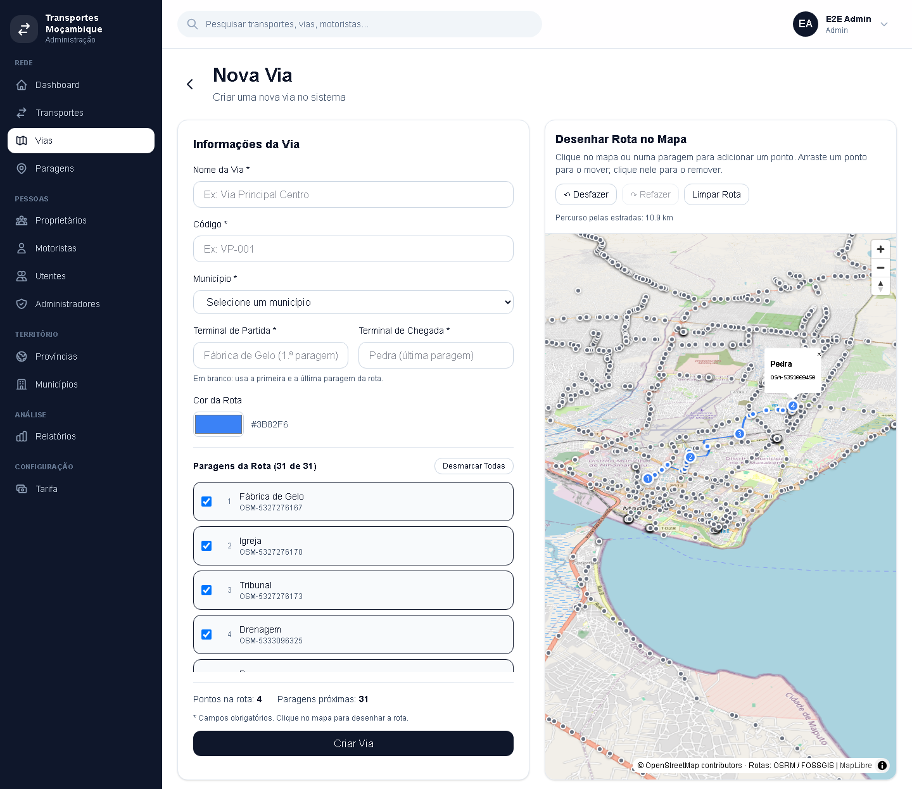

1. Preencher nome, código e município. Os terminais podem ficar vazios: usam-se a primeira e a última paragem do percurso.
2. Clicar no mapa, ou numa paragem, para juntar um ponto. Arrastar um ponto move-o; clicar nele apaga-o. "Desfazer", "Refazer" e "Limpar Rota" actuam sobre os pontos.
3. Depois de cada alteração, os pontos vão para um router OSRM público, que devolve o percurso pelas estradas que passa por eles: primeiro o router de carros da FOSSGIS (`routing.openstreetmap.de`), e o router de demonstração do OSRM (`router.project-osrm.org`) quando a FOSSGIS não responde ([`RouteDrawer.tsx`](../transport-admin/app/components/RouteDrawer.tsx)). "Percurso pelas estradas" mostra o comprimento. Se os dois falharem, a linha desenha-se a tracejado entre os pontos e "Criar Via" recusa gravar ("Não foi possível calcular o percurso pelas estradas…"); mover ou juntar um ponto tenta outra vez. Porquê recusar: uma linha recta daria tarifas, tempos e posições errados.
4. As paragens a menos de **50 m** do percurso aparecem em "Paragens da Rota", pela ordem de viagem, e ligam-se à rota quando é criada. Desmarcar as que não interessam.
5. "Criar Via" guarda o percurso em `Via.geoLocationPath` como `lng,lat;lng,lat;…` ([Base de dados → Convenções](base-de-dados.md#convenções-ler-antes-de-consultar)).

**Editar uma rota (`/vias/{id}/editar`)** muda o nome, os terminais, a cor, o município e as paragens ligadas, e **"Atribuir Transporte"** põe veículos na rota (`PATCH /api/transportes/{id}` com o id da rota). O percurso tem a sua própria página:

**Redesenhar o percurso de uma rota (`/vias/{id}/percurso`)**, a partir de **"Redesenhar percurso"** na página da rota. Usa-se quando a linha de uma rota corta quarteirões em vez de seguir as ruas ([Base de dados → Pôr os percursos nas estradas](base-de-dados.md#pôr-os-percursos-das-rotas-nas-estradas) mostra como encontrá-las).

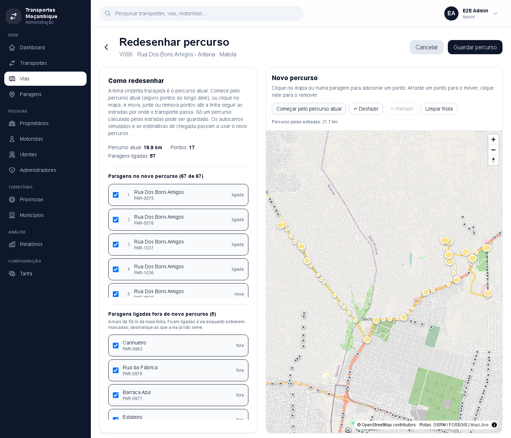

1. O percurso actual desenha-se a tracejado cinzento, e as paragens ligadas à rota ficam em destaque.
2. **"Começar pelo percurso atual"** põe até 25 pontos ao longo do percurso actual (nas curvas) e pede ao router a estrada que passa por eles. Ou clicar no mapa ou numa paragem para juntar pontos, como ao desenhar uma rota nova. Arrastar, juntar ou apagar pontos onde o percurso pelas estradas sai do caminho do autocarro.
3. Só um percurso pelas estradas se pode gravar, como em "Nova Via": enquanto o router não respondeu, ou quando falhou (linha a tracejado), "Guardar percurso" fica desligado.
4. **"Paragens no novo percurso"** lista as paragens a menos de 50 m do percurso novo, pela ordem de viagem, marcadas "ligada" (já ligada) ou "nova". **"Paragens ligadas fora do novo percurso"** lista as paragens ligadas por onde o percurso novo já não passa. Cada paragem marcada fica ligada à rota; desmarcar as que a rota não serve.
5. "Guardar percurso" grava o percurso e as paragens marcadas (`PATCH /api/vias/{id}` com `geoLocationPath` e `paragensIds`). As ligações que ficam mantêm-se como estavam. As posições dos autocarros em viagem, as horas de chegada e as tarifas passam logo a usar o percurso novo ([Localização e GPS](localizacao-gps.md#como-se-escolhe-uma-posição)).

Num telemóvel o mapa vem primeiro, por cima das listas de paragens.

## Paragens (`/paragens`)

**Lista.** Nome, código, [coordenadas](conceitos.md#coordenadas "Dois números que dizem onde está um ponto na Terra.") e rotas; a pesquisa coincide com o nome ou o código, sem contar as maiúsculas. Os contadores mostram o total, os terminais, as paragens normais e a média de rotas por paragem.

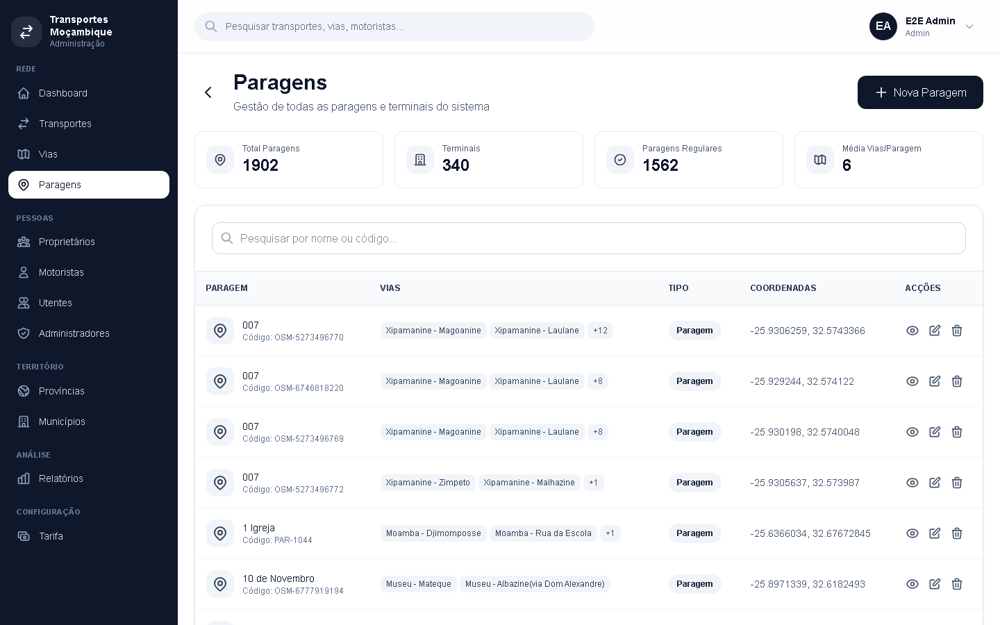

**Detalhe (`/paragens/{id}`).**

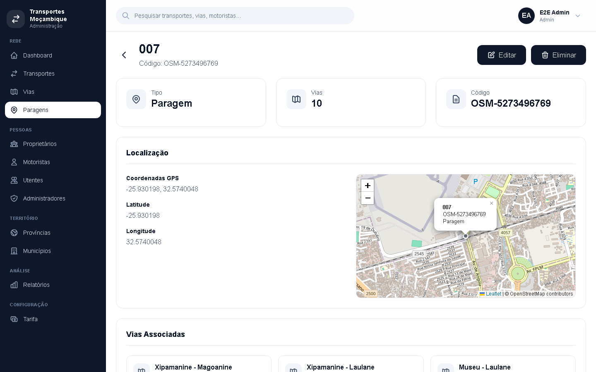

Tipo (paragem ou terminal), número de rotas, código, coordenadas num mapa do [OpenStreetMap](conceitos.md#openstreetmap "Um mapa do mundo inteiro feito por voluntários, como uma Wikipédia dos mapas, que qualquer pessoa pode usar e corrigir."), e as rotas que passam na paragem.

**Nova e editar.** Nome, código, e um clique no mapa para a posição (os campos de latitude e longitude são só de leitura). Aparecem as rotas que passam a menos de **100 m** do clique; marcar as rotas a que a paragem pertence. Um clique sem rotas a menos de 100 m responde "Nenhuma via encontrada (raio de 100m)" com a mais próxima. **"Esta paragem é um terminal"** guarda-se em cada ligação a uma rota (`ViaParagem.terminalBoolean`), não na paragem. Porquê na ligação: uma paragem pode ser o terminal de uma rota e uma paragem a meio de outra.

**Apagar** uma paragem também apaga as ligações às rotas e os alertas de chegada dos passageiros nela, que nunca mais poderiam disparar.

## Motoristas (`/motoristas`)

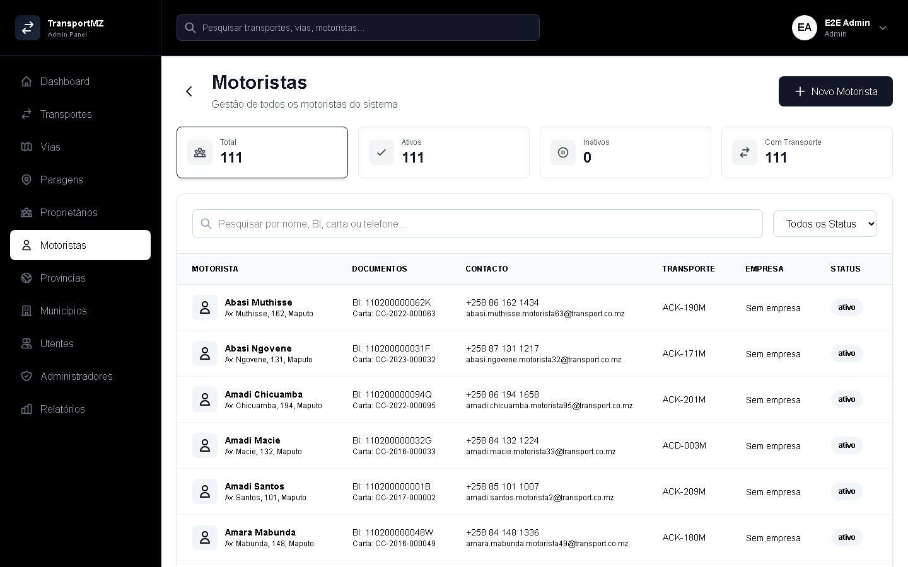

**Lista.** Nome e morada, números de BI e da carta, telefone e email, veículo, empresa proprietária e estado, com contadores (Total, Ativos, Inativos, Com Transporte) e um filtro por estado.

**"Atribuir Motoristas"** (`/motoristas/atribuir`, no cabeçalho da lista) junta os motoristas activos sem veículo com os veículos sem motorista. Um motorista também se pode atribuir na página do veículo ou no formulário do motorista. Um veículo tem no máximo um motorista.

**Detalhe (`/motoristas/{id}`).**

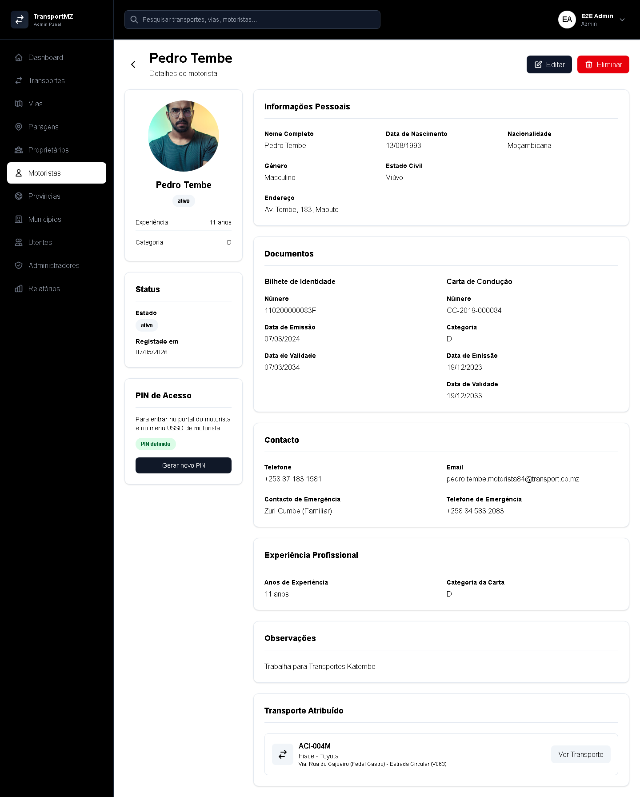

Dados pessoais, documentos de BI e carta, contactos e contacto de emergência, experiência, notas, o veículo atribuído e o cartão **"PIN de Acesso"**.

**PIN.** Os motoristas entram no [portal do motorista](portal-motorista.md) e na opção 6 do USSD com um PIN de 6 algarismos que só o administrador pode criar ([`DriverPinCard.tsx`](../transport-admin/app/components/DriverPinCard.tsx)):


| Estado | Significado |
|---|---|
| "Sem PIN: não pode entrar" | Sem PIN: o motorista não consegue entrar em lado nenhum. |
| "PIN definido" | Há um PIN. Não se pode mostrar outra vez. |

"Gerar PIN" / "Gerar novo PIN" (`POST /api/motoristas/{id}/pin`) tira um PIN aleatório de 6 algarismos, guarda o seu hash bcrypt em `Motorista.password` e mostra o PIN uma vez ("Novo PIN (só é mostrado agora)"). O PIN anterior deixa logo de funcionar, que é também como se repõe um PIN esquecido. Nenhuma API devolve o hash: o cliente [Prisma](conceitos.md#prisma "A ferramenta com que o código fala com a base de dados sem escrever SQL à mão.") do painel omite `Motorista.password` em todas as consultas ([Segurança → Motoristas](seguranca.md#motoristas)).

**Novo e editar.** Todos os campos pessoais e de documentos são obrigatórios, menos deficiência e notas. Não há campo de palavra-passe: depois de criar o motorista, abre-se a sua página e carrega-se em "Gerar PIN". O número de BI, o número da carta e o email têm de ser únicos.

## Proprietários (`/proprietarios`)

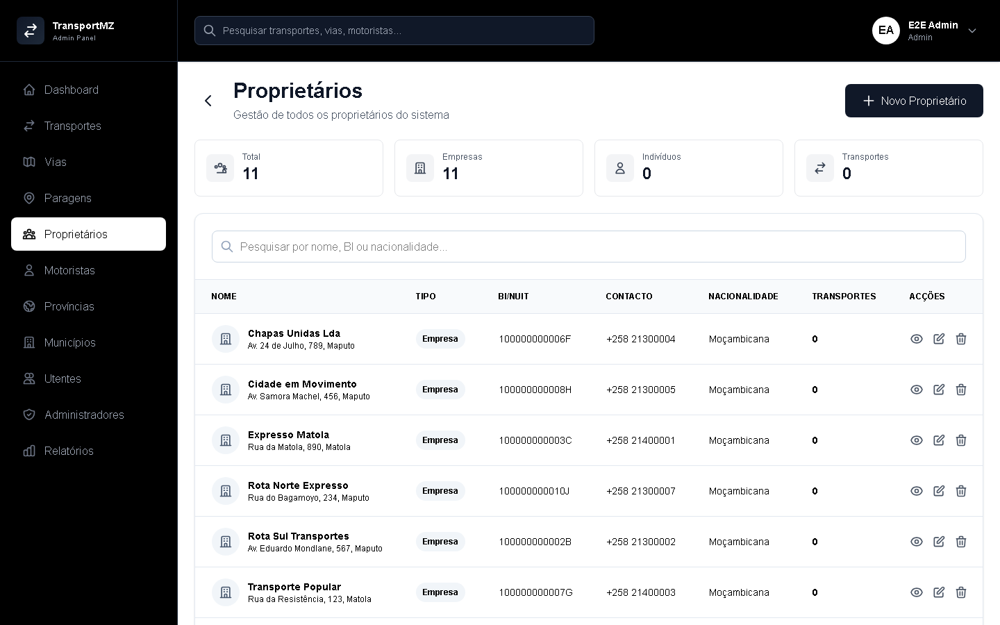

Empresas ou pessoas donas de veículos. A página de detalhe lista os seus veículos; "Associar Transportes" liga mais (`POST /api/transportes/{id}/atribuir-proprietario`), e um veículo pode ter vários proprietários.

**Apagar um proprietário que ainda tem veículos** responde primeiro "Não é Possível Eliminar … tem N transportes associados". **"Remover Associações e Eliminar"** apaga então o proprietário e as suas ligações aos veículos (`DELETE /api/proprietarios/{id}?force=true`). Os veículos ficam.

O "Upload do Certificado (PDF)" do formulário não se guarda ([Limitações](limitacoes.md)). A "Data de Início de Operações" guarda-se na coluna `birthDate`.

## Províncias e municípios

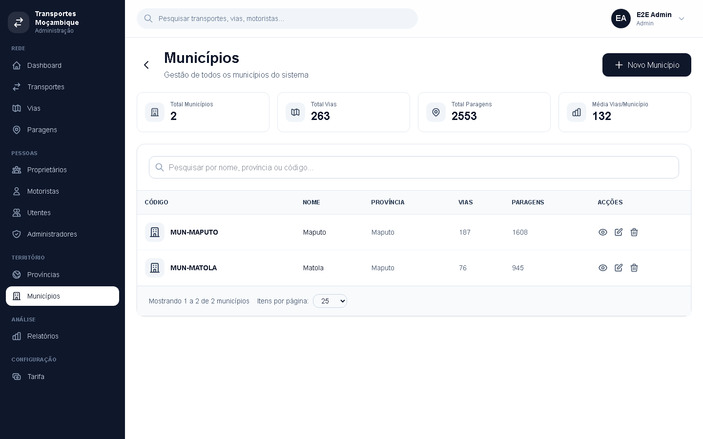

`/provincias` e `/municipios` listam, criam, editam e apagam. Um município pertence a uma província; as rotas pertencem a um município. O mapa dos formulários ("Coordenadas do Centro") define o ponto central guardado. O controlo "Raio de Cobertura" só muda o tamanho do círculo no mapa do formulário e não se guarda.

A lista de municípios conta as suas rotas e as paragens distintas nessas rotas.

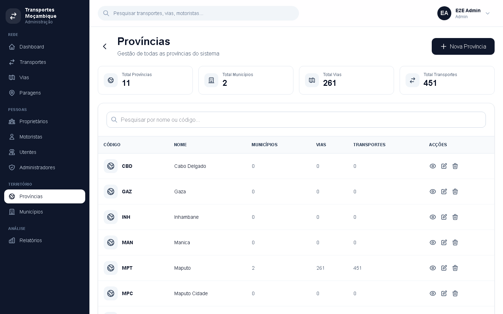

## Passageiros (`/utentes`)

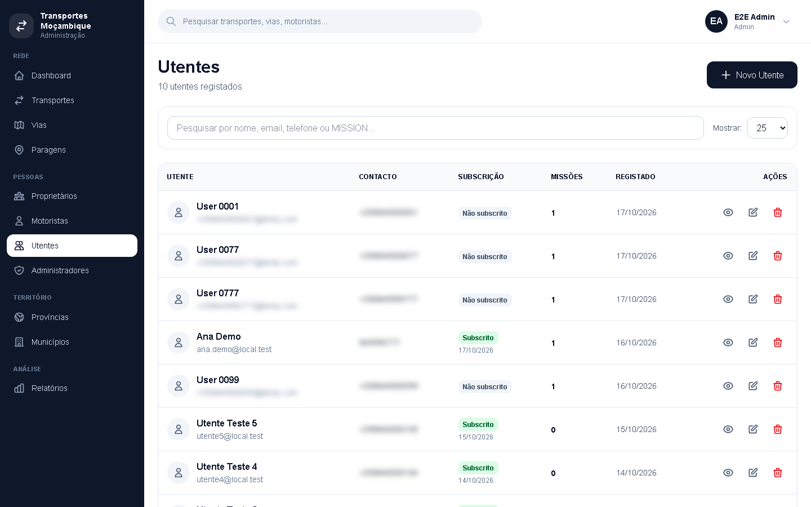

**Lista.** Nome e email, telefone, código [`MISSION`](glossario.md#a-rede-e-as-pessoas "Um alerta de chegada: um SMS quando um autocarro estiver perto de uma paragem") (`Utente.mISSION`, uma referência única), subscrição, número de alertas de chegada e data de registo.

Os passageiros que só usaram o USSD aparecem com um email provisório (`+258…@temp.com`), um código `USSD-…`, "Não subscrito" e sem palavra-passe. Completam a conta ao registar-se na web com o mesmo telefone ([Aplicação dos passageiros → Conta e entrada](app-passageiros.md#conta-e-entrada)).

**Detalhe.** Perfil, estado e os alertas de chegada do passageiro ("Missões") com a paragem.

**Novo e editar.** O administrador pode criar um passageiro com palavra-passe (guardada como hash bcrypt) e mudar os seus dados.

## Administradores e perfil

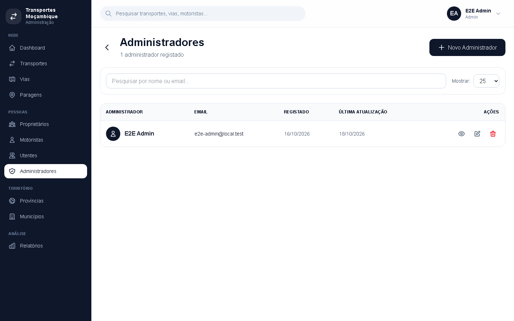

`/administradores` lista, cria, edita e apaga administradores. Um administrador novo precisa de nome, email e uma palavra-passe de pelo menos 6 caracteres, escrita duas vezes. As palavras-passe são hashes bcrypt em `Administrador.senha`.

`/perfil` ("Meu Perfil" no menu do avatar) muda o nome e a palavra-passe do próprio administrador (pede a actual; pelo menos 6 caracteres). O email não se muda aí.

## Relatórios (`/relatorios`)

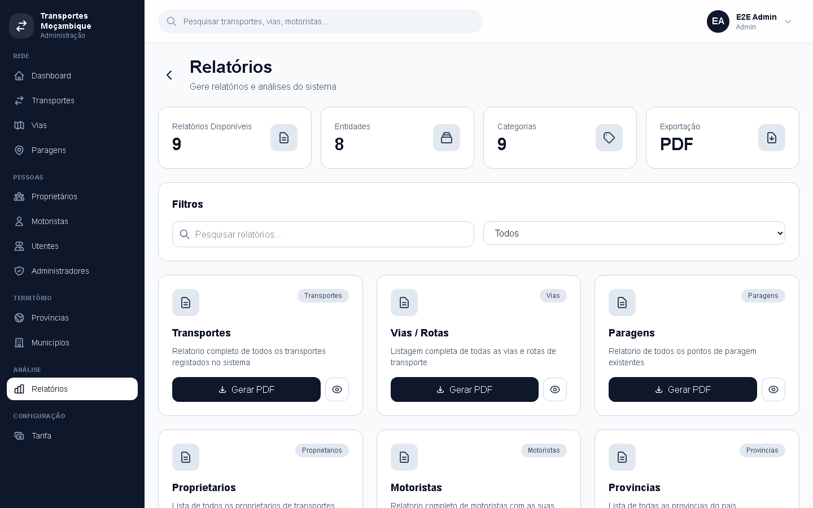

Nove relatórios: um por entidade (Transportes, Vias, Paragens, Proprietários, Motoristas, Províncias, Municípios, Utentes) e "Estatísticas Gerais".

1. **"Gerar PDF"** carrega os dados: até 5 000 linhas da API da lista da entidade, ou `GET /api/relatorios/stats` para as estatísticas gerais.
2. Abre uma pré-visualização com os primeiros 8 campos de até 100 linhas (as palavras-passe nunca aparecem).
3. **"Imprimir"** abre a janela de impressão do navegador; escolher "Guardar como PDF" para ter o ficheiro. Porquê pelo navegador: não é preciso uma biblioteca de PDF no servidor, e o navegador já sabe fazê-lo.

A pesquisa e os filtros de categoria no topo escolhem entre os cartões dos relatórios; não filtram os dados.

<a id="tarifa"></a>

## Tarifa (`/tarifa`)

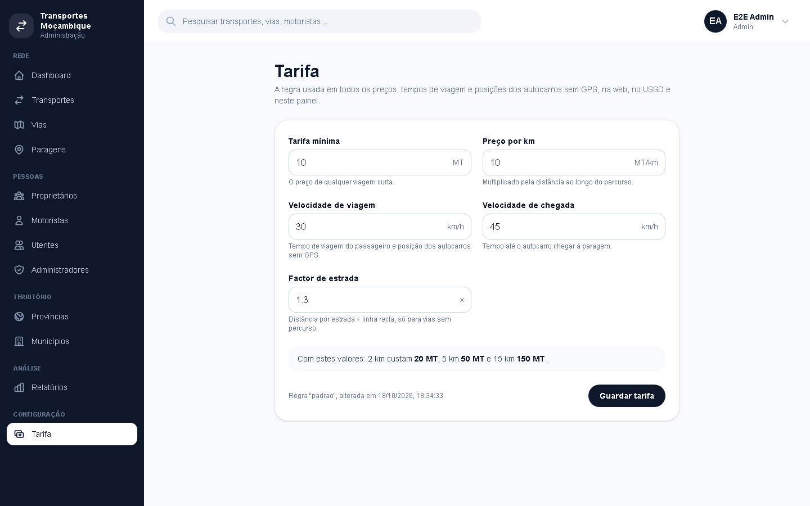

A regra por trás de todas as tarifas, tempos de viagem e posições dos autocarros em viagem, na web, no USSD e neste painel ([Configuração → Regra de tarifa](configuracao.md#regra-de-tarifa-tarifa); [`app/tarifa/page.tsx`](../transport-admin/app/tarifa/page.tsx)). Barra lateral → Configuração → **Tarifa**.

| Campo | Por omissão | Efeito |
|---|---|---|
| Tarifa mínima | 10 MT | A tarifa de qualquer viagem curta. Meticais inteiros, de 0 a 1000. |
| Preço por km | 10 MT/km | Tarifa = a maior entre a mínima e ⌈km × preço⌉, com os km medidos ao longo do percurso da rota pela estrada. |
| Velocidade de viagem | 30 km/h | A velocidade dos autocarros sem GPS: as suas posições, horas de chegada e tempos de viagem. De 5 a 120. |
| Velocidade de chegada | 45 km/h | Só para rotas sem percurso pela estrada. De 5 a 120. |
| Factor de estrada | 1.3 | Distância pela estrada ÷ linha recta, só para rotas sem percurso pela estrada. De 1 a 3. |

A linha cinzenta por baixo dos campos mostra quanto custam 2, 5 e 15 km com os valores escritos, antes de gravar. **"Guardar tarifa"** grava (`PUT /api/tarifa`); um valor fora do intervalo é recusado com o intervalo permitido. A aplicação dos passageiros e o USSD lêem a regra através de uma cache de 60 segundos, por isso as tarifas novas aparecem em menos de um minuto. As posições e as passagens do próprio painel usam logo a velocidade nova.

## API usada por cada página

Tudo em [`transport-admin/app/api`](../transport-admin/app/api), tudo atrás do cookie da sessão. Os formatos dos pedidos e das respostas estão na [Referência da API](referencia-api.md#painel-de-administração-transport-admin).

| Página | Endpoints |
|---|---|
| Pesquisa do cabeçalho | `GET /api/transportes?search=`, `GET /api/vias?search=`, `GET /api/motoristas?search=` |
| Início | `GET /api/dashboard/stats`, `GET /api/transportes/estado` |
| Veículos | `GET/POST /api/transportes`, `GET/PUT/PATCH/DELETE /api/transportes/{id}`, `GET /api/transportes/estado`, `GET /api/transportes/{id}/posicao`, `GET /api/transportes/{id}/operacao`, `GET/POST/DELETE /api/transportes/{id}/gps`, `POST/DELETE /api/transportes/{id}/atribuir-motorista`, `POST/DELETE /api/transportes/{id}/atribuir-proprietario`, `POST/DELETE /api/transportes/{id}/proprietario` |
| Rotas | `GET/POST /api/vias`, `GET/PATCH/DELETE /api/vias/{id}`, `PATCH /api/transportes/{id}`; a partir do navegador, o router de carros da FOSSGIS, ou o router de demonstração do OSRM quando falha |
| Paragens | `GET/POST /api/paragens`, `GET/PATCH/DELETE /api/paragens/{id}` |
| Motoristas | `GET/POST /api/motoristas`, `GET/PUT/DELETE /api/motoristas/{id}`, `GET/POST/DELETE /api/motoristas/{id}/pin`, `GET/POST/DELETE /api/motoristas/atribuir` |
| Proprietários | `GET/POST /api/proprietarios`, `GET/PUT/DELETE /api/proprietarios/{id}` |
| Províncias, municípios | `GET/POST /api/provincias`, `GET/PATCH/DELETE /api/provincias/{id}`, o mesmo para `/api/municipios` |
| Passageiros | `GET/POST /api/utentes`, `GET/PUT/DELETE /api/utentes/{id}` |
| Administradores, perfil | `GET/POST /api/administradores`, `GET/PATCH/DELETE /api/administradores/{id}`, `POST /api/administradores/{id}/change-password` |
| Relatórios | os endpoints das listas acima com `?limit=5000`, `GET /api/relatorios/stats` |
| Tarifa | `GET/PUT /api/tarifa` |
| Entrada | `POST /api/auth/admin/login`, `POST /api/auth/admin/logout`, `GET /api/auth/admin/session` |

<!-- navegação-fim: gerada por .github/scripts/docs-nav.py -->

---

Anterior: [Portal do motorista](portal-motorista.md) · [Índice](README.md) · Seguinte: [Publicação](publicacao.md)
<!-- /navegação-fim -->
