# Passenger web app

**Live:** https://transport-mz.vercel.app · **Code:** `transport-client/app` · **Runs locally on:** http://localhost:3000

It works like a ride-hailing app (Uber, Bolt, Yango), but for public transport. The start is your position, or a place you pick. The app lists every place you can get to from there, by the time you would arrive, and says which stop to walk to for the first bus. Pick a destination C and the journey is laid out as **A → B → C**:

- **A** is where you are;
- **B** is the stop where you take the first bus;
- **C** is where you get off, with the changes of bus in between when one bus is not enough.

You can follow your bus until it arrives, and save a stop to get an SMS when a bus is close. Browsing and planning need no account; saving alerts and the account page need one. Every screen below is followed by the requests it makes. The full request and response formats are in the [API reference](api-reference.md#passenger-app-transport-client).

**On this page:** [How to use it](#how-to-use-it-step-by-step) · [The map](#the-map--and-search) · [Partida and destinations](#partida-and-destinations) · [Stops near you](#stops-near-you) · [A stop's destinations](#a-stops-destinations) · [Journeys](#journeys) · [Following a journey](#following-a-journey-viagem) · [Account and sign-in](#account-and-sign-in) · [Account page and alerts](#account-page-and-alerts-user-info) · [Browser storage](#what-the-browser-stores)

---

## How to use it, step by step

These screenshots were taken by driving the app in a browser (Playwright) against a copy of the database at 07:40 on a weekday. The position was set a few steps from the Portão stop.

**1. Open the app.** It asks for your location. The panel then shows:

- **Partida**: "A sua localização";
- **Para onde ir**: every place you can reach, earliest arrival first.

Each row says where to take the first bus ("Apanhe em Portão · 70 m a pé"), "Directo" or how many buses it takes, the routes, the arrival time and the minutes from now.

**2. Pick a destination**, from the list or by typing in "Para onde quer ir?". Results show how far each place is from the start.

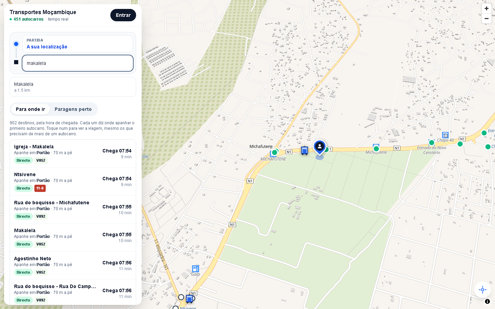

**3. See the journey: A → B → C.** It shows the walk to the stop (A → B), the bus with its plate, when it comes, and where and when to get off (B → C). The map draws the walk dotted along the streets and the bus in its route's colour. The other options are below, earliest arrival first.

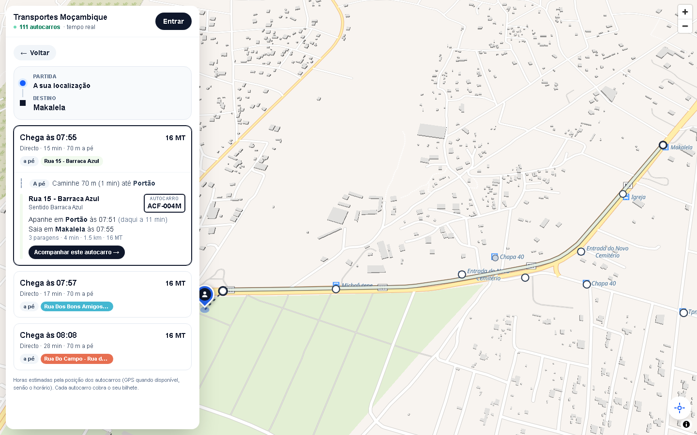

**4. Follow the journey.** "Acompanhar viagem →" opens the whole journey on one map:

- your position;
- the walk to the stop, dotted along the streets;
- each bus leg in its route's colour;
- every bus of the journey, moving.

The dark card says what to do now: "Caminhe até Portão", then "Espere em Portão" with the minutes until the bus comes, then "Saia em Makalela às …" once you are on board. Every step is listed under it, with live times.

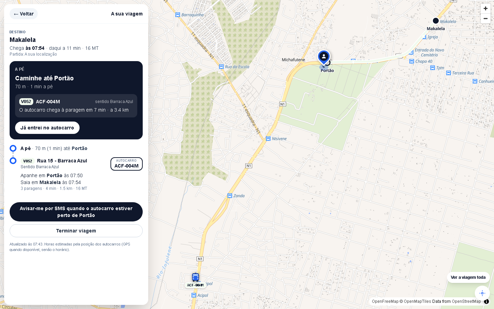

**5. Destinations that take more than one bus** are in the same list ("2 autocarros", with each route's code). "Ver mais destinos" shows more.

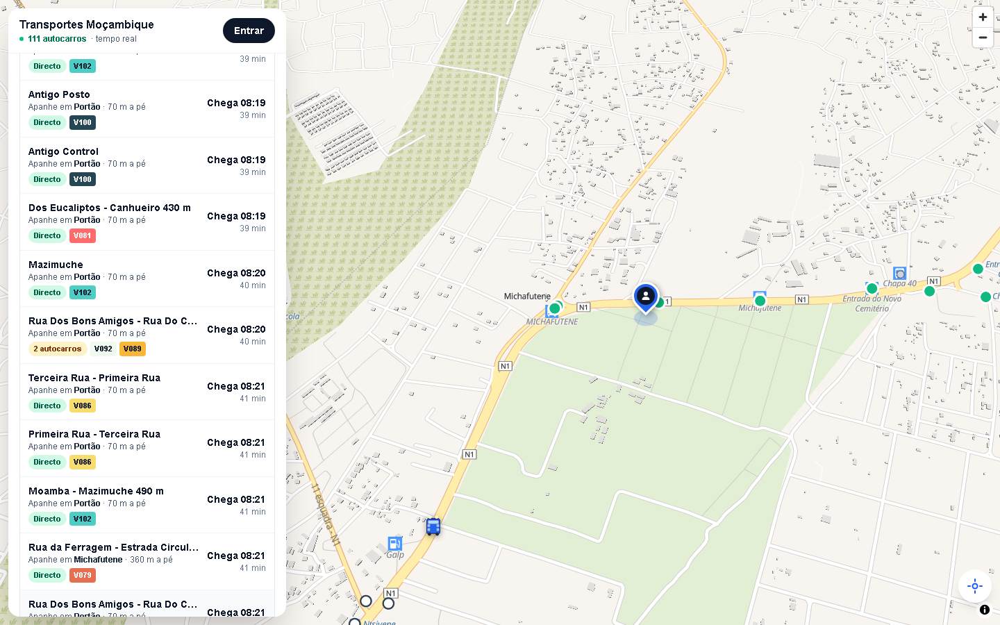

Opening one shows each bus in turn. You walk to the first stop, ride to the change, wait for the next bus there, and ride on. All times are worked out for the moment you reach each stop.

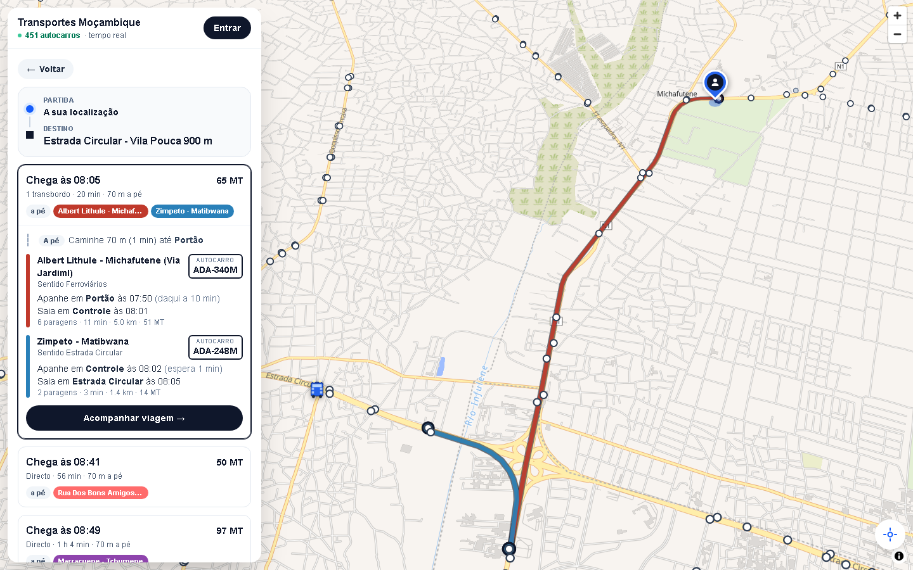

**6. Start somewhere else.** Tap **Partida** and type a stop or place. The list of destinations is then worked out from there, and each row says where to take the first bus. That is the start itself, or a stop a short walk away.

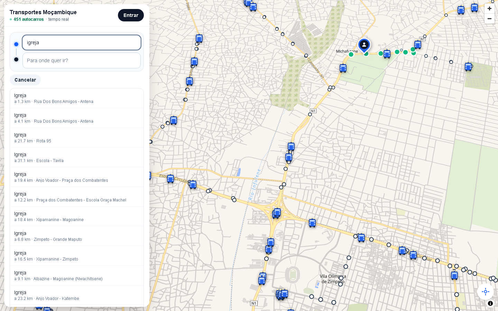

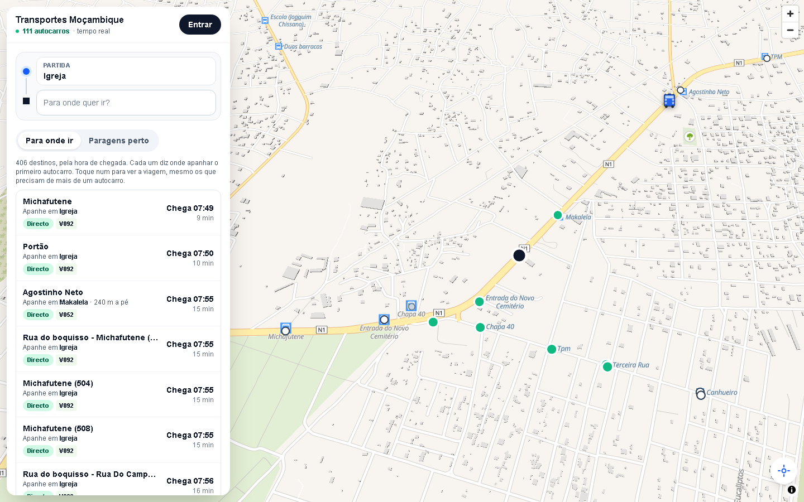

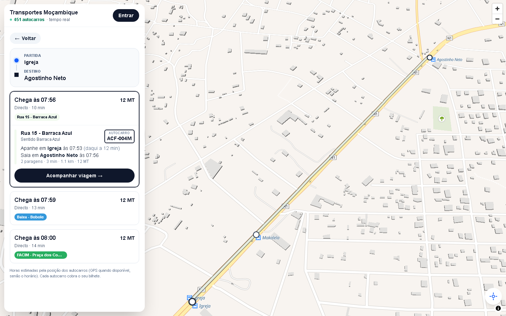

"A sua localização" (under the Partida field) brings the start back to your position.

**7. The stops near you.** The "Paragens perto" tab lists them. Tapping one shows everything that stop reaches, and its routes ([A stop's destinations](#a-stops-destinations)).

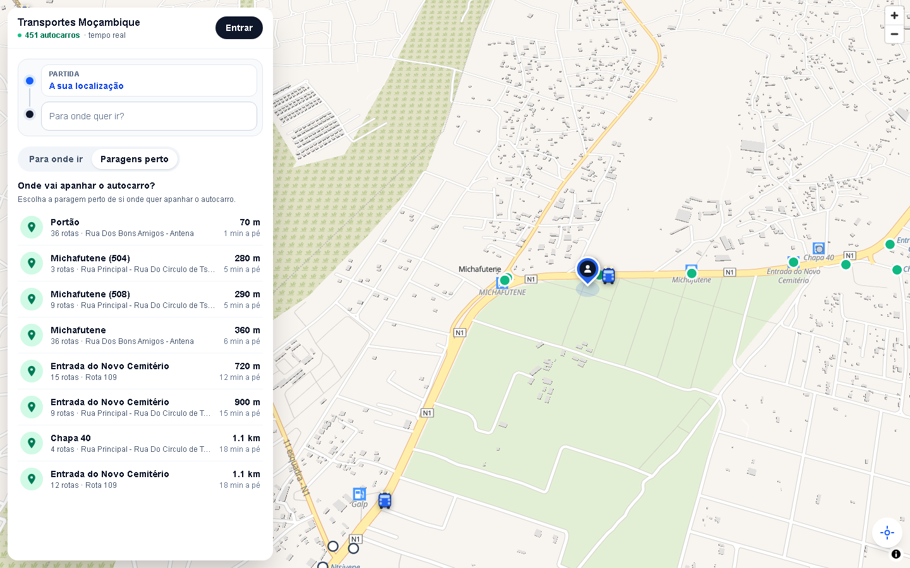

On a phone, the panel is a bottom sheet over the map. Drag its top up to fill the whole screen (the map is hidden; the title and "Voltar" move into the sheet), or down until only its top shows. A tap on the bar at its top raises it a step, or brings it back to half the screen from the whole screen.

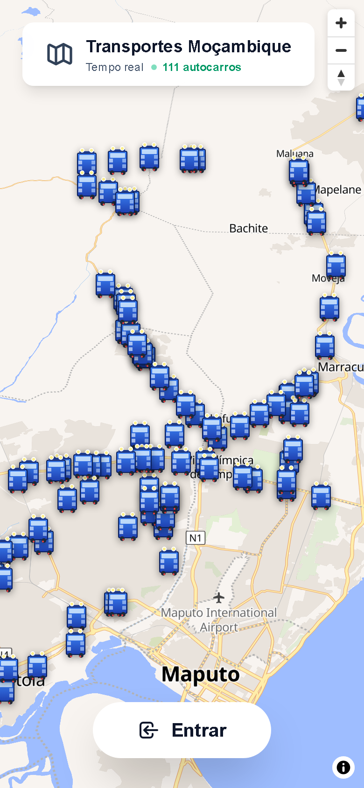 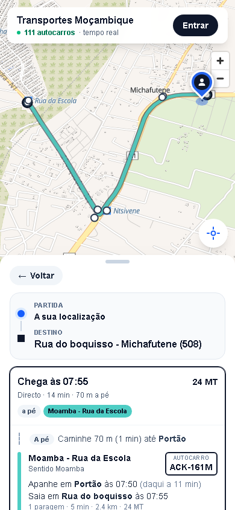 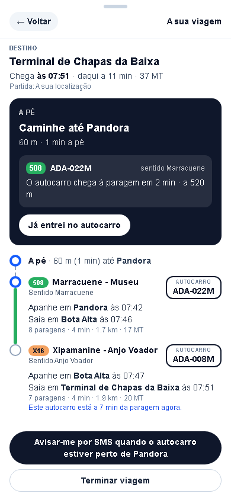

## The map (`/` and `/search`)

`/` and `/search` are the same page (`app/components/TripPlanner.tsx`); `/search` is where sign-in and registration lead. The title card shows the number of buses and "Entrar", or the passenger's avatar when signed in.

- **Buses.** Every bus with its position now: a real GPS position when fresh, otherwise the timetable position ([GPS tracking](gps-tracking.md#how-a-position-is-chosen)). Markers glide to their new position every 5 seconds. Tapping a bus draws its route and opens a card with "Acompanhar →".
- **Your position.** The browser asks for the location when the page opens. With it, the map centres on you once, and a blue pin follows you: it shows your initials when you are signed in, a person icon otherwise. The round button at the bottom right centres the map on you again, or asks again after a refusal. Positions more than 80 km from Maputo are not used to centre the map.
- **Stops.** Every stop is on the map at every zoom, and tapping one opens it:
  - the stops near you are green dots;
  - stops where buses pass are white dots;
  - stops no bus serves now (none of their routes has a vehicle) are grey. Their page says so, and they are not offered in the search or the nearby list.
- **The panel** is a card on the left on a computer, with the title (bus count, "Entrar" or the avatar) at its top. On a phone it is a bottom sheet with three heights: lowered (only its top shows), half the screen, and the whole screen. Drag its top between them, or tap the bar at its top (`app/components/Sheet.tsx`).

| When | Request |
|---|---|
| Page opens | `GET /api/stops` (every stop served by a bus, with its routes, and the stops no bus serves now; cached 5 min) |
| Page opens | `GET /api/buses` (all buses with positions) |
| Every 5 s | `GET /api/buses?fields=position` (light: id, latitude, longitude, source, heading; also triggers the arrival SMS check) |

## Partida and destinations

The top of the panel has two fields:

- **Partida** is where the journey starts. It is "A sua localização" when the position is known. Tapping it lets you type a stop or place instead; the list says how far each result is. "A sua localização" puts your position back, and "Cancelar" keeps the current start. The start you pick is marked on the map, and the map moves to it.
- **"Para onde quer ir?"** searches every stop by name, without accents or capitals. Every typed word must start a word of the name: "av ind" finds "Av. das Indústrias". Stops with the same name within 400 m count as one place. A route number in brackets at the end of the name does not count, so the 41 bays of the Museu terminal ("Museu (X39)", "Museu (109)", …) are one "Museu"; the journey still names the bay to board at. Each result shows how far it is from the start, and the route name when two places share a name.

Below them, the **"Para onde ir"** tab lists every place reachable from the start, with up to 4 buses, earliest arrival first. Each row has:

- **where to take the first bus**: "Apanhe em Portão · 70 m a pé". From your position, this is the stop within 800 m that gets you there soonest, counting the walk. When the same bus passes a closer stop at most 2 minutes later, the closer stop is chosen. From a picked place, it is that place or a stop within 300 m.
- "Directo", or how many buses it takes ("2 autocarros");
- the codes of the routes, in their colours;
- the arrival ("Chega 07:54", "Chega amanhã 05:37") and the time from now.

The first 25 are shown, and "Ver mais destinos" adds 50 at a time. Places within a short walk of the start are left out.

Choosing a destination, from the list or the search, plans the journey from the start. Without a position and without a picked start, the list of destinations is not shown. The search then plans from the stop nearest the centre of the map.

| When | Request |
|---|---|
| Position known, or a start picked | `GET /api/destinos?lat=…&lng=…` (asked again after about 100 m) or `GET /api/destinos?from={stopIds}` |

## Stops near you

**"Onde vai apanhar o autocarro?"**: the stops where you can catch a bus. The panel lists up to 8 stops within 1.5 km, nearest first, with the distance, the walking time (4.5 km/h, a quarter added for streets) and the number of routes. With no stop that close, it lists the 3 nearest under "Paragens mais próximas", with a line saying none is within 1.5 km and without walking times. With a picked start, the list is about that start ("Paragens perto da partida"). Without a position (refused, unavailable, or far from Maputo), the list is about the centre of the map and follows it as you move the map, with a line saying why. This list is the second tab, "Paragens perto", when a start is known.

## A stop's destinations

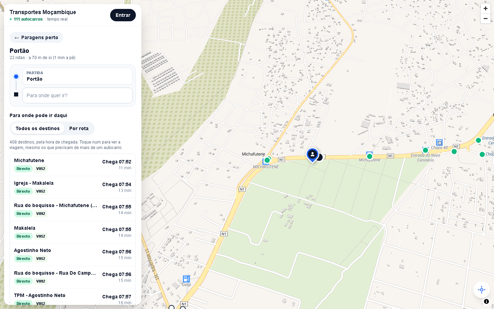

Tapping a stop (in the list or on the map) shows:

- its name, number of routes and, with a position, how far it is from you; "Apanhe o autocarro aqui" reminds you this is where you board;
- the Partida (this stop) and the destination search, where each result says **"Directo"** (a bus from this stop goes there) or **"Com transbordo"** (it needs a change). Changing the Partida here makes the new start the panel's start;
- **"Todos os destinos"** (the first tab): every place you can reach from this stop, with up to 4 buses, in the order you would get there.
  - Each row has the arrival ("Chega 10:17", "Chega amanhã 05:37") and the time from now.
  - It shows "Directo", or how many buses it takes ("3 autocarros"), and the codes of those routes in their colours.
  - The first 25 are shown; "Ver mais destinos" adds 50 at a time.

  Tapping a row opens that journey: the arrival is the same as on the row, or earlier.
- **"Por rota"** (the second tab): every route through the stop, under a header in the route's colour. For each direction ("Sentido Antena"):
  - the next bus's arrival ("Próximo autocarro 27 min", "às 17:58", "amanhã às 05:12");
  - its plate, drawn like a number plate on the right, so it is easy to match with the bus in the street;
  - the stops it goes to, in order, as a line in the route's colour; each has an "Ir" button.

  Consecutive stops with the same name are shown once; "Ver as N paragens" shows them all.

Tapping one of those stops, or a search result, plans the journey from this stop.

| When | Request |
|---|---|
| Stop opened | `GET /api/stops/{id}` |

## Journeys

The top of the panel shows the Partida and the destination. Up to three options follow, earliest arrival first. When another option takes the same number of buses, needs less walking, and arrives at most 2 minutes later, it comes first. It is usually the same bus, caught at a closer stop, and it is the one the list of destinations showed. Each card shows the arrival ("Chega às 16:51", or "Chega amanhã às 06:32"), the total fare, "Directo" or the number of changes ("2 transbordos"), the total time from now and the walking distance, and the routes as coloured labels. The chosen option is drawn on the map: each bus in its route's colour, walks dotted along the streets ([Walks along the streets](#walks-along-the-streets)), and only the buses of that journey stay on the map.

The chosen option lists its steps:

- **Walks**: "Caminhe 100 m (2 min) até Portão", from your position to the first stop, between two stops to change buses (up to 400 m), or from the last stop.
- **Buses**: the route and its direction, with the bus's plate as a number-plate badge on the right; where and when to take it ("Apanhe em Portão às 16:47 (daqui a 5 min)", and for the next buses the wait at the stop: "espera 35 min"); where and when to get off; the number of stops, time on board, distance and fare. "Acompanhar viagem →" under the steps follows the whole journey, every bus of it ([Following a journey](#following-a-journey-viagem)).
- When the journey only finishes the next morning (buses run 05:00–21:00), a note says so.

Each bus charges its own fare, with the fare rule (max(10 MT, ⌈km × 10 MT⌉) by default, [Configuration](configuration.md#fare-rule-tarifa)). Times use the same model as everywhere else: real GPS when fresh, else the timetable, worked out for the moment you reach each stop. How the options are found is in [Data flow → Journey planning](data-flow.md#journey-planning). When the two places are not connected by any chain of buses (a few routes form separate groups), the panel says "Não há ligação de autocarro entre estes dois locais".

| When | Request |
|---|---|
| From a stop or a picked start | `GET /api/journeys?from={stopIds}&to={stopIds}` |
| From your position | `GET /api/journeys?lat=…&lng=…&to={stopIds}` |

### Walks along the streets

The map draws each walk along the streets, the way a person would go. The page asks `GET /api/walk` for the street path of each walk shown; until it arrives, or when there is none, the walk is a straight dotted line. The path comes from the OSRM foot router of FOSSGIS (`routing.openstreetmap.de`, OpenStreetMap data), through the passenger app's server ([API reference](api-reference.md#get-apiwalk)).

- The points are rounded to about 45 m in the browser and to about 11 m on the server, then the path is cut at the exact ends. While you walk, the page asks again only every few dozen metres.
- The walking distance and minutes on the cards still come from the planner (straight line, timed at 4.5 km/h with a quarter added for streets), so the line can be a little longer than the "Caminhe 300 m" it is drawn for.
- FOSSGIS allows light use only, one request a second. The server waits its turn, keeps paths in memory, and the CDN keeps each answer a week. When the router is busy or down, walks are straight lines again ([Known limitations](known-limitations.md#journeys)).

## Following a journey (`/viagem`)

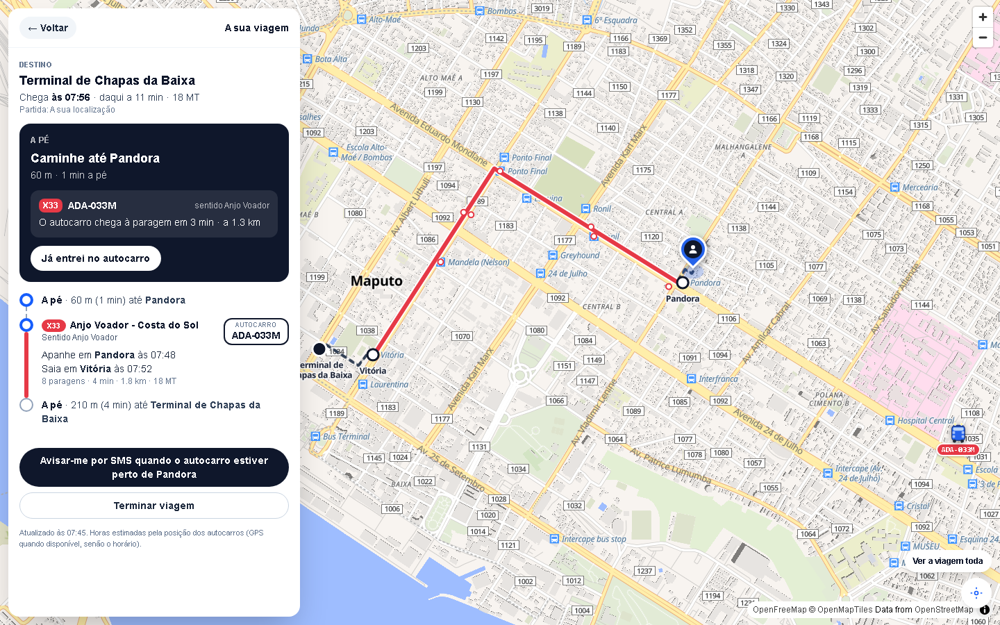

"Acompanhar viagem →" on a journey opens `/viagem` (`app/components/JourneyFollow.tsx`). The map takes the whole screen, like a ride-hailing app.

**On the map:**

- your position, with your initials or the person icon;
- the walks, dotted along the streets;
- each bus leg in its route's colour, cut at the stops where you get on and off, with the stops in between;
- the destination, as a dark dot;
- every bus of the journey that is still to come, with its plate, moving.

"Ver a viagem toda" fits the whole journey on the screen, and the round button centres the map on you.

**The dark card** is the step you are on:

| Step | What it says |
|---|---|
| Walking to the stop | "Caminhe até Portão", the distance and minutes, and the bus: "O autocarro chega à paragem em 10 min · a 4.6 km". When the bus will pass before you can be there: "Chega antes de si: apanha-o na passagem seguinte, às 08:31". |
| At the stop (within 50 m) | "Espere em Portão", with the same line about the bus |
| On board | "Saia em Laurentina às 07:52", the minutes and stops left, and the direction |
| After the last bus | "Caminhe até …", then "Chegou ao destino" |

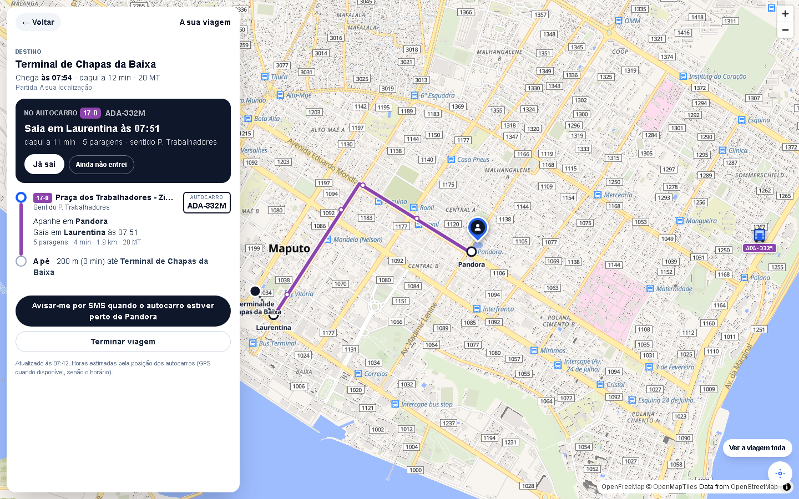

**Moving on by itself.** The page knows the step from your position and the bus's:

- you are on board when the bus has passed your stop and you are within 120 m of it;
- you are off when the bus has passed your exit stop, or you are at that stop and the bus has moved on.

Without a position, it assumes you took the bus at its time. "Já entrei no autocarro", "Já saí" and "Ainda não entrei" correct it. The step is kept for the browser tab (`sessionStorage`), so a reload does not lose it.

**Under the card**, every step of the journey with a status dot (done, now, later). Each bus has its route code and colour, plate, where and when to get on and off, stops, minutes, distance and fare. For a later bus: "Este autocarro está a 7 min da paragem agora".

**Buttons:**

- "Avisar-me por SMS quando o autocarro estiver perto de Portão" saves an arrival alert for the first boarding stop. An SMS comes when a bus is under 1 km away ([Data flow → Arrival alert](data-flow.md#arrival-alert-and-sms)). Without a session it says to sign in, and an expired session clears the stored account.
- "Terminar viagem" goes back to the map.

**One bus on its own.** "Acompanhar →" on a bus of the map opens `/viagem?b={busId}`. It shows that bus's route, where the bus is, and the next 12 stops it reaches with the minutes to each. The account page's alerts open `/track/{busId}?paragem={stopId}`, which redirects here and adds "A sua paragem": the bus's next pass there, either way. Old `/track/{id}?paragem=…&destino=…` links redirect to a one-bus journey.

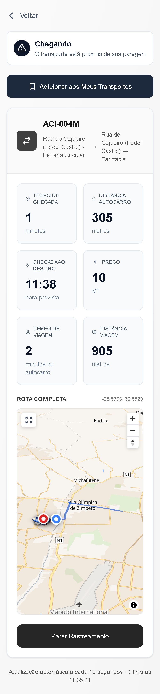 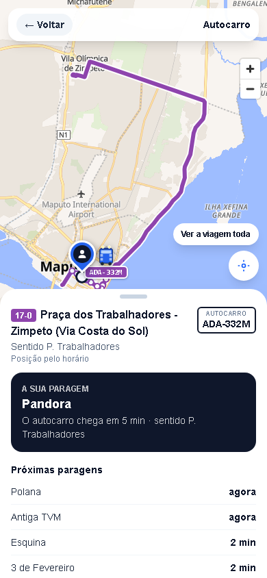

| When | Request |
|---|---|
| On open, every 10 s, and when the step changes | `GET /api/viagem?b=BUS~DE~PARA,…&lat=…&lng=…&a=STEP&bordo=0\|1&para=STOP` |
| One bus | `GET /api/viagem?b=BUS` or `?b=BUS~STOP` |
| The alert button | `POST /api/user/missions/save` (Bearer) `{"transporteId", "paragemId"}` |

## Account and sign-in

`/auth` signs in with **phone number and password**, or registers with name, email, phone and password ("Registe-se").

- The phone can be typed with or without `+258`. Accounts created by USSD are stored with the prefix and are still found.
- Someone who has only used USSD already has a passwordless account (created by option 1). Registering with the same phone **completes that account** and keeps their alerts. Signing in before registering answers "Este número ainda não tem senha. Faça o registo para criar uma."
- The password needs at least 6 characters and is stored as a bcrypt hash.
- Sign-in and registration return a **session token** (HMAC-signed, valid 90 days). Every `/api/user/*` request sends it as `Authorization: Bearer <token>` and can only read or change that passenger's own data ([Security](security.md#passengers)).

| Action | Request |
|---|---|
| "Entrar" | `POST /api/auth/login` `{"telefone", "senha"}` |
| "Registar" | `POST /api/auth/register` `{"nome", "email", "telefone", "senha"}` |

## Account page and alerts (`/user-info`)

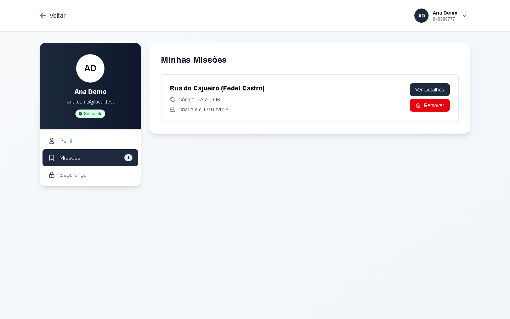

Three tabs, each reachable directly with `?tab=`:

| Tab | `?tab=` | What it does | Requests |
|---|---|---|---|
| **Perfil** | `perfil` | Shows the profile; the name can be changed | `GET /api/user/{id}`, `PUT /api/user/{id}` `{"nome"}` |
| **Missões** | `missoes` | Saved stops (arrival alerts). "Ver Detalhes" follows the first bus that serves that stop, with its next pass there; "Remover" deletes the alert. | `GET /api/user/missions`, `DELETE /api/user/missions/{id}`, `GET /api/buses` |
| **Segurança** | `seguranca` | Changes the password (the current one is required) | `POST /api/user/{id}/change-password` |

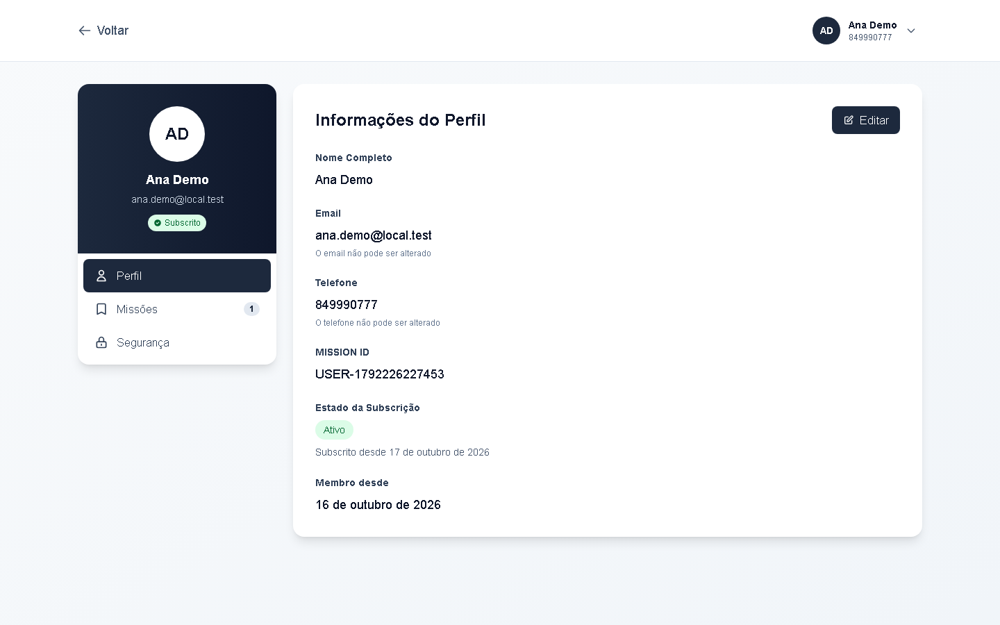

`/my-transports` is an old address. It redirects (HTTP 307) to `/user-info?tab=missoes`.

## What the browser stores

| `localStorage` key | Content | Set by |
|---|---|---|
| `utente` | The passenger's profile (id, name, email, phone, subscription) plus the session `token` | sign-in and registration; refreshed by the account page |

Signing out (avatar menu) clears it. A token that is expired or signed with a rotated secret makes `/api/user/*` answer 401. The account page and the alert button then clear the stored account, and the passenger signs in again.

---

[← Configuration](configuration.md) · [Documentation index](README.md) · Next: [USSD service →](ussd.md)
