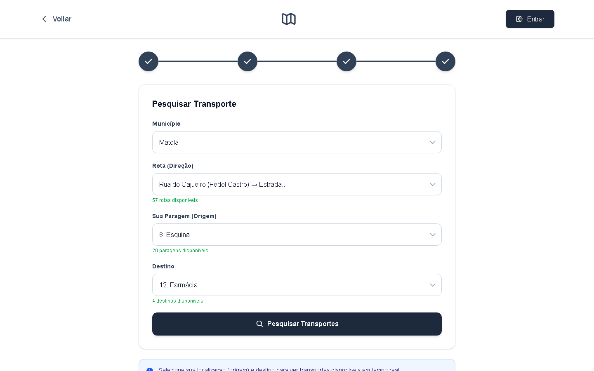
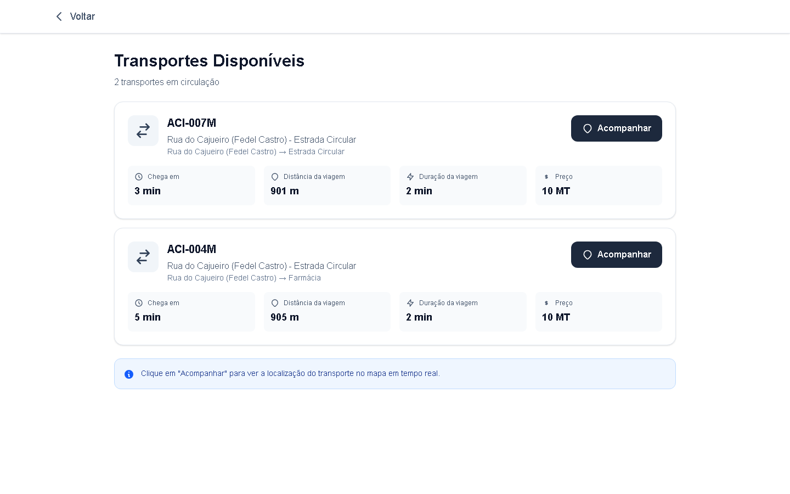

# Passenger web app

**Live:** https://transport-mz.vercel.app · **Code:** `transport-client/app` · **Runs locally on:** http://localhost:3000

Passengers see every bus on a live map, search for a trip between two stops, follow one bus until it arrives, and save stops to get an SMS when a bus is close. Browsing and searching need no account. Saving alerts and the account page need one. Every screen below is followed by the requests it makes; the full request and response formats are in the [API reference](api-reference.md#passenger-app-transport-client).

**On this page:** [Live map](#live-map-) · [Search](#search-search) · [Results](#results) · [Tracking a bus](#tracking-a-bus-trackid) · [Account and sign-in](#account-and-sign-in) · [Account page and alerts](#account-page-and-alerts-user-info) · [Browser storage](#what-the-browser-stores)

---

## Live map (`/`)

- Shows every bus with its position now: a real GPS position when fresh, otherwise the timetable position ([GPS tracking](gps-tracking.md#how-a-position-is-chosen)). The counter in the corner ("111 autocarros") is the number of buses on the map.
- The map opens on the area where the buses are (the 10th–90th percentile of their positions), not on the whole province.
- Markers glide to their new position every 5 seconds.
- "Entrar" goes to sign-in (`/auth`), which opens the search after signing in or registering. The search itself needs no account: open `/search` directly.

| When | Request |
|---|---|
| Page opens | `GET /api/startup` (also triggers the arrival SMS check) |
| Page opens | `GET /api/buses` (all buses with positions) |
| Every 5 s | `GET /api/buses?fields=position` (light: id, latitude, longitude, source, heading) |

On a phone the same page fills the screen:

## Search (`/search`)

The form goes step by step: **Município** → **Rota (Direção)** → **Sua Paragem (Origem)** → **Destino**. Each list only offers options that have buses ("57 rotas disponíveis", "20 paragens disponíveis"). Stops appear in travel order along the route, numbered, and destinations are the stops after the origin in the chosen direction.

| Step | Request |
|---|---|
| Open | `GET /api/available-routes` → municipalities with buses |
| Municipality chosen | `GET /api/available-routes?municipioId=…` → that municipality's routes with buses |
| Route chosen | `GET /api/available-routes?municipioId=…&viaId=…` → its stops in travel order |
| "Pesquisar Transportes" | `GET /api/buses?paragemId=ORIGIN&destinoId=DEST&viaIds=A,B` |

`viaIds` holds every route with the same two terminals as the chosen one, so buses on both directions are considered.

## Results

One card per bus that serves both stops, sorted by arrival:

| Field | Meaning |
|---|---|
| **Chega em** | Minutes until the bus reaches your origin, going in your direction. It includes turning around at a terminal if the bus has passed you or is going the other way. Waits of an hour or more show the clock time ("às 11:56"). At night, or when the bus would only come after 21:00, it is tomorrow's first pass ("amanhã às 05:12"). |
| **Distância da viagem** | Road distance from your origin to your destination, along the route's path. |
| **Duração da viagem** | That distance at the fare rule's travel speed (30 km/h by default). |
| **Preço** | max(10 MT, ⌈km × 10 MT⌉) with the default fare rule ([Configuration](configuration.md#fare-rule-tarifa)). |

"Acompanhar" opens the tracking page for that bus with your two stops: `/track/{busId}?paragem=ORIGIN&destino=DEST`.

## Tracking a bus (`/track/[id]`)

- **Status banner.** For example "Chegando — O transporte está próximo da sua paragem", or "Transporte já passou" when the bus passed your stop and comes back on its next lap.
- **Six figures:**
  - **Tempo de chegada** and **Distância autocarro**: the wait, and how far the bus still drives to reach you;
  - **Chegada ao destino**: the expected clock time at your destination;
  - **Preço**;
  - **Tempo de viagem** and **Distância viagem**: minutes and distance on board.
- **Rota completa.** The route's road path. The bus marker glides along it; your origin and destination are highlighted. The full-screen button enlarges the map.
- **"Adicionar aos Meus Transportes"** saves an arrival alert for your origin stop. You get an SMS when a bus on a route through that stop is less than 1 km away ([Data flow → Arrival alert](data-flow.md#arrival-alert-and-sms)). Without a session the button answers "Você precisa estar logado para salvar transportes". An expired session clears the stored account so you can sign in again.
- **"Parar Rastreamento"** leaves the page. The footer shows the refresh period and the time of the last update.

| When | Request |
|---|---|
| Every 10 s | `GET /api/bus/{id}?paragem=ORIGIN&destino=DEST` |
| Signed in, on open | `GET /api/user/missions` (Bearer) to show whether the stop is already saved |
| "Adicionar aos Meus Transportes" | `POST /api/user/missions/save` (Bearer) `{"transporteId", "paragemId"}` |

On a phone:

## Account and sign-in

`/auth` signs in with **phone number and password**, or registers with name, email, phone and password ("Registe-se").

- The phone can be typed with or without `+258`. Accounts created by USSD are stored with the prefix and are still found.
- Someone who has only used USSD already has a passwordless account (created by option 1). Registering with the same phone **completes that account** and keeps their alerts. Signing in before registering answers "Este número ainda não tem senha. Faça o registo para criar uma."
- The password needs at least 6 characters and is stored as a bcrypt hash.
- Sign-in and registration return a **session token** (HMAC-signed, valid 90 days). Every `/api/user/*` request sends it as `Authorization: Bearer <token>` and can only read or change that passenger's own data ([Security](security.md#passengers)).

| Action | Request |
|---|---|
| "Entrar" | `POST /api/auth/login` `{"telefone", "senha"}` |
| "Registar" | `POST /api/auth/register` `{"nome", "email", "telefone", "senha"}` |

## Account page and alerts (`/user-info`)

Three tabs, each reachable directly with `?tab=`:

| Tab | `?tab=` | What it does | Requests |
|---|---|---|---|
| **Perfil** | `perfil` | Shows the profile; the name can be changed | `GET /api/user/{id}`, `PUT /api/user/{id}` `{"nome"}` |
| **Missões** | `missoes` | Saved stops (arrival alerts). "Ver Detalhes" opens the tracking page of the first bus that serves that stop; "Remover" deletes the alert. | `GET /api/user/missions`, `DELETE /api/user/missions/{id}`, `GET /api/buses` |
| **Segurança** | `seguranca` | Changes the password (the current one is required) | `POST /api/user/{id}/change-password` |

`/my-transports` is an old address. It redirects (HTTP 307) to `/user-info?tab=missoes`.

## What the browser stores

| `localStorage` key | Content | Set by |
|---|---|---|
| `utente` | The passenger's profile (id, name, email, phone, subscription) plus the session `token` | sign-in and registration; refreshed by the account page |

Signing out (avatar menu) clears it. A token that is expired or signed with a rotated secret makes `/api/user/*` answer 401. The account and tracking pages then clear the stored account, and the passenger signs in again.

---

[← Configuration](configuration.md) · [Documentation index](README.md) · Next: [USSD service →](ussd.md)
