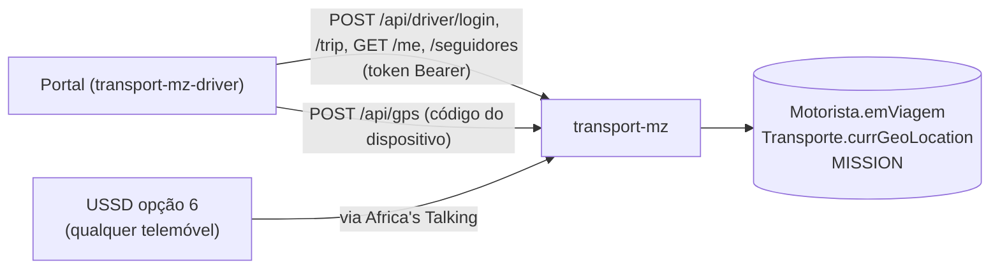

# Portal do motorista

<!-- navegação: gerada por .github/scripts/docs-nav.py, não editar à mão -->
[Documentação](README.md) › 4. Usar as aplicações › **Portal do motorista** (página 17 de 25)

Anterior: [Aplicação dos passageiros](app-passageiros.md) · [Índice](README.md) · Seguinte: [Painel de administração](painel-admin.md)

<details>
<summary>Todas as páginas</summary>

- 0. Começar do zero: [Conceitos básicos](conceitos.md) · [Preparar o computador](preparar-o-computador.md)
- 1. Conhecer o projecto: [Visão geral](visao-geral.md) · [Glossário](glossario.md) · [Fontes de dados](fontes-de-dados.md) · [Estado do projecto](estado-do-projecto.md)
- 2. Montar localmente: [Primeiros passos](primeiros-passos.md) · [Base de dados](base-de-dados.md) · [Configuração](configuracao.md)
- 3. Perceber como funciona: [Fluxos de dados](fluxos-de-dados.md) · [Localização e GPS](localizacao-gps.md) · [Serviço USSD](ussd.md) · [Segurança](seguranca.md) · [Referência da API](referencia-api.md) · [Mapa do código](mapa-do-codigo.md)
- 4. Usar as aplicações: [Aplicação dos passageiros](app-passageiros.md) · **Portal do motorista** · [Painel de administração](painel-admin.md)
- 5. Pôr online: [Publicação](publicacao.md) · [Guia da Vercel](guia-vercel.md) · [Guia da Neon](guia-neon.md) · [Africa's Talking](africas-talking.md)
- 6. Manter: [Testes](testes.md) · [Resolução de problemas](resolucao-de-problemas.md) · [Limitações](limitacoes.md)

</details>
<!-- /navegação -->

> **Em palavras simples:** O site dos motoristas, para usar no telemóvel: o motorista entra com o número de telefone e um PIN, carrega em "Iniciar viagem" quando começa a conduzir, e pode partilhar a posição do telemóvel para o autocarro aparecer no sítio certo do mapa. Esta página mostra o dia de um motorista, passo a passo.

| | |
|---|---|
| Ao vivo | https://transport-mz-driver.vercel.app |
| Localmente | http://localhost:3001 ([Primeiros passos](primeiros-passos.md#7-correr-as-aplicações)) |
| Código | [`transport-driver/app`](../transport-driver/app); a [API](conceitos.md#api "Uma API é a lista de pedidos que um servidor aceita de outros programas; cada um desses pedidos, com o seu endereço, é um endpoint.") está na aplicação dos passageiros, em [`transport-client/app/api/driver`](../transport-client/app/api/driver) |

Uma [aplicação web](conceitos.md#aplicacao-web "Um site que se usa como um programa: tem botões, mapas e contas, e muda conforme o que se faz.") para o telemóvel do motorista. O motorista entra com um PIN, inicia e termina viagens, pode partilhar o [GPS](conceitos.md#gps "O sistema de satélites com que um telemóvel ou um aparelho sabe as suas coordenadas.") do telemóvel como a posição do veículo, e vê quantos passageiros esperam nas paragens da rota. O portal não tem API nem [base de dados](conceitos.md#base-de-dados "O sítio organizado onde a plataforma guarda tudo o que tem de durar: rotas, paragens, veículos, contas.") próprias: todos os pedidos vão para a aplicação dos passageiros (`transport-mz`), cujo endereço é `NEXT_PUBLIC_API_URL` ([Configuração](configuracao.md#transport-driver-portal-do-motorista)).

O mesmo estado de viagem pode mudar-se a partir de qualquer telemóvel pela opção 6 do [USSD](conceitos.md#ussd "Os menus que aparecem num telemóvel quando se marca um código como *384*848080#; funcionam em qualquer telemóvel, sem internet.") ([Serviço USSD → Área do motorista](ussd.md#6-área-do-motorista)). O portal e o USSD estão sempre de acordo porque os dois lêem e escrevem `Motorista.emViagem` ([`lib/driverTrips.ts`](../transport-client/lib/driverTrips.ts)).



Porquê uma aplicação web e não uma aplicação Android: não precisa de loja nem de instalação, abre em qualquer telemóvel com [navegador](conceitos.md#navegador "O programa com que se abrem sites: Chrome, Firefox, Edge, Safari."), e cada [publicação](conceitos.md#publicacao "Pôr uma versão nova do código a funcionar nos servidores, ao vivo, para toda a gente.") chega logo a todos os motoristas.

**Nesta página:** [Antes da primeira entrada](#antes-da-primeira-entrada) · [O dia de um motorista](#o-dia-de-um-motorista-passo-a-passo) · [Entrada](#entrada-) · [Painel](#painel-dashboard) · [Viagens](#iniciar-e-terminar-uma-viagem) · [GPS do telemóvel](#partilhar-o-gps-do-telemóvel) · [Passageiros à espera](#passageiros-à-espera-na-rota) · [O que o navegador guarda](#o-que-o-navegador-guarda) · [Erros](#erros)

---

## Antes da primeira entrada

Um motorista não se regista sozinho. Um administrador:

1. Cria o motorista no painel (**Motoristas → Novo**) e atribui-o a um veículo (**Motoristas → Atribuir Motoristas**). A rota do veículo ([`Via`](glossario.md#a-rede-e-as-pessoas "A tabela das rotas de autocarro (route)")) é a rota que o portal mostra.
2. Abre a página do motorista e carrega em **"Gerar PIN"** no cartão "PIN de Acesso" ([Painel → Dar um PIN a um motorista](painel-admin.md#tarefa-pin)). O PIN de 6 algarismos aparece uma só vez ("só é mostrado agora"). Só o seu [hash](conceitos.md#hash "Uma 'impressão digital' de um texto, que se calcula num sentido e não se consegue desfazer.") bcrypt fica em `Motorista.password`.
3. Dá o PIN ao motorista. **"Gerar novo PIN"** substitui-o e o antigo deixa de funcionar; é também assim que se repõe um PIN esquecido.

Porquê o administrador gera o PIN: o motorista não precisa de email nem de escolher nada, e um PIN aleatório não se adivinha a partir da data de nascimento ([Segurança → Motoristas](seguranca.md#motoristas)).

Para um telemóvel que partilha o GPS, o administrador cria também o **[código do dispositivo](conceitos.md#rastreador "Um aparelho (ou um telemóvel com uma aplicação) que envia a posição de um veículo pela internet; o código do dispositivo é a sua 'palavra-passe'.")** do veículo (**Transportes → veículo → Rastreador GPS**, ver [Localização e GPS](localizacao-gps.md#1-criar-o-código-do-dispositivo)).

## O dia de um motorista, passo a passo

O que o motorista faz, no telemóvel, depois de o administrador ter feito [os passos antes da primeira entrada](#antes-da-primeira-entrada).

1. **Abrir o portal** em https://transport-mz-driver.vercel.app. No Android, o menu do Chrome → "Adicionar ao ecrã principal" põe-no no ecrã inicial como uma aplicação.
2. **Entrar** com o número de telefone que o administrador registou (com ou sem `+258`, os espaços não contam) e o PIN de 6 algarismos. O portal lembra-se do motorista durante 30 dias.
3. **Confirmar o topo do ecrã:** o nome, a matrícula do veículo e o código da rota. Se estiverem errados, o administrador corrige-os; o portal mostra o veículo e a rota novos em 5 minutos.
4. **Opcional, uma vez por telemóvel: partilhar o GPS.** Tocar no nome → colar em "Código GPS do veículo" o código dado pelo administrador → **Guardar**. Permitir a localização quando o navegador pedir ([detalhes](#partilhar-o-gps-do-telemóvel)).
5. **No primeiro [terminal](conceitos.md#terminal "A janela onde se escrevem instruções para o computador em texto, em vez de clicar."), tocar em "Iniciar viagem".** O botão fica escuro, "Em viagem" aparece no topo e o relógio começa. É este botão que põe o autocarro em serviço: só a partir daqui os passageiros o vêem a andar, o recebem nas viagens e recebem [SMS](conceitos.md#sms "As mensagens de texto curtas dos telemóveis.") dele. O cartão "Os passageiros vêem" passa de "Fora de serviço" a "Em circulação". Com um código GPS guardado, o telemóvel passa a enviar a posição: o portal fica aberto e o ecrã ligado.
6. **Durante a viagem,** "À espera" mostra quantos passageiros pediram para ser avisados nas paragens desta rota nas últimas 3 horas, e a lista de paragens mostra onde ("2 à espera"). Arrastar o painel para cima mostra todas as paragens.
7. **No fim, tocar em "Terminar viagem".** O autocarro fica parado onde está e sai das viagens dos passageiros; quem esperava por ele recebe um SMS a dizer que deixou de circular, com o autocarro seguinte.
8. **Sem dados ou sem smartphone?** Marcar o código USSD, escolher 6, escrever o PIN, e 1 → 1 inicia ou termina a viagem ([Serviço USSD → Área do motorista](ussd.md#6-área-do-motorista)). O portal mostra o mesmo estado em 10 segundos.
9. **Sair** (tocar no nome → **Sair**) num telemóvel partilhado. Um PIN esquecido repõe-o o administrador ("Gerar novo PIN").

## Entrada (`/`)


"Número de telefone" e "PIN", depois "Entrar" ([`app/page.tsx`](../transport-driver/app/page.tsx)).

- O telefone coincide com ou sem `+258` e espaços. Os telefones dos motoristas estão guardados em formatos diferentes (`+258 87 123 4567`, `841234567`), por isso o [servidor](conceitos.md#servidor "Um computador sempre ligado que recebe pedidos e responde a eles.") normaliza os dois lados antes de comparar.
- Se der certo, o servidor devolve o perfil do motorista, o veículo, a rota (com as paragens pela ordem de viagem e o percurso pela estrada) e um **[token](conceitos.md#sessao "Depois de entrar, o servidor dá uma prova de quem se é (um token), e o navegador mostra-a a cada pedido para não ter de pedir a palavra-passe outra vez.") de sessão** válido 30 dias, assinado com `DRIVER_SESSION_SECRET`. O portal guarda tudo no `localStorage` e abre `/dashboard`.

| Acção | Pedido |
|---|---|
| "Entrar" | `POST {API}/api/driver/login` `{"telefone": "871234567", "password": "<PIN>"}` |

`{API}` é `NEXT_PUBLIC_API_URL`, `https://transport-mz.vercel.app` em produção ([`lib/api.ts`](../transport-driver/lib/api.ts)). Os endpoints respondem com `Access-Control-Allow-Origin: *` porque o portal corre noutro domínio.

## Painel (`/dashboard`)

 

O mapa ocupa o ecrã inteiro, com um painel por cima: uma folha em baixo num telemóvel, um cartão à esquerda num computador. É parecido com a aplicação dos passageiros ([`app/dashboard/page.tsx`](../transport-driver/app/dashboard/page.tsx)).

- **Topo:** a foto do motorista (ou as iniciais), o nome, a matrícula e o código da rota, com "Parado" ou "Em viagem". Tocar abre o perfil ([abaixo](#partilhar-o-gps-do-telemóvel)). Num computador é o topo do cartão.
- **Mapa:** [MapLibre](conceitos.md#mosaicos "As imagens das ruas por baixo dos autocarros e das paragens, que o mapa descarrega aos bocados (mosaicos) conforme se mexe.") com um estilo da OpenFreeMap, inclinado 60° com edifícios em 3D a partir do zoom 15. Desenha o percurso da rota pela estrada (`Via.geoLocationPath`) a azul, as paragens (os terminais como pontos escuros) com os nomes, e o autocarro. O autocarro fica **onde os passageiros o vêem**, a mesma posição da web e do USSD (`autocarro` em `GET /api/driver/trip`): parado e mais claro antes de "Iniciar viagem", depois a andar pela rota, ou na posição GPS enviada. Porquê esta e não a do telemóvel: o motorista vê o que os passageiros vêem, e um autocarro que não anda no mapa diz-lhe que falta iniciar a viagem. O botão redondo centra o mapa nele.
- **O painel**, de cima para baixo:
  - **"Iniciar viagem"** (verde) ou **"Terminar viagem"** (escuro) ([Viagens](#iniciar-e-terminar-uma-viagem));
  - três números: **Tempo de viagem**, o tempo desde o início da viagem, contado a partir de `viagemIniciadaEm` no servidor, e por isso certo depois de recarregar a página ou de iniciar a viagem pelo USSD; **km/h**, a velocidade do autocarro como os passageiros a vêem (a do GPS, ou a de viagem da tarifa durante a viagem, 0 parado); e **À espera**, os passageiros à espera ao longo da rota ([abaixo](#passageiros-à-espera-na-rota));
  - **Os passageiros vêem:** o estado do autocarro na web e no USSD ("Em circulação", "No terminal" ou "Fora de serviço") e, durante a viagem, as 3 paragens seguintes com os minutos até lá. Parado, diz "Carregue em "Iniciar viagem" para o autocarro aparecer a andar." Sem veículo, ou com a rota desactivada no painel: "Os passageiros não vêem este autocarro";
  - **GPS do telemóvel:** se o telemóvel partilha a posição, com o último envio ("GPS enviado às 10:31") ou "Sem código: toque para o configurar". Tocar abre o perfil;
  - a rota: o código, o nome e os terminais, e depois as paragens pela ordem de viagem com "2 à espera" onde há passageiros. Paragens seguidas com o mesmo nome (os dois lados de uma rua) aparecem uma vez.
- **Num telemóvel** a folha tem três alturas, como na aplicação dos passageiros: em baixo (só se vê o botão da viagem), meio ecrã, e ecrã inteiro (sem o mapa). Arrasta-se pelo topo, ou toca-se na barra ([`app/components/Sheet.tsx`](../transport-driver/app/components/Sheet.tsx)).


| Quando | Pedido |
|---|---|
| A página abre, depois a cada 10 s | `GET {API}/api/driver/trip` (token da sessão como Bearer) → `{"emViagem", "viagemIniciadaEm", "autocarro"}`: o estado da viagem e o autocarro como os passageiros o vêem ([Referência da API](referencia-api.md#get-apidrivertrip-post-apidrivertrip)) |
| A página abre, depois a cada 5 min | `GET {API}/api/driver/me` (token da sessão como Bearer) → o motorista, o veículo e a rota como o painel os tem agora; o mapa só se redesenha quando mudaram |
| A página abre, depois a cada 60 s | `GET {API}/api/driver/seguidores` (token da sessão como Bearer) |
| Durante uma viagem, no máximo a cada 15 s | `POST {API}/api/gps` (**código do dispositivo** como Bearer), só se houver um código guardado |

Porquê estes intervalos: o autocarro no mapa anda (10 s, como o acompanhamento de viagem da web) e o estado da viagem pode mudar pelo USSD; o veículo e a rota mudam raramente (5 min); e cada pedido gasta dados móveis do motorista (cerca de 1 KB a cada 10 s).

## Iniciar e terminar uma viagem


"Iniciar viagem" envia `POST {API}/api/driver/trip` com `{"action": "iniciar"}`; "Terminar viagem" envia `{"action": "encerrar"}`. A resposta é o estado novo, com o autocarro, e o botão, a etiqueta "Em viagem", o relógio e o mapa seguem-no. Um erro aparece por baixo do botão: sem veículo ("Não tem veículo atribuído. Peça ao administrador."), com um veículo sem rota, ou com a rota desactivada ("A rota do seu veículo está desactivada. Peça ao administrador."), a viagem não começa (`409`).

| Acção | Mudança na base de dados |
|---|---|
| `iniciar` | `Motorista.emViagem = true`, `viagemIniciadaEm = now()`, e `viagemSentido`: `1` se o autocarro estava parado na primeira metade do percurso (parte do terminal do início), `-1` na segunda (parte do fim). Se já houver uma viagem em curso (iniciada pelo USSD, por exemplo), nada muda e a hora de início fica. |
| `encerrar` | `emViagem = false`, `viagemIniciadaEm = NULL`, `viagemSentido = NULL`. Sem GPS recente, o ponto onde a viagem punha o autocarro fica em `Transporte.currGeoLocation`: é aí que ele aparece parado, e daí que a viagem seguinte escolhe o terminal. |

O que o estado da viagem faz e não faz:

- **Liga a partilha do GPS** deste portal: as posições só se enviam durante uma viagem. Porquê: fora do serviço, o telemóvel do motorista não deve mostrar onde ele está.
- É **partilhado com o USSD**: uma viagem iniciada pelo `*6` aparece aqui em 10 s, e ao contrário.
- **Põe o autocarro em serviço**, ou tira-o: é o que decide se os passageiros o vêem a andar, se entra nas viagens e nas horas de chegada, e se manda SMS. Sem GPS, a posição conta-se desde a hora de início ([Localização e GPS](localizacao-gps.md#como-se-escolhe-uma-posição)).
- O portal não envia SMS numa viagem. O menu USSD do motorista envia ("Viagem iniciada com sucesso! …").
- O painel de administração não mostra o estado. Consulta-se directamente ([Guia da Neon](guia-neon.md)):

```sql
SELECT nome, telefone, "emViagem", "viagemIniciadaEm" FROM "Motorista" WHERE "emViagem";
```

## Partilhar o GPS do telemóvel


Tocar no nome (ou na linha "GPS do telemóvel") abre o perfil: número de BI e telefone (desfocados acima), veículo e rota, o campo **"Código GPS do veículo"**, e **"Sair"**. "Fechar" ou um toque fora fecha-o.

Para fazer do telemóvel o rastreador GPS do veículo:

1. Colar o código do dispositivo do veículo, dado pelo painel, e tocar em **"Guardar"**. O painel responde "Código guardado: a posição é enviada durante a viagem". O código fica neste telemóvel (`localStorage['gpsCodigo']`); um valor vazio apaga-o.
2. Permitir o acesso à localização quando o navegador pedir. A página segue a posição com alta precisão.
3. Tocar em **"Iniciar viagem"**. A partir daí, cada posição nova (no máximo uma a cada 15 s) é enviada:

```http
POST https://transport-mz.vercel.app/api/gps
Authorization: Bearer <código do dispositivo>
Content-Type: application/json

{"latitude": -25.9655, "longitude": 32.5832, "speed": 23.4, "heading": 87, "accuracy": 12, "timestamp": 1792225800000}
```

`speed` está em km/h (os m/s do navegador × 3,6), `accuracy` em metros, `timestamp` em milissegundos. O servidor guarda-a no veículo (`Transporte.currGeoLocation`, `gpsAtualizadoEm`, `gpsVelocidade`, `gpsDirecao`). A partir daí, os passageiros (e o mapa do portal) vêem essa posição em vez da calculada pela viagem, durante 3 minutos depois de cada envio. As regras completas (limite de precisão, horas antigas e futuras) estão em [Localização e GPS → JSON](localizacao-gps.md#json-com-o-código-como-bearer).

Porquê o código do dispositivo e não o token do motorista: a posição é do veículo, não da pessoa, e o mesmo código serve um rastreador de hardware ou o [Traccar Client](conceitos.md#traccar "Uma aplicação gratuita para telemóvel que envia a posição do telemóvel pelo protocolo OsmAnd.") se o veículo passar a ter um.

A linha de estado por baixo do campo, e a linha "GPS do telemóvel" do painel, dizem o resultado de cada envio:

| Estado | Significado |
|---|---|
| "GPS enviado às 10:31" | Guardada (ou ignorada por ser mais antiga do que a última, ou menos precisa do que 200 m; as duas respondem 200). |
| "Código GPS inválido" | [401](conceitos.md#codigos-de-resposta "O número de três algarismos com que o servidor diz como correu o pedido."): nenhum veículo tem este código. Foi mal escrito, ou o administrador gerou um novo. |
| "Erro ao enviar GPS" | Outro erro [HTTP](conceitos.md#http "A forma combinada como o navegador (ou outro programa) pede algo a um servidor, e como o servidor responde."). |
| "Sem ligação: GPS não enviado" | Sem rede. A posição seguinte tenta-se no intervalo seguinte. |
| "Localização do telemóvel indisponível" | Permissão de localização recusada, ou nenhuma posição disponível. |

Os navegadores param de enviar quando a página fica em segundo plano ou o ecrã se desliga. Para seguir o veículo sem falhas, usa-se um rastreador próprio ou a aplicação Traccar Client ([Localização e GPS → Traccar Client](localizacao-gps.md#traccar-client-num-telemóvel); [Limitações](limitacoes.md)).

## Passageiros à espera na rota

"À espera" no painel é o total. A lista de paragens por baixo mostra, em cada paragem, o número de passageiros à espera lá ("2 à espera"): os alertas de chegada da web (linhas [`MISSION`](glossario.md#a-rede-e-as-pessoas "Um alerta de chegada: um SMS quando um autocarro estiver perto de uma paragem")) criados nas **últimas 3 horas**, e as viagens acompanhadas por SMS (USSD) cujo passageiro espera nessa paragem um autocarro desta rota; as paragens sem nenhum não mostram nada. Os alertas já respondidos por um SMS de chegada continuam a contar, porque um passageiro avisado de que o autocarro chega em 5 minutos continua à espera. Paragens seguidas com o mesmo nome aparecem uma vez, com as contagens somadas. Os números actualizam-se a cada minuto. Porquê 3 horas: um alerta mais antigo provavelmente já não é de alguém na paragem.

`GET {API}/api/driver/seguidores` responde:

```json
{"total": 3, "paragens": [{"nome": "Rua do Cajueiro (Fedel Castro)", "aEspera": 0}, {"nome": "Padaria", "aEspera": 1}]}
```

Os mesmos números em [SQL](conceitos.md#sql "A linguagem com que se fazem perguntas e alterações a uma base de dados."), para uma rota:

```sql
SET TIME ZONE 'UTC';
SELECT p.nome, count(m.id) AS a_espera
FROM "ViaParagem" vp
JOIN "Paragem" p ON p.id = vp."paragemId"
LEFT JOIN "MISSION" m ON m."paragemId" = p.id AND m."createdAt" >= now() - interval '3 hours'
WHERE vp."viaId" = '<id da via>'
GROUP BY p.id, p.nome ORDER BY a_espera DESC;
```

## O que o navegador guarda

| Chave do `localStorage` | Conteúdo | Posta por | Apagada por |
|---|---|---|---|
| `motorista` | A resposta da entrada: perfil, veículo, rota com paragens e percurso, `token` da sessão; actualizada a partir de `/api/driver/me` quando o painel muda o veículo ou a rota | entrada | "Sair", ou qualquer 401 de `/api/driver/trip` ou `/api/driver/me` |
| `gpsCodigo` | O código do dispositivo do veículo | "Guardar" | guardar um valor vazio |

Quando o administrador passa o motorista para outro veículo, ou muda a rota do veículo ou as suas paragens, o portal apanha a mudança em 5 minutos (ou logo ao recarregar), sem sair da conta.

## Erros

| Mensagem | Causa | Correcção |
|---|---|---|
| "Motorista não encontrado. Contacte o administrador." | Nenhum motorista tem este número. | Confirmar o número em **Motoristas**. |
| "Ainda não tem PIN. Peça ao administrador para gerar o seu PIN." | `Motorista.password` está vazio. | "Gerar PIN" no painel. |
| "PIN incorreto" | PIN errado. | Escrevê-lo outra vez, ou "Gerar novo PIN" no painel. |
| "Sessão indisponível. Contacte o administrador." (500) | `DRIVER_SESSION_SECRET` não está definido na aplicação dos passageiros. | Defini-lo na [Vercel](conceitos.md#vercel "A empresa cujos servidores correm as três aplicações e as publicam a cada merge.") e publicar outra vez ([Configuração](configuracao.md#variáveis-de-ambiente)). |
| "Erro de conexão. Verifique se o servidor está a funcionar." | O portal não chega a `NEXT_PUBLIC_API_URL`. | Confirmar a variável (é fixada na compilação) e que a aplicação dos passageiros está a funcionar. |
| Volta à entrada | O token da sessão expirou (30 dias), foi assinado com um [segredo](conceitos.md#segredo "Um valor que só a plataforma deve saber, como uma palavra-passe: quem o tiver pode agir em nome dela.") que mudou, ou o motorista foi apagado. | Entrar outra vez. |

<!-- navegação-fim: gerada por .github/scripts/docs-nav.py -->

---

Anterior: [Aplicação dos passageiros](app-passageiros.md) · [Índice](README.md) · Seguinte: [Painel de administração](painel-admin.md)
<!-- /navegação-fim -->
