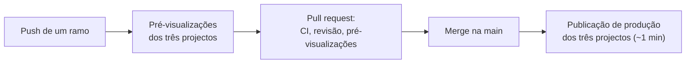
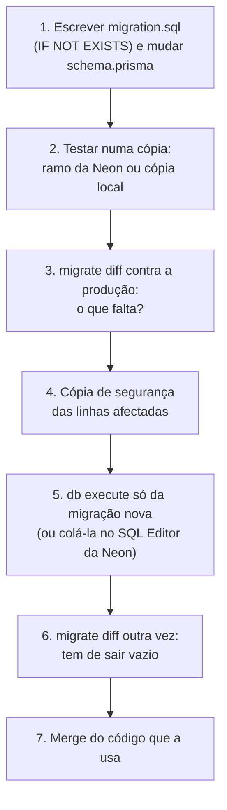

# Publicação

<!-- navegação: gerada por .github/scripts/docs-nav.py, não editar à mão -->
[Documentação](README.md) › 5. Pôr online › **Publicação** (página 19 de 25)

Anterior: [Painel de administração](painel-admin.md) · [Índice](README.md) · Seguinte: [Guia da Vercel](guia-vercel.md)

<details>
<summary>Todas as páginas</summary>

- 0. Começar do zero: [Conceitos básicos](conceitos.md) · [Preparar o computador](preparar-o-computador.md)
- 1. Conhecer o projecto: [Visão geral](visao-geral.md) · [Glossário](glossario.md) · [Fontes de dados](fontes-de-dados.md) · [Estado do projecto](estado-do-projecto.md)
- 2. Montar localmente: [Primeiros passos](primeiros-passos.md) · [Base de dados](base-de-dados.md) · [Configuração](configuracao.md)
- 3. Perceber como funciona: [Fluxos de dados](fluxos-de-dados.md) · [Localização e GPS](localizacao-gps.md) · [Serviço USSD](ussd.md) · [Segurança](seguranca.md) · [Referência da API](referencia-api.md) · [Mapa do código](mapa-do-codigo.md)
- 4. Usar as aplicações: [Aplicação dos passageiros](app-passageiros.md) · [Portal do motorista](portal-motorista.md) · [Painel de administração](painel-admin.md)
- 5. Pôr online: **Publicação** · [Guia da Vercel](guia-vercel.md) · [Guia da Neon](guia-neon.md) · [Africa's Talking](africas-talking.md)
- 6. Manter: [Testes](testes.md) · [Resolução de problemas](resolucao-de-problemas.md) · [Limitações](limitacoes.md)

</details>
<!-- /navegação -->

> **Em palavras simples:** Publicar é pôr uma versão nova a funcionar no site verdadeiro, para toda a gente. Aqui acontece sozinho: quando uma alteração é aceite no [GitHub](conceitos.md#github "O site onde o repositório está guardado e partilhado, e onde se revêem as alterações."), a [Vercel](conceitos.md#vercel "A empresa cujos servidores correm as três aplicações e as publicam a cada merge.") actualiza os três sites em poucos minutos. Esta página explica esse caminho, como confirmar que correu bem, e como voltar atrás.

As três aplicações correm na Vercel, um projecto cada, todos ligados ao [repositório](conceitos.md#repositorio "A pasta do projecto com todo o seu histórico no git.") do GitHub `transportmozambique/Transport-Mozambique`. Um push publica; não há um passo de lançamento à parte. A [base de dados](conceitos.md#base-de-dados "O sítio organizado onde a plataforma guarda tudo o que tem de durar: rotas, paragens, veículos, contas.") está na [Neon](conceitos.md#neon "A empresa que guarda a base de dados PostgreSQL da produção, na internet.") e muda-se à mão, com [SQL](conceitos.md#sql "A linguagem com que se fazem perguntas e alterações a uma base de dados.") que se pode correr mais de uma vez sem estragar nada, como se explica abaixo.

Porquê a Vercel e a Neon: as duas têm planos gratuitos que chegam para este projecto, nenhuma pede um [servidor](conceitos.md#servidor "Um computador sempre ligado que recebe pedidos e responde a eles.") para gerir, e a Vercel publica um projecto [Next.js](conceitos.md#nextjs "O Next.js é a 'estrutura' sobre a qual as três aplicações estão feitas; o React é a parte dele que desenha os ecrãs.") sem configuração ([Visão geral → Tecnologias e porquê](visao-geral.md#tecnologias-e-porquê)). Como criar cada conta e projecto, passo a passo: [Guia da Vercel](guia-vercel.md) e [Guia da Neon](guia-neon.md).

**Nesta página:** [Os três projectos](#os-três-projectos) · [Como uma alteração chega à produção](#como-uma-alteração-chega-à-produção) · [Compilações](#compilações) · [Alterações à base de dados em produção](#alterações-à-base-de-dados-em-produção) · [Confirmar uma publicação](#confirmar-uma-publicação) · [Voltar atrás](#voltar-atrás) · [Publicar à mão](#publicar-à-mão)

---

## Os três projectos

| Projecto da Vercel (equipa `transportmozambique`) | Root Directory | [URL](conceitos.md#url "O texto que diz ao navegador onde está uma página ou informação, como https://transport-mz.vercel.app/viagem.") de produção | [Variáveis de ambiente](conceitos.md#variavel-de-ambiente "Uma definição que se dá a um programa de fora do código, como o endereço da base de dados ou uma palavra-passe.") |
|---|---|---|---|
| `transport-mz` | `transport-client` | https://transport-mz.vercel.app | [aplicação dos passageiros](configuracao.md#transport-client-passageiros-ussd-api-do-motorista-gps) |
| `transport-mz-admin` | `transport-admin` | https://transport-mz-admin.vercel.app | [painel](configuracao.md#transport-admin-painel-de-administração) |
| `transport-mz-driver` | `transport-driver` | https://transport-mz-driver.vercel.app | [portal do motorista](configuracao.md#transport-driver-portal-do-motorista) |

Os três usam a predefinição Next.js com os comandos de origem ([`npm install`](conceitos.md#npm "O npm descarrega e instala os pacotes (código feito por outros) de que cada aplicação precisa."), `npm run build`) e [Node.js](conceitos.md#nodejs "O programa que corre JavaScript fora do navegador, num computador ou num servidor.") 24.x. As funções correm na região `iad1` da Vercel (Washington, D.C.), perto da base de dados da Neon em `us-east-2` (Ohio). Porquê essa região: cada pedido faz várias consultas, e a distância entre a função e a base de dados conta em cada uma; a distância ao telemóvel conta uma só vez.

**Trabalho agendado.** [`.github/workflows/arrival-check.yml`](../.github/workflows/arrival-check.yml) chama `POST https://transport-mz.vercel.app/api/simulation {"action":"check"}` a cada 5 minutos a partir do [GitHub Actions](conceitos.md#ci "Verificações que o GitHub corre sozinho a cada pull request, para nenhum erro conhecido chegar ao main."), para os [SMS](conceitos.md#sms "As mensagens de texto curtas dos telemóveis.") de chegada saírem mesmo sem tráfego na web ([Fluxos de dados → Alerta de chegada](fluxos-de-dados.md#alerta-de-chegada-e-sms)). Porquê o GitHub: o plano Hobby da Vercel só permite [cron jobs](conceitos.md#agendamento "Uma tarefa que corre sozinha a uma hora marcada, ou de tantos em tantos minutos.") uma vez por dia. As execuções estão no separador Actions do repositório → "Verificação de chegadas (SMS)", onde "Run workflow" também corre uma à mão. O GitHub suspende os agendamentos depois de 60 dias sem actividade no repositório; "Enable workflow" na mesma página liga-o outra vez.

## Como uma alteração chega à produção



1. **[Ramo](conceitos.md#ramo "Uma linha de trabalho separada, onde se fazem mudanças sem tocar na versão principal.").** Cada push para qualquer ramo compila uma **pré-visualização** de cada um dos três projectos, com o seu URL (`transport-<hash>-transportmozambique.vercel.app`, e um nome fixo `…-git-<ramo>-…`). A Vercel liga-as a partir do [pull request](conceitos.md#pull-request "Um pull request é o pedido para juntar um ramo ao main; o merge é a junção, quando o pedido é aceite.").
2. **Rever** a alteração nas pré-visualizações. As pré-visualizações usam as variáveis do ambiente **Preview**: a pré-visualização da aplicação dos passageiros não tem chave da [Africa's Talking](conceitos.md#africas-talking "O gateway de USSD e SMS usado por este projecto.") (sem SMS), e o seu `DATABASE_URL` é um valor sensível à parte; confirmar a que base de dados aponta antes de testar algo que escreva ([Configuração → Onde estão os valores](configuracao.md#onde-estão-os-valores)).
3. **Verificações.** O CI do GitHub verifica os tipos das três aplicações, compara os três [esquemas](conceitos.md#migracao "O esquema é a lista das tabelas e colunas; uma migração é uma alteração a essa lista, escrita em SQL para se poder repetir.") e confirma as ligações e a navegação da documentação ([Testes → CI no GitHub](testes.md#ci-no-github)). Faz-se merge quando estas e as três pré-visualizações da Vercel estão verdes.
4. **Merge na `main`.** Cada projecto compila uma [publicação](conceitos.md#publicacao "Pôr uma versão nova do código a funcionar nos servidores, ao vivo, para toda a gente.") de **produção** e passa o domínio de produção para ela quando a compilação dá certo. As compilações demoram 30 a 60 s.

Cada push compila os três projectos, mesmo que só a pasta de uma aplicação tenha mudado. No plano Hobby há um limite de publicações por dia: muitos pushes seguidos são recusados ("rate limited") até passar algum tempo, por isso juntam-se as alterações num só push quando possível.

O portal do motorista lê `NEXT_PUBLIC_API_URL` na compilação. Uma pré-visualização do portal fala por isso com o que essa variável diz para as pré-visualizações, normalmente a aplicação dos passageiros de produção, e não a pré-visualização da aplicação dos passageiros do mesmo ramo.

## Compilações

| Projecto | `npm run build` | Notas |
|---|---|---|
| `transport-mz` | `prisma generate && next build` | `postinstall` também corre `prisma generate`. |
| `transport-mz-admin` | `prisma generate && next build` com `NODE_OPTIONS=--max-old-space-size=4096` | Precisa de `DATABASE_URL` na compilação: o Next.js avalia os módulos da [API](conceitos.md#api "Uma API é a lista de pedidos que um servidor aceita de outros programas; cada um desses pedidos, com o seu endereço, é um endpoint.") ao recolher os dados das páginas, e o cliente [Prisma](conceitos.md#prisma "A ferramenta com que o código fala com a base de dados sem escrever SQL à mão.") recusa um URL indefinido ("Invalid value undefined for datasource \"db\""). |
| `transport-mz-driver` | `next build` | Páginas estáticas; sem base de dados. |

A mesma compilação corre-se localmente antes do push, para apanhar erros de tipos, que fazem falhar a compilação da Vercel:

```bash
cd transport-admin && npx tsc --noEmit && npm run build
```

## Alterações à base de dados em produção

A base de dados de produção foi criada com `prisma db push` e à mão, por isso **não tem a tabela `_prisma_migrations`**. `prisma migrate status` lista todas as migrações como por aplicar, e **`prisma migrate deploy` tentaria criar outra vez as tabelas que já existem. Nunca se corre contra a produção.** Os ficheiros de migração em [`prisma/migrations`](../prisma/migrations) estão escritos para se poderem correr mais de uma vez (`IF NOT EXISTS`) e aplicam-se um a um:



1. Escrever a migração em `prisma/migrations/<data>_<nome>/migration.sql`, de forma idempotente, e mudar `prisma/schema.prisma` (depois copiar o esquema para `transport-client/prisma/schema.prisma`; a cópia do painel só difere no bloco `generator`; o CI confirma, [Base de dados → Alterações ao esquema](base-de-dados.md#alterações-ao-esquema-e-migrações)).
2. Testá-la numa cópia da produção: um ramo da Neon ou uma cópia local ([Primeiros passos → Cópia dos dados de produção](primeiros-passos.md#trabalhar-com-uma-cópia-dos-dados-de-produção)).
3. Ver o que falta na produção, com o endereço **directo** (o `DATABASE_URL` sem `-pooler`):

   ```bash
   cd transport-client
   npx prisma migrate diff --from-url "$PROD_DIRECT_URL" --to-schema-datamodel ../prisma/schema.prisma --script
   ```

4. Guardar uma cópia das linhas que a alteração vai mudar (por exemplo `CREATE TABLE "Via_copia_20261018" AS SELECT * FROM "Via";`, ou um `pg_dump` da tabela).
5. Aplicar só a migração nova:

   ```bash
   npx prisma db execute --url "$PROD_DIRECT_URL" --file ../prisma/migrations/<data>_<nome>/migration.sql
   ```

   Ou colar o SQL no SQL Editor da Neon ([Guia da Neon → Colar uma consulta e corrê-la](guia-neon.md#3-colar-uma-consulta-e-corrê-la)).
6. Correr o diff outra vez. Tem de sair uma migração vazia.
7. Fazer o merge do código que usa a alteração.

**A ordem com a publicação do código.** O Prisma lê todas as colunas de um modelo por omissão, por isso um código que conhece uma coluna nova falha numa base de dados sem ela. As alterações que **juntam** (tabelas novas, colunas que aceitam nulo, colunas com valor por omissão) aplicam-se **antes** do merge do código que as usa. As que **tiram** aplicam-se depois de o código que deixou de as usar estar em produção.

O URL fica fora do histórico da shell e dos [registos](conceitos.md#registos "As linhas de texto que um programa escreve sobre o que está a fazer, para se perceber depois o que aconteceu."): tira-se com `vercel env pull` para um ficheiro ignorado pelo [git](conceitos.md#git "O programa que guarda o histórico de todas as versões do código, e quem mudou o quê e quando.") e lê-se de lá.

## Confirmar uma publicação

**Estado e registos.**

```bash
vercel ls transport-mz                     # publicações recentes, a mais nova primeiro
vercel inspect <url da publicação>         # destino, nomes, resultado da compilação
vercel logs <url da publicação>            # registos das funções (pedidos USSD, resultados dos SMS, erros)
```

O mesmo está no painel da Vercel em **Deployments** e **Logs** de cada projecto ([Guia da Vercel → Registos](guia-vercel.md#registos)).

**Teste rápido depois de uma publicação de produção** (só lê):

```bash
curl -s https://transport-mz.vercel.app/api/simulation                       # {"success":true,"status":{"mode":"gps-or-driver-trip","busCount":…}}
curl -s "https://transport-mz.vercel.app/api/buses?fields=position" | head -c 200
curl -s -o /dev/null -w "%{http_code}\n" -X POST https://transport-mz.vercel.app/api/ussd \
  -d "sessionId=g&serviceCode=*384*848080%23&phoneNumber=%2B258840000009&text="   # 403 (a guarda do callback está activa)
curl -s -o /dev/null -w "%{http_code}\n" https://transport-mz-admin.vercel.app/api/transportes   # 401 (precisa de sessão)
curl -s -o /dev/null -w "%{http_code}\n" https://transport-mz-driver.vercel.app/                 # 200
```

Depois, abrir cada aplicação num [navegador](conceitos.md#navegador "O programa com que se abrem sites: Chrome, Firefox, Edge, Safari."): o mapa ao vivo, uma entrada no painel, uma entrada de motorista com PIN, e o menu principal no simulador da Africa's Talking ([Africa's Talking → Usar o menu no simulador](africas-talking.md#usar-o-menu-no-simulador)).

## Voltar atrás

A Vercel guarda todas as publicações. Para pôr uma anterior outra vez no domínio de produção:

- **Painel da Vercel:** projecto → Deployments → a última publicação de produção boa → "Instant Rollback" (ou "Promote to Production").
- **CLI:** `vercel rollback <url da publicação>`.

Voltar atrás só muda o código. As alterações à base de dados ficam, por isso só se volta a uma versão do código que funcione com o esquema actual, ou desfaz-se o esquema com uma nova migração idempotente. Voltar atrás não mexe na `main`: o [commit](conceitos.md#commit "Uma fotografia guardada do código num momento, com uma frase a dizer o que mudou.") mau também se reverte no GitHub, senão o merge seguinte publica-o outra vez.

## Publicar à mão

Normalmente não é preciso: os pushes publicam. Para publicar outra vez sem mudar o código (por exemplo depois de mudar uma variável de ambiente, que só se aplica às publicações novas), usa-se "Redeploy" na publicação de produção actual, no painel da Vercel, ou:

```bash
vercel redeploy <url da publicação de produção>
```

<!-- navegação-fim: gerada por .github/scripts/docs-nav.py -->

---

Anterior: [Painel de administração](painel-admin.md) · [Índice](README.md) · Seguinte: [Guia da Vercel](guia-vercel.md)
<!-- /navegação-fim -->
