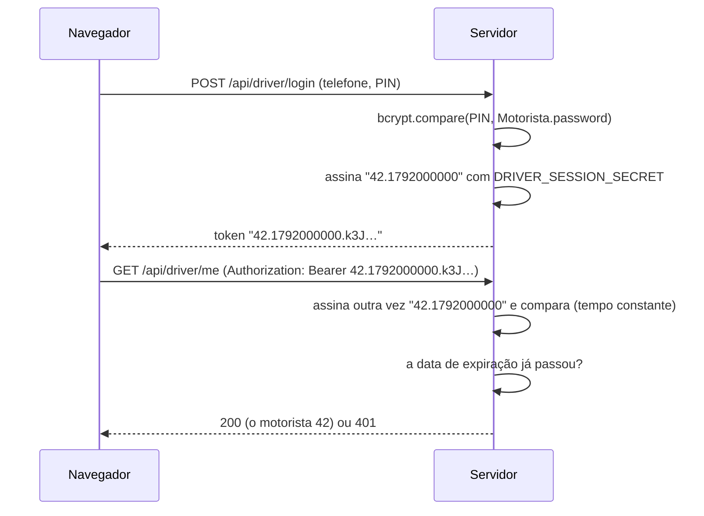

# Segurança

<!-- navegação: gerada por .github/scripts/docs-nav.py, não editar à mão -->
[Documentação](README.md) › 3. Perceber como funciona › **Segurança** (página 11 de 23)

Anterior: [Serviço USSD](ussd.md) · [Índice](README.md) · Seguinte: [Referência da API](referencia-api.md)

<details>
<summary>Todas as páginas</summary>

- 1. Conhecer o projecto: [Visão geral](visao-geral.md) · [Glossário](glossario.md) · [Fontes de dados](fontes-de-dados.md) · [Estado do projecto](estado-do-projecto.md)
- 2. Montar localmente: [Primeiros passos](primeiros-passos.md) · [Base de dados](base-de-dados.md) · [Configuração](configuracao.md)
- 3. Perceber como funciona: [Fluxos de dados](fluxos-de-dados.md) · [Localização e GPS](localizacao-gps.md) · [Serviço USSD](ussd.md) · **Segurança** · [Referência da API](referencia-api.md) · [Mapa do código](mapa-do-codigo.md)
- 4. Usar as aplicações: [Aplicação dos passageiros](app-passageiros.md) · [Portal do motorista](portal-motorista.md) · [Painel de administração](painel-admin.md)
- 5. Pôr online: [Publicação](publicacao.md) · [Guia da Vercel](guia-vercel.md) · [Guia da Neon](guia-neon.md) · [Africa's Talking](africas-talking.md)
- 6. Manter: [Testes](testes.md) · [Resolução de problemas](resolucao-de-problemas.md) · [Limitações](limitacoes.md)

</details>
<!-- /navegação -->

Como cada tipo de utilizador e de aparelho prova quem é, o que fica guardado e de que forma, que endpoints respondem a qualquer pessoa, como mudar cada segredo, e as falhas que ainda estão abertas.

**Nesta página:** [Resumo](#resumo) · [Sessões assinadas](#sessões-assinadas) · [Painel de administração](#painel-de-administração) · [Passageiros](#passageiros) · [Motoristas](#motoristas) · [Dispositivos GPS](#dispositivos-gps) · [Resposta USSD (callback)](#resposta-ussd-callback) · [Endpoints públicos](#endpoints-públicos) · [Segredos e dados pessoais guardados](#segredos-e-dados-pessoais-guardados) · [Mudar segredos](#mudar-segredos) · [Falhas conhecidas](#falhas-conhecidas)

---

## Resumo

| Quem | Prova quem é com | Recebe | Dura | Verificado em |
|---|---|---|---|---|
| Administrador | email + palavra-passe | cookie `admin_session` (`HttpOnly`, `SameSite=Lax`, `Secure` em produção) | 12 horas | [`transport-admin/proxy.ts`](../transport-admin/proxy.ts), em cada `/api/*` |
| Passageiro (web) | telefone + palavra-passe | token Bearer | 90 dias | cada rota `/api/user/*` ([`lib/userSession.ts`](../transport-client/lib/userSession.ts)) |
| Motorista (portal) | telefone + PIN de 6 algarismos | token Bearer | 30 dias | `/api/driver/me`, `/api/driver/trip`, `/api/driver/seguidores` ([`lib/driverSession.ts`](../transport-client/lib/driverSession.ts)) |
| Motorista (USSD, opção 6) | o número que liga + PIN, em cada pedido | nada (o USSD não guarda sessão) | uma sessão USSD | `/api/ussd` |
| Dispositivo GPS | o seu código de dispositivo | nada (vai com cada posição) | até ser revogado | [`/api/gps`](../transport-client/app/api/gps/route.ts) |
| Africa's Talking | a chave no URL do callback ([abaixo](#resposta-ussd-callback)) | | | `/api/ussd` |

## Sessões assinadas

As três sessões (administrador, passageiro, motorista) são **tokens assinados, não linhas na base de dados**:

```text
<id>.<expira-em>.<assinatura HMAC-SHA256 de "id.expira-em">
```



O servidor refaz a assinatura com o segredo, compara-a com a recebida sem que o tempo dependa do valor (`timingSafeEqual`), e verifica a data. Código: [`transport-client/lib/signedToken.ts`](../transport-client/lib/signedToken.ts) e [`transport-admin/lib/adminSession.ts`](../transport-admin/lib/adminSession.ts).

Porquê assim: as funções da Vercel não guardam nada entre pedidos, e uma tabela de sessões custaria uma consulta à base de dados em cada pedido. Um token assinado verifica-se só com o segredo. O preço é não se poder terminar uma sessão sozinha ([Falhas conhecidas](#falhas-conhecidas)): para as terminar todas, muda-se o segredo.

Cada tipo de sessão tem o seu segredo, para um segredo descoberto não abrir as outras portas:

| Segredo | Aplicação | Sem ele, em produção |
|---|---|---|
| `ADMIN_SESSION_SECRET` | painel | entrar responde 500 e todos os `/api/*` respondem 401 |
| `USER_SESSION_SECRET` | passageiros | registo e entrada respondem 500; `/api/user/*` responde 401 |
| `DRIVER_SESSION_SECRET` | passageiros | a entrada do motorista responde 500; os endpoints do motorista respondem 401 |

Um segredo em falta **fecha a porta** em produção. Em desenvolvimento usa-se uma chave fixa só de desenvolvimento, para uma instalação local funcionar sem eles ([Configuração](configuracao.md)).

## Painel de administração

- As palavras-passe guardam-se como hashes bcrypt (`Administrador.senha`, custo 10). Nenhuma API as devolve: os endpoints dos administradores escolhem os campos um a um.
- [`proxy.ts`](../transport-admin/proxy.ts) guarda só `/api/*`. As páginas são código estático do navegador que nada mostra sem a API, e a aplicação sai da conta em qualquer 401. Porquê só a API: os dados estão todos na API, e as páginas sem dados não revelam nada.
- O primeiro administrador cria-se com `node create-admin.js` ([`transport-admin/create-admin.js`](../transport-admin/create-admin.js)), que pergunta a palavra-passe (pelo menos 10 caracteres) sem a mostrar no ecrã. A página "Administradores" aceita 6 caracteres.
- Todos os administradores têm os mesmos direitos; não há papéis.
- O cliente Prisma do painel ([`transport-admin/lib/prisma.ts`](../transport-admin/lib/prisma.ts)) deixa `Motorista.password` (o hash do PIN) de fora de todas as consultas; só a rota do PIN o lê, pedindo-o explicitamente. Porquê: assim nenhuma lista de motoristas o pode enviar por engano.

## Passageiros

- O registo (`POST /api/auth/register`) guarda um hash bcrypt da palavra-passe (pelo menos 6 caracteres). A entrada (`POST /api/auth/login`) devolve um token válido 90 dias, guardado no `localStorage['utente']` do navegador ([Aplicação dos passageiros → Conta e entrada](app-passageiros.md#conta-e-entrada)).
- Cada endpoint `/api/user/*` lê o id do passageiro do token e só age sobre esse passageiro: um id de perfil ou um `utenteId` que não seja o do token responde 401, e um alerta de outra pessoa responde 404.
- **Os números de telefone não são verificados.** Não há código por SMS no registo. Quem souber um número que só foi usado no USSD pode registar-se com ele e ficar com essa conta sem palavra-passe, incluindo os alertas ([Falhas conhecidas](#falhas-conhecidas)).
- O USSD cria passageiros com a palavra-passe provisória `temp`, que não é um hash bcrypt, e por isso a entrada recusa-a ("Este número ainda não tem senha").

## Motoristas

- Os motoristas nunca escolhem um segredo. O administrador gera um **PIN de 6 algarismos** com `crypto.randomInt` ([`app/api/motoristas/[id]/pin/route.ts`](../transport-admin/app/api/motoristas/[id]/pin/route.ts)) e vê-o uma só vez; `Motorista.password` guarda só o seu hash bcrypt. "Gerar novo PIN" substitui-o, e o PIN antigo deixa logo de funcionar ([Painel → Dar um PIN a um motorista](painel-admin.md#tarefa-pin)). Porquê gerado: um PIN escolhido pela pessoa é muitas vezes uma data de nascimento ou "123456".
- O portal envia telefone + PIN para `POST /api/driver/login` e recebe um token válido 30 dias. Um PIN novo **não** termina as sessões já abertas com o antigo; para terminar todas as sessões de motoristas, muda-se `DRIVER_SESSION_SECRET` ([Mudar segredos](#mudar-segredos)).
- No USSD, a opção 6 pede o PIN em todas as sessões e confia no número que liga. O PIN aparece como `***` nos registos.
- Os endpoints do motorista respondem `Access-Control-Allow-Origin: *` porque o portal está noutro domínio. Aqui é seguro porque se autenticam com um token Bearer, não com um cookie: outro site não consegue enviar o token do motorista.
- O token de um motorista deixa-o ler o seu perfil, veículo e rota, começar e terminar a viagem, e contar os passageiros à espera. Não deixa enviar posições GPS (isso precisa do código do dispositivo) nem ler dados de outras pessoas.

## Dispositivos GPS

- Cada veículo pode ter um código de dispositivo: 20 caracteres, 120 bits aleatórios ([`app/api/transportes/[id]/gps/route.ts`](../transport-admin/app/api/transportes/[id]/gps/route.ts)). Só se guarda o seu SHA-256 (`Transporte.gpsDispositivoHash`). Porquê SHA-256 e não bcrypt: bcrypt é lento de propósito para palavras-passe que se podem adivinhar; um segredo aleatório de 120 bits não se adivinha, e o servidor recebe uma posição a cada poucos segundos.
- Quem tiver o código pode pôr a posição do veículo para os passageiros. Trata-se como uma palavra-passe; "Gerar novo código" ou "Revogar dispositivo" corta logo um código que tenha escapado ([Painel → Ligar um GPS](painel-admin.md#tarefa-gps)).
- `/api/gps` responde `Access-Control-Allow-Origin: *` para o portal do motorista poder enviar a partir do navegador ([Localização e GPS](localizacao-gps.md)).

## Resposta USSD (callback)

A Africa's Talking não assina os pedidos que envia, e `/api/ussd` é um URL público. Os menus confiam no campo `phoneNumber`: os resultados vão para ele por SMS, a opção 1 cria um passageiro e um alerta para ele, e a opção 6 faz entrar um motorista por ele. Sem uma verificação, qualquer pessoa podia enviar pedidos com o número de outra.

Por isso, em `transport-mz` define-se **`USSD_CALLBACK_KEY`** com um valor aleatório, e o callback regista-se com ele:

```text
https://transport-mz.vercel.app/api/ussd?key=<USSD_CALLBACK_KEY>
```

Os pedidos sem a chave certa recebem `403 Forbidden` e ficam registados como "USSD pedido recusado". A comparação é feita em tempo constante (`callbackAllowed` em [`app/api/ussd/route.ts`](../transport-client/app/api/ussd/route.ts)). Porquê uma chave no URL: é a única coisa que a Africa's Talking deixa configurar no callback (não envia cabeçalhos próprios nem assinaturas).

O preço: a chave faz parte do URL, e os detalhes de um pedido na Vercel mostram-na a quem puder ler os registos de `transport-mz` ([Guia da Vercel → Registos](guia-vercel.md#registos)). Sem a variável, o endpoint responde a todos (assim foi até 2026-10-17). A variável e o URL do callback na Africa's Talking mudam-se juntos, seguidos de uma nova publicação ([Mudar segredos](#mudar-segredos)).

Para confirmar que a guarda está activa, um pedido sem chave tem de dar 403:

```bash
curl -s -o /dev/null -w "%{http_code}" -X POST https://transport-mz.vercel.app/api/ussd \
  -d "sessionId=g&serviceCode=*384*848080%23&phoneNumber=%2B258840000009&text="
# 403
```

A rota antiga `/api/ussd-telerivet` (de um gateway que já não se usa) tem o mesmo tipo de verificação com `TELERIVET_SECRET`.

## Endpoints públicos

Endpoints que respondem sem nenhuma credencial, de propósito:

| Endpoint | Mostra ou faz |
|---|---|
| `/api/startup`, `/api/simulation` (`GET`) | contagens de autocarros e da última verificação de chegadas |
| `POST /api/simulation {"action":"check"}` | corre já a verificação de chegadas; só saem os SMS que estão na hora |
| `/api/stops`, `/api/stops/{id}`, `/api/destinos`, `/api/journeys`, `/api/viagem`, `/api/buses`, `/api/bus/{id}` | a rede (rotas, paragens, percursos), viagens entre paragens, e posições, matrículas e tarifas dos veículos ([Referência da API](referencia-api.md)) |
| `/api/walk` | um caminho a pé pelas ruas entre dois pontos |
| `POST /api/auth/register`, `/api/auth/login`, `/api/driver/login` | entrar |
| `/api/ussd` | os menus USSD (com a [chave do callback](#resposta-ussd-callback)) |

Porquê públicos: a informação de transportes é para toda a gente, e pedir conta para ver um horário afastaria passageiros.

**A posição do passageiro.** Uma posição enviada a estes endpoints não se guarda na base de dados. A aplicação web envia-a a `/api/journeys` e `/api/viagem` no corpo de um `POST`, que a Vercel não regista. `/api/destinos` ainda a recebe no URL, arredondada pela página a 3 casas decimais (cerca de 110 m), e esse ponto arredondado aparece nos registos dos pedidos. `/api/walk` recebe os pontos arredondados a cerca de 45 m pela página e a 11 m pelo servidor, e passa-os ao router da FOSSGIS (`routing.openstreetmap.de`) a partir do servidor, de forma que a FOSSGIS vê o servidor e não o passageiro. Esses pontos também ficam nos registos, e a CDN guarda a resposta uma semana para quem pedir os mesmos pontos ([Fontes de dados](fontes-de-dados.md)).

Nenhum endpoint público devolve dados pessoais de passageiros ou motoristas.

A aplicação antiga da raiz do repositório (`app/`, não publicada) tem endpoints de administração sem autenticação. Nunca deve ser publicada assim ([Limitações](limitacoes.md)).

## Segredos e dados pessoais guardados

| Dado | Guardado como |
|---|---|
| Palavras-passe dos administradores | bcrypt (`Administrador.senha`) |
| Palavras-passe dos passageiros | bcrypt (`Utente.senha`); `temp` nas contas só de USSD |
| PIN dos motoristas | bcrypt (`Motorista.password`) |
| Códigos dos dispositivos GPS | SHA-256 (`Transporte.gpsDispositivoHash`) |
| Tokens de sessão | não se guardam; são assinados |
| Segredos do ambiente | variáveis de ambiente da Vercel (as de tipo Secret não se podem ler de volta); ficheiros `.env` locais, ignorados pelo git |

Dados pessoais na base de dados: nomes, emails, telefones e paragens de espera (`MISSION`) dos passageiros; nomes, números de BI e de carta, datas de nascimento, moradas, telefones e contactos de emergência dos motoristas; números de BI e contactos dos proprietários. As cópias da base de dados e as capturas de ecrã do painel levam estes dados: ficam fora de pastas partilhadas, e os dados de pessoas reais desfocam-se antes de publicar uma captura. (As pessoas nas capturas desta documentação são registos de demonstração da importação inicial ou contas de teste locais.)

## Mudar segredos

Cada segredo muda-se em passos, por esta ordem. "Publicar outra vez" quer dizer fazer um novo deploy do projecto na Vercel, porque as variáveis de ambiente só se lêem no arranque ([Guia da Vercel → Variáveis de ambiente](guia-vercel.md#variáveis-de-ambiente)).

| Segredo | Passos | Efeito |
|---|---|---|
| `ADMIN_SESSION_SECRET`, `USER_SESSION_SECRET`, `DRIVER_SESSION_SECRET` | 1. Gerar um valor novo: `openssl rand -base64 32`. 2. Pô-lo no projecto da Vercel, em Production e Preview, como variável de tipo **Secret** ([Guia da Vercel → Variáveis de ambiente](guia-vercel.md#variáveis-de-ambiente)). 3. Publicar outra vez. | Todas as sessões desse tipo terminam e as pessoas entram outra vez. É a forma de terminar todas as sessões de uma vez. |
| `AFRICASTALKING_API_KEY` | 1. Gerar uma chave nova na Africa's Talking (a antiga deixa de funcionar). 2. Pô-la em `transport-mz`. 3. Publicar outra vez. | Os SMS falham entre os passos 1 e 3; o USSD continua. Uma chave nova pode demorar alguns minutos a ser aceite. |
| `USSD_CALLBACK_KEY` | 1. Gerar um valor novo. 2. Pô-lo em `transport-mz` e publicar outra vez. 3. Mudar o URL do callback na Africa's Talking ([Africa's Talking](africas-talking.md)). 4. Confirmar o 403 sem chave (acima) e um menu no simulador. | O USSD responde 403 até as duas estarem iguais. |
| Palavra-passe da base de dados | 1. Neon → Roles → repor a palavra-passe ([Guia da Neon](guia-neon.md)). 2. Actualizar `DATABASE_URL` nos três projectos (Production e Preview) e nos `.env` locais. 3. Publicar outra vez os três. | Tudo falha até o URL novo estar publicado; faz-se a uma hora calma. |
| O PIN de um motorista | "Gerar novo PIN" no painel | O PIN antigo deixa de funcionar; as sessões abertas no portal continuam (muda-se `DRIVER_SESSION_SECRET` para as terminar). |
| O código de um dispositivo GPS | "Gerar novo código" ou "Revogar dispositivo" no painel | O código antigo recebe logo 401. |

As chaves de contas que já não se usam (por exemplo, uma conta antiga da Africa's Talking) revogam-se.

## Falhas conhecidas

| Falha | Risco | Correcção possível |
|---|---|---|
| Sem limite de tentativas de entrada (administradores, passageiros, motoristas) | Um PIN de 6 algarismos tem um milhão de valores; quem souber o telefone de um motorista pode experimentá-los em `/api/driver/login` | Contar as falhas por conta e bloquear algum tempo depois de algumas (precisa de uma tabela), ou pôr as rotas de entrada atrás de um limitador de pedidos |
| Os números de telefone não são verificados | Ficar com a conta de um passageiro só de USSD; registar-se com o número de outra pessoa | Código de uma só vez por SMS no registo |
| As sessões não se terminam uma a uma | Um token que escape funciona até expirar (até 90 dias nos passageiros) | Guardar uma versão de sessão por conta e verificá-la |
| A chave do callback USSD viaja no URL (definida desde 2026-10-17) | Quem puder ler os registos de pedidos de `transport-mz` vê-a, e pode usar os menus com qualquer número | Dar acesso aos registos só a quem a pode saber; mudá-la com o URL do callback se escapar ([acima](#resposta-ussd-callback)) |
| `USER_SESSION_SECRET` e `DRIVER_SESSION_SECRET` estão como variáveis normais na Vercel | Os membros do projecto podem lê-los e forjar sessões de passageiros ou motoristas | Guardá-los outra vez como Secret com valores novos ([Mudar segredos](#mudar-segredos)); todos entram outra vez uma vez |
| Sem papéis no painel | Qualquer administrador pode gerir administradores | Papéis em `Administrador` |
| `POST /api/simulation` é público | Qualquer pessoa pode correr a verificação de chegadas (só envia os SMS que estão na hora) | Pedir um segredo, ou retirar a acção |

<!-- navegação-fim: gerada por .github/scripts/docs-nav.py -->

---

Anterior: [Serviço USSD](ussd.md) · [Índice](README.md) · Seguinte: [Referência da API](referencia-api.md)
<!-- /navegação-fim -->
