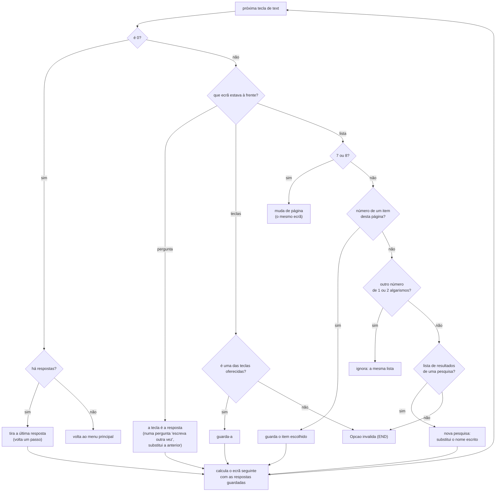
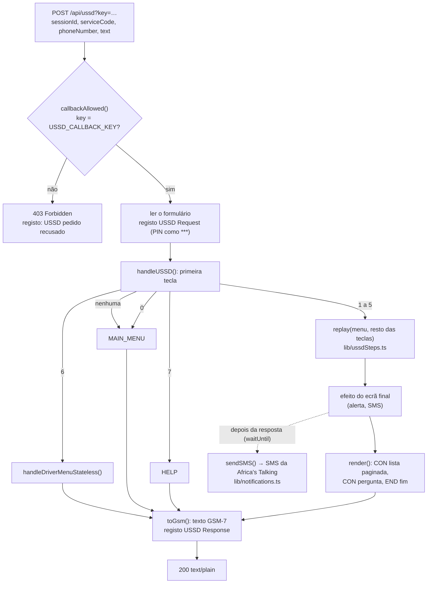
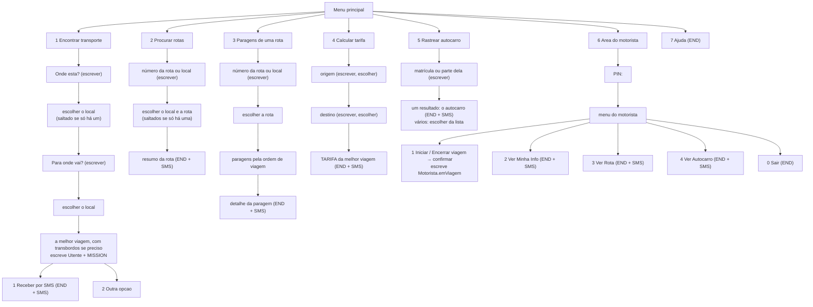

# Serviço USSD

<!-- navegação: gerada por .github/scripts/docs-nav.py, não editar à mão -->
[Documentação](README.md) › 3. Perceber como funciona › **Serviço USSD** (página 12 de 25)

Anterior: [Localização e GPS](localizacao-gps.md) · [Índice](README.md) · Seguinte: [Segurança](seguranca.md)

<details>
<summary>Todas as páginas</summary>

- 0. Começar do zero: [Conceitos básicos](conceitos.md) · [Preparar o computador](preparar-o-computador.md)
- 1. Conhecer o projecto: [Visão geral](visao-geral.md) · [Glossário](glossario.md) · [Fontes de dados](fontes-de-dados.md) · [Estado do projecto](estado-do-projecto.md)
- 2. Montar localmente: [Primeiros passos](primeiros-passos.md) · [Base de dados](base-de-dados.md) · [Configuração](configuracao.md)
- 3. Perceber como funciona: [Fluxos de dados](fluxos-de-dados.md) · [Localização e GPS](localizacao-gps.md) · **Serviço USSD** · [Segurança](seguranca.md) · [Referência da API](referencia-api.md) · [Mapa do código](mapa-do-codigo.md)
- 4. Usar as aplicações: [Aplicação dos passageiros](app-passageiros.md) · [Portal do motorista](portal-motorista.md) · [Painel de administração](painel-admin.md)
- 5. Pôr online: [Publicação](publicacao.md) · [Guia da Vercel](guia-vercel.md) · [Guia da Neon](guia-neon.md) · [Africa's Talking](africas-talking.md)
- 6. Manter: [Testes](testes.md) · [Resolução de problemas](resolucao-de-problemas.md) · [Limitações](limitacoes.md)

</details>
<!-- /navegação -->

> **Em palavras simples:** O [USSD](conceitos.md#ussd "Os menus que aparecem num telemóvel quando se marca um código como *384*848080#; funcionam em qualquer telemóvel, sem internet.") é o menu que aparece num telemóvel simples quando se marca um código como `*384*848080#`, como o do saldo. Com ele, qualquer pessoa procura autocarros sem [internet](conceitos.md#internet "A rede que liga milhões de computadores e telemóveis, por onde passam os pedidos e as respostas."). Esta página mostra todos os ecrãs do menu, e explica o que acontece entre a tecla carregada e o ecrã seguinte.

O USSD leva a plataforma a qualquer telemóvel, sem dados nem aplicação. O passageiro marca um código curto, e o [gateway](conceitos.md#gateway "A empresa que faz a ponte entre as redes dos telemóveis (Vodacom, Movitel, Tmcel) e a internet.") do operador ([Africa's Talking](conceitos.md#africas-talking "O gateway de USSD e SMS usado por este projecto.")) passa cada tecla para `POST /api/ussd` da aplicação dos passageiros, que responde com o ecrã seguinte. O serviço está em português sem acentos ([GSM-7](conceitos.md#gsm-7 "O conjunto de letras que todos os telemóveis mostram nos SMS e no USSD; não tem a maior parte das letras acentuadas.")), e cada ecrã cabe em 182 caracteres. Esta página explica o caminho de um pedido, **como se lê cada tecla**, como a pesquisa aceita nomes mal escritos, e mostra todos os ecrãs.

| | |
|---|---|
| Código (sandbox) | `*384*848080#`, marcado no [simulador da Africa's Talking](africas-talking.md#usar-o-menu-no-simulador) |
| [URL](conceitos.md#url "O texto que diz ao navegador onde está uma página ou informação, como https://transport-mz.vercel.app/viagem.") de resposta ([callback](conceitos.md#callback "Um endereço que se dá a outro serviço para ele chamar sempre que algo acontece.")) | `https://transport-mz.vercel.app/api/ussd?key=…` |
| Código | [`app/api/ussd/route.ts`](../transport-client/app/api/ussd/route.ts) (menus) e [`lib/ussdSteps.ts`](../transport-client/lib/ussdSteps.ts) (leitura das teclas) |
| Pesquisa de nomes | [`lib/places.ts`](../transport-client/lib/places.ts) (`searchPlaces`, `matchScore`) |
| Configuração e simulador | [Africa's Talking, passo a passo](africas-talking.md#como-foi-configurado-passo-a-passo) |
| Ao vivo (telemóveis reais) | ainda não: precisa de um canal USSD de produção da Africa's Talking ([Passar a produção](africas-talking.md#passar-a-produção)) |

**Nesta página:** [O caminho de um pedido](#o-caminho-de-um-pedido) · [Leitura das teclas](#leitura-das-teclas) · [Pesquisa tolerante](#pesquisa-tolerante) · [Dentro do handler](#dentro-do-handler) · [Porque é assim](#porque-é-que-o-menu-é-assim) · [Árvore dos menus](#árvore-dos-menus) · [1 Encontrar transporte](#1-encontrar-transporte) · [2 Procurar rotas](#2-procurar-rotas) · [3 Paragens de uma rota](#3-paragens-de-uma-rota) · [4 Calcular tarifa](#4-calcular-tarifa) · [5 Rastrear autocarro](#5-rastrear-autocarro) · [6 Área do motorista](#6-área-do-motorista) · [7 Ajuda](#7-ajuda) · [Erros](#erros) · [Testar](#testar)


---

## O caminho de um pedido

O USSD não é a internet: a [sessão](conceitos.md#sessao "Depois de entrar, o servidor dá uma prova de quem se é (um token), e o navegador mostra-a a cada pedido para não ter de pedir a palavra-passe outra vez.") vive na rede do operador. A Africa's Talking liga essa sessão à aplicação por [HTTP](conceitos.md#http "A forma combinada como o navegador (ou outro programa) pede algo a um servidor, e como o servidor responde."), um pedido por tecla.

```mermaid
sequenceDiagram
  autonumber
  participant P as Telemóvel
  participant O as Rede do operador
  participant AT as Africa's Talking
  participant V as Vercel (transport-mz)
  participant H as /api/ussd
  participant DB as Neon
  P->>O: marca *384*848080#
  O->>AT: sessão USSD aberta
  AT->>V: POST /api/ussd?key=… (sessionId, serviceCode, phoneNumber, text="")
  V->>H: arranca a função (ou reutiliza uma quente)
  H->>H: confirma a chave; lê o formulário
  H-->>AT: "CON Transportes Mocambique …"
  AT-->>P: mostra o ecrã e espera
  P->>AT: escreve 1 (via operador)
  AT->>H: POST text="1"
  H-->>AT: "CON Onde esta? …"
  P->>AT: escreve museu
  AT->>H: POST text="1*museu"
  H->>DB: rede (guardada 5 min por instância)
  H-->>AT: "CON De: Museu …"
  Note over P,H: … uma volta por tecla, até um ecrã END
  H-->>AT: "END Detalhes enviados por SMS."
  AT-->>P: último ecrã; a sessão fecha
  H--)AT: SMS (depois de responder, com waitUntil)
```

**O pedido.** Em cada tecla, a Africa's Talking envia um [`POST`](conceitos.md#get-e-post "GET pede para ver uma coisa; POST envia dados para o servidor fazer algo com eles.") com o corpo em formulário:

| Campo | Exemplo | Significado |
|---|---|---|
| `sessionId` | `ATUid_8f2…` | O mesmo durante a sessão |
| `serviceCode` | `*384*848080#` | O código marcado |
| `phoneNumber` | `+258840000001` | Quem marcou |
| `text` | `1*museu*zimpeto` | **Todas as respostas até agora**, juntas com `*`. Vazio no primeiro pedido. |

Com `USSD_CALLBACK_KEY` definida, o URL tem de levar `?key=<esse valor>`, senão a resposta é `403 Forbidden` ([Segurança → Resposta USSD](seguranca.md#resposta-ussd-callback)). Porquê: a Africa's Talking não assina os pedidos, e os menus confiam em `phoneNumber` (enviam [SMS](conceitos.md#sms "As mensagens de texto curtas dos telemóveis.") para ele, e a opção 6 faz entrar um motorista por ele).

**A resposta.** Texto simples (`text/plain`) a começar por:

- `CON ` — mostrar este ecrã e esperar resposta;
- `END ` — mostrar este ecrã e fechar a sessão.

**Sem estado no [servidor](conceitos.md#servidor "Um computador sempre ligado que recebe pedidos e responde a eles.").** O servidor não guarda nada entre pedidos: em cada pedido parte `text` em `*` e repete o caminho desde o menu principal. Porquê: qualquer instância [serverless](conceitos.md#serverless "Um pedaço de código que a Vercel arranca só quando chega um pedido, e desliga a seguir.") responde a qualquer tecla, um pedido perdido não estraga nada, e não há uma tabela de sessões para escrever a cada tecla (nem para limpar). O mesmo `text` dá sempre o mesmo ecrã, o que também torna o menu fácil de testar ([Testar](#testar)).

## Leitura das teclas

Como `text` traz tudo o que foi escrito, o servidor tem de saber o que cada pedaço quer dizer. "7" pode ser "página seguinte" numa lista ou parte de um nome; "2" pode ser o segundo item de uma lista ou "outra opção". A regra de [`lib/ussdSteps.ts`](../transport-client/lib/ussdSteps.ts) é: **cada tecla é lida como o ecrã a que respondeu a pede.** O servidor percorre as teclas uma a uma, vê que ecrã estava à frente de cada uma, e só então decide o que ela é.

Há quatro tipos de ecrã:

| Ecrã | Exemplo | Como se lê a tecla seguinte |
|---|---|---|
| **pergunta** (`ask`) | "Onde esta? Escreva o nome…" | Qualquer texto é a resposta (um nome, uma matrícula, um PIN). `0` volta atrás. |
| **lista** (`list`) | "Qual paragem? 1. Portao 2. …" | `1`–`6` (ou `1`–`4` nas listas de locais e rotas) escolhe o item dessa página; `7` página seguinte; `8` página anterior; `0` volta atrás; outro número de 1 ou 2 algarismos mostra a mesma lista outra vez. **Numa lista de resultados de pesquisa, qualquer outro texto é uma nova pesquisa.** |
| **teclas** (`keys`) | "1. Receber por SMS 2. Outra opcao" | Só as teclas oferecidas, e `0`. Outra tecla dá "Opcao invalida". |
| **fim** (`end`) | "TARIFA … Preco: 208 MT" | Nenhuma: a sessão acabou. |

### Um exemplo, tecla a tecla

O passageiro está no Portão e quer ir a Makalela. Escreve `portao`, vê a lista, escolhe o primeiro; escreve `makalela`, vê dois resultados, escolhe o primeiro; vê a viagem, pede outra opção, e depois o SMS. No fim, `text` é `1*portao*1*makalela*1*2*1`. O servidor lê assim:

| Tecla | Ecrã à frente quando foi escrita | Lida como | Respostas guardadas | Ecrã seguinte |
|---|---|---|---|---|
| `1` | menu principal | opção 1 (Encontrar transporte) | | pergunta "Onde esta?" |
| `portao` | pergunta "Onde esta?" | o nome escrito | `portao` | lista "Qual paragem?" (Portao, Portao da Vila, …) |
| `1` | lista de locais, página 1 | item 1 = Portao | `portao`, `1` (→ Portao) | pergunta "Para onde vai?" |
| `makalela` | pergunta "Para onde vai?" | o nome escrito | …, `makalela` | lista "Para onde vai?" (Makalela, Mikaela) |
| `1` | lista de locais | item 1 = Makalela | …, `1` (→ Makalela) | teclas: a melhor viagem |
| `2` | teclas `1`, `2` | "Outra opcao" | …, `2` | teclas: a segunda viagem |
| `1` | teclas `1`, `2` | "Receber por SMS" | …, `1` | fim: "Detalhes enviados por SMS." (e o SMS sai) |

Se o passageiro tivesse escrito outro nome em vez de escolher um item (por exemplo `1*portao*xipamanine`), a lista de "Qual paragem?" leria `xipamanine` como **nova pesquisa** e substituiria `portao`. Se tivesse escrito `9` numa lista de 4 itens, a mesma lista voltaria a aparecer. Se tivesse escrito `0`, voltaria um passo.

### As regras, em diagrama



No código: `replay(menu, keys)` em [`lib/ussdSteps.ts`](../transport-client/lib/ussdSteps.ts). Cada opção do menu é uma função `Menu` que recebe as respostas guardadas e devolve o ecrã a mostrar ([`app/api/ussd/route.ts`](../transport-client/app/api/ussd/route.ts): `journeyMenu`, `routesMenu`, `routeStopsMenu`, `fareMenu`, `trackBusMenu`). Os efeitos (enviar um SMS, criar um alerta) só correm no ecrã que fica à frente, nunca enquanto as teclas anteriores são repetidas: por isso um SMS não sai duas vezes.

## Pesquisa tolerante

As pessoas escrevem os nomes no teclado do telemóvel, de memória, sem sugestões enquanto escrevem. Uma pesquisa que falha obriga a escrever outra vez numa sessão com tempo limitado. Por isso a pesquisa de locais ([`lib/places.ts`](../transport-client/lib/places.ts), a mesma da web) compara cada palavra escrita com as palavras do nome, e aceita:

| Escrito | Encontra | Porque coincide |
|---|---|---|
| `museu` | Museu | a mesma palavra |
| `zimp` | Zimpeto | o início de uma palavra |
| `av ind` | Av. das Industrias | abreviaturas (`av` = avenida, `r` = rua, `pc` = praça, `b` = bairro, `hosp`, `merc`, `esc`…) e o início de cada palavra |
| `paragem do museu` | Museu | palavras de ligação (`de`, `do`, `da`, `perto`, `paragem`, `terminal`…) não contam |
| `chipamanine` | Xipamanine | soa igual: `x`, `ch` e `sh` iguais; `z` e `ss` como `s`; `c`/`qu` como `k`; `h` mudo; letras dobradas uma só vez |
| `manine` | Xipamanine, Bombas-Xicanhanine… | 3 ou mais letras dentro de uma palavra |
| `makalala` | Makalela | um erro (letra trocada, a mais, a menos, ou duas trocadas de lugar) a partir de 4 letras; dois erros a partir de 8 |
| `magoa nine` | Magoanine | espaços no sítio errado |
| `1o de maio`, `primeiro de maio` | 1º de Maio | ordinais como `1o`, `2a` ou por extenso (até `terceiro`) |

Os resultados vêm ordenados pela coincidência mais fraca de todas as palavras: primeiro as palavras iguais e os inícios, depois as que soam igual, depois os erros. Um nome igual ao escrito vem em primeiro.

Também há o que **não** coincide, de propósito:

- os erros têm de manter o primeiro som da palavra (`xyzq` não encontra "Chissano");
- um erro contra o início de uma palavra ainda não acabada só a partir de 5 letras;
- os números têm de coincidir exactamente ou como início: um erro num número levaria a outra rua (`Rua 15` e `Rua 16`).

Quando nada coincide, o ecrã diz `Nenhuma paragem com "…". Escreva outra vez so uma parte do nome (ex: Museu)`, e o que se escrever a seguir é uma pesquisa nova. Quando a lista mostra os sítios errados, também basta escrever outro nome.

As rotas (opções 2 e 3) aceitam o número que está no autocarro, com ou sem espaços e palavras à volta: `X12`, `x 12`, `rota 53-0`, `chapa 53`. As matrículas (opção 5) comparam-se só pelas letras e algarismos: `ack 145m`, `ACK-145M` e `ack145` são a mesma.

## Dentro do handler

Como se trata uma tecla em [`app/api/ussd/route.ts`](../transport-client/app/api/ussd/route.ts):



1. **Confirmar quem chama** (`callbackAllowed`). Com `USSD_CALLBACK_KEY` definida, a `key` do URL tem de ser igual. A comparação demora o mesmo tempo seja qual for o valor (`timingSafeEqual`), para não se poder adivinhar a chave pelo tempo de resposta. Uma chave errada ou em falta responde `403` e regista "USSD pedido recusado: chave do callback em falta ou errada". Nada mais corre.
2. **Ler o pedido.** Os quatro campos do formulário são lidos e registados como `USSD Request`. Na opção 6 a segunda resposta é o PIN do motorista, que fica registado como `***`.
3. **Escolher a opção.** A primeira tecla escolhe: nada (menu principal), `0` (menu principal outra vez), `1` a `5` (um menu repetido tecla a tecla, [Leitura das teclas](#leitura-das-teclas)), `6` (o menu do motorista, que lê as suas teclas sozinho) ou `7` (ajuda).
4. **Repetir as teclas** (`replay`). Cada menu lê da [base de dados](conceitos.md#base-de-dados "O sítio organizado onde a plataforma guarda tudo o que tem de durar: rotas, paragens, veículos, contas.") o que precisa (a rede, guardada 5 minutos por instância; a tarifa, guardada 60 s; os veículos) e devolve o ecrã para as respostas até agora. As viagens de um par de locais calculam-se uma só vez por pedido.
5. **Correr o efeito.** Só o ecrã final tem efeito: o ecrã de viagem da opção 1 regista o alerta de chegada; os ecrãs finais enviam o resultado por SMS.
6. **Fazer o ecrã** (`render`). Uma lista passa por `paginateList`: os itens da página, cada um cortado para o ecrã inteiro caber em 182 caracteres, e `7. Proximo`, `8. Anterior`, `0. Voltar` quando se aplicam.
7. **Passar a GSM-7** (`toGsm`). Tiram-se os acentos, e os ordinais e sinais tipográficos passam a letras simples (`1º`/`1⁰` → `1o`, `2ª` → `2a`, `–` → `-`). Porquê: muitos telemóveis e redes só mostram GSM-7 no USSD, e um carácter fora dele põe a mensagem em Unicode, que estraga o ecrã ou o corta a meio. A resposta fica registada como `USSD Response` e sai como `200 text/plain`.
8. **Erros.** Uma excepção responde `END Erro ao processar pedido. Tente novamente.` com estado 200, para o telemóvel mostrar uma mensagem em vez do erro do gateway. A excepção fica registada como `Erro USSD`.
9. **O SMS, depois da resposta.** `sendSMS` ([`lib/notifications.ts`](../transport-client/lib/notifications.ts)) põe o número como `+258…` e envia-o pelo SDK `africastalking`. Regista `SMS enviado para …` ou `Erro ao enviar SMS para …`, e nunca repete. Porquê depois: o gateway USSD dá poucos segundos para cada resposta, e o SMS pode demorar.

Um pedido demora tipicamente 0,1 a 0,3 s na função, bem dentro do tempo que o gateway permite. A [API](conceitos.md#api "Uma API é a lista de pedidos que um servidor aceita de outros programas; cada um desses pedidos, com o seu endereço, é um endpoint.") de SMS do sandbox às vezes responde tarde: o registo mostra então `Erro ao enviar SMS` embora a mensagem tenha chegado ao simulador ([Africa's Talking → SMS](africas-talking.md#sms)).


## Porque é que o menu é assim

| Escolha | Porquê |
|---|---|
| Escrever o nome do local em vez de escolher de uma lista | Há quase 2 000 paragens; listas de 6 itens levariam dezenas de páginas. Escrever "museu" chega lá numa tecla. |
| Pesquisa tolerante | Sem sugestões enquanto se escreve, os erros são frequentes, e cada erro custaria uma sessão inteira. |
| Escrever outra vez numa lista faz uma nova pesquisa | Quem vê os locais errados não tem de voltar atrás (`0`) e esperar outro ecrã. |
| 6 itens por página (4 nas listas de locais e rotas) | Os nomes de locais e rotas precisam de mais espaço; com 4 itens cabem cerca de 29 caracteres por nome. |
| `7` próximo, `8` anterior, `0` voltar | Teclas fixas em todas as listas, ditas na ajuda; o `7` e o `8` ficam lado a lado no teclado. |
| Um local escolhido sozinho quando só há um resultado | Uma tecla a menos. |
| Resultados também por SMS | O ecrã USSD desaparece no fim da sessão; o SMS fica no telemóvel. |
| Sem acentos | Ver o passo 7 de [Dentro do handler](#dentro-do-handler). |

## Árvore dos menus



Os ecrãs abaixo foram gravados com [`scripts/ussd-ecras.ts`](../transport-client/scripts/ussd-ecras.ts) numa cópia local dos dados de produção, com o relógio fixo numa segunda-feira às 08:30 (hora de Maputo), em 2026-10-18 ([Testar](#testar)). As horas e as tarifas mudam com a hora e com a regra de tarifa.

### Menu principal (`text=""`)

```text
CON Transportes Mocambique
1. Encontrar transporte
2. Procurar rotas
3. Paragens de uma rota
4. Calcular tarifa
5. Rastrear autocarro
6. Area do motorista
7. Ajuda
```

`0` em qualquer primeiro ecrã de uma opção volta aqui.

## 1 Encontrar transporte

Como ir de um sítio a outro: o próximo autocarro, ou os autocarros entre os quais mudar quando nenhum vai directo. Os dois sítios escrevem-se, por isso qualquer paragem pode ser a origem ou o destino (o USSD não sabe onde está o telemóvel). Usa o mesmo planeador da [aplicação web](conceitos.md#aplicacao-web "Um site que se usa como um programa: tem botões, mapas e contas, e muda conforme o que se faz.") ([Fluxos de dados → Planear uma viagem](fluxos-de-dados.md#planear-uma-viagem)).

```text
text="1"                                  text="1*museu"
CON Onde esta?                            CON De: Museu
Escreva o nome da paragem ou do           Para onde vai? Escreva o nome do destino
local (ex: Museu)                         0. Voltar
0. Voltar
```

Com um só local, como "Museu", não há lista: passa logo ao destino. Com vários, aparece a lista (4 por página):

```text
text="1*portao"                           text="1*av ind"                          text="1*av ind*7"
CON Qual paragem?                         CON Qual paragem?                        CON Qual paragem?
1. Portao                                 1. Av. das Industrias                    1. Av. Indu.. - Machava-.. 170 m
2. Portao da Vila                         2. Av. Indu.. - Machava-.. 970 m         2. Av. Indu.. - Machava.. 1360 m
3. Primeiro Portao                        3. Av. Indu.. - Machava-.. 540 m         3. Avenida das Industrias - 120
4. Segundo Portao                         4. Av. Indu.. - Machava.. 2110 m         4. Av. Industrias - Darling
7. Proximo                                7. Proximo                               7. Proximo
0. Voltar                                 0. Voltar                                8. Anterior
                                                                                   0. Voltar
```

- **Locais com o mesmo nome** (49 nomes são usados por vários locais, muitas vezes ao longo de uma avenida) distinguem-se pelo local mais próximo com outro nome, e pela distância até ele quando também se repete. A web mostra os nomes inteiros ("Av. Industrias - Machava-Sede 960 m"); no USSD uma etiqueta tem no máximo 29 caracteres: encurta-se primeiro o nome, deixando pelo menos 10 caracteres, e depois a referência ([`lib/journeys.ts`](../transport-client/lib/journeys.ts), `placeLabel`).
- **A pesquisa tolerante** ([acima](#pesquisa-tolerante)) em acção:

```text
text="1*makalala"                         text="1*chipamanine"                     text="1*xyzq"
CON De: Makalela                          CON Qual paragem?                        CON Nenhuma paragem com "xyzq".
Para onde vai? Escreva o nome do destino  1. Xipamanine                            Escreva outra vez so uma parte do
0. Voltar                                 2. Xipesanine                            nome (ex: Museu)
                                          3. Bombas-Xicanhanine                    0. Voltar
                                          0. Voltar

text="1*xyzq*museu"                       text="1*portao*9"  (9 não está na lista)
CON De: Museu                             CON Qual paragem?
Para onde vai? Escreva o nome do destino  1. Portao
0. Voltar                                 2. Portao da Vila
                                          3. Primeiro Portao
                                          4. Segundo Portao
                                          7. Proximo
                                          0. Voltar
```

- **A resposta** é a melhor viagem, a chegada mais cedo primeiro; a hora conta a partir de agora, com as esperas. Um autocarro directo, e a opção seguinte com `2`:

```text
text="1*museu*zimpeto"                    text="1*museu*zimpeto*2"
CON Directo, chega 09:14                  CON Directo, chega 09:15
Apanhe em Museu (210) as 08:32            Apanhe em Museu (X10) as 08:33
Saia em Zimpeto (302)                     Saia em Zimpeto (703)
44 min, 208 MT                            45 min, 206 MT
1. Receber por SMS                        1. Receber por SMS
2. Outra opcao                            2. Outra opcao
0. Voltar                                 0. Voltar
```

  "Museu (210)" é a baia do [terminal](conceitos.md#terminal "A janela onde se escrevem instruções para o computador em texto, em vez de clicar.") do Museu onde pára a rota 210. Uma viagem com [transbordos](glossario.md#palavras-dos-ecrãs "Mudança de autocarro a meio de uma viagem") diz onde apanhar cada autocarro, a que horas, e onde sair para o seguinte (os nomes encurtam-se para caber; "amanha" marca o dia seguinte):

```text
text="1*museu*johane"                     text="1*portao*1*johane"
CON 1 transbordo, chega 09:04             CON 2 transbordos, chega 09:16
1) Museu (X10) 08:33 > UP                 1) Portao 08:31 > Hospital
2) UP 08:38 > Avenida Eduardo Mondlane    2) Hospital 08:51 > Rua 15
34 min, 125 MT                            3) Rua 15 09:01 > Johane Malate
1. Receber por SMS                        46 min, 197 MT
2. Outra opcao                            1. Receber por SMS
0. Voltar                                 2. Outra opcao
                                          0. Voltar
```

- `2` mostra a opção seguinte (a partir da segunda, `2` outra vez mostra a seguinte, e dá a volta); "2. Outra opcao" só aparece quando há mais de uma.
- `1` envia por SMS a opção mostrada, com todos os passos: caminhadas ("Caminhe 150 m ate …"), a rota e a matrícula de cada autocarro, onde e quando apanhar e sair, e cada tarifa. Depois, `END Detalhes enviados por SMS.`
- `0` volta ao destino (para escrever outro).
- **Escreve:** cada ecrã de viagem regista um alerta de chegada ([`MISSION`](glossario.md#a-rede-e-as-pessoas "Um alerta de chegada: um SMS quando um autocarro estiver perto de uma paragem")) na paragem onde se apanha o primeiro autocarro, para o passageiro receber um SMS quando um autocarro estiver a menos de 1 km. Se o número não tiver conta, cria primeiro um [`Utente`](glossario.md#a-rede-e-as-pessoas "A tabela das contas de passageiros") sem palavra-passe. Uma conta da web com o mesmo número conta, seja com que espaços ou indicativo foi guardada ([`lib/phones.ts`](../transport-client/lib/phones.ts)). Um alerta da mesma paragem das últimas 24 h é reutilizado.
- **Sem ligação:** `END Nao ha autocarro de … para ….` (algumas rotas formam grupos sem paragens em comum com o resto da rede).

## 2 Procurar rotas

O resumo de uma rota: pelo número que está no autocarro, ou entre as rotas que passam num local.

```text
text="2"                                  text="2*X12"  (também "2*x 12")
CON Rotas de um local                     END X12 Museu - Praca dos Combatentes
Escreva o nome do local ou o numero       De: Museu
da rota (ex: Baixa ou X12)                Para: Praca dos Combatentes
0. Voltar                                 Paragens: 24
                                          Distancia: 7.1 km
                                          Tarifa (percurso todo): 72 MT
                                          Autocarros: 2

text="2*museu"                            text="2*museu*1"
CON Rotas em Museu:                       END 3-0 Museu - Praca dos Trabalhadores
1. 3-0 Museu - Praca dos Trabalha..       (Via Av. 24 de Julho)
2. 18-0 Museu - Magoanine (Via Av..       De: Museu
3. 21-0 Museu - Albazine(via Dom ..       Para: Praca dos Trabalhadores
4. 23-0 Museu - Matendene (Via Ja..       Paragens: 15
7. Proximo                                Distancia: 3.4 km
0. Voltar                                 Tarifa (percurso todo): 35 MT
                                          Autocarros: 2

text="2*rota 53-0"                        text="2*xyzq"
END 53-0 Baixa - Albazine(via Hulene)     CON Nenhuma rota ou paragem com "xyzq".
De: Baixa                                 Escreva outra vez so uma parte do
Para: Albazine                            nome (ex: Museu)
Paragens: 52                              0. Voltar
Distancia: 20.1 km
Tarifa (percurso todo): 202 MT
Autocarros: 2
```

Quando o nome escrito coincide com vários locais (`2*baixa`: o Terminal de [Chapas](glossario.md#transportes-em-maputo "Os minibuses que levam a maior parte dos passageiros de Maputo") da Baixa e várias ruas da Baixa), aparece primeiro `CON Qual local?` com a lista, 4 por página. Cada rota começa pelo código, o número no autocarro: várias rotas vão do Museu a Albazine, e o código distingue-as quando o resto do nome é cortado. "De" e "Para" são os terminais da rota (`Via.terminalPartida`, `terminalChegada`). As paragens contam-se depois de juntar as seguidas com o mesmo nome (os dois lados de uma rua). A distância mede-se ao longo do percurso. O mesmo texto vai por SMS.

## 3 Paragens de uma rota

As paragens de uma rota pela ordem de viagem, e depois os detalhes de uma paragem.

```text
text="3"                                  text="3*X12"                text="3*X12*7"
CON Paragens de uma rota                  CON X12: 24 paragens        CON X12: 24 paragens
Escreva o numero da rota ou um local      1. Museu (X12)              1. Cadeia Civil
onde passa (ex: X12 ou Museu)             2. Cristal                  2. Clinica
0. Voltar                                 3. Oftamologia              3. Esquina
                                          4. Primeira Esquina         4. Instituto do Cor..
                                          5. Maternidade              5. Coop
                                          6. Mangueira                6. OMM
                                          7. Proximo                  7. Proximo
                                          0. Voltar                   8. Anterior
                                                                      0. Voltar

text="3*X12*2"
END Cristal
Paragem 2 de 24
Rota: X12 Museu - Praca dos Combatentes
Rotas que passam aqui: 18-0, 21-0, 215, 221, 222, 23-0, 302, 305, 307, 34-1, 37-0, 403, 404, 406, 408, 67-0, C6, X10..
```

Como na opção 2, escrever um local (`3*museu`) mostra primeiro as rotas que lá passam. Paragens seguidas com o mesmo nome aparecem uma vez. Escolher uma paragem acaba a sessão e envia os detalhes por SMS.

## 4 Calcular tarifa

A tarifa entre dois locais escritos: a da melhor viagem, contando todos os autocarros (o mesmo planeador da opção 1). Porquê a da viagem: o passageiro paga cada autocarro que apanha, e uma distância em linha recta daria outro valor.

```text
text="4"                                  text="4*museu*zimpeto"            text="4*portao*1*johane"
CON Calcular tarifa                       END TARIFA                        END TARIFA
De onde parte? Escreva o nome da          De: Museu                         De: Portao
paragem ou do local                       Para: Zimpeto                     Para: Johane Malate
0. Voltar                                 Preco: 208 MT                     Preco: 197 MT
                                          Directo, rota 302                 2 transbordos: rotas 504 > V053 > 203
                                          Viagem: 42 min, 20.7 km           Viagem: 43 min, 19.5 km
```

A escolha dos locais é como na opção 1 (lista quando há vários, pesquisa tolerante). "Viagem" é o tempo a bordo e a pé, sem as esperas; a opção 1 dá a hora de chegada com as esperas. A tarifa e o tempo usam a regra de tarifa activa ([Configuração](configuracao.md#regra-de-tarifa-tarifa)). Também por SMS.

## 5 Rastrear autocarro

Um autocarro pela matrícula, ou parte dela, e onde está agora.

```text
text="5"                                  text="5*ack 145"
CON Rastrear autocarro                    END AUTOCARRO ACK-145M
Escreva a matricula ou parte dela         Mercedes-Benz Sprinter
(ex: ACK ou 184M)                         Rota: V086 Rua Dos Bons Amigos - Antena
0. Voltar                                 Perto de: Canhueiro

text="5*ACI"                              text="5*ACI*3"
CON Qual autocarro?                       END AUTOCARRO ACI-004M
1. ACI-001M                               Toyota Hiace
2. ACI-002M                               Rota: V063 Rua do Cajueiro (Fedel Castro) - Estrada Circular
3. ACI-004M                               Perto de: Tanques
4. ACI-005M
5. ACI-006M                               text="5*XYZ"
6. ACI-007M                               CON Nenhum autocarro com "XYZ".
7. Proximo                                Escreva outra vez parte da matricula (ex: ACK)
0. Voltar                                 0. Voltar
```

"Perto de" é a paragem da rota mais próxima da posição actual do autocarro ([GPS](conceitos.md#gps "O sistema de satélites com que um telemóvel ou um aparelho sabe as suas coordenadas.") ou horário, [Localização e GPS](localizacao-gps.md)). Menos de 3 letras ou algarismos pede mais (`Escreva pelo menos 3 letras ou numeros da matricula`). Na lista, escrever outra matrícula faz nova pesquisa. Também por SMS.

## 6 Área do motorista

O número de telefone do motorista tem de coincidir com um `Motorista.telefone` (espaços e o `+258` ignorados). O PIN é o que o administrador gerou ([Painel → Dar um PIN a um motorista](painel-admin.md#tarefa-pin)). É o mesmo estado de viagem que o [portal do motorista](portal-motorista.md) mostra. Este menu ([`handleDriverMenuStateless`](../transport-client/app/api/ussd/route.ts)) lê as teclas por nível: a segunda é sempre o PIN, que se verifica em cada pedido porque não há sessão.

```text
text="6"                     text="6*<PIN>"
CON Area do Motorista        CON BEM-VINDO, PEDRO
PIN:
                             STATUS: OFFLINE
                             MATRICULA: ACI-004M
                             ROTA: Rua do Cajueiro (Fedel Castr..

                             1. Iniciar Viagem
                             2. Ver Minha Info
                             3. Ver Rota
                             4. Ver Autocarro
                             0. Sair

text="6*<PIN>*1"                                   text="6*<PIN>*1*1"
CON INICIAR VIAGEM                                 END VIAGEM INICIADA

Veiculo: ACI-004M                                  STATUS: ONLINE
Rota: Rua do Cajueiro (Fedel Castro) -> Estrada Circular
                                                   Boa viagem, Pedro!
1. Confirmar - Iniciar Viagem                      Veiculo: ACI-004M
0. Cancelar                                        Rota: Rua do Cajueiro (Fedel Castro) -> Estrada Circular

                                                   Bom trabalho!
```

Durante uma viagem a primeira opção passa a "1. Encerrar Viagem", e confirmar responde "END VIAGEM ENCERRADA … STATUS: OFFLINE".

| Teclas | Ecrã | Escreve / envia |
|---|---|---|
| `6*<PIN>*1*1` | VIAGEM INICIADA / ENCERRADA | `Motorista.emViagem`, `viagemIniciadaEm`; SMS "Viagem iniciada com sucesso! …" ou "Viagem encerrada com sucesso. …" |
| `6*<PIN>*1*2` (outra tecla que não 1) | "Operacao cancelada." | nada |
| `6*<PIN>*2` | nome, BI, carta, estado da viagem, veículo, rota | SMS com o mesmo |
| `6*<PIN>*3` | rota e número de paragens | SMS com todas as paragens pela ordem de viagem |
| `6*<PIN>*4` | matrícula, modelo, cor, lugares, paragem mais próxima | SMS com o mesmo |
| `6*<PIN>*0` | "Sessao encerrada. Obrigado por usar o sistema!" | nada |
| PIN errado | "PIN incorreto. Por favor, disque novamente para tentar de novo." | nada |
| motorista sem PIN | "Ainda nao tem PIN. Peca ao administrador para gerar o seu PIN." | nada |
| número que não é de motorista | "Desculpe, o seu numero nao esta registado como motorista no sistema." | SMS a pedir para contactar o administrador |

Depois de escrito o PIN, todos os pedidos seguintes da sessão o levam dentro de `text` (`6*<PIN>*…`). A aplicação esconde-o nos seus [registos](conceitos.md#registos "As linhas de texto que um programa escreve sobre o que está a fazer, para se perceber depois o que aconteceu.").

## 7 Ajuda

```text
END Ajuda
1 Viagem entre 2 locais
2 Rotas de um local
3 Paragens de uma rota
4 Preco de uma viagem
5 Autocarro (matricula)
6 Motoristas
Escreva so parte do nome
7 proximo 8 anterior 0 voltar
```

## Erros

| Situação | Resposta |
|---|---|
| Uma opção que não está no ecrã (`text="9"`, `text="1*museu*zimpeto*5"`) | `END Opcao invalida. Tente novamente.` |
| Nada encontrado numa pesquisa | `CON Nenhuma paragem com "…".` e pede para escrever outra vez (não fecha a sessão) |
| Nenhuma viagem entre os dois locais | `END Nao ha autocarro de … para ….` |
| Erro inesperado no servidor | `END Erro ao processar pedido. Tente novamente.` (HTTP 200, para o telemóvel o mostrar) |

## Testar

**Com o [script](conceitos.md#script "Um pequeno programa que se corre à mão, uma vez, para uma tarefa: importar dados, corrigir percursos, mostrar listas.") dos ecrãs**, sem servidor nem Africa's Talking ([`scripts/ussd-ecras.ts`](../transport-client/scripts/ussd-ecras.ts)). Cada argumento é um `text`:

```bash
cd transport-client
npx tsx scripts/ussd-ecras.ts "" "1*museu" "1*museu*zimpeto"
USSD_HORA="2026-10-19T08:30:00+02:00" npx tsx scripts/ussd-ecras.ts "4*museu*zimpeto"   # relógio fixo
```

Usa a base de dados de `DATABASE_URL`. A opção 1 escreve (um `MISSION`, e um `Utente` para um telefone novo) e, com `AFRICASTALKING_API_KEY` definida, os ecrãs finais enviam SMS: usar contra uma cópia local.

**Com [`curl`](conceitos.md#curl "Um comando que faz pedidos HTTP a partir do terminal, como um navegador sem janela.")**, localmente ou contra a produção (com a chave do callback). Na produção as opções 2 a 5 e 7 só lêem, mas enviam SMS; o ecrã de viagem da opção 1 escreve um alerta.

```bash
curl -s -X POST "http://localhost:3000/api/ussd" \
  --data-urlencode "sessionId=teste-1" \
  --data-urlencode "serviceCode=*384*848080#" \
  --data-urlencode "phoneNumber=+258840000001" \
  --data-urlencode "text=2*X12"
```

**No simulador da Africa's Talking.** Marcar `*384*848080#` a partir de um número de teste. Os ecrãs são respostas reais da produção, e os SMS chegam à caixa do telemóvel simulado ([Africa's Talking → Usar o menu no simulador](africas-talking.md#usar-o-menu-no-simulador)):


<!-- navegação-fim: gerada por .github/scripts/docs-nav.py -->

---

Anterior: [Localização e GPS](localizacao-gps.md) · [Índice](README.md) · Seguinte: [Segurança](seguranca.md)
<!-- /navegação-fim -->
