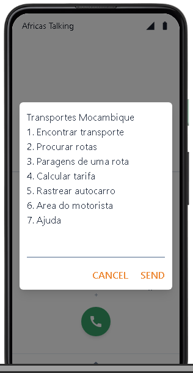
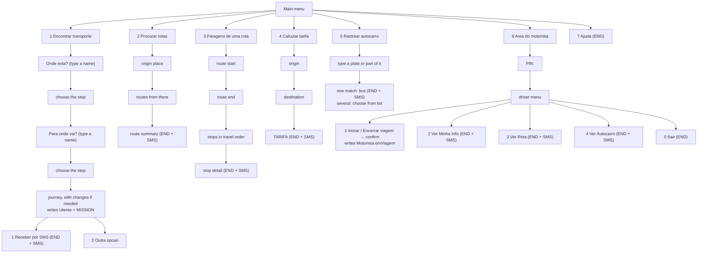
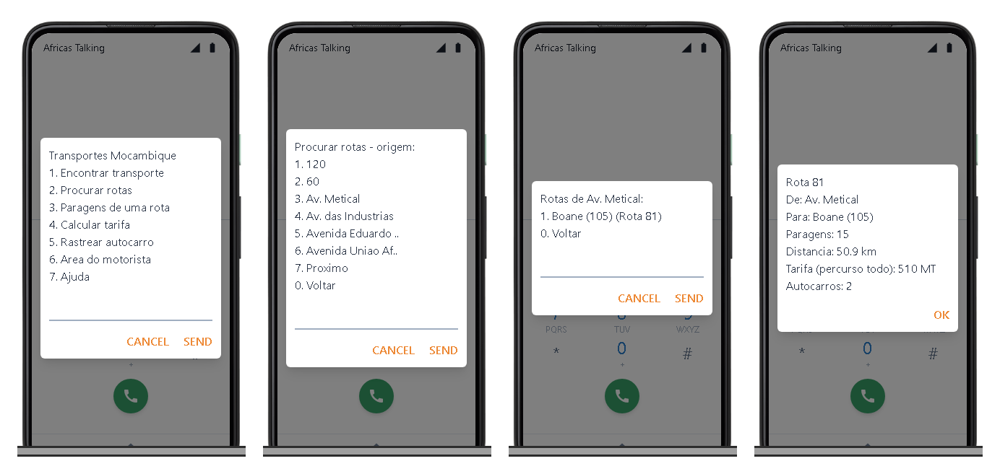
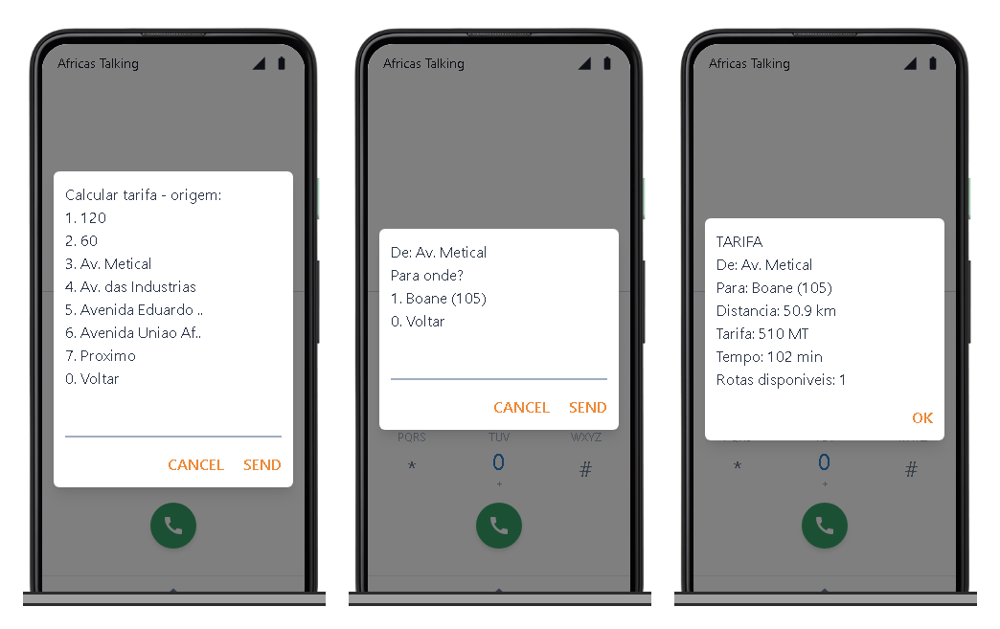
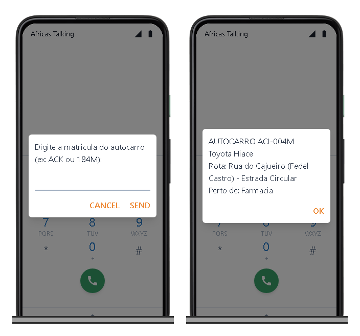
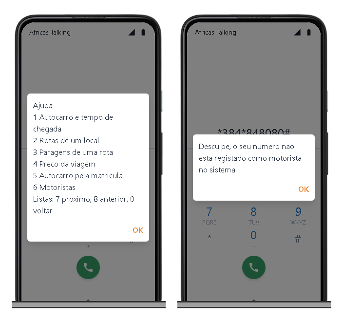
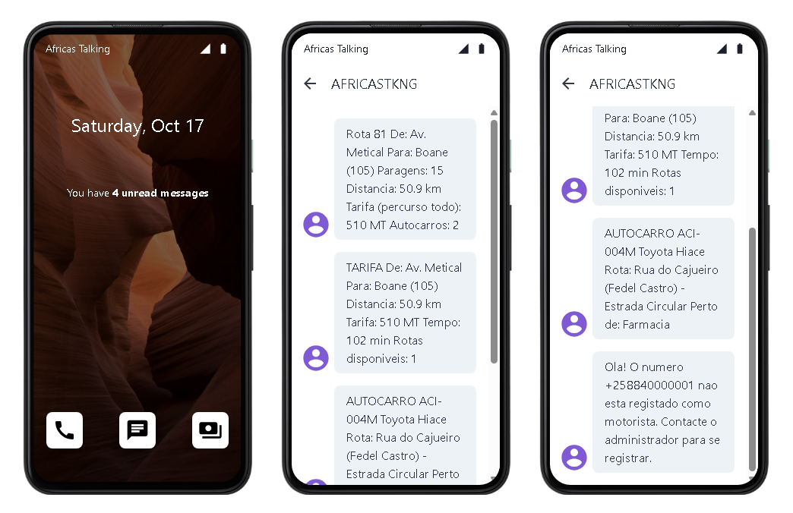

# USSD service

USSD brings the platform to any phone, without data or an app. The passenger dials a short code, and the operator's gateway (Africa's Talking) relays each keypress to `POST /api/ussd` on the passenger app. The app answers with the next screen. The service is in Portuguese, without accents (GSM-7), and each screen fits in 182 characters.

| | |
|---|---|
| Code (sandbox) | `*384*848080#`, dialled from the [Africa's Talking simulator](africas-talking.md#try-it-in-the-simulator) |
| Callback | `https://transport-mz.vercel.app/api/ussd` |
| Code | `transport-client/app/api/ussd/route.ts` |
| Live (real phones) | not yet: needs a production USSD channel from Africa's Talking ([Going live](africas-talking.md#going-live)) |

**On this page:** [How a session works](#how-a-session-works) · [Menu tree](#menu-tree) · [1 Encontrar transporte](#1-encontrar-transporte) · [2 Procurar rotas](#2-procurar-rotas) · [3 Paragens de uma rota](#3-paragens-de-uma-rota) · [4 Calcular tarifa](#4-calcular-tarifa) · [5 Rastrear autocarro](#5-rastrear-autocarro) · [6 Área do motorista](#6-area-do-motorista) · [7 Ajuda](#7-ajuda) · [Errors](#errors) · [Testing](#testing)



---

## How a session works

**Request.** On every keypress Africa's Talking sends a form-encoded `POST`:

| Field | Example | Meaning |
|---|---|---|
| `sessionId` | `ATUid_8f2…` | Same for the whole session |
| `serviceCode` | `*384*848080#` | The code that was dialled |
| `phoneNumber` | `+258840000001` | The caller |
| `text` | `2*3*1` | **Every answer so far**, joined with `*`. Empty on the first request. |

When `USSD_CALLBACK_KEY` is set, the request URL must also carry `?key=<that value>`, or the answer is `403 Forbidden` ([Security → USSD callback](security.md#ussd-callback)).

**Response.** Plain text (`text/plain`) beginning with:

- `CON ` — show this screen and wait for an answer;
- `END ` — show this screen and close the session.

**No server-side state.** The server splits `text` on `*` and replays the path from the main menu on every request. It keeps nothing between requests, so any server instance can answer any keypress, and a lost request costs nothing.

**Lists** are paginated, 6 items per page. Inside a list:

| Key | Action |
|---|---|
| `1`–`6` | choose that item |
| `7` | next page ("Proximo") |
| `8` | previous page ("Anterior") |
| `0` | back ("Voltar") |

Typed answers (a place name in option 1, a plate number, a driver's PIN) are not navigation keys; on a typed step only `0` goes back. Long names are cut with `..` so the screen stays within **182 characters** (the text after `CON `/`END `). Accents are removed (`toGsm`), because one accented letter would make the message Unicode.

**SMS.** Options 1 to 6 can send the result by SMS too. The SMS is sent after the response, with `waitUntil`, so the screen never waits for it. Without `AFRICASTALKING_API_KEY` the SMS is only logged.

**Logs.** Each request and response is logged (`📱 USSD Request`, `📤 USSD Response`) in the Vercel function logs. The PIN in option 6 is masked as `***`.

## Menu tree



The screens below were recorded with `curl` against a local copy of the production data, at 10:30 Maputo time (option 1: at 16:50) ([Testing](#testing)). The simulator screenshots come from production.

### Main menu (`text=""`)

```text
CON Transportes Mocambique
1. Encontrar transporte
2. Procurar rotas
3. Paragens de uma rota
4. Calcular tarifa
5. Rastrear autocarro
6. Area do motorista
7. Ajuda
```

The places offered by options 2–4 are the start terminals (`Via.terminalPartida`) of routes that have at least one bus, in alphabetical order. Names such as "120" and "60" are real OpenStreetMap stop names.

## 1 Encontrar transporte

How to get from one place to another: the next bus, or the buses to change between when no single bus goes there. Both places are typed, so any stop can be the origin or the destination (USSD does not know where the phone is). It uses the same journey planner as the web app ([Passenger web app → Journeys](passenger-web.md#journeys)).

```text
text="1"                                text="1*portao"
CON Onde esta?                          CON Qual paragem?
Escreva o nome da paragem ou do         1. Portao
local (ex: Museu)                       2. Segundo Portao da Radio Marconi
0. Voltar                               0. Voltar

text="1*portao*1"                       text="1*portao*1*makalela"
CON De: Portao                          CON Para onde vai?
Para onde vai? Escreva o nome do        1. Makalela
destino                                 0. Voltar
0. Voltar
```

- **Typing a name.** Any part of the name, without accents or capitals; every typed word must start a word of the name (`av ind` finds "Av. das Industrias"). Stops with the same name within 400 m are one place. Nothing found: `CON Nenhuma paragem com "xyz".` and `0` to type again.
- **Places with the same name** (49 names are used by several places, often along one avenue) are told apart by the nearest place with another name, and the distance to it when that is also shared. These lists show 4 places per page, so the labels have room:

```text
text="1*av ind"                           text="1*av ind*7"
CON Qual paragem?                         CON Qual paragem?
1. Av. das Industrias                     1. Av... - Maputo - Wintbank - ..
2. Av... - Rua Principal - Rua Do ..      2. Av. Industrias - 120
3. Av. Industrias - Casa Branca           3. Av. In.. - Machava-Sede 960 m
4. Av. In.. - Machava-Sede 170 m          4. Av. In.. - Machava-Sede 970 m
7. Proximo                                7. Proximo
0. Voltar                                 8. Anterior
                                          0. Voltar
```

  When no other place is within 1.5 km, the first route through the place is used instead ("Av... - Rua Principal - …").
- **The answer** is the best journey, earliest arrival first; the time is from now, waits included. A direct bus:

```text
text="1*portao*1*makalela*1"            text="1*portao*1*makalela*1*2"
CON Directo, chega 16:55                CON Directo, chega 16:59
Apanhe em Portao as 16:51               Apanhe em Portao as 16:55
Saia em Makalela                        Saia em Makalela
6 min, 16 MT                            10 min, 16 MT
1. Receber por SMS                      1. Receber por SMS
2. Outra opcao                          2. Outra opcao
0. Voltar                               0. Voltar
```

  And a journey with changes, where to take each bus, when, and where to get off for the next one (names are shortened to fit the screen; "amanha" marks the next day):

```text
text="1*portao*1*johane*1"
CON 2 transbordos, chega amanha 06:33
1) Portao 18:21 > Rua 15
2) Rua 15 19:19 > Avenida 4 ..
3) Avenida 4 .. amanha 06:23 > Johane Mal..
13 h 44 min, 204 MT
1. Receber por SMS
0. Voltar
```

- `2` shows the next option (from the second option on, `2` again shows the one after, and it wraps around); "2. Outra opcao" only appears when there is more than one.
- `1` sends the option on screen by SMS, with every step: walks ("Caminhe 150 m ate …"), each bus's route and plate, where and when to take it and get off, and each fare. Then `END Detalhes enviados por SMS.`
- **Writes:** each journey screen registers an arrival alert (`MISSION`) at the stop where the first bus is taken, so the passenger gets an SMS when a bus is under 1 km away. If the phone number has no account, it first creates a passwordless `Utente`. An alert for the same stop from the last 24 h is reused.
- **No connection:** `END Nao ha autocarro de … para ….` (a few routes form groups with no stop in common with the rest of the network).

## 2 Procurar rotas

Which routes leave from a place, with their length and full-route fare.



```text
text="2*3"                              text="2*3*1"
CON Rotas de Av. Metical:               END Rota 81
1. Boane (105) (Rota 81)                De: Av. Metical
0. Voltar                               Para: Boane (105)
                                        Paragens: 15
                                        Distancia: 50.9 km
                                        Tarifa (percurso todo): 510 MT
                                        Autocarros: 2
```

Distance is measured along the route's road path. The same text is sent by SMS.

## 3 Paragens de uma rota

The stops of a route in travel order, then the details of one stop.

```text
text="3*3*1"                         text="3*3*1*7"                text="3*3*1*2"
CON Paragens (11):                   CON Paragens (11):            END ESTRADA NACIONAL NUMERO 1
1. Av. Metical                       1. Tedeco                     Paragem 2 de 11
2. ESTRADA NACIONAL N..              2. Eucalipto                  Rota: Av. Metical -> Boane (105)
3. Primeiras Casas                   3. Instituto                  Rotas que passam aqui: Rota 81
4. Mazambanine                       4. Joaquim Chissano
5. Entrada do Areiro                 5. Boane (105)
6. Fabrica De Cimento                8. Anterior
7. Proximo                           0. Voltar
0. Voltar
```

Consecutive stops with the same street name are merged. Choosing a stop ends the session and sends its details by SMS.

## 4 Calcular tarifa



```text
text="4*3*1"
END TARIFA
De: Av. Metical
Para: Boane (105)
Distancia: 50.9 km
Tarifa: 510 MT
Tempo: 102 min
Rotas disponiveis: 1
```

Distance is measured along the matching route's road path. When several routes match, the shortest is used. Without a matching route, the straight line × `fatorEstrada` (1.3) is used instead. Fare and time use the active fare rule ([Configuration](configuration.md#fare-rule-tarifa)). Sent by SMS too.

## 5 Rastrear autocarro

Find a bus by its plate, or part of it.



```text
text="5"                                  text="5*ACI"
CON Digite a matricula do autocarro       CON Escolha o autocarro:
(ex: ACK ou 184M):                        1. ACI-001M
                                          2. ACI-002M
                                          3. ACI-004M
                                          4. ACI-005M
                                          5. ACI-006M
                                          6. ACI-007M
                                          Mais resultados: use mais digitos.

text="5*ACI-004M"  (or "5*ACI*3")         text="5*XYZ"
END AUTOCARRO ACI-004M                    END Nenhum autocarro encontrado com a matricula "XYZ".
Toyota Hiace
Rota: Rua do Cajueiro (Fedel Castro) - Estrada Circular
Perto de: Esquina
```

"Perto de" is the route stop nearest to the bus's current position (GPS or timetable). Sent by SMS too.

## 6 Area do motorista

The driver's phone number must match a `Motorista.telefone`. Spaces and the `+258` prefix are ignored. The PIN is the one the administrator generated ([Admin → Driver PIN](admin-dashboard.md#drivers-motoristas)). This is the same trip state the [driver portal](driver-portal.md) shows.

```text
text="6"                     text="6*<PIN>"
CON Area do Motorista        CON BEM-VINDO, PEDRO
PIN:
                             STATUS: OFFLINE
                             MATRICULA: ACI-004M
                             ROTA: Rua do Cajueiro (Fedel Castr..

                             1. Iniciar Viagem
                             2. Ver Minha Info
                             3. Ver Rota
                             4. Ver Autocarro
                             0. Sair

text="6*<PIN>*1"                                   text="6*<PIN>*1*1"
CON INICIAR VIAGEM                                 END VIAGEM INICIADA

Veiculo: ACI-004M                                  STATUS: ONLINE
Rota: Rua do Cajueiro (Fedel Castro) -> Estrada Circular
                                                   Boa viagem, Pedro!
1. Confirmar - Iniciar Viagem                      Veiculo: ACI-004M
0. Cancelar                                        Rota: Rua do Cajueiro (Fedel Castro) -> Estrada Circular

                                                   Bom trabalho!
```

During a trip the first option becomes "1. Encerrar Viagem", and confirming it answers "END VIAGEM ENCERRADA … STATUS: OFFLINE".

| Input | Screen | Writes / sends |
|---|---|---|
| `6*<PIN>*1*1` | VIAGEM INICIADA / ENCERRADA | `Motorista.emViagem`, `viagemIniciadaEm`; SMS "Viagem iniciada com sucesso! …" or "Viagem encerrada com sucesso. …" |
| `6*<PIN>*1*2` (a key other than 1) | "Operacao cancelada." | nothing |
| `6*<PIN>*2` | name, ID number, licence, trip state, vehicle, route | SMS with the same |
| `6*<PIN>*3` | route and number of stops | SMS with every stop in travel order |
| `6*<PIN>*4` | plate, model, colour, seats, nearest stop | SMS with the same |
| `6*<PIN>*0` | "Sessao encerrada. Obrigado por usar o sistema!" | nothing |
| wrong PIN | "PIN incorreto. Por favor, disque novamente para tentar de novo." | nothing |
| driver without a PIN | "Ainda nao tem PIN. Peca ao administrador para gerar o seu PIN." | nothing |
| number not a driver | "Desculpe, o seu numero nao esta registado como motorista no sistema." | SMS asking to contact the administrator |

After the PIN is typed, every later request of the session carries it inside `text` (`6*<PIN>*…`). The app masks it in its own logs.

## 7 Ajuda

```text
END Ajuda
1 Autocarro e tempo de chegada
2 Rotas de um local
3 Paragens de uma rota
4 Preco da viagem
5 Autocarro pela matricula
6 Motoristas
Listas: 7 proximo, 8 anterior, 0 voltar
```



## Errors

| Situation | Answer |
|---|---|
| A choice that is not on the screen (`text="9"`, `text="1*99"`) | `END Opcao invalida. Tente novamente.` |
| No routes with buses | `END Nenhuma localizacao disponivel de momento.` |
| Unexpected server error | `END Erro ao processar pedido. Tente novamente.` (HTTP 200, so the phone shows it) |

## Testing

**With `curl`**, locally or against production. Production options 2–5 and 7 only read, but they send SMS when an API key is set. Option 1's result screen writes an alert.

```bash
curl -s -X POST http://localhost:3000/api/ussd \
  --data-urlencode "sessionId=test-1" \
  --data-urlencode "serviceCode=*384*848080#" \
  --data-urlencode "phoneNumber=+258840000001" \
  --data-urlencode "text=2*3*1"
```

**In the Africa's Talking simulator.** Dial `*384*848080#` from a test number. The screens are real production answers, and SMS arrive in the simulated phone's inbox ([Africa's Talking → simulator](africas-talking.md#try-it-in-the-simulator)):



---

[← Passenger web app](passenger-web.md) · [Documentation index](README.md) · Next: [Driver portal →](driver-portal.md)
