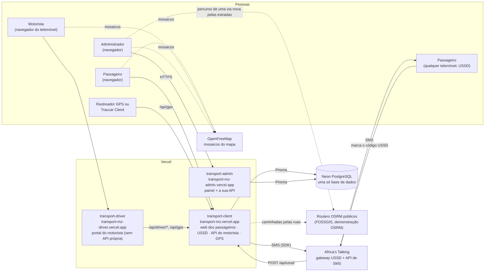

# Visão geral

<!-- navegação: gerada por .github/scripts/docs-nav.py, não editar à mão -->
[Documentação](README.md) › 1. Conhecer o projecto › **Visão geral** (página 3 de 25)

Anterior: [Preparar o computador](preparar-o-computador.md) · [Índice](README.md) · Seguinte: [Glossário](glossario.md)

<details>
<summary>Todas as páginas</summary>

- 0. Começar do zero: [Conceitos básicos](conceitos.md) · [Preparar o computador](preparar-o-computador.md)
- 1. Conhecer o projecto: **Visão geral** · [Glossário](glossario.md) · [Fontes de dados](fontes-de-dados.md) · [Estado do projecto](estado-do-projecto.md)
- 2. Montar localmente: [Primeiros passos](primeiros-passos.md) · [Base de dados](base-de-dados.md) · [Configuração](configuracao.md)
- 3. Perceber como funciona: [Fluxos de dados](fluxos-de-dados.md) · [Localização e GPS](localizacao-gps.md) · [Serviço USSD](ussd.md) · [Segurança](seguranca.md) · [Referência da API](referencia-api.md) · [Mapa do código](mapa-do-codigo.md)
- 4. Usar as aplicações: [Aplicação dos passageiros](app-passageiros.md) · [Portal do motorista](portal-motorista.md) · [Painel de administração](painel-admin.md)
- 5. Pôr online: [Publicação](publicacao.md) · [Guia da Vercel](guia-vercel.md) · [Guia da Neon](guia-neon.md) · [Africa's Talking](africas-talking.md)
- 6. Manter: [Testes](testes.md) · [Resolução de problemas](resolucao-de-problemas.md) · [Limitações](limitacoes.md)

</details>
<!-- /navegação -->

> **Em palavras simples:** A plataforma ajuda quem anda de [chapa](glossario.md#transportes-em-maputo "Os minibuses que levam a maior parte dos passageiros de Maputo") ou de autocarro em Maputo e na Matola a saber que transporte apanhar e quando chega. Funciona de três maneiras: um site com um mapa, um menu no telemóvel que funciona sem [internet](conceitos.md#internet "A rede que liga milhões de computadores e telemóveis, por onde passam os pedidos e as respostas.") ([USSD](conceitos.md#ussd "Os menus que aparecem num telemóvel quando se marca um código como *384*848080#; funcionam em qualquer telemóvel, sem internet.")), e mensagens de aviso ([SMS](conceitos.md#sms "As mensagens de texto curtas dos telemóveis.")). Por trás há três sites (passageiros, motoristas e administração), uma [base de dados](conceitos.md#base-de-dados "O sítio organizado onde a plataforma guarda tudo o que tem de durar: rotas, paragens, veículos, contas.") com as rotas e as paragens, e duas empresas que mantêm tudo ligado. Esta página mostra como as peças se juntam e porque se escolheu cada uma.

Esta página explica o que é a plataforma, para quem é, de que peças é feita, como as peças falam umas com as outras e **porque é que cada tecnologia foi escolhida**. É a primeira página do guia: as seguintes partem do que aqui se descreve.

**Nesta página:** [O problema](#o-problema) · [Quem usa e como](#quem-usa-e-como) · [Diagrama do sistema](#diagrama-do-sistema) · [As três aplicações](#as-três-aplicações) · [Como as partes se ligam](#como-as-partes-se-ligam) · [Decisões de desenho](#decisões-de-desenho) · [Tecnologias e porquê](#tecnologias-e-porquê) · [Estrutura do repositório](#estrutura-do-repositório) · [Código antigo](#código-antigo-apagado)

---

## O problema

Em Maputo e na Matola a maior parte das viagens faz-se de chapa (minibus) e de autocarro, em centenas de rotas que não têm horário publicado nem mapa. Quem não conhece a rota pergunta na paragem. A plataforma junta numa só base de dados as rotas, as paragens e os veículos, e responde a três perguntas:

1. **Que autocarro apanho para ir de A a B, e onde mudo?** (o planeador de viagens)
2. **Quando chega o próximo?** (a posição de cada autocarro, por [GPS](conceitos.md#gps "O sistema de satélites com que um telemóvel ou um aparelho sabe as suas coordenadas.") ou pelo horário)
3. **Quanto custa?** (a regra de tarifa)

As respostas chegam por duas vias: uma [aplicação web](conceitos.md#aplicacao-web "Um site que se usa como um programa: tem botões, mapas e contas, e muda conforme o que se faz.") para quem tem smartphone, e um menu **USSD** (`*384*…#`) para qualquer telemóvel, mesmo sem internet. Porquê o USSD: em Moçambique muitos passageiros usam telemóveis simples ou não têm dados móveis; o USSD funciona em qualquer telemóvel e não gasta dados.

## Quem usa e como

| Quem | Por onde | O que faz | Explicado em |
|---|---|---|---|
| Passageiro com smartphone | [navegador](conceitos.md#navegador "O programa com que se abrem sites: Chrome, Firefox, Edge, Safari."), https://transport-mz.vercel.app | vê as paragens à volta, planeia viagens com [transbordos](glossario.md#palavras-dos-ecrãs "Mudança de autocarro a meio de uma viagem"), acompanha a viagem no mapa, pede um SMS quando o autocarro está perto | [Aplicação dos passageiros](app-passageiros.md) |
| Passageiro com qualquer telemóvel | USSD `*384*848080#` (ambiente de testes) | as mesmas perguntas, escritas no teclado; recebe o resultado também por SMS | [Serviço USSD](ussd.md) |
| Motorista | navegador do telemóvel, https://transport-mz-driver.vercel.app, ou USSD opção 6 | inicia e termina viagens, partilha o GPS do telemóvel, vê quantos passageiros esperam em cada paragem | [Portal do motorista](portal-motorista.md) |
| Administrador | navegador, https://transport-mz-admin.vercel.app | gere rotas, paragens, veículos, motoristas, PINs, [rastreadores GPS](conceitos.md#rastreador "Um aparelho (ou um telemóvel com uma aplicação) que envia a posição de um veículo pela internet; o código do dispositivo é a sua 'palavra-passe'.") e a tarifa | [Painel de administração](painel-admin.md) |

## Diagrama do sistema



Como ler o diagrama: as setas cheias são pedidos que a plataforma faz ou recebe; as tracejadas são serviços públicos usados só para desenhar mapas e percursos. A base de dados é o único ponto de encontro entre as aplicações: não há fila de mensagens nem processo em segundo plano.

## As três aplicações

O [repositório](conceitos.md#repositorio "A pasta do projecto com todo o seu histórico no git.") tem três aplicações [Next.js](conceitos.md#nextjs "O Next.js é a 'estrutura' sobre a qual as três aplicações estão feitas; o React é a parte dele que desenha os ecrãs."), cada uma publicada como um projecto próprio na [Vercel](conceitos.md#vercel "A empresa cujos servidores correm as três aplicações e as publicam a cada merge.").

| | Aplicação dos passageiros | Painel de administração | Portal do motorista |
|---|---|---|---|
| Pasta | [`transport-client/`](../transport-client) | [`transport-admin/`](../transport-admin) | [`transport-driver/`](../transport-driver) |
| Endereço | https://transport-mz.vercel.app | https://transport-mz-admin.vercel.app | https://transport-mz-driver.vercel.app |
| Projecto na Vercel | `transport-mz` | `transport-mz-admin` | `transport-mz-driver` |
| Páginas | 7: `/` e `/search` (mapa e planeador), `/viagem` (acompanhar uma viagem), `/auth`, `/user-info`, `/track/[id]` e `/my-transports` (redireccionam) | 48: lista, detalhe, novo e editar de cada entidade, mais painel, relatórios, tarifa e perfil | 2: `/` (entrada) e `/dashboard` |
| Rotas da [API](conceitos.md#api "Uma API é a lista de pedidos que um servidor aceita de outros programas; cada um desses pedidos, com o seu endereço, é um endpoint.") | 24 ([`app/api`](../transport-client/app/api)) | 34 ([`app/api`](../transport-admin/app/api)) | nenhuma |
| Acesso à base de dados | [Prisma](conceitos.md#prisma "A ferramenta com que o código fala com a base de dados sem escrever SQL à mão."), leitura e escrita | Prisma, leitura e escrita | nenhum: usa a API dos passageiros |
| Quem a chama | navegadores, [Africa's Talking](conceitos.md#africas-talking "O gateway de USSD e SMS usado por este projecto."), o portal do motorista, rastreadores GPS | navegadores dos administradores | navegadores dos motoristas |
| Autenticação | passageiros e motoristas: [tokens](conceitos.md#sessao "Depois de entrar, o servidor dá uma prova de quem se é (um token), e o navegador mostra-a a cada pedido para não ter de pedir a palavra-passe outra vez.") assinados ("Bearer") | administradores: cookie assinado `HttpOnly`, verificado em [`proxy.ts`](../transport-admin/proxy.ts) em cada `/api/*` | guarda o token do motorista dado pela aplicação dos passageiros |

A aplicação dos passageiros é mais do que o nome diz. Além das páginas web, é o [servidor](conceitos.md#servidor "Um computador sempre ligado que recebe pedidos e responde a eles.") público da plataforma:

- o **USSD** ([`app/api/ussd/route.ts`](../transport-client/app/api/ussd/route.ts));
- a **API do motorista** ([`app/api/driver/`](../transport-client/app/api/driver));
- a **entrada das posições GPS** ([`app/api/gps/route.ts`](../transport-client/app/api/gps/route.ts));
- a **verificação dos SMS de chegada** ([`lib/busSimulator.ts`](../transport-client/lib/busSimulator.ts)).

Porquê tudo nesta aplicação: é a única que tem de estar aberta ao público, e assim só um projecto precisa das chaves da Africa's Talking e dos [segredos](conceitos.md#segredo "Um valor que só a plataforma deve saber, como uma palavra-passe: quem o tiver pode agir em nome dela.") das sessões de passageiros e motoristas.

## Como as partes se ligam

- **Uma só base de dados.** As três cópias do [esquema](conceitos.md#migracao "O esquema é a lista das tabelas e colunas; uma migração é uma alteração a essa lista, escrita em SQL para se poder repetir.") Prisma descrevem as mesmas tabelas. A referência é [`prisma/schema.prisma`](../prisma/schema.prisma); a cópia de [`transport-client`](../transport-client/prisma/schema.prisma) é igual e a de [`transport-admin`](../transport-admin/prisma/schema.prisma) junta `previewFeatures = ["omitApi"]`. O [CI](conceitos.md#ci "Verificações que o GitHub corre sozinho a cada pull request, para nenhum erro conhecido chegar ao main.") verifica que são iguais ([`check-schemas.mjs`](../.github/scripts/check-schemas.mjs)). Porquê três cópias: cada projecto da Vercel só vê a sua pasta e gera o seu próprio cliente Prisma.
  - O painel escreve a rede: vias, paragens, veículos, motoristas, PINs, códigos GPS, tarifa.
  - A aplicação dos passageiros lê a rede e escreve passageiros, alertas ([`MISSION`](glossario.md#a-rede-e-as-pessoas "Um alerta de chegada: um SMS quando um autocarro estiver perto de uma paragem")), o estado das viagens e as posições GPS.
- **Portal do motorista → aplicação dos passageiros.** O portal é só interface. O endereço da API vem de `NEXT_PUBLIC_API_URL` ([`lib/api.ts`](../transport-driver/lib/api.ts)), posto no código na altura da compilação. Esses endpoints respondem `Access-Control-Allow-Origin: *` e pedem o token do motorista. Porquê assim: o menu USSD do motorista e o portal partilham o mesmo estado de viagem sem o copiar.
- **Africa's Talking → aplicação dos passageiros.** Cada tecla de uma sessão USSD é um `POST /api/ussd` com os campos `sessionId`, `serviceCode`, `phoneNumber` e `text`. A resposta é texto que começa por `CON` (continua) ou `END` (termina). Explicado passo a passo em [Serviço USSD](ussd.md).
- **Aplicação dos passageiros → Africa's Talking.** Os SMS saem pelo SDK `africastalking` ([`lib/notifications.ts`](../transport-client/lib/notifications.ts)), depois de a resposta USSD partir, com `waitUntil` de `@vercel/functions`. Porquê: o telemóvel não fica à espera do SMS, e o [gateway](conceitos.md#gateway "A empresa que faz a ponte entre as redes dos telemóveis (Vodacom, Movitel, Tmcel) e a internet.") USSD tem pouco tempo para receber cada resposta.
- **Rastreadores GPS → aplicação dos passageiros.** Um telemóvel com o [Traccar Client](conceitos.md#traccar "Uma aplicação gratuita para telemóvel que envia a posição do telemóvel pelo protocolo OsmAnd."), um rastreador reencaminhado por um servidor Traccar, ou o próprio portal do motorista enviam posições para `/api/gps` com o código do veículo. Ver [Localização e GPS](localizacao-gps.md).
- **Painel → aplicação dos passageiros: nada.** O painel calcula as posições com a sua própria cópia do código ([`transport-admin/lib/vehiclePosition.ts`](../transport-admin/lib/vehiclePosition.ts)). A única referência à aplicação dos passageiros é o endereço do servidor GPS que mostra ao criar um código (`GPS_SERVER_URL`).
- **Mapas.** As três aplicações desenham mapas com [MapLibre](conceitos.md#mosaicos "As imagens das ruas por baixo dos autocarros e das paragens, que o mapa descarrega aos bocados (mosaicos) conforme se mexe.") GL e mosaicos vectoriais da OpenFreeMap. As páginas "Nova Via" e "Redesenhar percurso" do painel ([`RouteDrawer.tsx`](../transport-admin/app/components/RouteDrawer.tsx)) pedem a um [router](conceitos.md#router "Um serviço que, dados dois ou mais pontos, responde com o caminho pelas ruas entre eles e a distância.") OSRM público que ponha nas estradas os pontos clicados. As caminhadas nos mapas dos passageiros seguem as ruas com caminhos do router a pé da FOSSGIS, pedidos pelo servidor ([`/api/walk`](../transport-client/app/api/walk/route.ts), [`lib/walkRoute.ts`](../transport-client/lib/walkRoute.ts)).

## Decisões de desenho

Estas escolhas explicam a maior parte da forma do código. Cada uma diz o que se faz, porquê, e o que se perde.

1. **As posições dos autocarros calculam-se na leitura; nada corre em segundo plano.** [`lib/vehiclePosition.ts`](../transport-client/lib/vehiclePosition.ts) dá a posição de um veículo em qualquer momento:
   - a posição GPS real, se chegou nos últimos 3 minutos;
   - senão a posição pelo horário: cada autocarro vai e volta ao longo do percurso da sua via das 05:00 às 21:00 (hora de Maputo), à velocidade de viagem da tarifa, com 5 minutos em cada [terminal](conceitos.md#terminal "A janela onde se escrevem instruções para o computador em texto, em vez de clicar."), desfasado por um número tirado do seu id.

   **Porquê:** numa plataforma [serverless](conceitos.md#serverless "Um pedaço de código que a Vercel arranca só quando chega um pedido, e desliga a seguir.") (Vercel) não há um processo sempre ligado para mover os autocarros, e cada pedido pode cair numa instância diferente. Uma fórmula que só depende da hora dá a mesma resposta em todos os endpoints, no USSD e em todas as instâncias, sem escrever nada. **O que se perde:** sem GPS, a posição é uma estimativa, não a realidade. Ver [Localização e GPS](localizacao-gps.md#como-se-escolhe-uma-posição).
2. **O USSD não guarda sessão.** A Africa's Talking reenvia em `text` todas as teclas da sessão (`1*museu*2`), e o servidor refaz o caminho a cada pedido ([`lib/ussdSteps.ts`](../transport-client/lib/ussdSteps.ts)). **Porquê:** qualquer instância responde a qualquer tecla e um pedido perdido não estraga nada. Ver [Serviço USSD → Leitura das teclas](ussd.md#leitura-das-teclas).
3. **As sessões são tokens assinados, não linhas na base de dados.** Passageiros (90 dias) e motoristas (30 dias) recebem tokens `id.expiraEm.assinatura` assinados com HMAC-SHA256 ([`lib/signedToken.ts`](../transport-client/lib/signedToken.ts)); os administradores recebem o mesmo tipo de token num cookie `HttpOnly` (12 horas). Sem o segredo em produção, a entrada é recusada (falha fechada). **Porquê:** verificar uma assinatura não precisa de consultar a base de dados. **O que se perde:** um token não se anula antes de expirar, a não ser mudando o segredo (o que termina todas as sessões). Ver [Segurança](seguranca.md).
4. **Os preços e as velocidades estão na base de dados.** A linha activa de [`Tarifa`](glossario.md#a-rede-e-as-pessoas "A regra de tarifa: preço mínimo, preço por km e velocidades") define a tarifa mínima, o preço por km, o factor de estrada e as velocidades; muda-se na página "Tarifa" do painel. A web e o USSD lêem-na por `getFareRule()` ([`lib/fares.ts`](../transport-client/lib/fares.ts)), guardada 60 s. **Porquê:** mudar um preço não obriga a publicar código. Ver [Configuração → Regra de tarifa](configuracao.md#regra-de-tarifa-tarifa).
5. **O trabalho periódico corre num [agendamento](conceitos.md#agendamento "Uma tarefa que corre sozinha a uma hora marcada, ou de tantos em tantos minutos.") do [GitHub](conceitos.md#github "O site onde o repositório está guardado e partilhado, e onde se revêem as alterações."), e também com o tráfego.** Um workflow do GitHub Actions ([`arrival-check.yml`](../.github/workflows/arrival-check.yml)) chama a verificação dos SMS de chegada a cada 5 minutos. **Porquê o GitHub:** o plano gratuito (Hobby) da Vercel só permite cron jobs uma vez por dia. A verificação corre também quando o mapa pede posições, no máximo a cada 30 s por instância. Ver [Fluxos de dados → Alerta de chegada e SMS](fluxos-de-dados.md#alerta-de-chegada-e-sms).
6. **Os segredos guardam-se em [hash](conceitos.md#hash "Uma 'impressão digital' de um texto, que se calcula num sentido e não se consegue desfazer.").** Os PINs dos motoristas e as palavras-passe de passageiros e administradores são hashes bcrypt; os códigos dos dispositivos GPS são hashes SHA-256. O PIN e o código só se mostram uma vez, quando o administrador os cria. **Porquê:** quem ler a base de dados não fica com nada que sirva para entrar.

## Tecnologias e porquê

| Camada | Tecnologia | Porquê esta | Onde |
|---|---|---|---|
| Aplicações | Next.js 16 (App Router), React 19, [TypeScript](conceitos.md#typescript "As linguagens em que o código deste projecto está escrito; TypeScript é JavaScript com verificações extra.") 5 | Uma só ferramenta faz as páginas e a API do mesmo projecto, e a Vercel publica-a sem configuração. O TypeScript apanha erros de tipos antes de publicar (o CI corre `tsc`). | as três |
| Estilo | Tailwind CSS 4 | Classes no próprio componente, sem folhas de estilo separadas a manter. | as três |
| Base de dados | [PostgreSQL](conceitos.md#postgresql "O programa de base de dados que este projecto usa; gratuito e muito usado.") 18 na [Neon](conceitos.md#neon "A empresa que guarda a base de dados PostgreSQL da produção, na internet.") (produção), 16 ou mais localmente | PostgreSQL é aberto, robusto e conhecido. A Neon dá-o sem servidor para gerir, com plano gratuito, editor de [SQL](conceitos.md#sql "A linguagem com que se fazem perguntas e alterações a uma base de dados.") no navegador e ligação directa à Vercel. | partilhada |
| Acesso à base de dados | Prisma 5.22 | Consultas com tipos a partir do esquema, e o mesmo esquema documenta as tabelas. | passageiros, painel |
| Mapas | MapLibre GL 5 com mosaicos da OpenFreeMap | MapLibre é aberto (sem chave nem conta); a OpenFreeMap serve mosaicos do [OpenStreetMap](conceitos.md#openstreetmap "Um mapa do mundo inteiro feito por voluntários, como uma Wikipédia dos mapas, que qualquer pessoa pode usar e corrigir.") de graça e sem chave. | as três |
| Percursos pelas estradas | routers OSRM públicos (FOSSGIS e demonstração do OSRM) | Gratuitos e baseados no OpenStreetMap, os mesmos dados do mapa. Só para uso leve: ver [Limitações](limitacoes.md). | painel, passageiros |
| Gráficos | Recharts 3 | Gráficos em React sem configurar uma biblioteca de baixo nível. | painel |
| USSD e SMS | Africa's Talking (SDK `africastalking` 0.7) | Um só fornecedor para USSD e SMS em vários países africanos, com ambiente de testes gratuito e simulador no navegador. | passageiros |
| Trabalho depois da resposta | `waitUntil` de `@vercel/functions` | Envia o SMS depois de responder, sem a função terminar antes. | passageiros |
| Hashes e assinaturas | bcryptjs (palavras-passe, PINs), SHA-256 (códigos GPS), HMAC-SHA256 (sessões) | O bcrypt é lento de propósito, o que trava quem tente adivinhar; o SHA-256 chega para códigos aleatórios longos. | passageiros, painel |
| Testes | [Jest](conceitos.md#testes "Programas que experimentam as aplicações sozinhos e avisam quando algo deixou de funcionar.") 29 (API e base de dados), Playwright 1.64 (interface de ponta a ponta) | Jest para lógica e API; o Playwright conduz um navegador real como um administrador. | painel |
| Alojamento | Vercel, um projecto por aplicação | Publica cada [`git push`](conceitos.md#git "O programa que guarda o histórico de todas as versões do código, e quem mudou o quê e quando.") sozinha, com pré-visualização por [pull request](conceitos.md#pull-request "Um pull request é o pedido para juntar um ramo ao main; o merge é a junção, quando o pedido é aceite.") e plano gratuito. | as três |
| Agendamento | GitHub Actions | Corre de 5 em 5 minutos de graça, onde a Vercel gratuita só deixa uma vez por dia. | verificação de chegadas |

## Estrutura do repositório

```text
.
├── transport-client/    aplicação dos passageiros + USSD + API do motorista + GPS (publicada como transport-mz)
├── transport-driver/    portal do motorista (transport-mz-driver)
├── transport-admin/     painel de administração, com os testes Jest e Playwright (transport-mz-admin)
├── prisma/              schema.prisma: a referência da base de dados
├── docs/                esta documentação (imagens em docs/images)
├── .github/             CI (Verificações), Verificação de chegadas (SMS), scripts de verificação
├── docker-compose.yml   PostgreSQL 16 local na porta 5433
└── start-all.bat        abre as três aplicações no Windows (portas 3000, 3001, 3002)
```

Cada pasta e ficheiro importante, com o que faz e onde é explicado: [Mapa do código](mapa-do-codigo.md).

## Código antigo (apagado)

Até 2026-10-19 o repositório guardava código que não se publicava:

- uma versão antiga da aplicação dos passageiros na raiz (`app/`, `lib/`, `package.json`, `vercel.json`), com endpoints de administração sem autenticação;
- a rota USSD do gateway Telerivet (`/api/ussd-telerivet`), com os menus antigos;
- cerca de 250 [scripts](conceitos.md#script "Um pequeno programa que se corre à mão, uma vez, para uma tarefa: importar dados, corrigir percursos, mostrar listas.") de uso único da primeira importação de dados (`check-*`, `fix-*`, `create-*`, `seed-*`), na raiz, em `transport-admin` e em `transport-client`;
- cópias `*.backup` e `*.old` de rotas, a pasta `scratch/` e `docs/architecture.pdf`.

Porquê se apagaram: confundiam quem chegava ao repositório, já não correspondiam ao código publicado, e vários scripts escreviam na base de dados de `DATABASE_URL` sem perguntar.

Não se perderam: estão no histórico do git. O repositório como estava antes vê-se em [`bd007cf`](https://github.com/transportmozambique/Transport-Mozambique/tree/bd007cf), e um ficheiro recupera-se com `git checkout bd007cf -- <caminho>`.

<!-- navegação-fim: gerada por .github/scripts/docs-nav.py -->

---

Anterior: [Preparar o computador](preparar-o-computador.md) · [Índice](README.md) · Seguinte: [Glossário](glossario.md)
<!-- /navegação-fim -->
